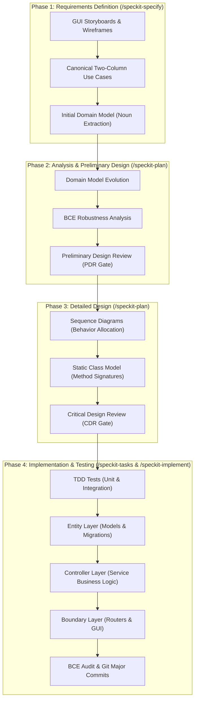

# ICONIX Process Preset for GitHub Spec Kit (Doug Rosenberg Canonical)

This preset integrates the full, canonical **ICONIX Process** formulated by **Doug Rosenberg & Matt Stephens** (*Use Case Driven Object Modeling with UML*) into the **GitHub Spec Kit** (`specify-cli`) workflow.

---

## 🏛️ The Four Phases of ICONIX in Spec Kit



---

## ⚖️ Doug Rosenberg's 4 Rules of Robustness Analysis

1. **Actors can only talk to Boundary objects.**
2. **Boundary objects can only talk to Controllers and Actors.**
3. **Entity objects can only talk to Controllers.**
4. **Controller objects can talk to Boundaries, Entities, and other Controllers (NEVER to Actors directly).**

> **The Golden Rule**: *A Boundary object may NEVER connect directly to an Entity object.* (Router/GUI → Service → Repository/Model).

---

## 🚦 Two Formal Review Checkpoints

1. **PDR (Preliminary Design Review)**:
   * Occurs after Robustness Analysis in `plan.md`.
   * Verifies: Does every sunny-day and rainy-day course have controller logic? Are all discovered entities added back to the Domain Model?
2. **CDR (Critical Design Review)**:
   * Occurs after Sequence Diagrams and Class Models in `plan.md`.
   * Verifies: Has every message on sequence diagrams been allocated to concrete class methods with types? Are test plans established?

---

## 🚀 Installation & Usage

In your project root:
```bash
specify preset add --dev ../speckit-iconix-preset
```

Verify installation:
```bash
specify preset list
specify preset resolve spec-template
specify preset resolve plan-template
specify preset resolve tasks-template
```
