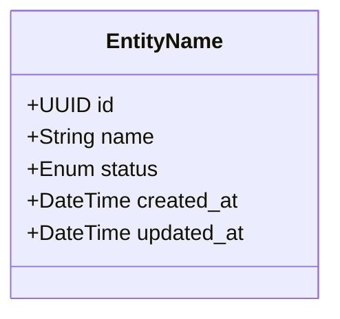
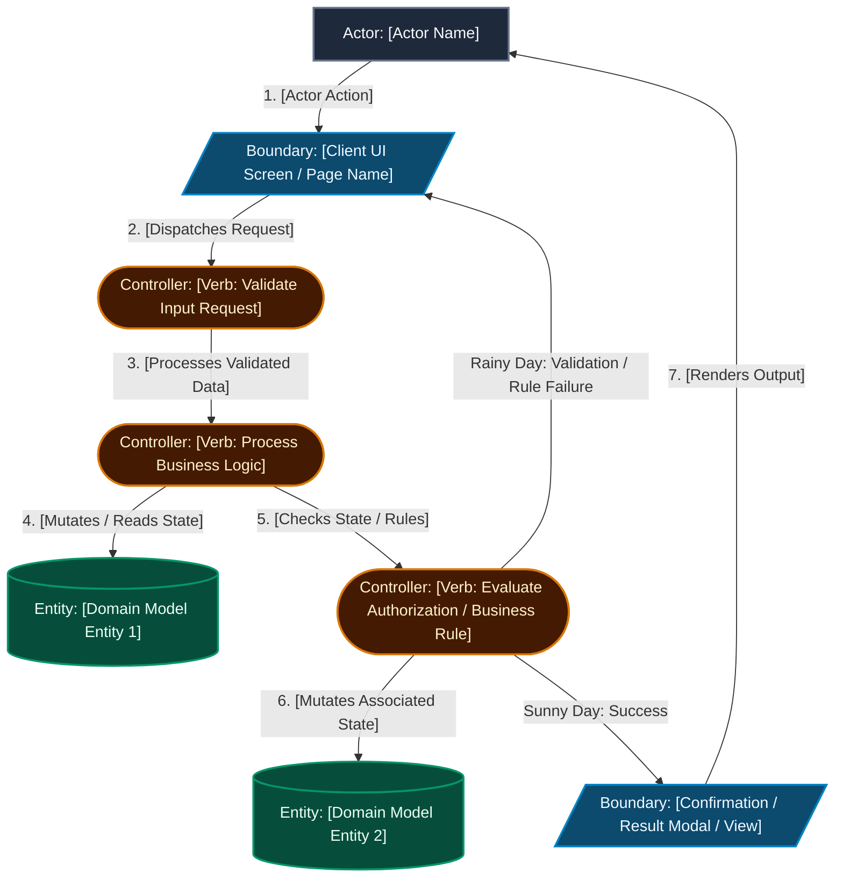
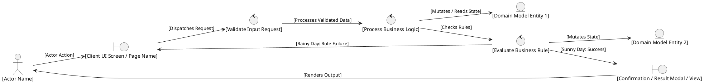
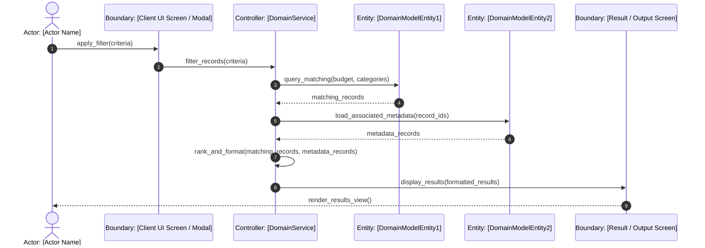
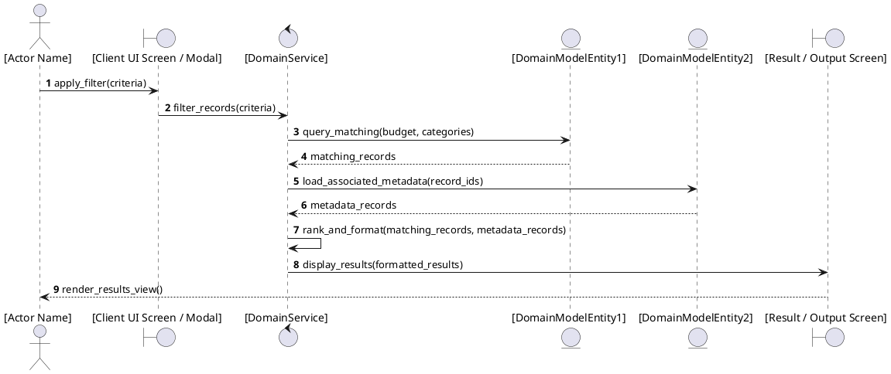
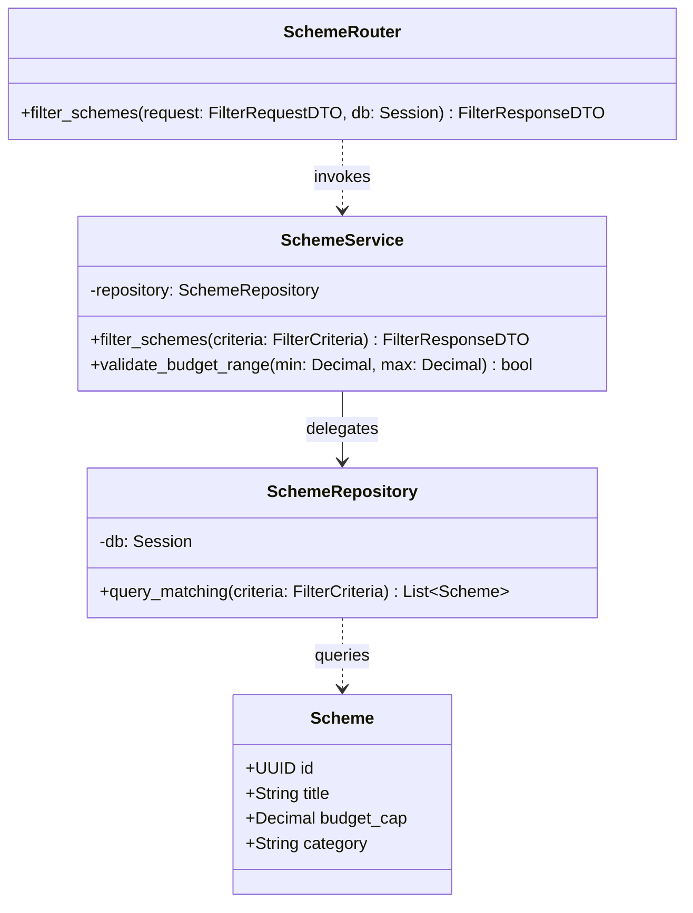

# Technical Plan: [FEATURE] – ICONIX Process

**Branch**: `feat/[###-feature-name]` | **Date**: [DATE] | **Spec**: [link to spec.md]
**Input**: Feature specification from `/specs/[###-feature-name]/spec.md`
**Methodology Reference**: Doug Rosenberg & Matt Stephens, *Use Case Driven Object Modeling with UML*

---

## 1. System Architecture & Technical Context
<!-- Overall technology stack, layer mapping, and communication boundaries -->
- **Frontend Layer**: Next.js App Router, React, Tailwind CSS / Vanilla CSS, React Query
- **Backend Layer**: FastAPI (Python 3.12), Pydantic v2, SQLModel / SQLAlchemy ORM
- **Persistence & Caching**: PostgreSQL (with pgvector), Redis
- **Architectural Pattern**: **Router (Boundary) → Service (Controller) → Repository/Model (Entity)**

---

## 2. Updated Domain Model
<!--
  Rosenberg Phase: Domain Model Evolution.
  Reflect entities and relationships refined during analysis.
-->

- **Entities & Types**: [Detail domain models, fields, types, and constraints]
- **Associations & Multiplicities**: [1..1, 1..*, 0..1 foreign key relationships]
- **Database Schema Migrations**: [Required Alembic/SQL scripts and indexes]

---

## 3. ICONIX Robustness Analysis (Preliminary Design)
<!--
  Doug Rosenberg's Four Rules of Robustness Analysis:
  1. Actors can only talk to Boundary objects.
  2. Boundary objects can only talk to Controllers and Actors.
  3. Entity objects can only talk to Controllers.
  4. Controller objects can talk to Boundaries, Entities, and other Controllers (NEVER to Actors directly).
  THE GOLDEN RULE: A Boundary object may NEVER connect directly to an Entity object.
-->

### Robustness Diagram: UC-[ID] [Use Case Title]
<!--
  Rosenberg Canonical Robustness Rules:
  1. Actor interacts ONLY with Boundaries.
  2. Controllers MUST be named using Verb Phrases (business logic actions, not software classes).
  3. Boundaries interact ONLY with Controllers and Actors (never direct to Entities).
  4. Entities represent domain model persistent state (accessed only by Controllers).
  5. Layout follows the use case narrative flow (Sunny Day main path + Rainy Day branches).
-->

<b>Canonical PlantUML: Robustness Diagram (Native BCE Icons)</b>

### Boundary-Controller-Entity (BCE) Inventory & Method Allocation
<!-- Controllers represent verbs/behavior that get allocated to class methods during Detailed Design -->

| BCE Type | Element Name | Responsibility / Concrete Implementation Allocation |
|---|---|---|
| **Boundary** | `[Screen / Modal Name]` | Frontend Client UI Component / Page (`frontend/...`). |
| **Controller** | `[Verb: Action Name]` | Allocated to `[ServiceClass.method_name()]`. |
| **Entity** | `[Domain Entity Name]` | Persisted Domain Model Entity matching database schema (`backend/.../models.py`). |

### BCE Rule Compliance Audit (Doug Rosenberg Rules)
- [x] **Rule 1 (Actors talk only to Boundaries)**: Confirmed user interacts exclusively with Client UI boundary objects.
- [x] **Rule 2 (Boundaries talk only to Controllers and Actors)**: Confirmed UI boundaries dispatch logic directly to controllers.
- [x] **Rule 3 (Entities talk only to Controllers)**: Confirmed domain entity models are accessed and mutated exclusively via controllers.
- [x] **Rule 4 (Controllers talk to Boundaries, Controllers, Entities; not to Actors)**: Confirmed controllers do not touch actors directly.
- [x] **Zero Direct Boundary-to-Entity Links**: Confirmed NO direct links from Boundary to Entity exist.

---

## 4. Preliminary Design Review (PDR) Checkpoint Gate
<!--
  Rosenberg Gate: Must pass PDR before proceeding to Detailed Design (Sequence Diagrams).
-->

| PDR Criteria | Status | Evidence / Notes |
|---|:---:|---|
| **1. Use Case Coverage** | PASS / FAIL | Does the robustness diagram account for all sunny-day steps? |
| **2. Alternate Courses Handled** | PASS / FAIL | Are all rainy-day exception flows wired through controllers? |
| **3. Domain Model Updated** | PASS / FAIL | Were new entities discovered and added to Section 2? |
| **4. Strict BCE Adherence** | PASS / FAIL | Confirmed NO direct Boundary-to-Entity connections exist. |

*GATE STATUS*: **[APPROVED TO PROCEED TO DETAILED DESIGN]**

---

## 5. Detailed Design: Sequence Diagrams (Behavior Allocation)
<!--
  Rosenberg Phase: Detailed Design.
  Sequence diagrams allocate methods to classes discovered in robustness analysis.
  Participant count & types MUST match Robustness Diagram 1-to-1.
  Do NOT use technical HTTP CRUD (GET/POST/DELETE) or raw SQL queries; use OO method invocations.
-->

### Sequence Diagram: UC-[ID]

<b>Canonical PlantUML: Sequence Diagram (Native BCE Lifeline Icons)</b>

---

## 6. Detailed Design: Static Class Model
<!--
  Rosenberg Phase: Static Class Diagrams.
  Add methods discovered on sequence diagrams to class definitions with types and visibility.
-->

### Concrete File & Method Signatures
- **Boundary**: `backend/src/schemes/router.py`
  - `POST /api/schemes/filter` -> `schemas.FilterResponseDTO`
- **Controller**: `backend/src/schemes/service.py`
  - `def filter_schemes(self, criteria: FilterCriteria) -> FilterResponseDTO:`
- **Entity**: `backend/src/schemes/models.py`
  - `class Scheme(SQLModel, table=True):`

---

## 7. Critical Design Review (CDR) Checkpoint Gate
<!--
  Rosenberg Gate: Must pass CDR before writing any production code.
-->

| CDR Criteria | Status | Evidence / Notes |
|---|:---:|---|
| **1. Method Allocation** | PASS / FAIL | Every message in sequence diagram maps to a class method. |
| **2. Class Signatures** | PASS / FAIL | Parameter types, return types, and exceptions defined. |
| **3. Test Plan Feasibility** | PASS / FAIL | Every controller method and boundary endpoint is unit-testable. |
| **4. PDR Traceability** | PASS / FAIL | All controllers from robustness diagrams exist in class models. |

*GATE STATUS*: **[APPROVED TO PROCEED TO IMPLEMENTATION]**

---

## 8. Version Control & Git Milestone Plan
| Milestone / Phase | Scope / Layer | Commit Type & Suggested Message | Verification Required |
|---|---|---|---|
| **Phase 1: Setup** | Infrastructure & Config | `chore(setup): scaffold [FEATURE] directory layout & deps` | Config linting passes |
| **Phase 2: Foundation** | Entity & Schema Migrations | `feat(core): implement database models & migrations` | Migration up/down passes |
| **Phase 3+: UC-1 (MVP)** | Boundary + Controller + Entity | `feat(UC-1): complete UC-1 flow and tests [Major Milestone]` | Integration test suite green |
| **Phase N: Final Release**| Documentation & Cleanup | `chore(release): complete [FEATURE] verification and documentation`| Full test suite green |
