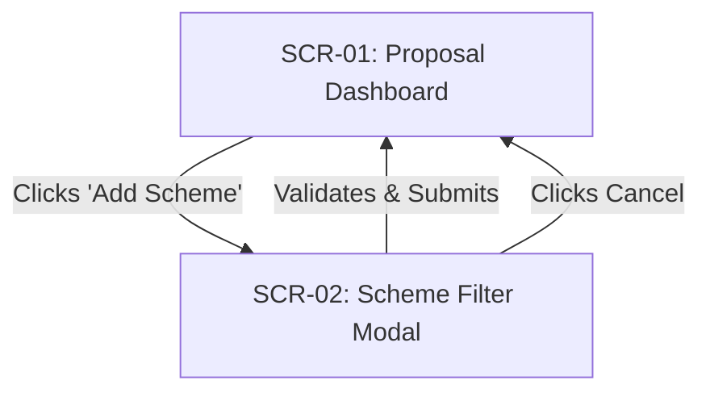
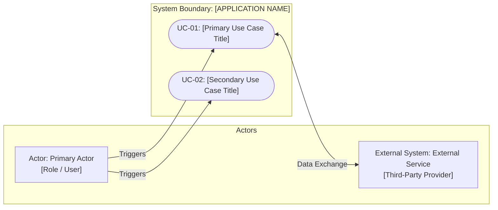
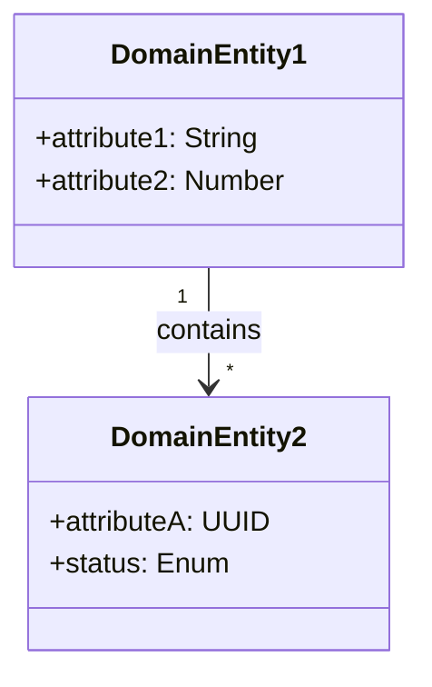

# Feature Specification: [FEATURE NAME] – ICONIX Process

**Feature Branch**: `feat/[###-feature-name]`
**Created**: [DATE]
**Status**: Draft
**Input**: User description: "$ARGUMENTS"
**Methodology Reference**: Doug Rosenberg & Matt Stephens, *Use Case Driven Object Modeling with UML*

---

## 1. Overview & System Context
<!-- High-level feature context: target actors, core business value, and problem statement -->
[Describe the feature scope, target users/roles, and the core problem this feature solves]

---

## 2. GUI Storyboards & Screen Navigation
<!--
  Rosenberg: "GUI prototype / storyboards anchor the use cases."
  Map out every screen, dialog, form, and visual transition involved in this feature.
-->

### Screen Inventory
| Screen / View ID | Screen Name | Key UI Elements | Next Screen / Action Trigger |
|---|---|---|---|
| `SCR-01` | [e.g., Proposal Dashboard] | [Filter dropdown, Scheme table, Search bar] | Clicks "Add Scheme" -> `SCR-02` |
| `SCR-02` | [e.g., Scheme Filter Modal] | [Budget range slider, Category tags, Submit] | Submits form -> Refresh `SCR-01` |

### Storyboard Navigation Flow

---

## 3. Use Case Model (Doug Rosenberg Canonical)

### 3.1 Use Case Diagram (Actors & System Boundary)
<!--
  Rosenberg: High-level UML Use Case diagram mapping Actors to Use Cases within System Boundary.
-->

---

### 3.2 Detailed Use Case Specifications

### UC-[ID]: [Use Case Title in Verb-Noun format, e.g., Filter Research Schemes]

- **Primary Actor**: [User / Lecturer / Researcher / System Daemon]
- **Goal in Context**: [What the actor achieves at the end of the interaction]
- **Preconditions**: [System / actor state that must be true before trigger]
- **Postconditions (Success Guarantees)**: [System state upon successful completion]
- **Trigger**: [Event initiating the use case]

#### Basic Course of Events (Sunny Day Flow)
| Step | Actor Action | System Response |
|:---:|---|---|
| 1 | The Actor [initiates action, e.g. accesses scheme filter]. | The System [presents available filter options]. |
| 2 | The Actor [selects criteria, e.g. budget cap and focus area] and clicks Apply. | The System [validates selected parameters]. |
| 3 | The Actor [confirms selection]. | The System [queries matching schemes, updates state, and renders results]. |

#### Alternate & Exception Courses (Rainy Day Flows)
<!-- Document error handling, invalid inputs, network drops, empty states -->
- **Alt-1: Invalid Criteria Selection**
  - **At step 2**: If the Actor specifies a negative budget or contradictory dates:
  - The System displays an inline validation message and keeps the form active.
- **Alt-2: No Matching Records Found**
  - **At step 3**: If query returns 0 matching results:
  - The System displays an empty state with suggested relaxed criteria.
- **Alt-3: Session Expiry / Unauthorized Access**
  - **At any step**: If the Actor's auth token has expired:
  - The System preserves draft input in local storage and redirects to the login screen.

---

## 4. Initial Domain Model (Noun-Phrase Extraction)
<!--
  Rosenberg Rule: Extract nouns from use cases and user vocabulary to form the initial domain vocabulary.
  Do NOT add UI widgets or database technicalities here. Only core domain business concepts.
-->

- **[Domain Entity 1]**: [Real-world business meaning and essential attributes]
- **[Domain Entity 2]**: [Real-world business meaning and relationship to Entity 1]

---

## 5. Requirements Traceability

### Functional Requirements (FR)
- **FR-001**: System MUST [specific capability testable against UC-[ID] step X]
- **FR-002**: System MUST [validation rule testable against Alt-1]
- **FR-003**: System MUST [state persistence requirement]

### Non-Functional Requirements (NFR)
- **NFR-001 (Performance)**: [e.g., Query latency < 300ms under 50 concurrent requests]
- **NFR-002 (Security)**: [e.g., Role-based access control; sanitized input against SQLi/XSS]
- **NFR-003 (Usability)**: [e.g., Conforms to WCAG 2.1 AA accessibility guidelines]

---

## 6. Success Criteria & Scope Boundaries
- **SC-001**: [Measurable outcome, e.g. 100% of valid scheme searches complete within 1 second]
- **SC-002**: [User efficiency metric, e.g. user completes the flow in <= 3 clicks]
- **Out of Scope**: [Explicit list of capabilities deferred to future iterations]

---

## 7. Git & Version Control Strategy
<!-- Mandatory version control policy defined directly from the specification -->
- **Feature Branch**: `feat/[###-feature-name]`
- **Conventional Commits Standard**:
  - `feat(scope)`: New feature or capability
  - `test(scope)`: Test additions or updates
  - `refactor(scope)`: Internal structural improvements
  - `chore(scope)`: Scaffolding, configuration, or documentation
- **Major Milestone Checkpoints**:
  - **Milestone 1 (Foundation)**: `feat(core): setup schema migrations and baseline models`
  - **Milestone 2 (Use Cases)**: `feat(UC-[ID]): complete [Title] use case end-to-end with tests`
  - **Milestone 3 (Release)**: `chore(release): complete [FEATURE NAME] verification and documentation`
