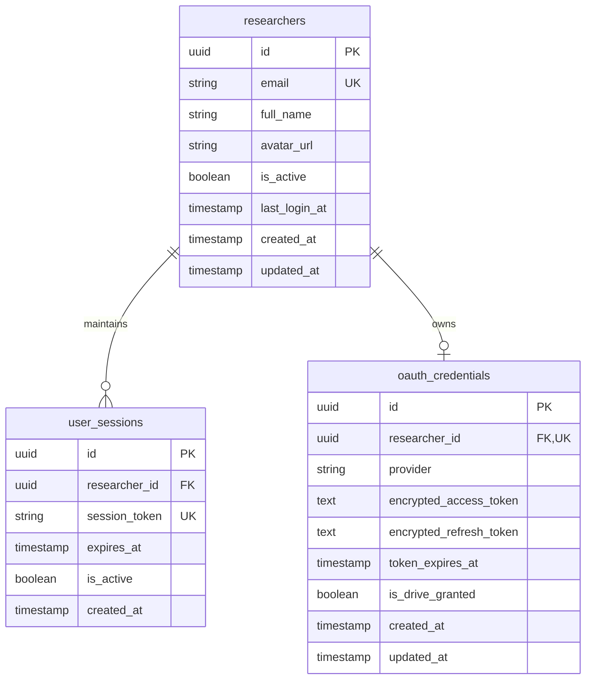

# Data Model Specification: Google OAuth Login & Drive Access

**Feature**: Google OAuth Login (`001-google-oauth-login`)  
**Database System**: PostgreSQL (with `pgvector` extension enabled)  
**ORM Framework**: SQLModel / SQLAlchemy  

---

## 1. Entity Relationship Diagram (ERD)



---

## 2. Table Specifications

### 2.1 Table: `researchers`
Stores core researcher account profiles.

| Column Name | Data Type | Constraints | Description |
|---|---|---|---|
| `id` | `UUID` | `PRIMARY KEY`, Default `gen_random_uuid()` | Unique identifier for researcher |
| `email` | `VARCHAR(255)` | `UNIQUE`, `NOT NULL`, Indexed | Google account email address |
| `full_name` | `VARCHAR(255)` | `NOT NULL` | Display name from Google Profile |
| `avatar_url` | `TEXT` | `NULLABLE` | Profile picture URL from Google |
| `is_active` | `BOOLEAN` | `NOT NULL`, Default `TRUE` | Account status flag |
| `last_login_at` | `TIMESTAMPTZ` | `NOT NULL` | Last successful login timestamp |
| `created_at` | `TIMESTAMPTZ` | `NOT NULL`, Default `NOW()` | Record creation timestamp |
| `updated_at` | `TIMESTAMPTZ` | `NOT NULL`, Default `NOW()` | Record update timestamp |

### 2.2 Table: `user_sessions`
Stores active 24-hour application sessions issued to researchers.

| Column Name | Data Type | Constraints | Description |
|---|---|---|---|
| `id` | `UUID` | `PRIMARY KEY`, Default `gen_random_uuid()` | Session record ID |
| `researcher_id` | `UUID` | `FOREIGN KEY (researchers.id) ON DELETE CASCADE`, Indexed | Associated researcher |
| `session_token` | `VARCHAR(512)` | `UNIQUE`, `NOT NULL`, Indexed | Cryptographic session identifier / JWT ID |
| `expires_at` | `TIMESTAMPTZ` | `NOT NULL` | Session expiration (24 hours from issuance) |
| `is_active` | `BOOLEAN` | `NOT NULL`, Default `TRUE` | Session validity state |
| `created_at` | `TIMESTAMPTZ` | `NOT NULL`, Default `NOW()` | Session creation timestamp |

### 2.3 Table: `oauth_credentials`
Stores encrypted Google OAuth tokens for Drive API access.

| Column Name | Data Type | Constraints | Description |
|---|---|---|---|
| `id` | `UUID` | `PRIMARY KEY`, Default `gen_random_uuid()` | Credential record ID |
| `researcher_id` | `UUID` | `FOREIGN KEY (researchers.id) ON DELETE CASCADE`, `UNIQUE` | Associated researcher |
| `provider` | `VARCHAR(50)` | `NOT NULL`, Default `'google'` | OAuth provider |
| `encrypted_access_token` | `TEXT` | `NOT NULL` | Fernet/AES-256 encrypted Google access token |
| `encrypted_refresh_token` | `TEXT` | `NULLABLE` | Fernet/AES-256 encrypted Google refresh token |
| `token_expires_at` | `TIMESTAMPTZ` | `NOT NULL` | Google access token expiration timestamp |
| `is_drive_granted` | `BOOLEAN` | `NOT NULL`, Default `FALSE` | Indicates whether Google Drive scope was consented |
| `created_at` | `TIMESTAMPTZ` | `NOT NULL`, Default `NOW()` | Record creation timestamp |
| `updated_at` | `TIMESTAMPTZ` | `NOT NULL`, Default `NOW()` | Record update timestamp |

---

## 3. Migration Setup & pgvector Preparation

```sql
-- Migration 001: Initial Auth Schema & pgvector Activation
CREATE EXTENSION IF NOT EXISTS "uuid-ossp";
CREATE EXTENSION IF NOT EXISTS "vector";

-- Indexes for performance & lookups
CREATE INDEX idx_researchers_email ON researchers(email);
CREATE INDEX idx_user_sessions_token ON user_sessions(session_token);
CREATE INDEX idx_user_sessions_researcher ON user_sessions(researcher_id);
CREATE INDEX idx_oauth_credentials_researcher ON oauth_credentials(researcher_id);
```
