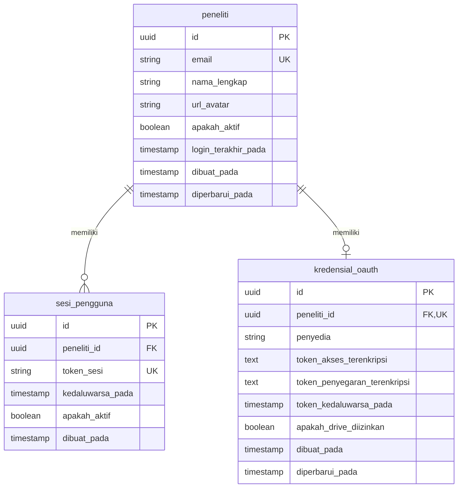

# Data Model Specification: Google OAuth Login & Drive Access

**Feature**: Google OAuth Login (`001-google-oauth-login`)  
**Database System**: PostgreSQL (with `pgvector` extension enabled)  
**ORM Framework**: SQLModel / SQLAlchemy  

---

## 1. Entity Relationship Diagram (ERD)



---

## 2. Table Specifications

### 2.1 Table: `peneliti`
Menyimpan profil akun utama peneliti.

| Nama Kolom | Tipe Data | Batasan | Deskripsi |
|---|---|---|---|
| `id` | `UUID` | `PRIMARY KEY`, Default `gen_random_uuid()` | Pengidentifikasi unik peneliti |
| `email` | `VARCHAR(255)` | `UNIQUE`, `NOT NULL`, Indexed | Alamat email akun Google |
| `nama_lengkap` | `VARCHAR(255)` | `NOT NULL` | Nama tampilan dari Profil Google |
| `url_avatar` | `TEXT` | `NULLABLE` | URL foto profil dari Google |
| `apakah_aktif` | `BOOLEAN` | `NOT NULL`, Default `TRUE` | Status keaktifan akun |
| `login_terakhir_pada` | `TIMESTAMPTZ` | `NOT NULL` | Waktu login terakhir berhasil |
| `dibuat_pada` | `TIMESTAMPTZ` | `NOT NULL`, Default `NOW()` | Waktu pembuatan baris data |
| `diperbarui_pada` | `TIMESTAMPTZ` | `NOT NULL`, Default `NOW()` | Waktu pembaruan baris data |

### 2.2 Table: `sesi_pengguna`
Menyimpan sesi aplikasi aktif selama 24 jam yang diterbitkan untuk peneliti.

| Nama Kolom | Tipe Data | Batasan | Deskripsi |
|---|---|---|---|
| `id` | `UUID` | `PRIMARY KEY`, Default `gen_random_uuid()` | ID baris sesi |
| `peneliti_id` | `UUID` | `FOREIGN KEY (peneliti.id) ON DELETE CASCADE`, Indexed | Peneliti pemilik sesi |
| `token_sesi` | `VARCHAR(512)` | `UNIQUE`, `NOT NULL`, Indexed | Token identifikasi sesi kriptografis / JWT ID |
| `kedaluwarsa_pada` | `TIMESTAMPTZ` | `NOT NULL` | Waktu kedaluwarsa sesi (24 jam sejak diterbitkan) |
| `apakah_aktif` | `BOOLEAN` | `NOT NULL`, Default `TRUE` | Status validitas sesi |
| `dibuat_pada` | `TIMESTAMPTZ` | `NOT NULL`, Default `NOW()` | Waktu pembuatan sesi |

### 2.3 Table: `kredensial_oauth`
Menyimpan token Google OAuth terenkripsi untuk akses Google Drive API.

| Nama Kolom | Tipe Data | Batasan | Deskripsi |
|---|---|---|---|
| `id` | `UUID` | `PRIMARY KEY`, Default `gen_random_uuid()` | ID kredensial |
| `peneliti_id` | `UUID` | `FOREIGN KEY (peneliti.id) ON DELETE CASCADE`, `UNIQUE` | Peneliti pemilik kredensial |
| `penyedia` | `VARCHAR(50)` | `NOT NULL`, Default `'google'` | Penyedia OAuth |
| `token_akses_terenkripsi` | `TEXT` | `NOT NULL` | Token akses Google terenkripsi Fernet/AES-256 |
| `token_penyegaran_terenkripsi` | `TEXT` | `NULLABLE` | Token penyegaran (refresh) Google terenkripsi Fernet/AES-256 |
| `token_kedaluwarsa_pada` | `TIMESTAMPTZ` | `NOT NULL` | Waktu kedaluwarsa access token Google |
| `apakah_drive_diizinkan` | `BOOLEAN` | `NOT NULL`, Default `FALSE` | Menandakan apakah izin scope Google Drive telah disetujui |
| `dibuat_pada` | `TIMESTAMPTZ` | `NOT NULL`, Default `NOW()` | Waktu pembuatan data |
| `diperbarui_pada` | `TIMESTAMPTZ` | `NOT NULL`, Default `NOW()` | Waktu pembaruan data |

---

## 3. Migration Setup & pgvector Preparation

```sql
-- Migration 001: Initial Auth Schema & pgvector Activation
CREATE EXTENSION IF NOT EXISTS "uuid-ossp";
CREATE EXTENSION IF NOT EXISTS "vector";

-- Indexes for performance & lookups
CREATE INDEX idx_peneliti_email ON peneliti(email);
CREATE INDEX idx_sesi_pengguna_token ON sesi_pengguna(token_sesi);
CREATE INDEX idx_sesi_pengguna_peneliti ON sesi_pengguna(peneliti_id);
CREATE INDEX idx_kredensial_oauth_peneliti ON kredensial_oauth(peneliti_id);
```
