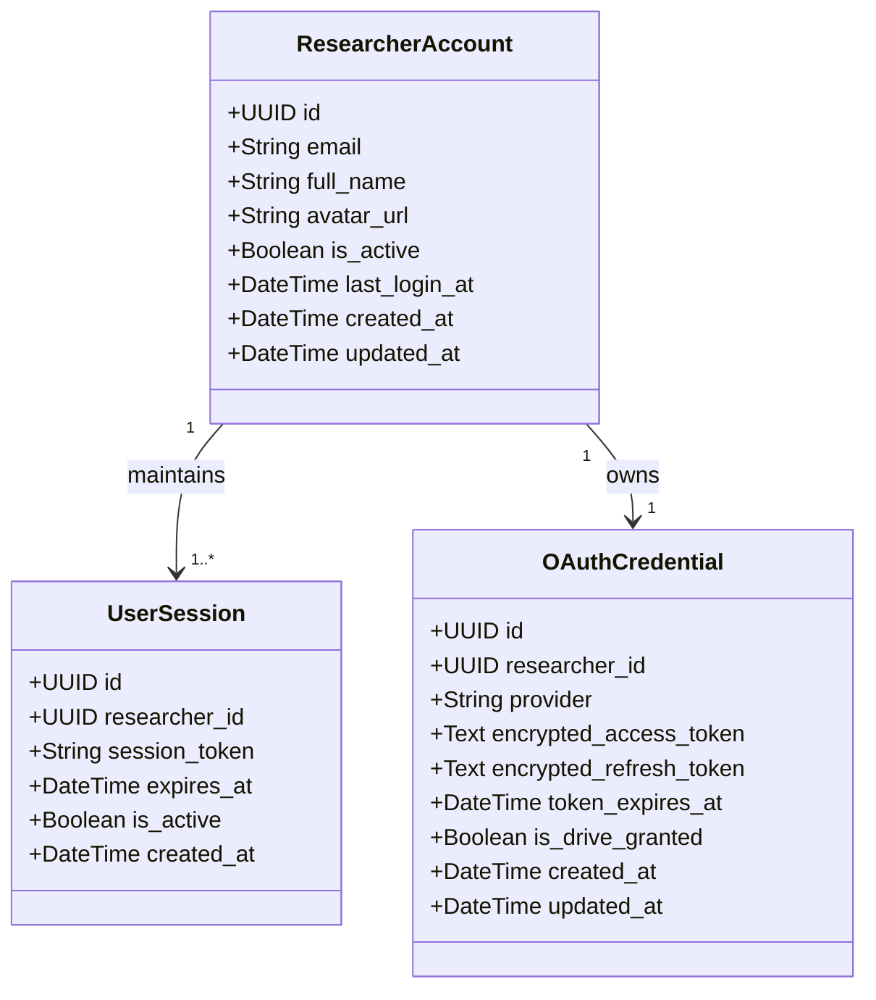
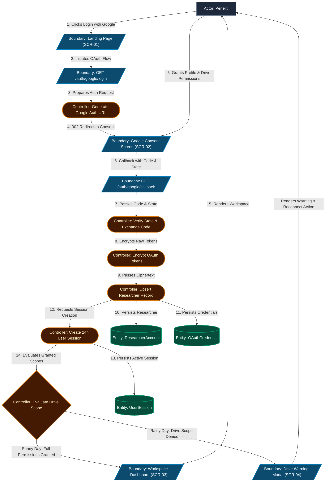
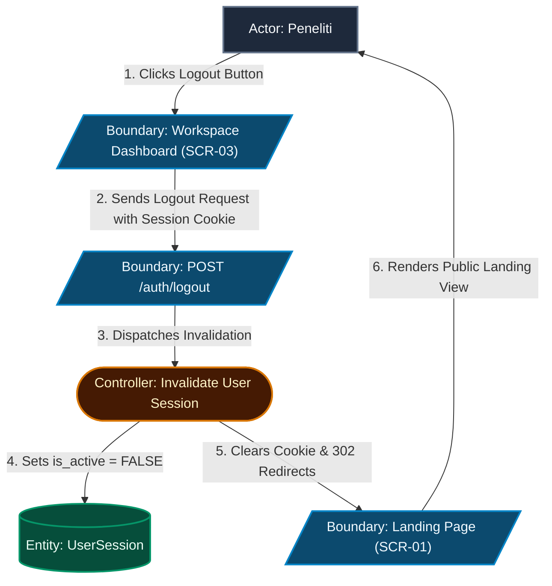
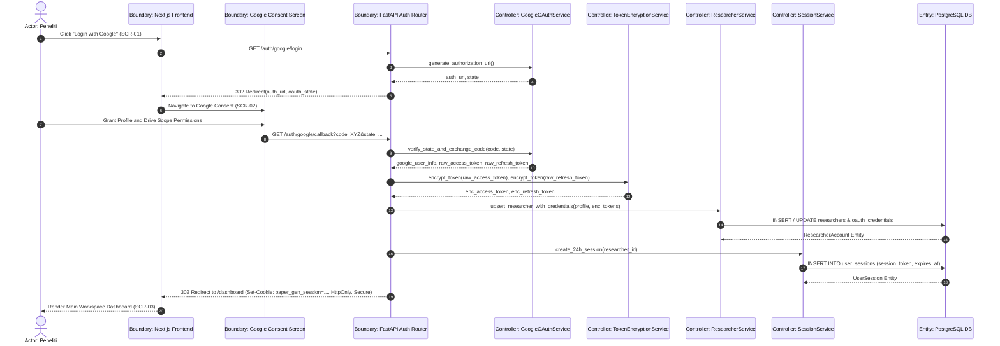
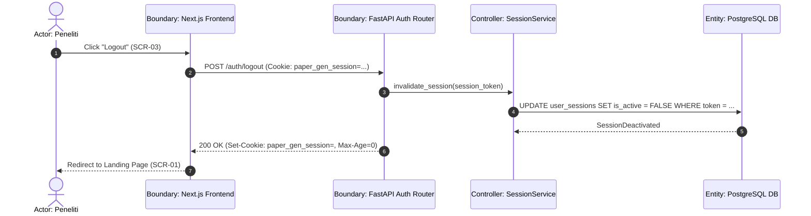
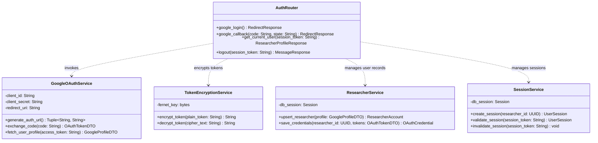

# Technical Plan: Google OAuth Login & Drive Access Authorization – ICONIX Process

**Branch**: `001-google-oauth-login` | **Date**: 2026-09-16 | **Spec**: [spec.md](file:///Users/gzaaa19/Telaah/specs/001-google-oauth-login/spec.md)  
**Input**: Feature specification from `/specs/001-google-oauth-login/spec.md`  
**Methodology Reference**: Doug Rosenberg & Matt Stephens, *Use Case Driven Object Modeling with UML*  

---

## 1. System Architecture & Technical Context

- **Frontend Layer**: Next.js App Router (TypeScript), Vanilla CSS, dijalankan dan di-build menggunakan **Bun** sebagai JavaScript runtime dan package manager.
- **Backend Layer**: FastAPI (Python 3.12), Pydantic v2, SQLModel / SQLAlchemy ORM. OAuth handled via `authlib` / `google-auth`. Encryption via `cryptography` (Fernet symmetric encryption).
- **Persistence & DB**: PostgreSQL dengan ekstensi `pgvector` siap diaktifkan pada migrasi Alembic.
- **Session & Cookie Security**: `httpOnly`, `Secure`, `SameSite=Lax` session cookie (`paper_gen_session`), berlaku 24 jam. Kredensial Google disimpan terenkripsi di PostgreSQL.
- **Architectural Pattern**: **Router (Boundary) → Service (Controller) → Repository/Model (Entity)**. Client secret Google terisolasi sepenuhnya di backend FastAPI.

---

## 2. Updated Domain Model

- **Entities**:
  - `ResearcherAccount`: Menyimpan profil identitas peneliti berbasis email unik Google.
  - `UserSession`: Menyimpan token sesi lokal terautentikasi (berlaku 24 jam).
  - `OAuthCredential`: Menyimpan ciphertext token otorisasi Google OAuth hasil enkripsi Fernet/AES-256.
- **Database Schema Migrations**: `alembic` script `001_auth_schema.py` membuat tabel `researchers`, `user_sessions`, `oauth_credentials`, indeks, serta mengaktifkan ekstensi `vector` (pgvector).

---

## 3. ICONIX Robustness Analysis (Preliminary Design)

### 3.1 Robustness Diagram: UC-01 Google OAuth Login & Authorization Flow

> **ICONIX BCE Element Legend**:
> - **Actor**: Pengguna / sistem eksternal yang berinteraksi dengan sistem (`Actor: Peneliti`).
> - **Boundary Object (`[/.../]` - Cyan/Blue)**: Antarmuka batas (halaman UI, modal, router/endpoint API gateway).
> - **Controller Object (`([...])` - Amber/Orange)**: Logika aplikasi, koordinasi, dan pemrosesan aturan bisnis (harus selalu menggunakan **Frasa Kata Kerja / Verb Phrase**).
> - **Entity Object (`[(...)]` - Emerald/Green)**: Objek domain persisten (tabel/model database).

### 3.2 Robustness Diagram: UC-02 Terminate Session (Logout Flow)

### 3.3 Boundary-Controller-Entity (BCE) Inventory & Method Allocation
Sesuai kaidah Doug Rosenberg, *Controller* pada Robustness Diagram adalah logika proses bisnis murni (kata kerja) yang selanjutnya dialokasikan menjadi *method* konkrit pada kelas saat memasuki Detailed Design (Sequence Diagram & Class Diagram):

| BCE Type | Element Name | Responsibility / Concrete Implementation Allocation |
|---|---|---|
| **Boundary** | `Landing Page (SCR-01)` | Frontend Next.js halaman landing publik (`frontend/src/app/page.tsx`). |
| **Boundary** | `GET /auth/google/login` | FastAPI Auth Router API Endpoint (`backend/src/auth/router.py`). |
| **Boundary** | `Google Consent Screen (SCR-02)` | Antarmuka otorisasi eksternal milik Google OAuth Server. |
| **Boundary** | `GET /auth/google/callback` | FastAPI Auth Callback Endpoint (`backend/src/auth/router.py`). |
| **Boundary** | `Workspace Dashboard (SCR-03)` | Frontend Next.js Dashboard Peneliti (`frontend/src/app/dashboard/page.tsx`). |
| **Boundary** | `Drive Warning Modal (SCR-04)` | Frontend React Component Modal Peringatan Drive (`frontend/src/components/DriveWarningModal.tsx`). |
| **Boundary** | `POST /auth/logout` | FastAPI Auth Router Endpoint Logout (`backend/src/auth/router.py`). |
| **Controller** | `Generate Google Auth URL` | `GoogleOAuthService.generate_authorization_url()` |
| **Controller** | `Verify State & Exchange Code` | `GoogleOAuthService.verify_state_and_exchange_code()` |
| **Controller** | `Encrypt OAuth Tokens` | `TokenEncryptionService.encrypt_token()` |
| **Controller** | `Upsert Researcher Record` | `ResearcherService.upsert_researcher_with_credentials()` |
| **Controller** | `Create 24h User Session` | `SessionService.create_24h_session()` |
| **Controller** | `Evaluate Drive Scope` | `GoogleOAuthService.check_drive_scope_granted()` |
| **Controller** | `Invalidate User Session` | `SessionService.invalidate_session()` |
| **Entity** | `ResearcherAccount` | Model persisten data peneliti (`backend/src/auth/models.py`). |
| **Entity** | `OAuthCredential` | Model persisten token OAuth terenkripsi (`backend/src/auth/models.py`). |
| **Entity** | `UserSession` | Model persisten sesi pengguna aktif (`backend/src/auth/models.py`). |

### 3.4 Strict BCE Rule Compliance Audit (Doug Rosenberg Rules)
- [x] **Rule 1 (Actors can only talk to Boundaries)**: Peneliti hanya berinteraksi dengan antarmuka UI (`SCR-01`, `SCR-02`, `SCR-03`, `SCR-04`).
- [x] **Rule 2 (Boundaries can only talk to Controllers and Actors)**: UI dan Endpoint API memicu Controller (verb) dan tidak pernah menyentuh Database Entity langsung.
- [x] **Rule 3 (Entities can only talk to Controllers)**: Entitas `ResearcherAccount`, `OAuthCredential`, dan `UserSession` hanya diakses dan dimutasi melalui Controllers.
- [x] **Rule 4 (Controllers can talk to Boundaries, Controllers, and Entities, but NOT directly to Actors)**: Logika proses berkomunikasi dengan Boundaries untuk navigasi/rendering ke aktor.
- [x] **Zero Direct Boundary-to-Entity Links**: Terverifikasi 100% tidak ada jalan pintas dari Boundary langsung ke Entity.

---

## 4. Preliminary Design Review (PDR) Checkpoint Gate

| PDR Criteria | Status | Evidence / Notes |
|---|:---:|---|
| **1. Use Case Coverage** | PASS | Diagram robustness mencakup alur lengkap UC-01 (Login) dan UC-02 (Logout). |
| **2. Alternate Courses Handled** | PASS | Alur penolakan scope Drive, token expired, dan pembatalan diarahkan melalui `C1` ke `B5` (SCR-04). |
| **3. Domain Model Updated** | PASS | Tabel `researchers`, `user_sessions`, dan `oauth_credentials` terdefinisi presisi. |
| **4. Strict BCE Adherence** | PASS | Terverifikasi TIDAK ADA hubungan langsung Boundary-ke-Entity. |

*GATE STATUS*: **[APPROVED TO PROCEED TO DETAILED DESIGN]**

---

## 5. Detailed Design: Sequence Diagrams (Behavior Allocation)

### Sequence Diagram 1: UC-01 Google OAuth Login & Callback

### Sequence Diagram 2: UC-02 Logout Flow

---

## 6. Detailed Design: Static Class Model

### Concrete File & Method Signatures
- **Boundaries**:
  - `backend/src/auth/router.py`:
    - `GET /auth/google/login` → `RedirectResponse`
    - `GET /auth/google/callback` → `RedirectResponse`
    - `GET /auth/me` → `ResearcherProfileResponse`
    - `POST /auth/logout` → `JSONResponse`
- **Controllers**:
  - `backend/src/auth/oauth_service.py`:
    - `class GoogleOAuthService:`
      - `def build_auth_url(self) -> Tuple[str, str]:`
      - `def exchange_code(self, code: str) -> Dict[str, Any]:`
  - `backend/src/auth/crypto_service.py`:
    - `class TokenEncryptionService:`
      - `def encrypt(self, plain_text: str) -> str:`
      - `def decrypt(self, cipher_text: str) -> str:`
  - `backend/src/auth/session_service.py`:
    - `class SessionService:`
      - `def create_24h_session(self, researcher_id: UUID) -> str:`
      - `def verify_session(self, session_token: str) -> ResearcherAccount:`
- **Entities**:
  - `backend/src/auth/models.py`:
    - `class ResearcherAccount(SQLModel, table=True):`
    - `class UserSession(SQLModel, table=True):`
    - `class OAuthCredential(SQLModel, table=True):`

---

## 7. Critical Design Review (CDR) Checkpoint Gate

| CDR Criteria | Status | Evidence / Notes |
|---|:---:|---|
| **1. Method Allocation** | PASS | Setiap pesan pada sequence diagram terpetakan ke method kelas yang konkret. |
| **2. Class Signatures** | PASS | Parameter, return type, dan tipe enkripsi terdefinisi lengkap. |
| **3. Test Plan Feasibility** | PASS | Seluruh controller (`OAuthManager`, `CryptoService`, `SessionService`) independen dan unit-testable dengan mock HTTP/DB. |
| **4. PDR Traceability** | PASS | Seluruh objek BCE dari analisis robustness ada dalam class diagram. |

*GATE STATUS*: **[APPROVED TO PROCEED TO IMPLEMENTATION]**

---

## 8. Version Control & Git Milestone Plan

| Milestone / Phase | Scope / Layer | Commit Type & Suggested Message | Verification Required |
|---|---|---|---|
| **Milestone 1** | Database Models & Alembic Migration | `feat(auth): add researcher, session, and oauth credential schema with pgvector` | Alembic migration up/down green |
| **Milestone 2** | Crypto & OAuth Core Controllers | `feat(auth): implement token encryption and Google OAuth code exchange service` | Unit tests for Fernet crypto & OAuth mock pass |
| **Milestone 3** | FastAPI Routers & Session Flow | `feat(auth): add login, callback, logout, and me API endpoints` | Integration test for OAuth flow green |
| **Milestone 4** | Next.js Frontend Integration | `feat(auth): implement login button, dashboard session check, and logout UI` | End-to-end Bun & Next.js verification green |
