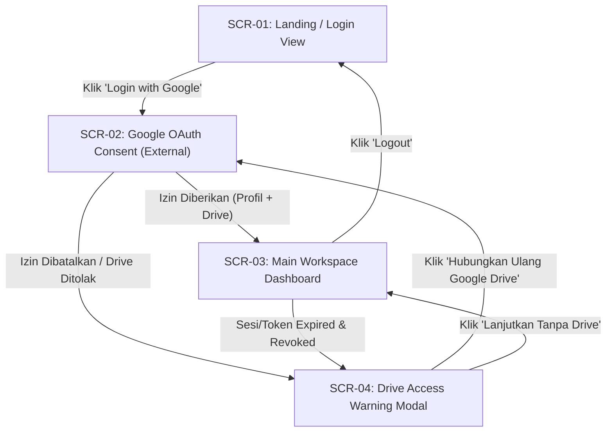
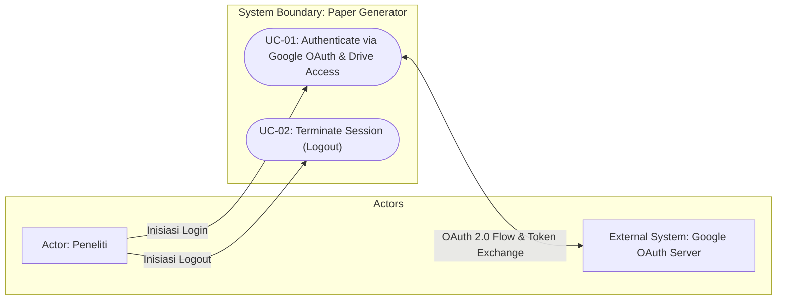
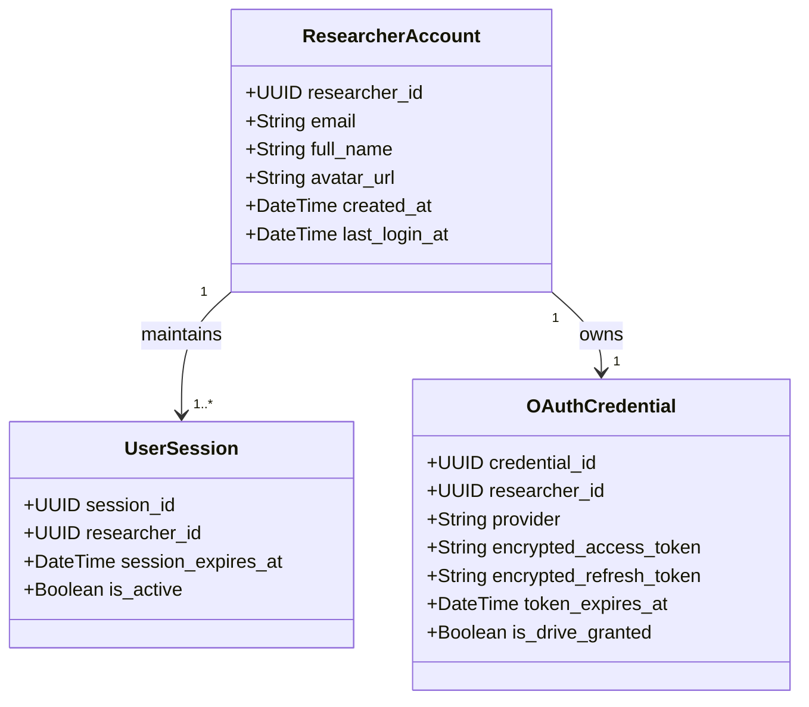

# Feature Specification: Google OAuth Login & Drive Access Authorization – ICONIX Process

**Feature Branch**: `001-google-oauth-login`
**Created**: 2026-09-16
**Status**: Draft
**Input**: User description: "Login via Google OAuth pada aplikasi Paper Generator"
**Methodology Reference**: Doug Rosenberg & Matt Stephens, *Use Case Driven Object Modeling with UML*

---

## 1. Overview & System Context

Paper Generator adalah aplikasi web yang membantu peneliti (dosen, mahasiswa, praktisi riset) menyusun draft paper konferensi/jurnal (seperti template `iciCos`) berbasis dokumen referensi dari Google Drive.

Fitur "Login via Google OAuth" menyediakan mekanisme autentikasi tunggal yang aman dan seamless. Selain memverifikasi identitas peneliti tanpa membutuhkan username/password lokal, proses ini sekaligus meminta persetujuan (*consent*) scope minimal untuk mengakses dan membaca dokumen referensi yang tersimpan di Google Drive milik peneliti.

---

## 2. GUI Storyboards & Screen Navigation

### Screen Inventory
| Screen / View ID | Screen Name | Key UI Elements | Next Screen / Action Trigger |
|---|---|---|---|
| `SCR-01` | Landing / Login View | Tombol "Login with Google", Ringkasan Manfaat Aplikasi, Penjelasan Akses Scope Google Drive | Klik "Login with Google" -> `SCR-02` |
| `SCR-02` | Google OAuth Consent Screen | Pemilihan Akun Google, Daftar Izin Scope (Profil Dasar + Baca Google Drive), Tombol Allow/Cancel | Persetujuan Berhasil -> `SCR-03` Penolakan/Batal -> `SCR-04` |
| `SCR-03` | Main Workspace Dashboard | Header Profil Peneliti (Nama, Email, Avatar), Badge Status Koneksi Google Drive, Tombol "Logout", Navigasi Referensi Drive | Klik "Logout" -> `SCR-01` Akses Terputus/Revoked -> `SCR-04` |
| `SCR-04` | Drive Access Warning & Consent Recovery Modal | Pesan Edukatif "Akses Google Drive Ditolak/Terputus", Tombol "Hubungkan Ulang Google Drive", Tombol "Lanjutkan Tanpa Drive" | Klik "Hubungkan Ulang" -> `SCR-02` Klik "Lanjutkan Tanpa Drive" -> `SCR-03` (Modus Terbatas) |

### Storyboard Navigation Flow

---

## 3. Use Case Model (Doug Rosenberg Canonical)

### 3.1 Use Case Diagram (Actors & System Boundary)

---

### 3.2 Detailed Use Case Specifications

### UC-01: Authenticate via Google OAuth & Authorize Drive Access

- **Primary Actor**: Peneliti (User)
- **Goal in Context**: Berhasil masuk ke dalam aplikasi menggunakan akun Google dan memberikan otoritas akses baca ke berkas Google Drive untuk keperluan analisis RAG.
- **Preconditions**: Peneliti membuka halaman aplikasi `SCR-01` dan belum memiliki sesi login aktif.
- **Postconditions (Success Guarantees)**: Sesi Peneliti lokal dibuat dan aktif, data profil dasar disimpan, serta kredensial akses token/refresh token tersimpan secara terenkripsi.
- **Trigger**: Peneliti menekan tombol "Login with Google" pada `SCR-01`.

#### Basic Course of Events (Sunny Day Flow)
| Step | Actor Action | System Response |
|:---:|---|---|
| 1 | Peneliti menekan tombol "Login with Google" pada `SCR-01`. | Sistem mengarahkan Peneliti ke Google OAuth Consent Screen (`SCR-02`) dengan meminta scope profil dasar dan izin baca Google Drive. |
| 2 | Peneliti memilih akun Google dan menyetujui permintaan izin akses. | Google mengembalikan otorisasi OAuth (authorization code/token) kembali ke callback Sistem. |
| 3 | - | Sistem memverifikasi otorisasi, membuat entitas Peneliti jika baru atau memperbarui jika lama, mengamankan token otorisasi secara terenkripsi, dan menerbitkan sesi lokal aktif. |
| 4 | - | Sistem mengarahkan Peneliti ke Main Workspace Dashboard (`SCR-03`) yang menampilkan profil Peneliti dan status Google Drive terhubung. |

#### Alternate & Exception Courses (Rainy Day Flows)
- **Alt-1: Peneliti Membatalkan Consent Google**
  - **At step 2**: Peneliti menutup dialog Google atau menekan tombol Cancel:
  - Sistem menangkap pembatalan, mengarahkan kembali ke `SCR-01` dengan pesan pemberitahuan "Proses login dibatalkan".
- **Alt-2: Peneliti Menolak Izin Akses Google Drive (Hanya Memberikan Izin Profil)**
  - **At step 2**: Peneliti menyetujui login profil tetapi menghapus centang pada izin Google Drive:
  - Sistem membuat sesi Peneliti namun mencatat status *Drive Access = False*, lalu menampilkan Modal Peringatan `SCR-04` bahwa fitur pembuatan paper dari referensi Drive tidak dapat digunakan hingga izin diberikan.
- **Alt-3: Refresh Token Kedaluwarsa / Sesi Terputus**
  - **At step 4 (atau penggunaan berikutnya)**: Ketika Sistem mencoba memanggil Google Drive API dan menerima respons token kedaluwarsa/tidak valid:
  - Sistem mencoba melakukan pembaruan token (*automatic refresh token flow*). Jika refresh token telah dicabut/hangus, Sistem mengubah status koneksi Drive menjadi terputus dan menampilkan dialog re-consent di `SCR-04`.
- **Alt-4: Peneliti Mencabut Izin Aplikasi dari Google Account Settings**
  - **At any step di SCR-03**: Peneliti telah mencabut izin aplikasi Paper Generator secara eksternal melalui pengaturan akun Google:
  - Pada permintaan API berikutnya, Sistem mendeteksi kegagalan otorisasi, menurunkan status sesi Drive, dan menampilkan `SCR-04` meminta otorisasi ulang.
- **Alt-5: Login dengan Akun Google Berbeda**
  - **At step 1-2**: Peneliti login menggunakan alamat email Google baru yang belum pernah terdaftar:
  - Sistem mendaftarkan akun Peneliti baru secara otomatis berbasis alamat email unik Google dan mengasosiasikan kredensial sesi bersangkutan.

---

### UC-02: Terminate Session (Logout)

- **Primary Actor**: Peneliti
- **Goal in Context**: Mengakhiri sesi aktif aplikasi dan memastikan akses lokal terputus.
- **Preconditions**: Peneliti berada dalam keadaan login di `SCR-03`.
- **Postconditions**: Sesi lokal Peneliti dihapus, token akses lokal dibersihkan, dan tampilan kembali ke `SCR-01`.
- **Trigger**: Peneliti memilih tombol "Logout" pada header profil di `SCR-03`.

#### Basic Course of Events (Sunny Day Flow)
| Step | Actor Action | System Response |
|:---:|---|---|
| 1 | Peneliti menekan tombol "Logout" pada `SCR-03`. | Sistem mengonfirmasi permintaan logout, menghapus sesi aktif Peneliti, dan membersihkan token tersimpan dari sesi aktif. |
| 2 | - | Sistem mengarahkan tampilan kembali ke halaman Landing / Login View (`SCR-01`). |

---

## 4. Initial Domain Model (Noun-Phrase Extraction)

- **ResearcherAccount**: Entitas bisnis utama yang merepresentasikan Peneliti pengguna aplikasi Paper Generator.
- **UserSession**: Entitas yang mencatat status keaktifan sesi Peneliti pada peramban/aplikasi.
- **OAuthCredential**: Kredensial terenkripsi hasil otorisasi Google OAuth, menyimpan token dan status hak akses Drive.

---

## 5. Requirements Traceability

### Functional Requirements (FR)
- **FR-001**: Sistem MUST menyediakan tombol "Login with Google" pada halaman awal (`SCR-01`).
- **FR-002**: Sistem MUST menjalankan OAuth 2.0 consent flow dengan scope profil dasar (`openid`, `email`, `profile`) dan scope baca terbatas Google Drive (`drive.readonly` atau scope spesifik berkas).
- **FR-003**: Sistem MUST membuat sesi terautentikasi untuk Peneliti setelah consent OAuth berhasil dan mengarahkan ke halaman workspace (`SCR-03`).
- **FR-004**: Sistem MUST meng-ekstrak dan menyimpan informasi profil dasar Peneliti (nama lengkap, alamat email, dan URL foto profil jika ada).
- **FR-005**: Sistem MUST menyediakan fungsi "Logout" yang menghapus sesi lokal Peneliti dan mengembalikan peramban ke halaman landing (`SCR-01`).
- **FR-006**: Sistem MUST menangani skenario penolakan scope Google Drive dengan menampilkan penjelasan edukatif di `SCR-04` tanpa memblokir sesi login profil dasar Peneliti.
- **FR-007**: Sistem MUST secara otomatis memperbarui *access token* yang kedaluwarsa menggunakan *refresh token* yang valid tanpa meminta Peneliti login ulang secara manual.
- **FR-008**: Sistem MUST mendeteksi pencabutan akses token eksternal (dari Google Account Settings) dan meminta otorisasi ulang saat Peneliti mencoba mengakses fitur Drive.

### Non-Functional Requirements (NFR)
- **NFR-001 (Performance)**: Alur login dari penekanan tombol di `SCR-01` hingga perampungan sesi lokal di `SCR-03` MUST selesai dalam durasi < 2 detik (di luar waktu respons pihak ketiga Google).
- **NFR-002 (Security - Constitution Alignment)**: Semua *access token* dan *refresh token* MUST NOT disimpan dalam bentuk plaintext. Token wajib dienkripsi saat disimpan di database dan ditransmisikan melalui koneksi terenkripsi (HTTPS).
- **NFR-003 (Usability & Error Resilience)**: Setiap kegagalan OAuth (pembatalan pengguna, masalah jaringan, token invalid) MUST menampilkan pesan kesalahan ramah pengguna yang jelas dan solusi tindakan perbaikan.
- **NFR-004 (Data Privacy)**: Aplikasi MUST mematuhi prinsip akses minimal (*least privilege*) dan hanya meminta scope Google Drive yang relevan untuk pembacaan dokumen referensi.

---

## 6. Success Criteria & Scope Boundaries

- **SC-001**: Minimal 95% Peneliti berhasil menyelesaikan alur login dan penautan Google Drive dalam waktu < 5 detik.
- **SC-002**: 100% token otorisasi tersimpan dalam keadaan terenkripsi sesuai prinsip Secure Auth di Konstitusi Proyek.
- **SC-003**: Sesi Peneliti tetap aktif dan berfungsi lancar tanpa terputus secara tidak wajar selama periode kerja normal melalui mekanisme refresh token otomatis.
- **Out of Scope**:
  - Pengelolaan kredensial lokal (username/password) — autentikasi murni menggunakan Google OAuth 2.0.
  - Pemilihan dan pemrosesan berkas Drive spesifik menjadi embedding pgvector (dikelola dalam fitur RAG Pipeline terpisah).
  - Manajemen peran/role institusi kompleks (di luar lingkup login dasar peneliti).

---

## 7. Git & Version Control Strategy

- **Feature Branch**: `001-google-oauth-login`
- **Conventional Commits Standard**:
  - `feat(auth)`: Tambah komponen UI tombol login dan handler callback OAuth
  - `feat(session)`: Implementasi manajemen sesi peneliti dan enkripsi token
  - `test(auth)`: Pengujian skenario sunny-day dan rainy-day alur OAuth
  - `chore(auth)`: Scaffolding dan integrasi alur otorisasi
- **Major Milestone Checkpoints**:
  - **Milestone 1 (Foundation)**: `feat(auth): definisikan entitas domain Peneliti, Sesi, dan Kredensial`
  - **Milestone 2 (OAuth Flow)**: `feat(auth): selesaikan alur otorisasi Google OAuth dan konsent Drive`
  - **Milestone 3 (Session & Security)**: `feat(session): enkripsi token, auto refresh, dan penanganan logout`
