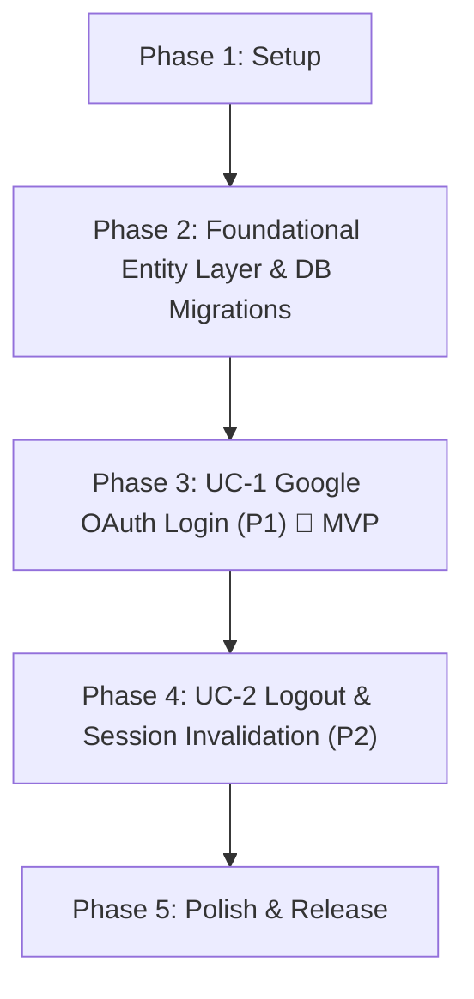

# Tasks: Google OAuth Login & Drive Access Authorization – ICONIX Implementation Plan

**Input**: Design documents from `/specs/001-google-oauth-login/`  
**Prerequisites**: `plan.md` (PDR & CDR Approved), `spec.md`, `research.md`, `data-model.md`, `contracts/auth-api.yaml`, `quickstart.md`  
**Methodology Reference**: Doug Rosenberg's ICONIX Process (BCE Architecture: Tests → Entity → Controller → Boundary)  

---

## Git Version Control Rules (Mandatory)
1. **Atomic Per-Task Commits**: After completing any implementation task and verifying its test, execute:  
   `git add <modified-files> && git commit -m "<type>(<scope>): <concise description>"`
2. **Major Checkpoint Commits**: At the conclusion of each Phase and upon completing each Use Case (ICONIX UC), execute the designated **Major Milestone Commit**.
3. **Commit Convention**: Follow Conventional Commits (`feat:`, `test:`, `refactor:`, `chore:`, `fix:`).

---

## Dependency Graph

---

## Phase 1: Setup & Environment Initialization

**Purpose**: Scaffolding directories, configurations, and dependencies.

- [X] T001 Initialize feature directory layout in `backend/src/auth/` and `frontend/src/app/` per plan.md
- [X] T002 Configure Python dependencies in `backend/requirements.txt` (`authlib`, `google-auth`, `cryptography`, `pydantic-settings`, `alembic`, `sqlmodel`, `pytest`, `httpx`) and JS dependencies in `frontend/package.json`
- [X] T003 [P] Create environment variable configuration templates in `backend/.env.example` and `frontend/.env.example`
- [X] T004 **Git Major Commit**: `git add . && git commit -m "chore(setup): scaffold google-oauth-login structure and configuration"`

---

## Phase 2: Foundational Entity Layer & Database Migrations

**Purpose**: Establish database schemas, entity models, and migration scripts required before use case controllers can run.

- [X] T005 Create Alembic migration script `backend/alembic/versions/001_auth_schema.py` enabling `vector` extension and creating `researchers`, `user_sessions`, and `oauth_credentials` tables with indexes
- [X] T006 Implement Entity SQLModel classes (`ResearcherAccount`, `UserSession`, `OAuthCredential`) in `backend/src/auth/models.py`
- [X] T007 [P] Implement base Repository database query methods in `backend/src/auth/repository.py`
- [X] T008 Run migration in test database environment (`alembic upgrade head`) and verify table creation
- [X] T009 **Git Major Commit**: `git add . && git commit -m "feat(core): implement database migrations and foundational entity models"`

**PDR Verification Checkpoint**: Entity models conform to Updated Domain Model in `plan.md`.

---

## Phase 3: Use Case 1 (UC-1) – Authenticate via Google OAuth & Authorize Drive Access (Priority: P1) 🎯 MVP

**Goal**: Peneliti dapat login menggunakan Google OAuth 2.0, menyetujui consent scope profil & Drive, dan mendapatkan sesi 24 jam aktif di dashboard aplikasi.  
**Independent Test**: `pytest backend/tests/test_auth_router.py -k "test_google_login"`

### Step 3.1: Unit & Integration Tests (TDD - Write First)
- [X] T010 [P] [UC1] Write unit tests for TokenEncryptionService (`encrypt_token` and `decrypt_token`) in `backend/tests/test_crypto_service.py`
- [X] T011 [P] [UC1] Write unit tests for GoogleOAuthService and SessionService in `backend/tests/test_auth_service.py`
- [X] T012 [P] [UC1] Write contract/integration tests for FastAPI auth router endpoints (`GET /auth/google/login`, `GET /auth/google/callback`, `GET /auth/me`) in `backend/tests/test_auth_router.py`
- [X] T013 [UC1] Verify tests FAIL prior to implementation (Red stage)
- [X] T014 [UC1] **Git Commit (Tests)**: `git add backend/tests/ && git commit -m "test(UC1): add failing test suite for Google OAuth login"`

### Step 3.2: Controller Layer (Business Logic & Encryption)
- [X] T015 [P] [UC1] Implement Pydantic DTO schemas (`GoogleProfileDTO`, `OAuthTokenDTO`, `ResearcherProfileResponse`, `ErrorResponse`) in `backend/src/auth/schemas.py`
- [X] T016 [P] [UC1] Implement `TokenEncryptionService` using Fernet/AES-256 symmetric encryption in `backend/src/auth/crypto_service.py`
- [X] T017 [UC1] Implement `GoogleOAuthService` for PKCE authorization URL generation and token exchange in `backend/src/auth/oauth_service.py`
- [X] T018 [UC1] Implement `SessionService` for issuing 24-hour session tokens in `backend/src/auth/session_service.py`
- [X] T019 [UC1] Implement `ResearcherService` for upserting researcher accounts and saving encrypted credentials in `backend/src/auth/researcher_service.py`
- [X] T020 [UC1] Verify unit tests pass (Green stage)
- [X] T021 [UC1] **Git Commit (Controller)**: `git add backend/src/auth/ && git commit -m "feat(UC1): implement controller services and encryption for OAuth"`

### Step 3.3: Boundary Layer (FastAPI API Router & Next.js Frontend)
- [ ] T022 [UC1] Implement FastAPI Router endpoints (`GET /auth/google/login`, `GET /auth/google/callback`, `GET /auth/me`) with `httpOnly`, `Secure`, `SameSite=Lax` cookies in `backend/src/auth/router.py`
- [ ] T023 [P] [UC1] Implement Landing/Login View (`SCR-01`) with "Login with Google" button in `frontend/src/app/page.tsx`
- [ ] T024 [P] [UC1] Implement Main Workspace Dashboard (`SCR-03`) displaying researcher profile and Drive connection status in `frontend/src/app/dashboard/page.tsx`
- [ ] T025 [P] [UC1] Implement Drive Access Warning & Consent Recovery Modal (`SCR-04`) for scope denial or expired token re-prompt in `frontend/src/components/DriveWarningModal.tsx`
- [ ] T026 [UC1] Implement API client fetch wrapper in `frontend/src/lib/api/auth.ts`
- [ ] T027 [UC1] Wire Next.js page components to backend API client and handle loading/error states

### Step 3.4: BCE Audit & Major Milestone Checkpoint
- [ ] T028 [UC1] **BCE Audit**: Confirm Next.js components & FastAPI Routers (Boundary) never query PostgreSQL tables (Entity) directly
- [ ] T029 [UC1] Run integration tests and confirm sunny-day login and rainy-day scope denial flows pass
- [ ] T030 [UC1] **Git Major Commit (Milestone)**: `git add . && git commit -m "feat(UC1): complete google-oauth-login use case end-to-end [MVP Milestone]"`

**Checkpoint**: Use Case 1 is fully functional and delivers an independently testable MVP.

---

## Phase 4: Use Case 2 (UC-2) – Terminate Session / Logout (Priority: P2)

**Goal**: Peneliti dapat keluar dari aplikasi (Logout), menginvalida sesi 24 jam di DB, dan membersihkan cookie peramban.  
**Independent Test**: `pytest backend/tests/test_auth_router.py -k "test_logout"`

### Step 4.1: Tests (TDD)
- [ ] T031 [P] [UC2] Write unit and integration tests for logout flow and session invalidation in `backend/tests/test_logout.py`
- [ ] T032 [UC2] **Git Commit (Tests)**: `git add backend/tests/ && git commit -m "test(UC2): add test suite for session logout"`

### Step 4.2: Controller & Boundary Implementation
- [ ] T033 [UC2] Implement `invalidate_session` method in `backend/src/auth/session_service.py`
- [ ] T034 [UC2] Implement `POST /auth/logout` endpoint in `backend/src/auth/router.py` clearing `paper_gen_session` cookie (`Max-Age=0`)
- [ ] T035 [P] [UC2] Wire "Logout" button on dashboard header in `frontend/src/app/dashboard/page.tsx` to `POST /auth/logout`
- [ ] T036 [UC2] **BCE Audit**: Confirm strict adherence to Boundary-Controller-Entity separation for logout flow
- [ ] T037 [UC2] **Git Major Commit (Milestone)**: `git add . && git commit -m "feat(UC2): complete logout use case end-to-end"`

---

## Phase 5: Verification, Documentation & Final Release

**Purpose**: Cross-cutting audit, full regression test, and release milestone.

- [ ] T038 Run complete backend `pytest` test suite and frontend `bun run build` check
- [ ] T039 Verify zero plaintext tokens in PostgreSQL database via query audit
- [ ] T040 [P] Update API documentation and OpenAPI spec in `specs/001-google-oauth-login/contracts/auth-api.yaml`
- [ ] T041 Code formatting (`black`/`ruff` for backend, `prettier` for frontend)
- [ ] T042 **Git Major Commit (Release)**: `git add . && git commit -m "chore(release): finalize google-oauth-login implementation, verification, and documentation"`
