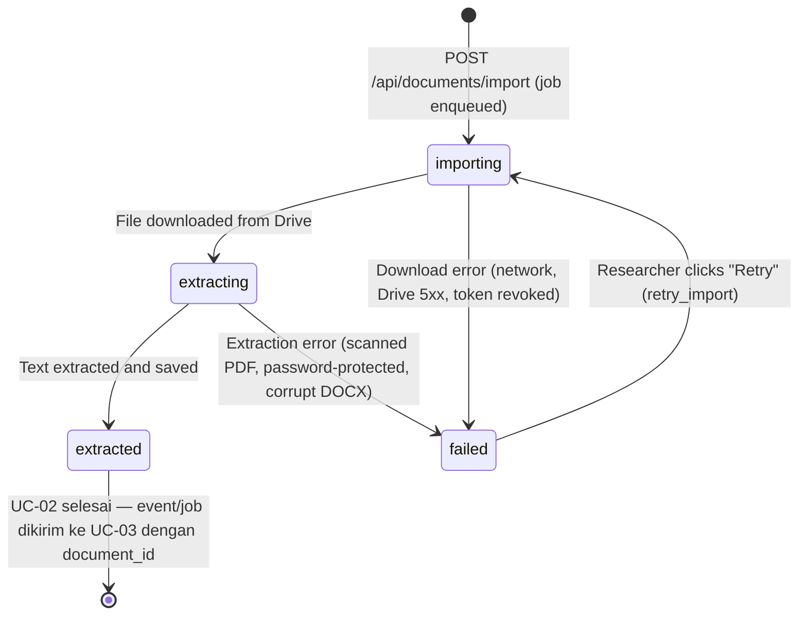

# Data Model: Google Drive Document Import (UC-02)

**Branch**: `002-drive-document-import` | **Date**: 2026-09-19
**Source**: [plan.md](plan.md) §2 — Updated Domain Model

---

## Tables

### `documents`

| Column | Type | Constraints | Notes |
|---|---|---|---|
| `id` | `UUID` | PK, default `gen_random_uuid()` | Primary key |
| `google_drive_id` | `VARCHAR(255)` | NOT NULL | Google Drive file ID — unique key for deduplication |
| `file_name` | `VARCHAR(500)` | NOT NULL | Original file name from Drive |
| `file_type` | `ENUM('pdf','docx')` | NOT NULL | Supported file types |
| `file_size_bytes` | `BIGINT` | NULLABLE | File size in bytes from Drive metadata |
| `drive_modified_at` | `TIMESTAMPTZ` | NULLABLE | `modifiedTime` from Drive API |
| `drive_md5_checksum` | `VARCHAR(64)` | NULLABLE | `md5Checksum` from Drive API — content change detection |
| `import_status` | `ENUM('importing','extracting','extracted','failed')` | NOT NULL, default `'importing'` | Import pipeline state machine |
| `failure_reason` | `TEXT` | NULLABLE | Human-readable error message if failed |
| `imported_at` | `TIMESTAMPTZ` | NOT NULL, default `NOW()` | Timestamp when import was initiated |
| `extracted_at` | `TIMESTAMPTZ` | NULLABLE | Timestamp when text extraction succeeded |
| `researcher_id` | `UUID` | NOT NULL, FK → `researchers.id` | Document owner (references `researchers` table from UC-01) |
| `created_at` | `TIMESTAMPTZ` | NOT NULL, default `NOW()` | Audit timestamp |
| `updated_at` | `TIMESTAMPTZ` | NOT NULL, default `NOW()` | Auto-update on write |

**Indexes**:
```sql
CREATE UNIQUE INDEX uq_documents_drive_id_researcher ON documents (google_drive_id, researcher_id);
CREATE INDEX idx_documents_researcher_id ON documents (researcher_id);
CREATE INDEX idx_documents_import_status ON documents (import_status);
```

**Constraints**:
- `(google_drive_id, researcher_id)` UNIQUE — a researcher cannot import the same Drive file twice without a force-reimport confirmation.
- `failure_reason` is only populated when `import_status = 'failed'`.

---

### `extracted_texts`

| Column | Type | Constraints | Notes |
|---|---|---|---|
| `id` | `UUID` | PK, default `gen_random_uuid()` | Primary key |
| `document_id` | `UUID` | NOT NULL, FK → `documents.id` ON DELETE CASCADE, UNIQUE | Exactly one active extraction per document |
| `full_text` | `TEXT` | NOT NULL | Complete concatenated text content (input for UC-03) |
| `total_pages` | `INTEGER` | NOT NULL | Total page count (PDF) or total section count (DOCX) |
| `extracted_at` | `TIMESTAMPTZ` | NOT NULL, default `NOW()` | Extraction timestamp |

**Indexes**:
```sql
CREATE UNIQUE INDEX uq_extracted_texts_document ON extracted_texts (document_id);
```

---

### `extracted_pages`

| Column | Type | Constraints | Notes |
|---|---|---|---|
| `id` | `UUID` | PK, default `gen_random_uuid()` | Primary key |
| `extracted_text_id` | `UUID` | NOT NULL, FK → `extracted_texts.id` ON DELETE CASCADE | Parent extraction record |
| `page_number` | `INTEGER` | NOT NULL | Physical page number (1-indexed for PDF) or section order (DOCX) |
| `content` | `TEXT` | NOT NULL | Text content for this specific page or section |

**Indexes**:
```sql
CREATE INDEX idx_extracted_pages_text_id ON extracted_pages (extracted_text_id);
CREATE UNIQUE INDEX uq_extracted_pages_number ON extracted_pages (extracted_text_id, page_number);
```

> `ExtractedPage` menyimpan teks per halaman (PDF) atau per seksi (DOCX) sebagai unit granularitas dari hasil ekstraksi UC-02. Setiap baris dikirim ke UC-03 (Document Indexing and Local Embedding) sebagai bagian dari `document_id` — UC-03 menentukan strategi chunking dan embedding secara mandiri menggunakan model lokal.

---

## State Machine: `documents.import_status`



**Catatan Boundary**: Status `extracted` adalah **terminal state UC-02**. Setelah state ini, sistem mengirim event ke UC-03 (Document Indexing and Local Embedding). Proses selanjutnya (cleaning, chunking, generate embedding lokal, penyimpanan vector ke pgvector, similarity search) adalah tanggung jawab eksklusif UC-03 dan **tidak** tercakup dalam state machine ini.

**Retry Policy**:
- `failed` from transient errors (Drive API 5xx, network timeout): ARQ `max_tries=3` with exponential backoff.
- `failed` from permanent errors (scanned PDF, encrypted PDF, file not found, token revoked): ARQ `max_tries=1` — no automatic retry. Researcher must resolve the underlying issue and trigger retry manually.

---

## Alembic Migration

File: `backend/alembic/versions/002_document_import_schema.py`

```python
"""UC-02: Document import schema — documents, extracted_texts, extracted_pages tables

Revision ID: 002
Revises: 001
Create Date: 2026-09-19
"""

def upgrade():
    # 1. Create ENUM types
    op.execute("CREATE TYPE import_status AS ENUM ('importing', 'extracting', 'extracted', 'failed')")
    op.execute("CREATE TYPE file_type AS ENUM ('pdf', 'docx')")

    # 2. Create documents table
    op.create_table(
        'documents',
        sa.Column('id', sa.UUID(), server_default=sa.text('gen_random_uuid()'), nullable=False),
        sa.Column('google_drive_id', sa.String(length=255), nullable=False),
        sa.Column('file_name', sa.String(length=500), nullable=False),
        sa.Column('file_type', sa.Enum('pdf', 'docx', name='file_type'), nullable=False),
        sa.Column('file_size_bytes', sa.BigInteger(), nullable=True),
        sa.Column('drive_modified_at', sa.DateTime(timezone=True), nullable=True),
        sa.Column('drive_md5_checksum', sa.String(length=64), nullable=True),
        sa.Column('import_status', sa.Enum('importing', 'extracting', 'extracted', 'failed', name='import_status'), server_default='importing', nullable=False),
        sa.Column('failure_reason', sa.Text(), nullable=True),
        sa.Column('imported_at', sa.DateTime(timezone=True), server_default=sa.text('now()'), nullable=False),
        sa.Column('extracted_at', sa.DateTime(timezone=True), nullable=True),
        sa.Column('researcher_id', sa.UUID(), nullable=False),
        sa.Column('created_at', sa.DateTime(timezone=True), server_default=sa.text('now()'), nullable=False),
        sa.Column('updated_at', sa.DateTime(timezone=True), server_default=sa.text('now()'), nullable=False),
        sa.ForeignKeyConstraint(['researcher_id'], ['researchers.id'], ondelete='CASCADE'),
        sa.PrimaryKeyConstraint('id')
    )

    # 3. Create extracted_texts table
    op.create_table(
        'extracted_texts',
        sa.Column('id', sa.UUID(), server_default=sa.text('gen_random_uuid()'), nullable=False),
        sa.Column('document_id', sa.UUID(), nullable=False),
        sa.Column('full_text', sa.Text(), nullable=False),
        sa.Column('total_pages', sa.Integer(), nullable=False),
        sa.Column('extracted_at', sa.DateTime(timezone=True), server_default=sa.text('now()'), nullable=False),
        sa.ForeignKeyConstraint(['document_id'], ['documents.id'], ondelete='CASCADE'),
        sa.PrimaryKeyConstraint('id'),
        sa.UniqueConstraint('document_id', name='uq_extracted_texts_document')
    )

    # 4. Create extracted_pages table
    op.create_table(
        'extracted_pages',
        sa.Column('id', sa.UUID(), server_default=sa.text('gen_random_uuid()'), nullable=False),
        sa.Column('extracted_text_id', sa.UUID(), nullable=False),
        sa.Column('page_number', sa.Integer(), nullable=False),
        sa.Column('content', sa.Text(), nullable=False),
        sa.ForeignKeyConstraint(['extracted_text_id'], ['extracted_texts.id'], ondelete='CASCADE'),
        sa.PrimaryKeyConstraint('id')
    )

    # 5. Create indexes
    op.create_index('uq_documents_drive_id_researcher', 'documents', ['google_drive_id', 'researcher_id'], unique=True)
    op.create_index('idx_documents_researcher_id', 'documents', ['researcher_id'])
    op.create_index('idx_documents_import_status', 'documents', ['import_status'])
    op.create_index('idx_extracted_pages_text_id', 'extracted_pages', ['extracted_text_id'])
    op.create_index('uq_extracted_pages_number', 'extracted_pages', ['extracted_text_id', 'page_number'], unique=True)

def downgrade():
    op.drop_table('extracted_pages')
    op.drop_table('extracted_texts')
    op.drop_table('documents')
    op.execute("DROP TYPE import_status")
    op.execute("DROP TYPE file_type")
```
