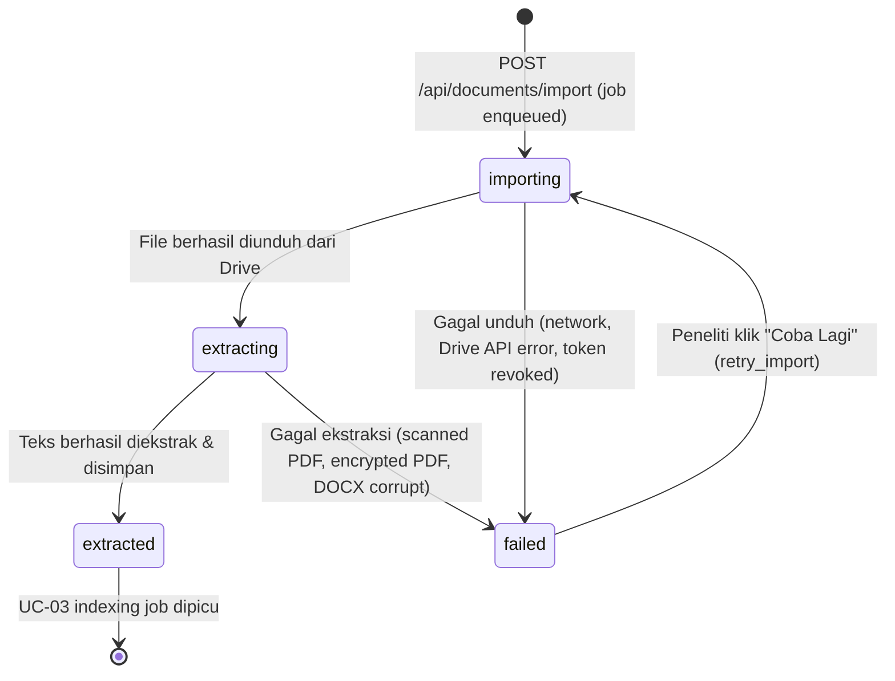

# Data Model: Google Drive Document Import (UC-02)

**Branch**: `002-drive-document-import` | **Date**: 2026-09-19
**Source**: [plan.md](plan.md) §2 — Updated Domain Model

---

## Tables

### `dokumen`

| Column | Type | Constraints | Notes |
|---|---|---|---|
| `id` | `UUID` | PK, default `gen_random_uuid()` | |
| `google_drive_id` | `VARCHAR(255)` | NOT NULL | Google Drive file ID — kunci deduplication |
| `nama_file` | `VARCHAR(500)` | NOT NULL | Nama file asli dari Drive |
| `tipe_file` | `ENUM('pdf','docx')` | NOT NULL | Tipe file yang didukung |
| `ukuran_file_bytes` | `BIGINT` | NULLABLE | Ukuran file dari Drive metadata |
| `tanggal_modifikasi_drive` | `TIMESTAMPTZ` | NULLABLE | `modifiedTime` dari Drive API |
| `md5_checksum_drive` | `VARCHAR(64)` | NULLABLE | `md5Checksum` dari Drive API — untuk deteksi perubahan konten |
| `status_import` | `ENUM('importing','extracting','extracted','failed')` | NOT NULL, default `'importing'` | State machine pipeline import |
| `alasan_gagal` | `TEXT` | NULLABLE | Pesan error yang dapat dibaca peneliti |
| `waktu_import` | `TIMESTAMPTZ` | NOT NULL, default `NOW()` | Waktu pertama kali import dimulai |
| `waktu_ekstraksi_selesai` | `TIMESTAMPTZ` | NULLABLE | Waktu ekstraksi teks berhasil selesai |
| `peneliti_id` | `UUID` | NOT NULL, FK → `peneliti.id` | Pemilik dokumen |
| `created_at` | `TIMESTAMPTZ` | NOT NULL, default `NOW()` | |
| `updated_at` | `TIMESTAMPTZ` | NOT NULL, default `NOW()` | Auto-update on write |

**Indexes**:
```sql
CREATE UNIQUE INDEX uq_dokumen_drive_id_peneliti ON dokumen (google_drive_id, peneliti_id);
CREATE INDEX idx_dokumen_peneliti_id ON dokumen (peneliti_id);
CREATE INDEX idx_dokumen_status_import ON dokumen (status_import);
```

**Constraints**:
- `(google_drive_id, peneliti_id)` UNIQUE — satu peneliti tidak bisa mengimpor file Drive yang sama dua kali tanpa konfirmasi override.
- `alasan_gagal` hanya terisi ketika `status_import = 'failed'`.

---

### `teks_ekstraksi`

| Column | Type | Constraints | Notes |
|---|---|---|---|
| `id` | `UUID` | PK, default `gen_random_uuid()` | |
| `dokumen_id` | `UUID` | NOT NULL, FK → `dokumen.id` ON DELETE CASCADE, UNIQUE | Satu dokumen → satu ekstraksi aktif |
| `konten_teks_penuh` | `TEXT` | NOT NULL | Seluruh teks dokumen digabung (input untuk UC-03) |
| `total_halaman` | `INTEGER` | NOT NULL | Jumlah halaman (PDF) atau seksi (DOCX) |
| `waktu_ekstraksi` | `TIMESTAMPTZ` | NOT NULL, default `NOW()` | |

**Indexes**:
```sql
CREATE UNIQUE INDEX uq_teks_ekstraksi_dokumen ON teks_ekstraksi (dokumen_id);
```

---

### `halaman_ekstraksi`

| Column | Type | Constraints | Notes |
|---|---|---|---|
| `id` | `UUID` | PK, default `gen_random_uuid()` | |
| `teks_ekstraksi_id` | `UUID` | NOT NULL, FK → `teks_ekstraksi.id` ON DELETE CASCADE | |
| `nomor_halaman` | `INTEGER` | NOT NULL | Nomor halaman (1-indexed untuk PDF); urutan paragraf/seksi untuk DOCX |
| `konten_halaman` | `TEXT` | NOT NULL | Teks halaman/seksi ini |

**Indexes**:
```sql
CREATE INDEX idx_halaman_teks_id ON halaman_ekstraksi (teks_ekstraksi_id);
CREATE UNIQUE INDEX uq_halaman_nomor ON halaman_ekstraksi (teks_ekstraksi_id, nomor_halaman);
```

> `HalamanEkstraksi` adalah unit granularity untuk UC-03 — setiap baris ini menjadi kandidat chunk dengan metadata `nomor_halaman` yang memungkinkan keterlacakan sitasi.

---

## State Machine: `dokumen.status_import`



**Retry Policy**:
- `failed` dari error transient (Drive API 5xx, network timeout): ARQ `max_tries=3` dengan exponential backoff.
- `failed` dari error permanen (scanned PDF, PDF terenkripsi, file tidak ditemukan di Drive, token revoked): ARQ `max_tries=1` — tidak diretry otomatis. Peneliti harus memicu ulang secara manual setelah menyelesaikan penyebab masalah.

---

## Alembic Migration

File: `backend/alembic/versions/002_document_import_schema.py`

```python
"""UC-02: Document import schema — dokumen, teks_ekstraksi, halaman_ekstraksi tables

Revision ID: 002
Revises: 001
Create Date: 2026-09-19
"""

def upgrade():
    # 1. Create ENUM types
    op.execute("CREATE TYPE import_status AS ENUM ('importing', 'extracting', 'extracted', 'failed')")
    op.execute("CREATE TYPE file_type AS ENUM ('pdf', 'docx')")

    # 2. Create dokumen table
    op.create_table('dokumen', ...)

    # 3. Create teks_ekstraksi table
    op.create_table('teks_ekstraksi', ...)

    # 4. Create halaman_ekstraksi table
    op.create_table('halaman_ekstraksi', ...)

    # 5. Create indexes
    op.create_index('uq_dokumen_drive_id_peneliti', 'dokumen', ['google_drive_id', 'peneliti_id'], unique=True)
    op.create_index('idx_dokumen_peneliti_id', 'dokumen', ['peneliti_id'])
    op.create_index('idx_dokumen_status_import', 'dokumen', ['status_import'])
    op.create_index('uq_teks_ekstraksi_dokumen', 'teks_ekstraksi', ['dokumen_id'], unique=True)
    op.create_index('idx_halaman_teks_id', 'halaman_ekstraksi', ['teks_ekstraksi_id'])
    op.create_index('uq_halaman_nomor', 'halaman_ekstraksi', ['teks_ekstraksi_id', 'nomor_halaman'], unique=True)

def downgrade():
    op.drop_table('halaman_ekstraksi')
    op.drop_table('teks_ekstraksi')
    op.drop_table('dokumen')
    op.execute("DROP TYPE import_status")
    op.execute("DROP TYPE file_type")
```
