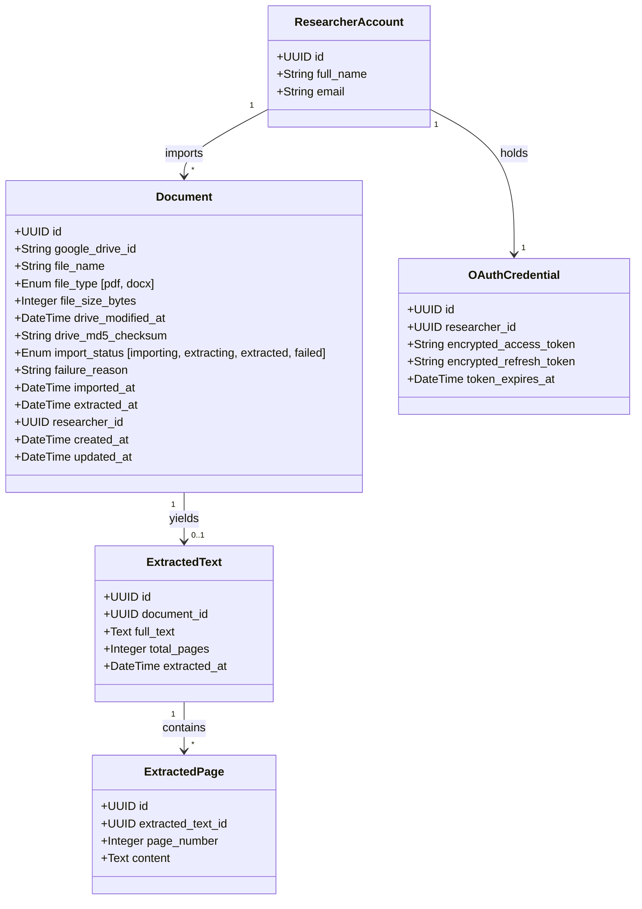
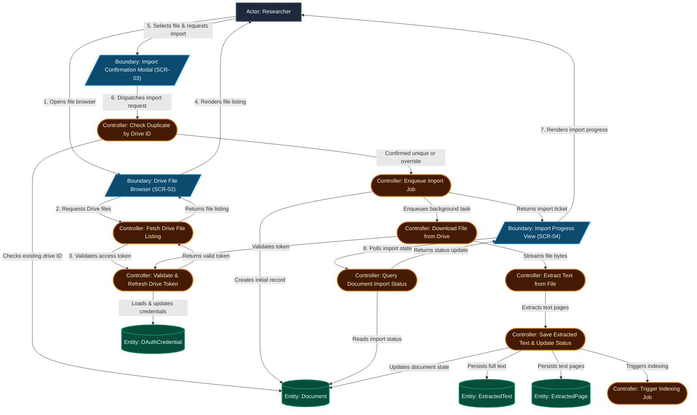
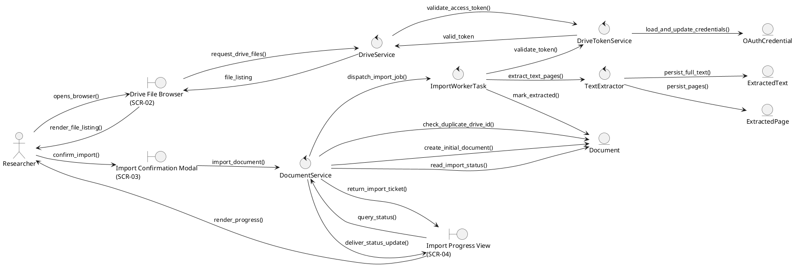
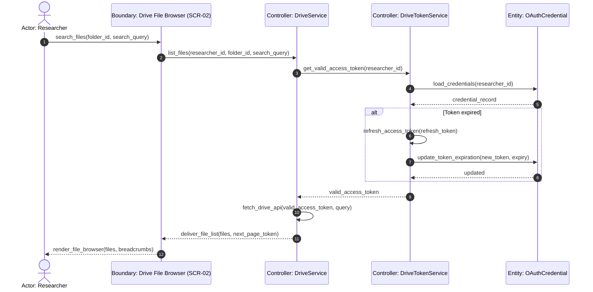
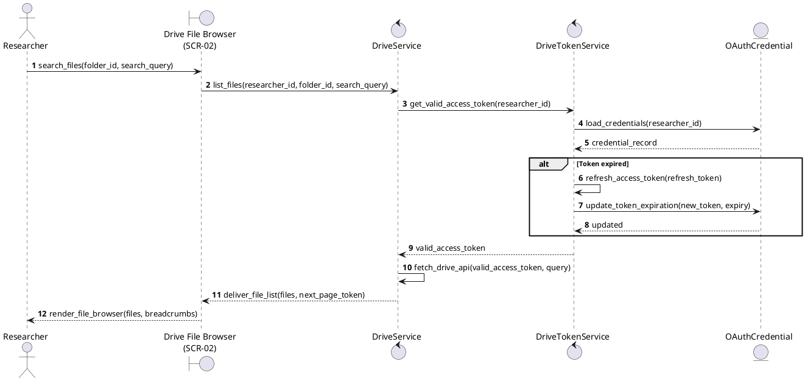
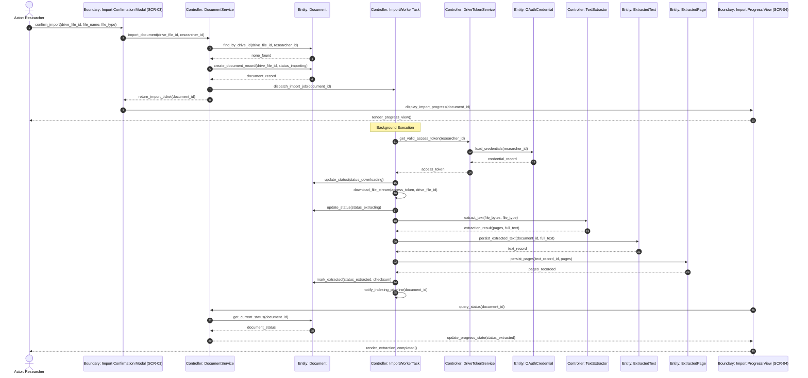
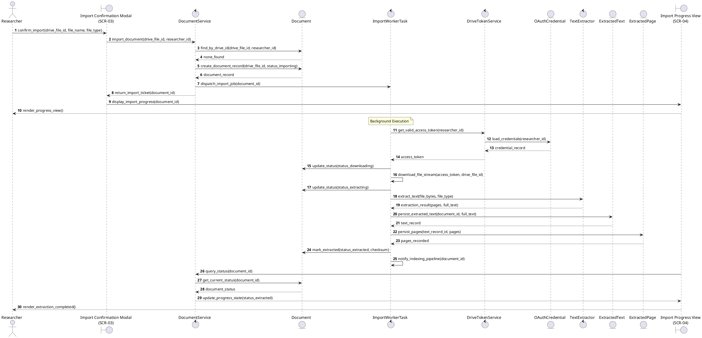
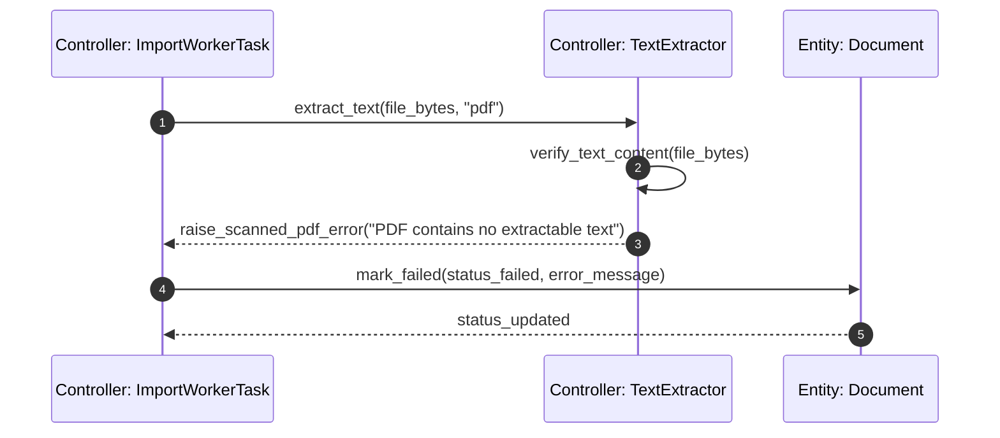
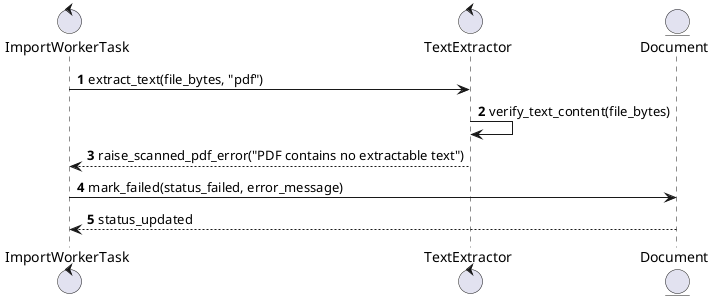
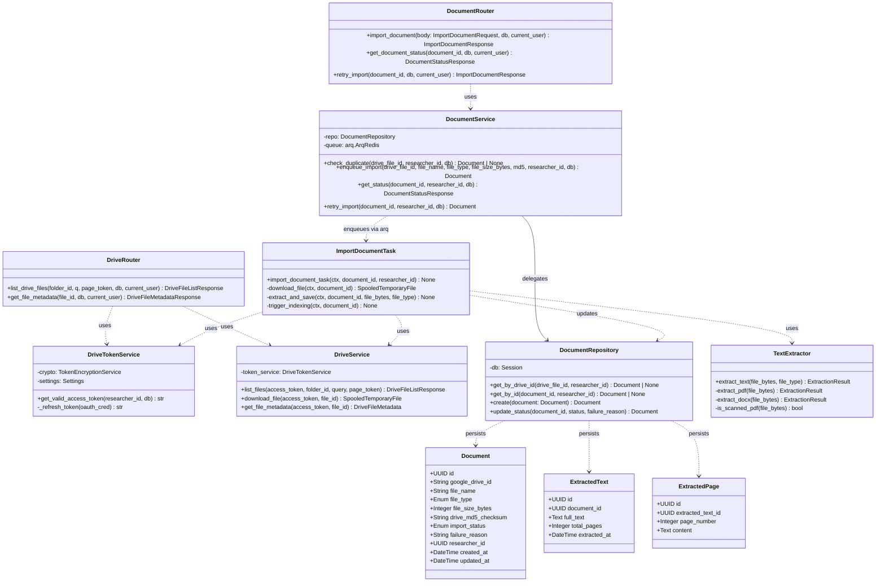

# Technical Plan: UC-02 Google Drive Connection and Document Import – ICONIX Process

**Branch**: `002-drive-document-import` | **Date**: 2026-09-19 | **Spec**: [spec.md](spec.md)
**Input**: Feature specification from `specs/002-drive-document-import/spec.md`
**Methodology Reference**: Doug Rosenberg & Matt Stephens, *Use Case Driven Object Modeling with UML*

---

## 1. System Architecture & Technical Context

- **Frontend Layer**: Next.js App Router (TypeScript), Tailwind CSS, shadcn/ui, `@phosphor-icons/react`, Bun runtime
- **Backend Layer**: FastAPI (Python 3.12), Pydantic v2, SQLModel / SQLAlchemy ORM
- **Persistence**: PostgreSQL (psycopg2-binary sync for FastAPI; asyncpg for ARQ worker)
- **Queue & Cache**: Redis (ARQ job queue)
- **Architectural Pattern**: **Router (Boundary) → Service (Controller) → Repository/Model (Entity)**
- **New Dependencies (from research.md)**:
  - `google-api-python-client>=2.120.0` — Drive API v3 file listing & download
  - `google-auth>=2.29.0`, `google-auth-httplib2>=0.2.0` — silent token refresh
  - `pdfplumber>=0.11.0` — PDF text extraction (MIT license)
  - `python-docx>=1.1.0` — DOCX text extraction
  - `arq>=0.25.0` — async background job queue (import + extraction pipeline)
  - `asyncpg>=0.29.0` — async DB driver for ARQ worker

---

## 2. Updated Domain Model



- **Document**: Main imported unit. `google_drive_id` serves as unique key for deduplication (Alt-3). `drive_md5_checksum` detects content modification. `import_status` follows state machine: `importing → extracting → extracted | failed`.
- **ExtractedText**: Complete text extraction result, decoupled from document metadata for re-extraction flexibility. Produced by UC-02 as output data; UC-03 (Document Indexing and Local Embedding) reads it via `document_id` reference.
- **ExtractedPage**: Page-level (PDF) or section-level (DOCX) text records produced by UC-02 extraction. Preserves `page_number` for citation traceability. UC-03 determines its own chunking and embedding strategy independently using a local embedding model.
- **OAuthCredential**: Existing auth entity — used for silent token refresh during Drive download.
- **Associations**: `Document.researcher_id` → FK to `researchers.id`. `ExtractedText.document_id` → FK to `documents.id` (UNIQUE constraint — one active extraction per document). `ExtractedPage.extracted_text_id` → FK to `extracted_texts.id`.
- **Database Migrations**: Alembic migration for `documents`, `extracted_texts`, and `extracted_pages` tables with indexes on `google_drive_id`, `researcher_id`, and `import_status`.

---

## 3. ICONIX Robustness Analysis (Preliminary Design)

### Robustness Diagram: UC-02: Google Drive Connection and Document Import



<details>
<summary><b>Canonical PlantUML: UC-02 Robustness Diagram (Native BCE Icons)</b></summary>


</details>

### Boundary-Controller-Entity (BCE) Inventory & Method Allocation

| BCE Type | Element Name | Responsibility / Concrete Implementation |
|---|---|---|
| **Boundary** | `Drive File Browser (SCR-02)` | Frontend Page (`frontend/src/app/library/drive-browser/page.tsx`). |
| **Boundary** | `Import Confirmation Modal (SCR-03)` | Frontend Dialog Component (`frontend/src/components/features/drive/ImportConfirmModal.tsx`). |
| **Boundary** | `Import Progress View (SCR-04)` | Frontend Status Component (`frontend/src/components/features/drive/ImportProgress.tsx`). |
| **Controller** | `Validate & Refresh Drive Token` | `DriveTokenService.get_valid_access_token()` |
| **Controller** | `Fetch Drive File Listing` | `DriveService.list_files()` |
| **Controller** | `Check Duplicate by Drive ID` | `DocumentService.check_duplicate()` |
| **Controller** | `Enqueue Import Job` | `DocumentService.enqueue_import()` |
| **Controller** | `Download File from Drive` | `import_document_task.download_file()` |
| **Controller** | `Extract Text from File` | `TextExtractor.extract_text()` |
| **Controller** | `Save Extracted Text & Update Status` | `import_document_task.save_extraction()` |
| **Controller** | `Trigger Indexing Job` | `import_document_task.enqueue_indexing()` |
| **Controller** | `Query Document Import Status` | `DocumentService.get_document_status()` |
| **Entity** | `Document` | Domain entity model persisten (`backend/src/documents/models.py`). |
| **Entity** | `ExtractedText` | Domain entity model persisten (`backend/src/documents/models.py`). |
| **Entity** | `ExtractedPage` | Domain entity model persisten (`backend/src/documents/models.py`). |
| **Entity** | `OAuthCredential` | Domain entity model persisten (`backend/src/auth/models.py`). |

### BCE Rule Compliance Audit (Doug Rosenberg Rules)

- [x] **Rule 1 (Actors → Boundaries only)**: Researchers interact exclusively with Client UI (`Drive File Browser`, `Import Confirmation Modal`, and `Import Progress View`).
- [x] **Rule 2 (Boundaries → Controllers & Actors only)**: UI boundaries dispatch directly to application controllers. Zero direct link to Entity.
- [x] **Rule 3 (Entities → Controllers only)**: `Document`, `ExtractedText`, `ExtractedPage`, and `OAuthCredential` are accessed and mutated exclusively via Controllers.
- [x] **Rule 4 (Controllers → Boundaries, Entities, Controllers; not Actors)**: Controllers communicate with Boundaries to render results to Actors.
- [x] **Zero Direct Boundary-to-Entity Links**: Confirmed no direct link exists between UI boundaries and Entity models.

---

## 4. Preliminary Design Review (PDR) Checkpoint Gate

| PDR Criteria | Status | Evidence / Notes |
|---|:---:|---|
| **1. Use Case Coverage** | ✅ PASS | All sunny-day and alternate steps are accounted for in robustness analysis. |
| **2. Alternate Courses Handled** | ✅ PASS | Alt-1 (token expired) → `C_REFRESH_TOKEN`; Alt-3 (duplicate) → `C_CHECK_DUPLICATE`; Alt-4 (download fail) → `C_DOWNLOAD` error path; Alt-5 (scanned PDF) → `C_EXTRACT_TEXT` error path. |
| **3. Domain Model Updated** | ✅ PASS | `ExtractedPage` added for citation traceability. Models match database schema. |
| **4. Strict BCE Adherence** | ✅ PASS | Zero direct Boundary-to-Entity links. Boundaries are pure Client UI. |

*GATE STATUS*: **✅ APPROVED TO PROCEED TO DETAILED DESIGN**

---

## 5. Detailed Design: Sequence Diagrams (Behavior Allocation)

### Sequence Diagram: UC-02a: Browse and Search Drive Files



<details>
<summary><b>Canonical PlantUML: UC-02a Sequence Diagram (Native BCE Lifeline Icons)</b></summary>


</details>

### Sequence Diagram: UC-02: Import and Extract Document (Happy Path)



<details>
<summary><b>Canonical PlantUML: UC-02 Sequence Diagram (Happy Path) (Native BCE Lifeline Icons)</b></summary>


</details>

### Sequence Diagram: UC-02 — Import Failure (Scanned PDF)



<details>
<summary><b>Canonical PlantUML: UC-02 Sequence Diagram (Failure Path)</b></summary>


</details>

---

## 6. Detailed Design: Static Class Model



### Concrete File & Method Signatures

**Backend structure** (`backend/src/`):
```
drive/
  router.py          → GET /api/drive/files, GET /api/drive/files/{file_id}
  drive_service.py   → DriveService.list_files(), .download_file(), .get_file_metadata()
  token_service.py   → DriveTokenService.get_valid_access_token()
  schemas.py         → DriveFileListResponse, DriveFileMetadata, DriveFileMetadataResponse

documents/
  router.py          → POST /api/documents/import, GET /api/documents/{id}/status, POST /api/documents/{id}/retry
  service.py         → DocumentService.check_duplicate(), .enqueue_import(), .get_status(), .retry_import()
  repository.py      → DocumentRepository (CRUD)
  models.py          → Document, ExtractedText, ExtractedPage (SQLModel)
  extractor.py       → TextExtractor.extract_text(), is_scanned_pdf()
  schemas.py         → ImportDocumentRequest, ImportDocumentResponse, DocumentStatusResponse

workers/
  import_task.py     → import_document_task(ctx, document_id, researcher_id) [ARQ task]
  worker.py          → ARQ WorkerSettings, redis pool, task registry

alembic/versions/
  002_document_import_schema.py   → CREATE TABLE documents, extracted_texts, extracted_pages + indexes
```

**Frontend structure** (`frontend/src/`):
```
app/library/
  page.tsx                        → SCR-01: Library / Document List
  drive-browser/page.tsx          → SCR-02: Drive File Browser

components/features/drive/
  DriveBrowser.tsx                → Folder navigation, file list, search, filter PDF/DOCX
  DriveFileRow.tsx                → Single file row with type badge and select action
  ImportConfirmModal.tsx          → SCR-03: Import Confirmation Dialog
  ImportProgress.tsx              → SCR-04: Import progress with status polling
  DriveFileIcon.tsx               → @phosphor-icons/react — FilePdf, FileDoc, Folder icons

hooks/
  useDriveFiles.ts                → React Query hook: GET /api/drive/files
  useDocumentStatus.ts            → React Query polling hook: GET /api/documents/{id}/status (3s interval)
  useImportDocument.ts            → React Query mutation: POST /api/documents/import
```

---

## 7. Critical Design Review (CDR) Checkpoint Gate

| CDR Criteria | Status | Evidence / Notes |
|---|:---:|---|
| **1. Method Allocation** | ✅ PASS | Every message in sequence diagrams maps to a concrete class method. |
| **2. Class Signatures** | ✅ PASS | Parameter types, return types defined in class models. Exception types (`ScannedPDFError`, `EncryptedPDFError`, `google.auth.exceptions.RefreshError`) documented. |
| **3. Test Plan Feasibility** | ✅ PASS | All controller methods and boundary endpoints are unit-testable. |
| **4. PDR Traceability** | ✅ PASS | All 8 controllers from robustness diagrams map to class methods. |

*GATE STATUS*: **✅ APPROVED TO PROCEED TO IMPLEMENTATION**

---

## 8. Version Control & Git Milestone Plan

| Milestone / Phase | Scope / Layer | Commit Type & Message | Verification Required |
|---|---|---|---|
| **Phase 1: Setup** | DB schema + ARQ infra | `feat(core): add document import schema migrations and ARQ worker setup` | Migration up/down passes; `arq worker` starts without error |
| **Phase 2: Drive API** | DriveService + token refresh | `feat(drive): implement Drive file listing, search, and token refresh service` | `DriveService.list_files()` returns paginated results with mock token |
| **Phase 3: File Browser UI** | SCR-02 frontend | `feat(UC-02a): implement Drive file browser with folder navigation and search` | Browser renders folder structure; only PDF/DOCX selectable |
| **Phase 4: Import Pipeline** | POST /import + ARQ task | `feat(UC-02): implement document import endpoint and ARQ extraction worker` | Import completes end-to-end; `ExtractedText` + `ExtractedPage` saved |
| **Phase 5: Progress & Retry UI** | SCR-03, SCR-04 frontend | `feat(UC-02): add import confirmation modal, progress view, and retry flow` | Status polling works; failed state shows error + retry button |
| **Phase 6: UC-03 Trigger** | ARQ → indexing queue | `feat(UC-02): trigger UC-03 indexing job on extraction completion` | After `extracted`, ARQ job `index_document_task` enqueued with correct `document_id` (verified via worker test T032) |
| **Phase 7: Release** | Tests + docs | `chore(release): complete UC-02 Drive import verification and documentation` | Full test suite green; quickstart.md validated |
