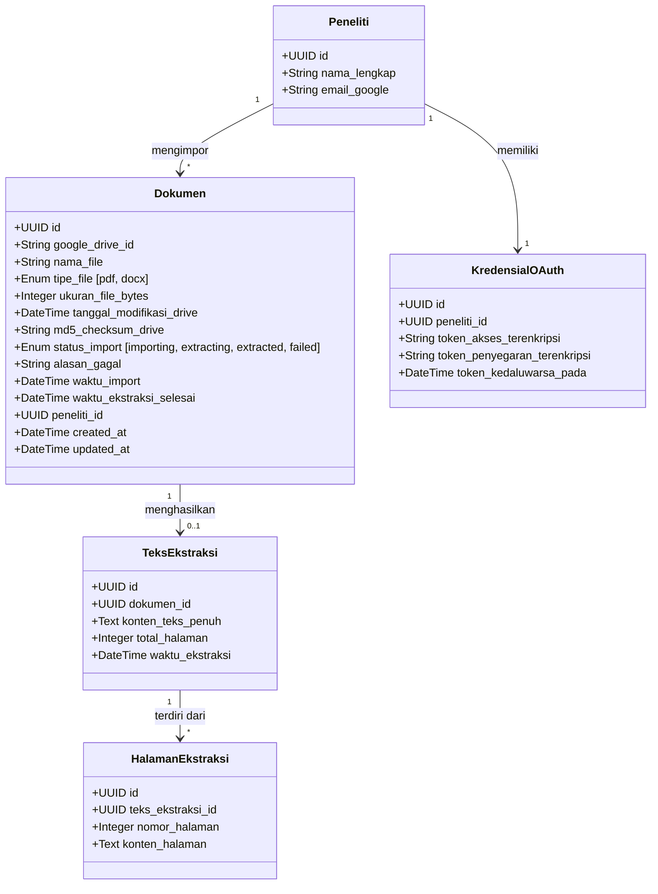
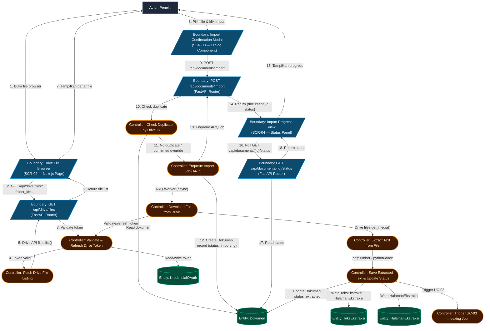
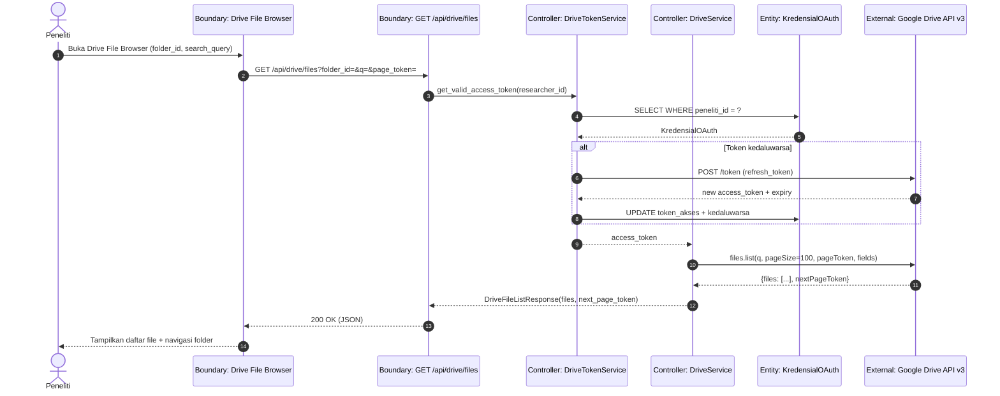
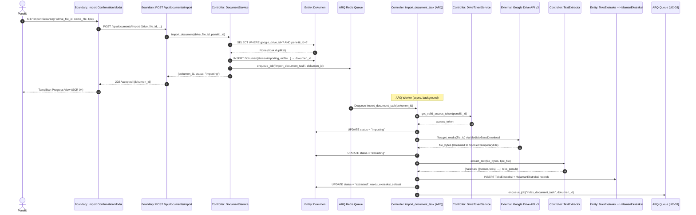
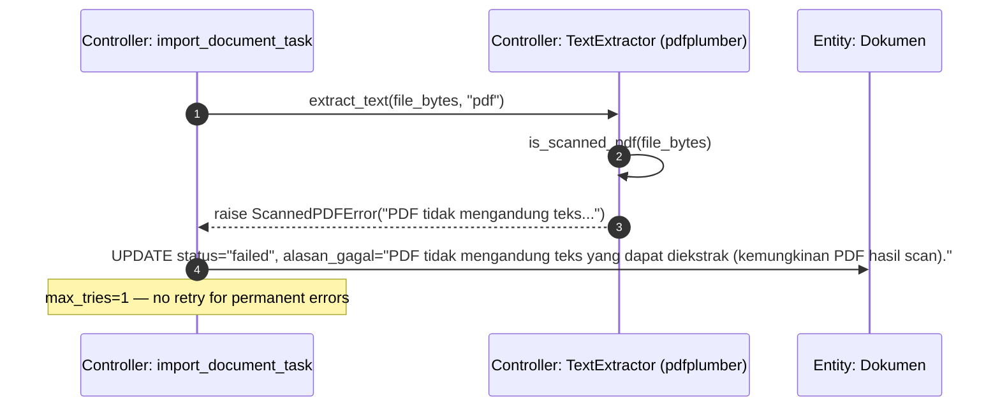
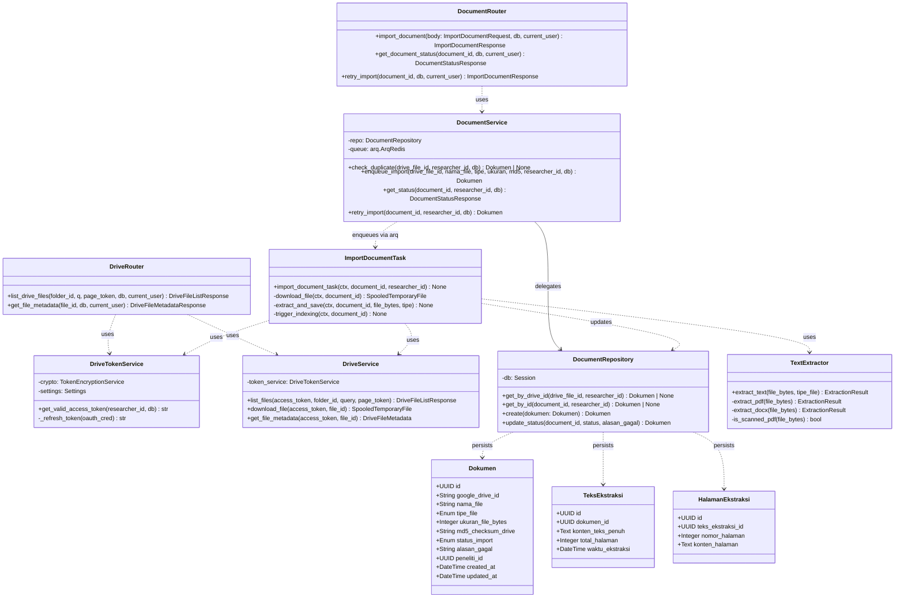

# Technical Plan: Google Drive Document Import (UC-02) – ICONIX Process

**Branch**: `002-drive-document-import` | **Date**: 2026-09-19 | **Spec**: [spec.md](spec.md)
**Input**: Feature specification from `specs/002-drive-document-import/spec.md`
**Methodology Reference**: Doug Rosenberg & Matt Stephens, *Use Case Driven Object Modeling with UML*

---

## 1. System Architecture & Technical Context

- **Frontend Layer**: Next.js App Router (TypeScript), Tailwind CSS, shadcn/ui, `@phosphor-icons/react`, Bun runtime
- **Backend Layer**: FastAPI (Python 3.12), Pydantic v2, SQLModel / SQLAlchemy ORM
- **Persistence**: PostgreSQL (psycopg2-binary sync for FastAPI; asyncpg for ARQ worker)
- **Queue & Cache**: Redis (ARQ job queue)
- **Architectural Pattern**: **Router (Boundary) → Service (Controller) → Repository/Model (Entity)**
- **New Dependencies (from research.md)**:
  - `google-api-python-client>=2.120.0` — Drive API v3 file listing & download
  - `google-auth>=2.29.0`, `google-auth-httplib2>=0.2.0` — silent token refresh
  - `pdfplumber>=0.11.0` — PDF text extraction (MIT license)
  - `python-docx>=1.1.0` — DOCX text extraction
  - `arq>=0.25.0` — async background job queue (import + extraction pipeline)
  - `asyncpg>=0.29.0` — async DB driver for ARQ worker

---

## 2. Updated Domain Model



- **Dokumen**: Unit import utama. `google_drive_id` adalah kunci unik untuk deduplication (Alt-3). `md5_checksum_drive` digunakan untuk deteksi perubahan konten. `status_import` mengikuti state machine: `importing → extracting → extracted → failed`.
- **TeksEkstraksi**: Teks hasil ekstraksi keseluruhan, terpisah dari metadata dokumen untuk fleksibilitas re-ekstraksi. Menjadi input langsung bagi UC-03 pipeline.
- **HalamanEkstraksi**: Teks per halaman (PDF) atau per seksi (DOCX), menyimpan `nomor_halaman` untuk keterlacakan sitasi ilmiah yang dibutuhkan UC-03.
- **KredensialOAuth**: Sudah ada — digunakan untuk token refresh saat download Drive.
- **Associations**: `Dokumen.peneliti_id` → FK ke `Peneliti.id`. `TeksEkstraksi.dokumen_id` → FK ke `Dokumen.id` (UNIQUE constraint — satu dokumen satu ekstraksi aktif). `HalamanEkstraksi.teks_ekstraksi_id` → FK ke `TeksEkstraksi.id`.
- **Database Migrations**: Alembic migration baru untuk tabel `dokumen`, `teks_ekstraksi`, `halaman_ekstraksi`. Index pada `dokumen.google_drive_id`, `dokumen.peneliti_id`, `dokumen.status_import`.

---

## 3. ICONIX Robustness Analysis (Preliminary Design)

### Robustness Diagram: UC-02 — Import Dokumen dari Google Drive



### Boundary-Controller-Entity (BCE) Inventory & Method Allocation

| BCE Type | Element Name | Responsibility / Concrete Implementation |
|---|---|---|
| **Boundary** | `Drive File Browser` | `frontend/src/app/library/drive-browser/page.tsx` |
| **Boundary** | `Import Confirmation Modal` | `frontend/src/components/features/drive/ImportConfirmModal.tsx` |
| **Boundary** | `Import Progress View` | `frontend/src/components/features/drive/ImportProgress.tsx` |
| **Boundary** | `GET /api/drive/files` | `backend/src/drive/router.py` — `list_drive_files()` |
| **Boundary** | `POST /api/documents/import` | `backend/src/documents/router.py` — `import_document()` |
| **Boundary** | `GET /api/documents/{id}/status` | `backend/src/documents/router.py` — `get_document_status()` |
| **Controller** | `Validate & Refresh Drive Token` | `backend/src/drive/token_service.py` — `DriveTokenService.get_valid_access_token()` |
| **Controller** | `Fetch Drive File Listing` | `backend/src/drive/drive_service.py` — `DriveService.list_files()` |
| **Controller** | `Check Duplicate by Drive ID` | `backend/src/documents/service.py` — `DocumentService.check_duplicate()` |
| **Controller** | `Enqueue Import Job` | `backend/src/documents/service.py` — `DocumentService.enqueue_import()` |
| **Controller** | `Download File from Drive` | `backend/src/workers/import_task.py` — `download_file()` |
| **Controller** | `Extract Text from File` | `backend/src/documents/extractor.py` — `extract_text()` |
| **Controller** | `Save Extracted Text & Update Status` | `backend/src/workers/import_task.py` — `save_extraction()` |
| **Controller** | `Trigger UC-03 Indexing Job` | `backend/src/workers/import_task.py` — `enqueue_indexing()` |
| **Entity** | `Dokumen` | `backend/src/documents/models.py` — `class Dokumen(SQLModel, table=True)` |
| **Entity** | `TeksEkstraksi` | `backend/src/documents/models.py` — `class TeksEkstraksi(SQLModel, table=True)` |
| **Entity** | `HalamanEkstraksi` | `backend/src/documents/models.py` — `class HalamanEkstraksi(SQLModel, table=True)` |
| **Entity** | `KredensialOAuth` | `backend/src/auth/models.py` — already exists |

### BCE Rule Compliance Audit (Doug Rosenberg Rules)

- [x] **Rule 1 (Actors → Boundaries only)**: Peneliti hanya berinteraksi dengan `Drive File Browser`, `Import Confirmation Modal`, `Import Progress View`.
- [x] **Rule 2 (Boundaries → Controllers & Actors only)**: `GET /api/drive/files` dispatch ke `DriveService.list_files()`; `POST /api/documents/import` dispatch ke `DocumentService.check_duplicate()` + `enqueue_import()`. Tidak ada koneksi langsung ke Entity.
- [x] **Rule 3 (Entities → Controllers only)**: `Dokumen`, `TeksEkstraksi`, `HalamanEkstraksi` hanya diakses oleh Controllers (`DocumentService`, `import_task.py`).
- [x] **Rule 4 (Controllers → Boundaries, Entities, Controllers; not Actors)**: Controllers tidak berinteraksi langsung dengan Actor.
- [x] **Zero Direct Boundary-to-Entity Links**: Tidak ada koneksi langsung antara Router endpoint dan model Entity.

---

## 4. Preliminary Design Review (PDR) Checkpoint Gate

| PDR Criteria | Status | Evidence / Notes |
|---|:---:|---|
| **1. Use Case Coverage** | ✅ PASS | Semua 8 sunny-day steps UC-02 terwakili dalam robustness diagram (B_BROWSER → B_DRIVE_LIST → C_LIST_FILES → B_CONFIRM → B_IMPORT → C_ENQUEUE_IMPORT → ARQ worker chain). |
| **2. Alternate Courses Handled** | ✅ PASS | Alt-1 (token expired) → `C_REFRESH_TOKEN`; Alt-3 (duplicate) → `C_CHECK_DUPLICATE`; Alt-4 (download fail) → `C_DOWNLOAD` error path; Alt-5 (extraction fail, scanned PDF) → `C_EXTRACT_TEXT` error path; Alt-6 (file deleted) → `C_DOWNLOAD` 404 path. |
| **3. Domain Model Updated** | ✅ PASS | `HalamanEkstraksi` ditambahkan (tidak ada di spec domain model awal) untuk mendukung keterlacakan per-halaman yang dibutuhkan UC-03. `md5_checksum_drive` ditambahkan ke `Dokumen`. |
| **4. Strict BCE Adherence** | ✅ PASS | Tidak ada koneksi Boundary-to-Entity langsung dalam diagram. ARQ worker (async) hanya mengakses Entity melalui Controllers. |

*GATE STATUS*: **✅ APPROVED TO PROCEED TO DETAILED DESIGN**

---

## 5. Detailed Design: Sequence Diagrams (Behavior Allocation)

### Sequence Diagram: UC-02a — Browse & List Drive Files



### Sequence Diagram: UC-02 — Import & Extract Document (Happy Path)



### Sequence Diagram: UC-02 — Import Failure (Scanned PDF)



---

## 6. Detailed Design: Static Class Model



### Concrete File & Method Signatures

**Backend structure** (`backend/src/`):
```
drive/
  router.py          → GET /api/drive/files, GET /api/drive/files/{file_id}
  drive_service.py   → DriveService.list_files(), .download_file(), .get_file_metadata()
  token_service.py   → DriveTokenService.get_valid_access_token()
  schemas.py         → DriveFileListResponse, DriveFileMetadata, DriveFileMetadataResponse

documents/
  router.py          → POST /api/documents/import, GET /api/documents/{id}/status, POST /api/documents/{id}/retry
  service.py         → DocumentService.check_duplicate(), .enqueue_import(), .get_status(), .retry_import()
  repository.py      → DocumentRepository (CRUD)
  models.py          → Dokumen, TeksEkstraksi, HalamanEkstraksi (SQLModel)
  extractor.py       → TextExtractor.extract_text(), is_scanned_pdf()
  schemas.py         → ImportDocumentRequest, ImportDocumentResponse, DocumentStatusResponse

workers/
  import_task.py     → import_document_task(ctx, document_id, researcher_id) [ARQ task]
  worker.py          → ARQ WorkerSettings, redis pool, task registry

alembic/versions/
  002_document_import_schema.py   → CREATE TABLE dokumen, teks_ekstraksi, halaman_ekstraksi + indexes
```

**Frontend structure** (`frontend/src/`):
```
app/library/
  page.tsx                        → SCR-01: Library / Daftar Dokumen
  drive-browser/page.tsx          → SCR-02: Drive File Browser

components/features/drive/
  DriveBrowser.tsx                → Folder navigation, file list, search, filter PDF/DOCX
  DriveFileRow.tsx                → Single file row with type badge and select action
  ImportConfirmModal.tsx          → SCR-03: Konfirmasi Import (Dialog)
  ImportProgress.tsx              → SCR-04: Progress import dengan status polling
  DriveFileIcon.tsx               → @phosphor-icons/react — FilePdf, FileDoc, Folder icons

hooks/
  useDriveFiles.ts                → React Query hook: GET /api/drive/files
  useDocumentStatus.ts            → React Query polling hook: GET /api/documents/{id}/status (3s interval)
  useImportDocument.ts            → React Query mutation: POST /api/documents/import
```

---

## 7. Critical Design Review (CDR) Checkpoint Gate

| CDR Criteria | Status | Evidence / Notes |
|---|:---:|---|
| **1. Method Allocation** | ✅ PASS | Setiap pesan dalam sequence diagram dipetakan ke method konkret (lihat Concrete File & Method Signatures). |
| **2. Class Signatures** | ✅ PASS | Parameter types, return types terdefinisi di class model. Exception types (`ScannedPDFError`, `EncryptedPDFError`, `google.auth.exceptions.RefreshError`) terdokumentasi. |
| **3. Test Plan Feasibility** | ✅ PASS | Setiap controller method dan boundary endpoint dapat diuji secara unit: `DriveService` dapat di-mock Drive API; `TextExtractor` dapat diuji dengan fixture PDF/DOCX; `DocumentService` dapat diuji dengan in-memory SQLite; ARQ task dapat diuji dengan `arq.testing`. |
| **4. PDR Traceability** | ✅ PASS | Semua 8 controller dari robustness diagram (C_REFRESH_TOKEN, C_LIST_FILES, C_CHECK_DUPLICATE, C_ENQUEUE_IMPORT, C_DOWNLOAD, C_EXTRACT_TEXT, C_SAVE_RESULT, C_TRIGGER_UC03) terpetakan ke class/method dalam static model. |

*GATE STATUS*: **✅ APPROVED TO PROCEED TO IMPLEMENTATION**

---

## 8. Version Control & Git Milestone Plan

| Milestone / Phase | Scope / Layer | Commit Type & Message | Verification Required |
|---|---|---|---|
| **Phase 1: Setup** | DB schema + ARQ infra | `feat(core): add document import schema migrations and ARQ worker setup` | Migration up/down passes; `arq worker` starts without error |
| **Phase 2: Drive API** | DriveService + token refresh | `feat(drive): implement Drive file listing, search, and token refresh service` | `DriveService.list_files()` returns paginated results with mock token |
| **Phase 3: File Browser UI** | SCR-02 frontend | `feat(UC-02a): implement Drive file browser with folder navigation and search` | Browser renders folder structure; only PDF/DOCX selectable |
| **Phase 4: Import Pipeline** | POST /import + ARQ task | `feat(UC-02): implement document import endpoint and ARQ extraction worker` | Import completes end-to-end; `TeksEkstraksi` + `HalamanEkstraksi` saved |
| **Phase 5: Progress & Retry UI** | SCR-03, SCR-04 frontend | `feat(UC-02): add import confirmation modal, progress view, and retry flow` | Status polling works; failed state shows error + retry button |
| **Phase 6: UC-03 Trigger** | ARQ → indexing queue | `feat(UC-02): trigger UC-03 indexing job on extraction completion` | After `extracted`, UC-03 `queued` status visible in Library |
| **Phase 7: Release** | Tests + docs | `chore(release): complete UC-02 Drive import verification and documentation` | Full test suite green; quickstart.md validated |
