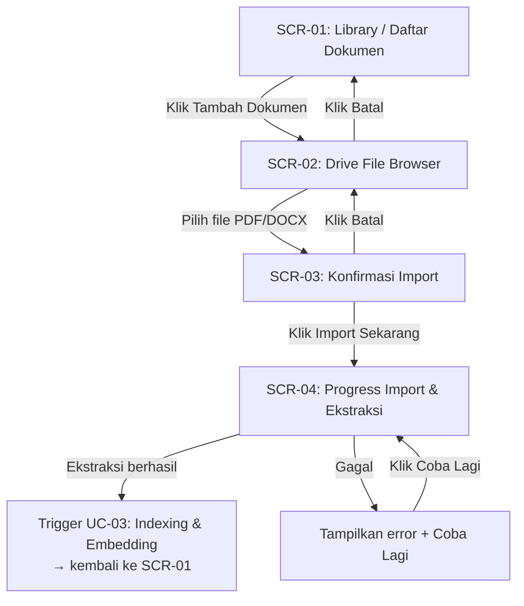
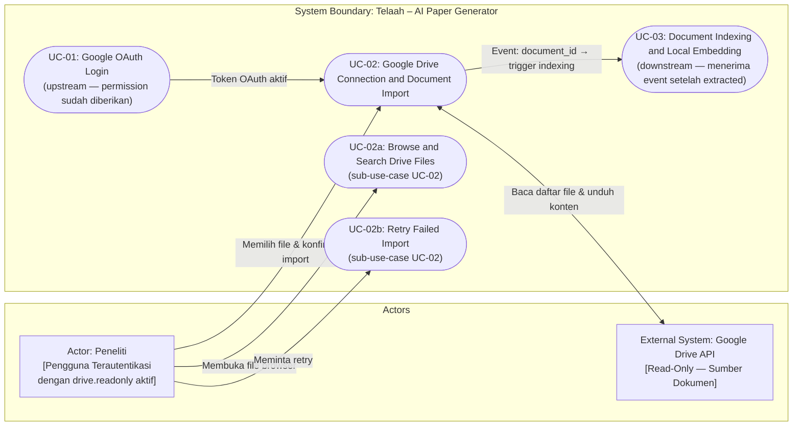
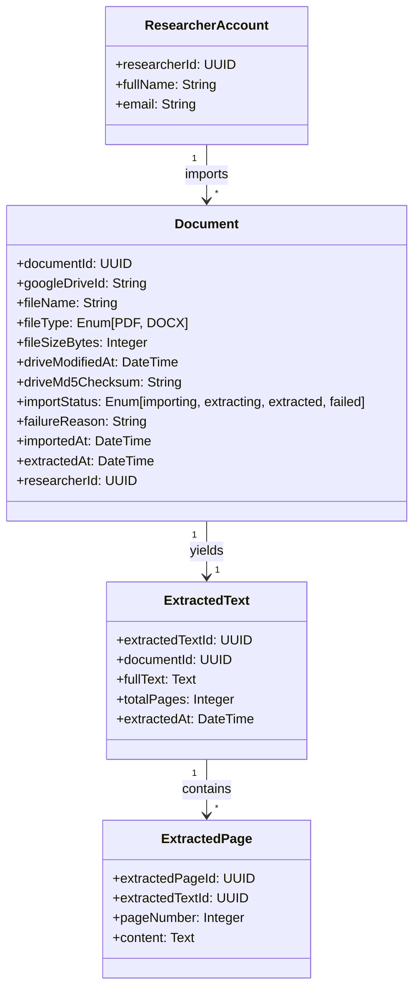

# Feature Specification: UC-02 Google Drive Connection and Document Import – ICONIX Process

**Feature Branch**: `002-drive-document-import`
**Created**: 2026-09-19
**Status**: Draft
**Input**: User description: "UC-02: Browse dokumen dari Google Drive, pilih file PDF atau DOCX, dan import untuk ekstraksi teks yang akan dikirim ke pipeline indexing (UC-03)."
**Methodology Reference**: Doug Rosenberg & Matt Stephens, *Use Case Driven Object Modeling with UML*

> **Catatan Dekomposisi UC**: Spec ini mencakup **UC-02: Google Drive Connection and Document Import** — mulai dari koneksi read-only ke Google Drive, browse dan search file, pemilihan dokumen, pengunduhan, ekstraksi teks, penyimpanan metadata & hasil ekstraksi, hingga pengiriman event ke UC-03. UC-02 **berhenti** setelah status dokumen menjadi `extracted` dan event dikirim ke UC-03. UC-01 (Google OAuth Login) hanya mencakup Google OAuth login dan grant permission `drive.readonly`. UC-03 (Document Indexing and Local Embedding) bertanggung jawab atas semua proses setelah event diterima.

---

## 1. Overview & System Context

Setelah peneliti berhasil login dan memberikan akses `drive.readonly` pada UC-01 (Google OAuth Login), fitur ini memungkinkan peneliti untuk menelusuri file di Google Drive mereka dari dalam aplikasi Telaah, memilih dokumen literatur ilmiah (PDF atau DOCX), dan memicu proses import serta ekstraksi teks. Setelah ekstraksi teks selesai, UC-02 mengirim event ke UC-03 (Document Indexing and Local Embedding) beserta `document_id` sebagai referensi. UC-02 **tidak melakukan** proses cleaning, chunking, embedding, penyimpanan vector, atau semantic retrieval — semua itu adalah tanggung jawab UC-03.

**Target Aktor**: Peneliti yang telah terautentikasi dan memiliki izin `drive.readonly` aktif.

**Masalah yang Diselesaikan**: Peneliti memiliki dokumen literatur ilmiah di Google Drive yang ingin digunakan sebagai referensi dalam penulisan paper. Tanpa fitur ini, peneliti tidak dapat menghubungkan koleksi dokumennya di Drive dengan sistem Telaah untuk keperluan semantic retrieval.

**Nilai Bisnis**: Memungkinkan peneliti menggunakan koleksi literatur yang sudah ada di Google Drive tanpa harus mengupload ulang secara manual — menjaga kesinambungan alur kerja penelitian yang sudah berjalan.

**Batasan Akses**: Sistem hanya membaca file (read-only). Tidak ada modifikasi, penghapusan, atau perpindahan file di Google Drive yang terjadi pada fitur ini.

---

## Clarifications

### Session 2026-09-21

- Q: Apa tanggung jawab tepat UC-02 vs UC-03? → A: UC-02 bertanggung jawab atas koneksi read-only ke Google Drive, browse dan search file, pemilihan file PDF/DOCX, pengunduhan, ekstraksi teks, penyimpanan metadata & hasil ekstraksi, serta pengiriman event ke UC-03 dengan `document_id`. UC-02 TIDAK melakukan cleaning, chunking, embedding, penyimpanan vector, similarity search, atau retrieval.
- Q: Bagaimana cara UC-02 memicu UC-03? → A: Setelah status dokumen menjadi `extracted`, sistem mengirim event/job ke UC-03 dengan `document_id` sebagai referensi. UC-02 selesai setelah pengiriman event ini.
- Q: Nama kanonik untuk tiap use case? → A: UC-01: Google OAuth Login; UC-02: Google Drive Connection and Document Import; UC-03: Document Indexing and Local Embedding. Label UC-02a dan UC-02b hanya boleh digunakan sebagai sub-use-case di dalam UC-02 (UC-02a: Browse and Search Drive Files; UC-02b: Retry Failed Import).
- Q: Apakah UC-03 boleh menggunakan Gemini Text Embedding API untuk indexing? → A: Tidak. UC-03 menggunakan model embedding lokal dan tidak menggunakan Gemini Text Embedding API untuk proses indexing.

---

## 2. GUI Storyboards & Screen Navigation

### Screen Inventory

| Screen / View ID | Screen Name | Key UI Elements | Next Screen / Action Trigger |
|---|---|---|---|
| `SCR-01` | Library / Daftar Dokumen | Tabel dokumen terimport, status badge, tombol "Tambah Dokumen" | Klik "Tambah Dokumen" → `SCR-02` |
| `SCR-02` | Drive File Browser | Daftar file/folder Google Drive (nama, tipe, tanggal modifikasi), breadcrumb navigasi folder, search/filter, tombol "Pilih" | Klik folder → masuk subfolder; Klik "Pilih" pada file → `SCR-03`; Klik batal → `SCR-01` |
| `SCR-03` | Konfirmasi Import | Nama file terpilih, preview metadata (ukuran, tipe, tanggal modifikasi), tombol "Import Sekarang" dan "Batal" | Klik "Import Sekarang" → `SCR-04`; Klik "Batal" → `SCR-02` |
| `SCR-04` | Progress Import & Ekstraksi | Indikator progres (Mengambil File → Mengekstrak Teks → Selesai), nama file, pesan status terkini | Selesai → kembali ke `SCR-01` dengan status baru; Gagal → tampilkan error + tombol "Coba Lagi" |

### Storyboard Navigation Flow

---

## 3. Use Case Model (Doug Rosenberg Canonical)

### 3.1 Use Case Diagram (Actors & System Boundary)

---

### 3.2 Detailed Use Case Specifications

### UC-02: Google Drive Connection and Document Import

- **Primary Actor**: Peneliti
- **Goal in Context**: Peneliti berhasil mengimpor dokumen literatur ilmiah dari Google Drive sehingga teksnya tersedia di sistem Telaah dan UC-03 (Document Indexing and Local Embedding) dapat memulai proses indexing
- **Preconditions**:
  - Peneliti telah berhasil login via Google OAuth 2.0 (UC-01 selesai)
  - Token akses `drive.readonly` aktif dan valid
  - Peneliti memiliki file PDF atau DOCX di Google Drive
- **Postconditions (Success Guarantees)**:
  - Teks dokumen berhasil diekstrak dan tersimpan di sistem Telaah
  - Metadata dokumen (nama file, Google Drive ID, tipe file, ukuran, tanggal modifikasi) tersimpan
  - Status dokumen berubah menjadi `extracted`
  - Sistem mengirim event/job ke UC-03 dengan `document_id` sebagai referensi — UC-02 **tidak** melanjutkan ke proses indexing, chunking, atau embedding
- **Trigger**: Peneliti mengklik "Tambah Dokumen" dari halaman Library

#### Basic Course of Events (Sunny Day Flow)

| Step | Actor Action | System Response |
|:---:|---|---|
| 1 | Peneliti mengklik tombol "Tambah Dokumen" di halaman Library. | Sistem membuka tampilan Drive File Browser dan mengambil daftar file/folder dari root Google Drive peneliti menggunakan token `drive.readonly`. |
| 2 | Peneliti menelusuri folder dan menemukan dokumen yang diinginkan. | Sistem menampilkan daftar file dan folder dengan nama, tipe file, dan tanggal modifikasi. Filter otomatis menampilkan hanya PDF dan DOCX; tipe lain ditampilkan namun tidak dapat dipilih. |
| 3 | Peneliti mengklik file PDF atau DOCX yang diinginkan. | Sistem menampilkan halaman Konfirmasi Import dengan metadata file: nama, ukuran, tipe, dan tanggal modifikasi terakhir dari Google Drive. |
| 4 | Peneliti mengklik "Import Sekarang". | Sistem mengunduh konten file dari Google Drive menggunakan token `drive.readonly`, mengubah status menjadi `importing`. |
| 5 | — (proses otomatis) | Sistem mengekstrak teks dari konten file (PDF atau DOCX) sesuai tipe file. Status berubah menjadi `extracting`. |
| 6 | — (proses otomatis) | Sistem menyimpan teks hasil ekstraksi beserta metadata dokumen. Status berubah menjadi `extracted`. |
| 7 | — (proses otomatis) | Sistem mengirim event/job ke UC-03 (Document Indexing and Local Embedding) dengan `document_id` sebagai referensi. UC-02 selesai di sini — proses cleaning, chunking, embedding, dan penyimpanan vector adalah tanggung jawab eksklusif UC-03. |
| 8 | Peneliti kembali ke halaman Library. | Sistem menampilkan dokumen baru di daftar dengan status `extracted`, menandakan ekstraksi berhasil dan event ke UC-03 telah dikirim. |

#### Alternate & Exception Courses (Rainy Day Flows)

- **Alt-1: Token OAuth Kedaluwarsa saat Browse**
  - **Pada Step 1**: Jika token `drive.readonly` tidak valid atau kedaluwarsa saat membuka file browser:
  - Sistem menampilkan pesan bahwa sesi Drive perlu diperbarui, dan mengarahkan peneliti untuk mengautentikasi ulang tanpa kehilangan sesi aplikasi.

- **Alt-2: File Bukan PDF atau DOCX Dipilih**
  - **Pada Step 3**: Jika peneliti mencoba memilih file dengan tipe selain PDF atau DOCX:
  - Sistem menampilkan keterangan bahwa hanya file PDF dan DOCX yang didukung, dan tidak menampilkan tombol konfirmasi untuk file tersebut.

- **Alt-3: Dokumen Sudah Pernah Diimpor (Duplikasi)**
  - **Pada Step 4**: Jika Google Drive ID dokumen sudah ada di sistem Telaah:
  - Sistem menampilkan peringatan bahwa dokumen ini sudah pernah diimpor, beserta status indexing terkininya, dan menawarkan opsi "Import Ulang" (menimpa data lama) atau "Batal".

- **Alt-4: Kegagalan Unduh File dari Google Drive**
  - **Pada Step 4**: Jika koneksi ke Google Drive API terputus atau file tidak dapat diunduh:
  - Sistem mengubah status menjadi `failed`, menyimpan detail kegagalan (termasuk kode error Google API), dan menampilkan opsi "Coba Lagi" kepada peneliti.

- **Alt-5: Kegagalan Ekstraksi Teks**
  - **Pada Step 5**: Jika teks tidak dapat diekstrak dari file (misalnya PDF terenkripsi, rusak, atau hanya berisi gambar tanpa teks):
  - Sistem mengubah status menjadi `failed`, menyimpan alasan kegagalan yang dapat dibaca peneliti (misalnya: "PDF tidak mengandung teks yang dapat diekstrak"), dan menampilkan opsi "Coba Lagi".

- **Alt-6: File Dihapus di Drive Setelah Browser Dibuka**
  - **Pada Step 4**: Jika file sudah tidak ada di Google Drive saat unduhan dimulai:
  - Sistem menampilkan pesan bahwa file tidak lagi ditemukan di Google Drive dan membatalkan proses import.

---

### UC-02a: Browse and Search Drive Files

- **Primary Actor**: Peneliti
- **Goal in Context**: Peneliti dapat menelusuri dan menemukan file yang diinginkan di Google Drive dari dalam aplikasi Telaah
- **Sub-use-case dari**: UC-02 (Google Drive Connection and Document Import)
- **Preconditions**: Token `drive.readonly` aktif; Drive File Browser terbuka
- **Postconditions**: Peneliti menemukan dan memilih file yang diinginkan

#### Basic Course of Events

| Step | Actor Action | System Response |
|:---:|---|---|
| 1 | Peneliti membuka Drive File Browser. | Sistem menampilkan daftar file dan folder dari root Drive peneliti, dengan filter tipe file aktif (PDF, DOCX). |
| 2 | Peneliti mengklik folder untuk masuk ke subfolder. | Sistem mengambil dan menampilkan isi subfolder tersebut. Breadcrumb navigasi diperbarui. |
| 3 | Peneliti mengetikkan kata kunci di kolom pencarian. | Sistem melakukan pencarian file di seluruh Drive peneliti berdasarkan nama file, hanya menampilkan hasil yang cocok dengan kata kunci. |
| 4 | Peneliti menemukan file yang diinginkan dan mengkliknya. | Sistem meneruskan ke UC-02 Step 3 (Konfirmasi Import). |

---

### UC-02b: Retry Failed Import

- **Primary Actor**: Peneliti
- **Goal in Context**: Peneliti dapat memulai ulang proses import untuk dokumen yang gagal diunduh atau diekstrak
- **Sub-use-case dari**: UC-02 (Google Drive Connection and Document Import)
- **Preconditions**: Status dokumen adalah `failed`
- **Postconditions**: Proses import dimulai ulang dari tahap unduhan

#### Basic Course of Events

| Step | Actor Action | System Response |
|:---:|---|---|
| 1 | Peneliti melihat dokumen dengan status `failed` di Library atau halaman Progress. | Sistem menampilkan alasan kegagalan dan tombol "Coba Lagi". |
| 2 | Peneliti mengklik "Coba Lagi". | Sistem mengubah status menjadi `importing` dan memulai ulang proses unduh dan ekstraksi seperti pada UC-02 Step 4. |

---

## 4. Initial Domain Model (Noun-Phrase Extraction)

- **Document**: Representasi berkas literatur ilmiah yang diimpor dari Google Drive. Menyimpan identitas Drive (`googleDriveId`), metadata berkas, hash konten (`driveMd5Checksum`), dan status pipeline import (`importStatus`). `googleDriveId` berfungsi sebagai kunci unik per peneliti untuk pencegahan duplikasi.
- **ExtractedText**: Konten teks lengkap hasil ekstraksi dari berkas, terpisah dari metadata dokumen untuk fleksibilitas re-ekstraksi. Menjadi input langsung untuk pipeline indexing UC-03.
- **ExtractedPage**: Potongan teks per halaman (PDF) atau per seksi (DOCX), menyimpan `pageNumber` untuk keterlacakan sitasi ilmiah pada UC-03.
- **ResearcherAccount**: Pengguna sistem yang memiliki hak eksklusif atas dokumen yang diimpor.

---

## 5. Requirements Traceability

### Functional Requirements (FR)

- **FR-001**: Sistem HARUS menampilkan daftar file dan folder dari Google Drive peneliti (menggunakan token `drive.readonly`) di dalam antarmuka aplikasi Telaah. *(UC-02 Step 1, UC-02a Step 1)*
- **FR-002**: Sistem HARUS memungkinkan peneliti menelusuri struktur folder Google Drive (masuk/keluar subfolder) dengan breadcrumb navigasi. *(UC-02a Step 2)*
- **FR-003**: Sistem HARUS menyediakan fungsi pencarian file berdasarkan nama di seluruh Google Drive peneliti. *(UC-02a Step 3)*
- **FR-004**: Sistem HARUS membatasi pemilihan file hanya pada tipe PDF dan DOCX; tipe file lain ditampilkan namun tidak dapat dipilih. *(UC-02 Step 2, Alt-2)*
- **FR-005**: Sistem HARUS menampilkan halaman konfirmasi import dengan metadata file (nama, ukuran, tipe, tanggal modifikasi) sebelum proses import dimulai. *(UC-02 Step 3)*
- **FR-006**: Sistem HARUS mengunduh konten file dari Google Drive menggunakan token `drive.readonly` yang aktif. *(UC-02 Step 4)*
- **FR-007**: Sistem HARUS mengekstrak teks dari file PDF dan DOCX yang berhasil diunduh. *(UC-02 Step 5)*
- **FR-008**: Sistem HARUS menyimpan teks hasil ekstraksi beserta metadata dokumen (Google Drive ID, nama file, tipe, ukuran, tanggal modifikasi, waktu import, identitas peneliti). *(UC-02 Step 6)*
- **FR-009**: Sistem HARUS menandai status import dokumen dengan salah satu dari: `importing`, `extracting`, `extracted`, atau `failed`. *(UC-02 Step 4–6)*
- **FR-010**: Setelah ekstraksi teks berhasil dan status dokumen menjadi `extracted`, sistem HARUS mengirim event atau job ke UC-03 (Document Indexing and Local Embedding) dengan `document_id` sebagai referensi. UC-02 **tidak** melanjutkan ke proses apapun setelah pengiriman event ini. *(UC-02 Step 7)*
- **FR-011**: Sistem HARUS mencegah duplikasi import dokumen yang sama berdasarkan Google Drive ID; jika dokumen sudah ada, sistem harus menampilkan opsi konfirmasi sebelum menimpa data lama. *(Alt-3)*
- **FR-012**: Sistem HARUS menyimpan alasan kegagalan yang dapat dibaca peneliti apabila proses import atau ekstraksi gagal, dan menyediakan opsi untuk memulai ulang. *(Alt-4, Alt-5)*
- **FR-013**: Sistem HARUS menampilkan status progress import (importing → extracting → extracted) kepada peneliti secara real-time. *(SCR-04)*
- **FR-014**: Sistem HARUS menangani token OAuth yang kedaluwarsa saat proses browse atau import dengan mengarahkan peneliti untuk mengautentikasi ulang tanpa kehilangan konteks. *(Alt-1)*
- **FR-015**: Sistem TIDAK BOLEH mengubah, memindahkan, atau menghapus file apapun di Google Drive peneliti selama proses import. *(Constraint — read-only)*

### Non-Functional Requirements (NFR)

- **NFR-001 (Performa)**: Tampilan daftar file Drive harus muncul dalam waktu yang responsif; peneliti tidak perlu menunggu lama untuk mulai menelusuri file.
- **NFR-002 (Keamanan & Privasi)**: Akses ke Google Drive dibatasi hanya pada scope `drive.readonly`; token akses tidak boleh disimpan dalam bentuk plaintext. Data dokumen dan teks ekstraksi hanya dapat diakses oleh peneliti pemiliknya.
- **NFR-003 (Non-Destruktif)**: Proses import tidak boleh dalam kondisi apapun memodifikasi, menghapus, atau memindahkan file di Google Drive.
- **NFR-004 (Ketahanan Gagal)**: Kegagalan import satu dokumen tidak boleh memengaruhi dokumen lain yang sedang dalam proses.
- **NFR-005 (Keterlacakan)**: Setiap dokumen yang diimpor harus dapat ditelusuri kembali ke Google Drive ID aslinya untuk keperluan sinkronisasi dan deduplication.

---

## 6. Success Criteria & Scope Boundaries

- **SC-001**: Peneliti dapat membuka Drive File Browser dari dalam aplikasi Telaah dan melihat file/folder dari Google Drive mereka.
- **SC-002**: Peneliti dapat menelusuri folder Google Drive (masuk subfolder, lihat breadcrumb) dan menggunakan pencarian berdasarkan nama file.
- **SC-003**: Hanya file PDF dan DOCX yang dapat dipilih untuk diimpor; tipe file lain tidak dapat dipilih.
- **SC-004**: Setelah konfirmasi import, dokumen PDF atau DOCX berhasil diunduh dari Google Drive dan teksnya berhasil diekstrak.
- **SC-005**: Metadata dokumen (Google Drive ID, nama file, tipe, ukuran, tanggal modifikasi, peneliti pemilik) tersimpan di sistem.
- **SC-006**: Status import dapat dipantau secara real-time oleh peneliti (`importing → extracting → extracted`).
- **SC-007**: Setelah ekstraksi berhasil dan status dokumen menjadi `extracted`, sistem mengirim event/job ke UC-03 dengan `document_id` sebagai referensi — terverifikasi ketika log atau ARQ job queue menunjukkan job `index_document_task` telah di-enqueue dengan `document_id` yang sesuai. Penerimaan dan eksekusi event oleh UC-03 berada di luar scope verifikasi UC-02.
- **SC-008**: Dokumen yang sudah pernah diimpor (Google Drive ID sama) memunculkan konfirmasi sebelum ditimpa — tidak ada duplikasi diam-diam.
- **SC-009**: Kegagalan unduhan atau ekstraksi menampilkan pesan error yang jelas dan opsi "Coba Lagi" kepada peneliti.
- **SC-010**: Tidak ada perubahan apapun yang terjadi pada file di Google Drive selama proses import.

**Out of Scope — UC-02 TIDAK BOLEH melakukan hal berikut:**

| Item | Tanggung Jawab |
|---|---|
| Google OAuth login dan pemberian izin `drive.readonly` | UC-01: Google OAuth Login |
| Cleaning teks untuk keperluan semantic retrieval | UC-03: Document Indexing and Local Embedding |
| Chunking teks untuk embedding | UC-03: Document Indexing and Local Embedding |
| Generate embedding lokal dari teks dokumen | UC-03: Document Indexing and Local Embedding |
| Penyimpanan vector ke pgvector atau vector store manapun | UC-03: Document Indexing and Local Embedding |
| Similarity search atau retrieval semantik | UC-03: Document Indexing and Local Embedding |
| Penggunaan Gemini Text Embedding API untuk indexing | UC-03: Document Indexing and Local Embedding (menggunakan model embedding lokal) |
| Dukungan tipe file selain PDF dan DOCX | Tidak dalam scope iterasi ini |
| Upload file dari perangkat lokal (bukan dari Drive) | Tidak dalam scope iterasi ini |
| Sinkronisasi otomatis perubahan file Drive | Iterasi mendatang (UC-03c) |
| Pengeditan atau anotasi dokumen di dalam aplikasi | Tidak dalam scope |

---

## 7. Assumptions

- Token OAuth `drive.readonly` yang diperoleh dari UC-01 (Google OAuth Login) sudah tersedia dan valid saat UC-02 dimulai; sistem menangani refresh token secara transparan.
- Google Drive API dapat mengembalikan daftar file dengan filter tipe dan pencarian berdasarkan nama.
- Ekstraksi teks dari PDF mengasumsikan file adalah PDF digital (bukan hasil scan gambar); PDF berbasis gambar (scanned) dapat menghasilkan ekstraksi kosong yang akan dilaporkan sebagai `failed`.
- Proses unduhan dan ekstraksi file dijalankan di sisi backend Telaah — tidak ada pemrosesan di sisi klien.
- Setiap peneliti hanya dapat mengakses dokumen yang diimpornya sendiri; tidak ada sharing antar peneliti dalam sistem.
- UC-02 mengirim event ke UC-03 (Document Indexing and Local Embedding) dengan `document_id` setelah status dokumen menjadi `extracted`. Pengelolaan event queue (ARQ/Redis) adalah implementasi mekanisme pengiriman; batas tanggung jawab UC-02 tetap berakhir setelah pengiriman event.
- UC-03 menggunakan **model embedding lokal** untuk proses indexing — UC-03 **tidak** menggunakan Gemini Text Embedding API atau external embedding API untuk proses indexing ini.

---

## 8. Git & Version Control Strategy

- **Feature Branch**: `002-drive-document-import`
- **Conventional Commits Standard**:
  - `feat(scope)`: Fitur baru atau kapabilitas baru
  - `test(scope)`: Penambahan atau pembaruan tes
  - `refactor(scope)`: Perbaikan struktur internal
  - `chore(scope)`: Scaffolding, konfigurasi, atau dokumentasi
- **Major Milestone Checkpoints**:
  - **Milestone 1 (Foundation)**: `feat(drive-import): setup document import schema and Drive API client`
  - **Milestone 2 (Browse)**: `feat(UC-02a): implement Drive file browser with folder navigation and search`
  - **Milestone 3 (Import)**: `feat(UC-02): implement file download, text extraction, and UC-03 trigger`
  - **Milestone 4 (Release)**: `chore(release): complete UC-02 Drive import verification and documentation`
