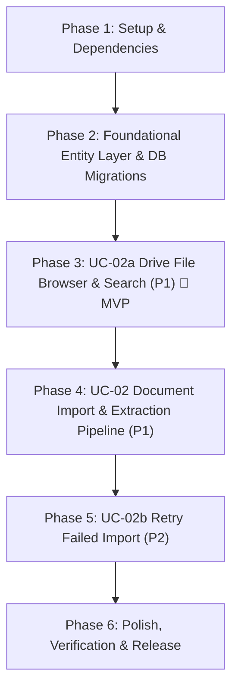

# Tasks: Google Drive Document Import (UC-02) – ICONIX Implementation Plan

**Input**: Design documents from `specs/002-drive-document-import/`
**Prerequisites**: `plan.md` (PDR & CDR Approved), `spec.md`, `research.md`, `data-model.md`, `contracts/api.md`, `quickstart.md`
**Methodology Reference**: Doug Rosenberg's ICONIX Process (BCE Architecture: Tests → Entity → Controller → Boundary)

---

## Git Version Control Rules (Mandatory)

1. **Atomic Per-Task Commits**: After completing any implementation task and verifying its test, execute:
   `git add <modified-files> && git commit -m "<type>(<scope>): <concise description>"`
2. **Major Checkpoint Commits**: At the conclusion of each Phase and upon completing each Use Case (ICONIX UC), execute the designated **Major Milestone Commit**.
3. **Commit Convention**: Follow Conventional Commits (`feat:`, `test:`, `refactor:`, `chore:`, `fix:`).

---

## Dependency Graph

---

## Phase 1: Setup & Environment Initialization

**Purpose**: Scaffolding directories, configurations, and dependencies.

- [X] T001 Configure Python backend dependencies (`google-api-python-client>=2.120.0`, `google-auth>=2.29.0`, `google-auth-httplib2>=0.2.0`, `pdfplumber>=0.11.0`, `python-docx>=1.1.0`, `arq>=0.25.0`, `asyncpg>=0.29.0`) in `backend/requirements.txt`
- [X] T002 Configure TypeScript interface contracts and type definitions for Drive files and document imports in `frontend/src/types/drive.ts` and `frontend/src/types/documents.ts`
- [X] T003 [P] Setup Redis connection pool and ARQ worker configuration in `backend/src/workers/worker.py`
- [X] T004 **Git Major Commit**: `git add . && git commit -m "chore(setup): scaffold UC-02 dependencies, types, and ARQ worker configuration"`

---

## Phase 2: Foundational Entity Layer & Database Migrations

**Purpose**: Establish database schemas, entity models, and migration scripts required before use case controllers can run.

- [X] T005 Create Alembic migration script `backend/alembic/versions/002_document_import_schema.py` creating `documents`, `extracted_texts`, and `extracted_pages` tables with indexes and unique constraints (`google_drive_id, researcher_id`)
- [X] T006 Implement Entity SQLModel classes (`Document`, `ExtractedText`, `ExtractedPage`) with enums (`import_status: importing, extracting, extracted, failed` and `file_type: pdf, docx`) in `backend/src/documents/models.py`
- [X] T007 [P] Implement base `DocumentRepository` CRUD and status update methods in `backend/src/documents/repository.py`
- [X] T008 Run migration in test database environment (`alembic upgrade head`) and verify table creation in PostgreSQL
- [X] T009 **Git Major Commit**: `git add . && git commit -m "feat(core): implement document import schema migrations and foundational entity models"`

**PDR Verification Checkpoint**: Entity models conform to Updated Domain Model in `plan.md` and `data-model.md`.

---

## Phase 3: Use Case 1 (UC-1 / UC-02a) – Browse & Search Google Drive Files (Priority: P1) 🎯 MVP

**Goal**: Peneliti dapat membuka Drive File Browser dari Library, melihat file/folder Drive dari akun Google yang terhubung, mencari file berdasarkan nama, menavigasi subfolder via breadcrumb, dan memfilter hanya file PDF & DOCX yang dapat dipilih.
**Independent Test**: `pytest backend/tests/test_drive_service.py backend/tests/test_drive_router.py`

### Step 3.1: Unit & Integration Tests (TDD - Write First)
- [X] T010 [P] [UC1] Write unit tests for `DriveTokenService` covering token validation, silent refresh using `Credentials.refresh()`, and `RefreshError` handling in `backend/tests/test_drive_token_service.py`
- [X] T011 [P] [UC1] Write unit tests for `DriveService` covering `files.list()` pagination (`pageSize=100`, `pageToken`), name search queries, and folder traversal in `backend/tests/test_drive_service.py`
- [X] T012 [P] [UC1] Write contract/integration tests for FastAPI drive router (`GET /api/drive/files`) in `backend/tests/test_drive_router.py`
- [X] T013 [UC1] Verify tests FAIL prior to implementation (Red stage)
- [X] T014 [UC1] **Git Commit (Tests)**: `git add backend/tests/ && git commit -m "test(UC1): add failing test suite for Drive file browsing and token refresh"`

### Step 3.2: Controller Layer (Business Logic & Drive API Integration)
- [X] T015 [P] [UC1] Implement Pydantic DTO schemas (`DriveFileItem`, `DriveFileListResponse`, `DriveFileMetadataResponse`) in `backend/src/drive/schemas.py`
- [X] T016 [P] [UC1] Implement `DriveTokenService` for silent token refresh via `google-auth` without replacing existing OAuth flow in `backend/src/drive/token_service.py`
- [X] T017 [UC1] Implement `DriveService` wrapping `google-api-python-client` (`files.list`, `files.get`) with folder and search filtering in `backend/src/drive/drive_service.py`
- [X] T018 [UC1] Verify unit tests pass (Green stage)
- [X] T019 [UC1] **Git Commit (Controller)**: `git add backend/src/drive/ && git commit -m "feat(UC1): implement DriveService, DriveTokenService, and schemas"`

### Step 3.3: Boundary Layer (FastAPI API Router & Next.js Frontend GUI)
- [X] T020 [UC1] Implement FastAPI Router endpoint (`GET /api/drive/files`) validating session cookie and injecting `DriveService` in `backend/src/drive/router.py`
- [X] T021 [P] [UC1] Implement Drive icon component using `@phosphor-icons/react` (`FilePdf`, `FileDoc`, `Folder`, strictly NO `lucide-react`) in `frontend/src/components/features/drive/DriveFileIcon.tsx`
- [X] T022 [P] [UC1] Implement `DriveFileRow` component displaying file name, type badge, size, modified date, and selectable state in `frontend/src/components/features/drive/DriveFileRow.tsx`
- [X] T023 [P] [UC1] Implement API client fetch wrapper in `frontend/src/lib/api/drive.ts` and React Query hook in `frontend/src/hooks/useDriveFiles.ts`
- [X] T024 [UC1] Implement `DriveBrowser` component with folder hierarchy navigation, breadcrumb bar, search input, and PDF/DOCX filter in `frontend/src/components/features/drive/DriveBrowser.tsx`
- [X] T025 [UC1] Implement Drive File Browser Page (`SCR-02`) at `/library/drive-browser` in `frontend/src/app/library/drive-browser/page.tsx`

### Step 3.4: BCE Audit & Major Milestone Checkpoint
- [X] T026 [UC1] **BCE Audit**: Confirm Frontend & Router (Boundary) never query Database (Entity) directly; all operations routed via `DriveService` and `DriveTokenService`
- [X] T027 [UC1] Run integration tests and confirm all sunny-day browse, search, and pagination flows pass
- [X] T028 [UC1] **Git Major Commit (Milestone)**: `git add . && git commit -m "feat(UC1): complete UC-02a Drive file browsing and search end-to-end [MVP Milestone]"`

**Checkpoint**: Use Case 2a is fully functional and delivers an independently testable MVP.

---

## Phase 4: Use Case 2 (UC-2 / UC-02) – Import & Extract Document (Priority: P1)

**Goal**: Peneliti memilih file PDF/DOCX dari Drive browser, mengonfirmasi import, sistem mengunduh binary stream, mengekstrak teks dengan struktur per halaman/seksi, menyimpan ke DB, dan memicu pipeline indexing UC-03.
**Independent Test**: `pytest backend/tests/test_text_extractor.py backend/tests/test_document_service.py backend/tests/test_document_router.py backend/tests/test_import_worker.py`

### Step 4.1: Unit & Integration Tests (TDD - Write First)
- [X] T029 [P] [UC2] Write unit tests for `TextExtractor` covering PDF extraction via `pdfplumber` with page tracking, scanned PDF detection (`is_scanned_pdf`), password-protected PDF handling, and DOCX paragraphs/tables extraction via `python-docx` in `backend/tests/test_text_extractor.py`
- [X] T030 [P] [UC2] Write unit tests for `DocumentService` covering duplicate checking by `google_drive_id`, `force_reimport` override logic, and job enqueueing in `backend/tests/test_document_service.py`
- [X] T031 [P] [UC2] Write contract/integration tests for document endpoints (`POST /api/documents/import`, `GET /api/documents/{id}/status`) in `backend/tests/test_document_router.py`
- [X] T032 [P] [UC2] Write worker task tests for `import_document_task` verifying download streaming (`SpooledTemporaryFile`), extraction persistence, and UC-03 queue dispatch in `backend/tests/test_import_worker.py`
- [X] T033 [UC2] Verify tests FAIL prior to implementation (Red stage)
- [X] T034 [UC2] **Git Commit (Tests)**: `git add backend/tests/ && git commit -m "test(UC2): add failing test suite for document import, extraction, and ARQ worker"`

### Step 4.2: Controller Layer (Text Extraction, Document Service & ARQ Worker)
- [X] T035 [P] [UC2] Implement Pydantic DTO schemas (`ImportDocumentRequest`, `ImportDocumentResponse`, `DocumentStatusResponse`) in `backend/src/documents/schemas.py`
- [X] T036 [P] [UC2] Implement `TextExtractor` using `pdfplumber` (coordinate-aware, page tracking) and `python-docx` (sections/tables) with `is_scanned_pdf` threshold check in `backend/src/documents/extractor.py`
- [X] T037 [UC2] Implement `DocumentService` for duplicate prevention, import enqueueing, and status retrieval in `backend/src/documents/service.py`
- [X] T038 [UC2] Implement `import_document_task` in `backend/src/workers/import_task.py` with chunked `MediaIoBaseDownload`, `SpooledTemporaryFile`, status progression (`importing -> extracting -> extracted`), and UC-03 queue dispatch
- [X] T039 [UC2] Verify unit tests pass (Green stage)
- [X] T040 [UC2] **Git Commit (Controller)**: `git add backend/src/documents/ backend/src/workers/ && git commit -m "feat(UC2): implement TextExtractor, DocumentService, and ARQ import worker task"`

### Step 4.3: Boundary Layer (FastAPI API Router & Next.js Frontend GUI)
- [X] T041 [UC2] Implement FastAPI Router endpoints (`POST /api/documents/import`, `GET /api/documents/{id}/status`) in `backend/src/documents/router.py`
- [X] T042 [P] [UC2] Implement API client functions in `frontend/src/lib/api/documents.ts` and React Query hooks (`useImportDocument.ts`, `useDocumentStatus.ts` with 3s polling) in `frontend/src/hooks/`
- [X] T043 [P] [UC2] Implement Import Confirmation Modal (`SCR-03`) with metadata preview, duplicate warning, and force re-import toggle in `frontend/src/components/features/drive/ImportConfirmModal.tsx`
- [X] T044 [P] [UC2] Implement Import Progress View (`SCR-04`) with multi-step progress bar (`importing -> extracting -> extracted`) and error alert in `frontend/src/components/features/drive/ImportProgress.tsx`
- [X] T045 [UC2] Integrate Library Page (`SCR-01`) at `/library` displaying document list, status badge, and "Tambah Dokumen" button triggering `SCR-02` in `frontend/src/app/library/page.tsx`

### Step 4.4: BCE Audit & Major Milestone Checkpoint
- [X] T046 [UC2] **BCE Audit**: Confirm Frontend & Router (Boundary) never query Database (Entity) directly; ARQ worker updates state exclusively through `DocumentRepository`
- [X] T047 [UC2] Run integration tests and confirm sunny-day import pipeline (PDF & DOCX) passes end-to-end
- [X] T048 [UC2] **Git Major Commit (Milestone)**: `git add . && git commit -m "feat(UC2): complete UC-02 document import and extraction pipeline end-to-end [Major Milestone]"`

---

## Phase 5: Use Case 3 (UC-3 / UC-02b) – Retry Failed Import (Priority: P2)

**Goal**: Peneliti dapat melihat alasan kegagalan import yang dapat dibaca manusia (misal: PDF hasil scan, file terenkripsi, atau error jaringan) dan memulai ulang proses import melalui tombol "Coba Lagi".
**Independent Test**: `pytest backend/tests/test_document_router.py -k "test_retry"`

### Step 5.1: Tests (TDD)
- [ ] T049 [P] [UC3] Write unit and integration tests for retry import flow (`POST /api/documents/{id}/retry`) and validation that only `failed` documents can be retried in `backend/tests/test_document_retry.py`
- [ ] T050 [UC3] **Git Commit (Tests)**: `git add backend/tests/ && git commit -m "test(UC3): add test suite for import retry flow"`

### Step 5.2: Controller & Entity Extensions
- [ ] T051 [UC3] Implement `retry_import` method in `backend/src/documents/service.py` resetting document status to `importing`, clearing `failure_reason`, and re-enqueueing `import_document_task` in ARQ

### Step 5.3: Boundary & Integration
- [ ] T052 [UC3] Implement FastAPI Router endpoint (`POST /api/documents/{id}/retry`) in `backend/src/documents/router.py`
- [ ] T053 [P] [UC3] Wire "Coba Lagi" action button and error alert display in `frontend/src/components/features/drive/ImportProgress.tsx` and `frontend/src/app/library/page.tsx`
- [ ] T054 [UC3] **BCE Audit**: Confirm Boundary-Controller-Entity separation in retry flow
- [ ] T055 [UC3] **Git Major Commit (Milestone)**: `git add . && git commit -m "feat(UC3): complete UC-02b retry import flow end-to-end"`

---

## Phase 6: Verification, Documentation & Final Release

**Purpose**: Cross-cutting audit, full regression test, constitution compliance check, and release milestone.

- [ ] T056 Run complete backend test suite (`pytest backend/tests/ -v`) and verify 100% passing tests
- [ ] T057 Run frontend lint, typecheck, and build (`bun run lint && bun run build`) verifying zero compile errors
- [ ] T058 Validate all 7 scenarios in `specs/002-drive-document-import/quickstart.md` (browse, happy PDF, happy DOCX, scanned PDF failure, duplicate 409, retry, md5 change detection)
- [ ] T059 [P] Verify constitution compliance: strictly NO `lucide-react` imports, all icons use `@phosphor-icons/react`, dark canvas aesthetic maintained, and read-only Drive constraint preserved
- [ ] T060 [P] Update API documentation in `backend/src/main.py` FastAPI OpenAPI metadata and feature documentation
- [ ] T061 Code formatting, linting, and unused import cleanup across `backend/` and `frontend/`
- [ ] T062 **Git Major Commit (Release)**: `git add . && git commit -m "chore(release): finalize UC-02 Google Drive Document Import implementation, verification, and documentation"`

---

## Implementation Strategy & MVP Scope

1. **MVP Scope (Phase 1 to Phase 3)**:
   - Setup dependencies, ARQ worker, database models, and Alembic migrations (T001–T009).
   - Complete UC-02a (Drive File Browser & Search) end-to-end (T010–T028).
   - At this point, researchers can connect to Drive, navigate folders, search files, and preview selectable PDF/DOCX files directly in the UI.

2. **Core Milestone (Phase 4)**:
   - Complete UC-02 (Import & Extract Document) end-to-end (T029–T048).
   - Enables background download, text extraction via `pdfplumber` / `python-docx`, scanned PDF rejection, database persistence, and handoff to UC-03.

3. **Robustness & Edge Cases (Phase 5)**:
   - Complete UC-02b (Retry Failed Import) (T049–T055).
   - Provides graceful failure recovery for researchers.

4. **Release & Quality Gate (Phase 6)**:
   - Full test suite, quickstart validation scenarios, constitution audit, and release commit (T056–T062).
