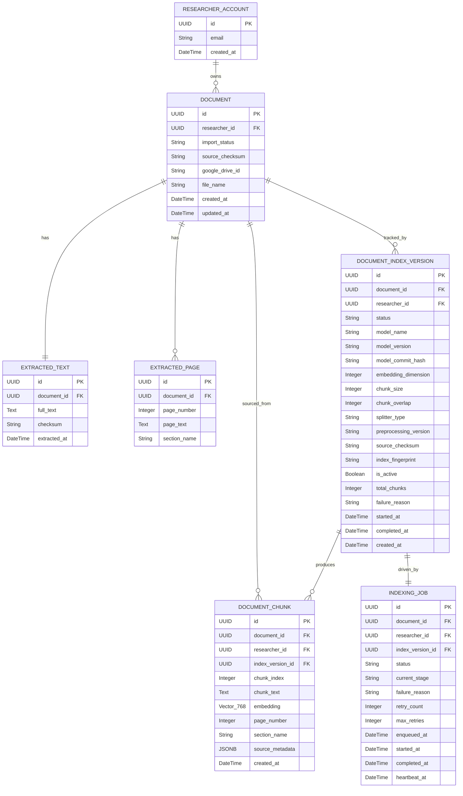

# Data Model: UC-03 Document Indexing and Local Embedding

**Feature Branch**: `003-document-indexing-embedding`
**Date**: 2026-09-22
**Spec**: [spec.md](./spec.md) | **Plan**: [plan.md](./plan.md)

---

## Entity Overview



---

## Entity Definitions

### 1. `document_index_versions` (Table)

Rekam jejak satu siklus indexing. Satu dokumen dapat memiliki multiple versions; hanya satu yang `is_active = TRUE` pada satu waktu.

| Column | Type | Constraints | Description |
|--------|------|-------------|-------------|
| `id` | `UUID` | PK, default `gen_random_uuid()` | Primary key |
| `document_id` | `UUID` | FK → `documents.id`, NOT NULL, INDEX | Dokumen yang diindeks |
| `researcher_id` | `UUID` | FK → `researcher_accounts.id`, NOT NULL, INDEX | Pemilik — isolasi multi-tenant |
| `status` | `VARCHAR(20)` | NOT NULL, DEFAULT `'queued'` | State machine: lihat di bawah |
| `model_name` | `VARCHAR(255)` | NOT NULL | `intfloat/multilingual-e5-base` |
| `model_version` | `VARCHAR(100)` | NOT NULL | Tag/branch HuggingFace |
| `model_commit_hash` | `VARCHAR(64)` | NOT NULL | SHA commit HF — reproducibility |
| `embedding_dimension` | `INTEGER` | NOT NULL, DEFAULT `768` | Harus cocok dengan kolom pgvector |
| `chunk_size` | `INTEGER` | NOT NULL, DEFAULT `1200` | Character count per chunk |
| `chunk_overlap` | `INTEGER` | NOT NULL, DEFAULT `150` | Character overlap antar chunk |
| `splitter_type` | `VARCHAR(100)` | NOT NULL, DEFAULT `'recursive_character'` | Tipe text splitter |
| `preprocessing_version` | `VARCHAR(20)` | NOT NULL, DEFAULT `'v1'` | Versi pipeline cleaning |
| `source_checksum` | `VARCHAR(64)` | NOT NULL | SHA-256 dari `ExtractedText.full_text` |
| `index_fingerprint` | `VARCHAR(64)` | NOT NULL, UNIQUE | Deterministic hash — deduplikasi |
| `is_active` | `BOOLEAN` | NOT NULL, DEFAULT `FALSE` | Hanya satu TRUE per `document_id` |
| `total_chunks` | `INTEGER` | NULLABLE | Diisi setelah `indexed` |
| `failure_reason` | `TEXT` | NULLABLE | Error message yang aman dibaca peneliti |
| `started_at` | `TIMESTAMPTZ` | NULLABLE | Saat worker mulai |
| `completed_at` | `TIMESTAMPTZ` | NULLABLE | Saat selesai (indexed atau failed) |
| `created_at` | `TIMESTAMPTZ` | NOT NULL, DEFAULT `NOW()` | Waktu record dibuat |

**Status State Machine**:
```
queued → cleaning → chunking → embedding → storing → indexed
                                                    ↘ failed
```

**Indexes**:
```sql
CREATE INDEX idx_div_document_id ON document_index_versions (document_id);
CREATE INDEX idx_div_researcher_id ON document_index_versions (researcher_id);
CREATE UNIQUE INDEX idx_div_fingerprint ON document_index_versions (index_fingerprint);
CREATE UNIQUE INDEX idx_div_active_per_doc
  ON document_index_versions (document_id)
  WHERE is_active = TRUE;
```

**Constraints**:
```sql
ALTER TABLE document_index_versions
  ADD CONSTRAINT chk_status
  CHECK (status IN ('queued','cleaning','chunking','embedding','storing','indexed','failed','archived'));

ALTER TABLE document_index_versions
  ADD CONSTRAINT chk_embedding_dimension
  CHECK (embedding_dimension > 0);
```

---

### 2. `document_chunks` (Table)

Unit terkecil knowledge base. Menyimpan teks + vektor + metadata penuh untuk traceability.

| Column | Type | Constraints | Description |
|--------|------|-------------|-------------|
| `id` | `UUID` | PK, default `gen_random_uuid()` | Primary key |
| `document_id` | `UUID` | FK → `documents.id`, NOT NULL, INDEX | Dokumen sumber |
| `researcher_id` | `UUID` | FK → `researcher_accounts.id`, NOT NULL, INDEX | Multi-tenant isolation |
| `index_version_id` | `UUID` | FK → `document_index_versions.id`, NOT NULL, INDEX | Versi index yang menghasilkan chunk |
| `chunk_index` | `INTEGER` | NOT NULL | Urutan chunk dalam dokumen (0-based) |
| `chunk_text` | `TEXT` | NOT NULL | Teks chunk penuh (tanpa prefix `passage: `) |
| `embedding` | `VECTOR(768)` | NOT NULL | Vektor embedding dari multilingual-e5-base |
| `page_number` | `INTEGER` | NULLABLE | Halaman sumber (null jika tidak tersedia) |
| `section_name` | `VARCHAR(255)` | NULLABLE | Section/heading sumber (null jika tidak tersedia) |
| `source_metadata` | `JSONB` | NOT NULL, DEFAULT `'{}'` | Metadata bibliografi: `{document_title, authors, publication_year, source_google_drive_id, source_checksum}` |
| `created_at` | `TIMESTAMPTZ` | NOT NULL, DEFAULT `NOW()` | Waktu chunk disimpan |

**HNSW Vector Index**:
```sql
CREATE INDEX idx_chunks_embedding_hnsw
  ON document_chunks
  USING hnsw (embedding vector_cosine_ops)
  WITH (m = 16, ef_construction = 128);
```

**B-Tree Indexes for Filtering**:
```sql
CREATE INDEX idx_chunks_researcher_version
  ON document_chunks (researcher_id, index_version_id);

CREATE INDEX idx_chunks_document_id
  ON document_chunks (document_id);
```

**Constraints**:
```sql
ALTER TABLE document_chunks
  ADD CONSTRAINT chk_chunk_index_non_negative
  CHECK (chunk_index >= 0);
```

**JSONB `source_metadata` schema**:
```json
{
  "document_title": "string | null",
  "authors": "string | null",
  "publication_year": "integer | null",
  "source_google_drive_id": "string | null",
  "source_checksum": "string"
}
```

---

### 3. `indexing_jobs` (Table)

Rekam jejak eksekusi background task. Digunakan untuk status polling, retry, dan stale detection (tanpa message broker eksternal).

| Column | Type | Constraints | Description |
|--------|------|-------------|-------------|
| `id` | `UUID` | PK | Primary key |
| `document_id` | `UUID` | FK → `documents.id`, NOT NULL, INDEX | Dokumen terkait |
| `researcher_id` | `UUID` | FK → `researcher_accounts.id`, NOT NULL, INDEX | Pemilik |
| `index_version_id` | `UUID` | FK → `document_index_versions.id`, NOT NULL | Index version yang dijalankan |
| `status` | `VARCHAR(20)` | NOT NULL, DEFAULT `'queued'` | Reflects pipeline stage |
| `current_stage` | `VARCHAR(30)` | NULLABLE | Sub-stage saat ini: `cleaning`, `chunking`, `embedding`, `storing` |
| `failure_reason` | `TEXT` | NULLABLE | Safe error message (tanpa stack trace internal) |
| `retry_count` | `INTEGER` | NOT NULL, DEFAULT `0` | Jumlah retry yang sudah dilakukan |
| `max_retries` | `INTEGER` | NOT NULL, DEFAULT `3` | Batas retry (env-configurable) |
| `enqueued_at` | `TIMESTAMPTZ` | NOT NULL, DEFAULT `NOW()` | Waktu task di-trigger via BackgroundTasks |
| `started_at` | `TIMESTAMPTZ` | NULLABLE | Waktu background task mulai eksekusi |
| `completed_at` | `TIMESTAMPTZ` | NULLABLE | Waktu job selesai (sukses atau gagal) |
| `heartbeat_at` | `TIMESTAMPTZ` | NULLABLE | Diperbarui tiap 30 detik oleh task; stale jika > 5 menit tanpa update |

**Indexes**:
```sql
CREATE INDEX idx_jobs_document_id ON indexing_jobs (document_id);
CREATE INDEX idx_jobs_researcher_id ON indexing_jobs (researcher_id);
CREATE INDEX idx_jobs_heartbeat ON indexing_jobs (heartbeat_at)
  WHERE status NOT IN ('completed', 'failed');
```

---

## SQLModel Python Definitions

```python
# backend/src/indexing/models.py
import uuid
from datetime import datetime
from typing import Optional
from sqlmodel import SQLModel, Field, Column
from sqlalchemy import UniqueConstraint, CheckConstraint
from pgvector.sqlalchemy import Vector
import sqlalchemy as sa


class DocumentIndexVersion(SQLModel, table=True):
    __tablename__ = "document_index_versions"
    __table_args__ = (
        UniqueConstraint("index_fingerprint", name="uq_div_fingerprint"),
        UniqueConstraint("document_id", name="uq_div_one_active_per_doc",
                         postgresql_where=sa.text("is_active = TRUE")),
        CheckConstraint(
            "status IN ('queued','cleaning','chunking','embedding','storing','indexed','failed','archived')",
            name="chk_div_status"
        ),
    )

    id: uuid.UUID = Field(default_factory=uuid.uuid4, primary_key=True)
    document_id: uuid.UUID = Field(foreign_key="documents.id", nullable=False, index=True)
    researcher_id: uuid.UUID = Field(foreign_key="researcher_accounts.id", nullable=False, index=True)
    status: str = Field(default="queued", max_length=20)
    model_name: str = Field(max_length=255)
    model_version: str = Field(max_length=100)
    model_commit_hash: str = Field(max_length=64)
    embedding_dimension: int = Field(default=768)
    chunk_size: int = Field(default=1200)
    chunk_overlap: int = Field(default=150)
    splitter_type: str = Field(default="recursive_character", max_length=100)
    preprocessing_version: str = Field(default="v1", max_length=20)
    source_checksum: str = Field(max_length=64)
    index_fingerprint: str = Field(max_length=64)
    is_active: bool = Field(default=False)
    total_chunks: Optional[int] = Field(default=None)
    failure_reason: Optional[str] = Field(default=None)
    started_at: Optional[datetime] = Field(default=None)
    completed_at: Optional[datetime] = Field(default=None)
    created_at: datetime = Field(default_factory=datetime.utcnow)


class DocumentChunk(SQLModel, table=True):
    __tablename__ = "document_chunks"
    __table_args__ = (
        CheckConstraint("chunk_index >= 0", name="chk_chunk_index_non_negative"),
    )

    id: uuid.UUID = Field(default_factory=uuid.uuid4, primary_key=True)
    document_id: uuid.UUID = Field(foreign_key="documents.id", nullable=False, index=True)
    researcher_id: uuid.UUID = Field(foreign_key="researcher_accounts.id", nullable=False, index=True)
    index_version_id: uuid.UUID = Field(foreign_key="document_index_versions.id", nullable=False, index=True)
    chunk_index: int
    chunk_text: str = Field(sa_column=sa.Column(sa.Text, nullable=False))
    embedding: list[float] = Field(sa_column=sa.Column(Vector(768), nullable=False))
    page_number: Optional[int] = Field(default=None)
    section_name: Optional[str] = Field(default=None, max_length=255)
    source_metadata: dict = Field(default={}, sa_column=sa.Column(sa.JSON))
    created_at: datetime = Field(default_factory=datetime.utcnow)


class IndexingJob(SQLModel, table=True):
    __tablename__ = "indexing_jobs"

    id: uuid.UUID = Field(default_factory=uuid.uuid4, primary_key=True)
    document_id: uuid.UUID = Field(foreign_key="documents.id", nullable=False, index=True)
    researcher_id: uuid.UUID = Field(foreign_key="researcher_accounts.id", nullable=False, index=True)
    index_version_id: uuid.UUID = Field(foreign_key="document_index_versions.id", nullable=False)
    status: str = Field(default="queued", max_length=20)
    current_stage: Optional[str] = Field(default=None, max_length=30)
    failure_reason: Optional[str] = Field(default=None)
    retry_count: int = Field(default=0)
    max_retries: int = Field(default=3)
    enqueued_at: datetime = Field(default_factory=datetime.utcnow)
    started_at: Optional[datetime] = Field(default=None)
    completed_at: Optional[datetime] = Field(default=None)
    heartbeat_at: Optional[datetime] = Field(default=None)
```

---

## Alembic Migration Strategy

### Migration Order

```
1. 001_enable_pgvector_extension.py
2. 002_create_document_index_versions.py
3. 003_create_document_chunks_with_vector.py
4. 004_create_indexing_jobs.py
5. 005_create_hnsw_index_on_chunks.py
```

### Migration 001 — Enable pgvector

```python
def upgrade():
    op.execute("CREATE EXTENSION IF NOT EXISTS vector;")

def downgrade():
    op.execute("DROP EXTENSION IF EXISTS vector;")
```

### Migration 005 — HNSW Index

```python
from alembic import op
import sqlalchemy as sa

def upgrade():
    op.execute("""
        CREATE INDEX CONCURRENTLY idx_chunks_embedding_hnsw
        ON document_chunks
        USING hnsw (embedding vector_cosine_ops)
        WITH (m = 16, ef_construction = 128);
    """)

def downgrade():
    op.execute("DROP INDEX IF EXISTS idx_chunks_embedding_hnsw;")
```

> [!NOTE] `CONCURRENTLY` pada HNSW index creation memungkinkan tabel tetap bisa di-write selama index dibangun. Diperlukan untuk production. Tidak dapat berjalan dalam transaction block — gunakan `connection.execute()` tanpa wrapping `BEGIN`.

---

## Index Fingerprint Algorithm

Fingerprint deterministik yang digunakan untuk mencegah duplikasi indexing:

```python
import hashlib

def compute_index_fingerprint(
    source_checksum: str,
    model_name: str,
    model_commit_hash: str,
    embedding_dimension: int,
    chunk_size: int,
    chunk_overlap: int,
    preprocessing_version: str,
) -> str:
    """Deterministic SHA-256 fingerprint for deduplication.
    Same input always produces same fingerprint — enables safe re-index detection.
    """
    components = "|".join([
        source_checksum,
        model_name,
        model_commit_hash,
        str(embedding_dimension),
        str(chunk_size),
        str(chunk_overlap),
        preprocessing_version,
    ])
    return hashlib.sha256(components.encode()).hexdigest()
```

---

## Environment Configuration

Semua nilai berikut dapat di-override via environment variable:

| Variable | Default | Description |
|----------|---------|-------------|
| `EMBEDDING_MODEL_NAME` | `intfloat/multilingual-e5-base` | Nama model HuggingFace |
| `EMBEDDING_MODEL_COMMIT_HASH` | `d711e52f...` | SHA commit untuk reproducibility |
| `EMBEDDING_DIMENSION` | `768` | Dimensi output embedding |
| `CHUNK_SIZE` | `1200` | Character count per chunk |
| `CHUNK_OVERLAP` | `150` | Character overlap antar chunk |
| `PREPROCESSING_VERSION` | `v1` | Versi pipeline text cleaning |
| `EMBEDDING_BATCH_SIZE` | `32` | Chunk per batch inference |
| `HF_CACHE_DIR` | `./models/hf_cache` | Lokasi cache model HuggingFace |
| `HNSW_M` | `16` | Parameter m HNSW index |
| `HNSW_EF_CONSTRUCTION` | `128` | Parameter ef_construction HNSW |
| `HNSW_EF_SEARCH` | `64` | Parameter ef_search saat query |
| `INDEXING_MAX_RETRIES` | `3` | Batas retry per job |
| `INDEXING_HEARTBEAT_INTERVAL` | `30` | Detik antar heartbeat update |
| `INDEXING_STALE_THRESHOLD_MINUTES` | `5` | Menit sebelum job dianggap stale |
| `INDEXING_SIMILARITY_TOP_K` | `10` | Jumlah chunk dikembalikan similarity search |
