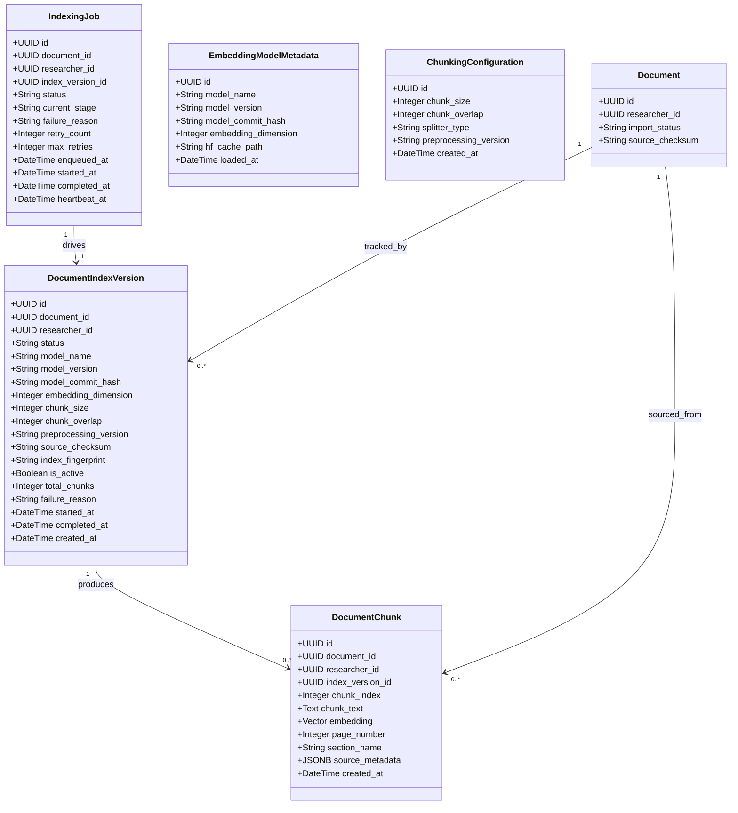
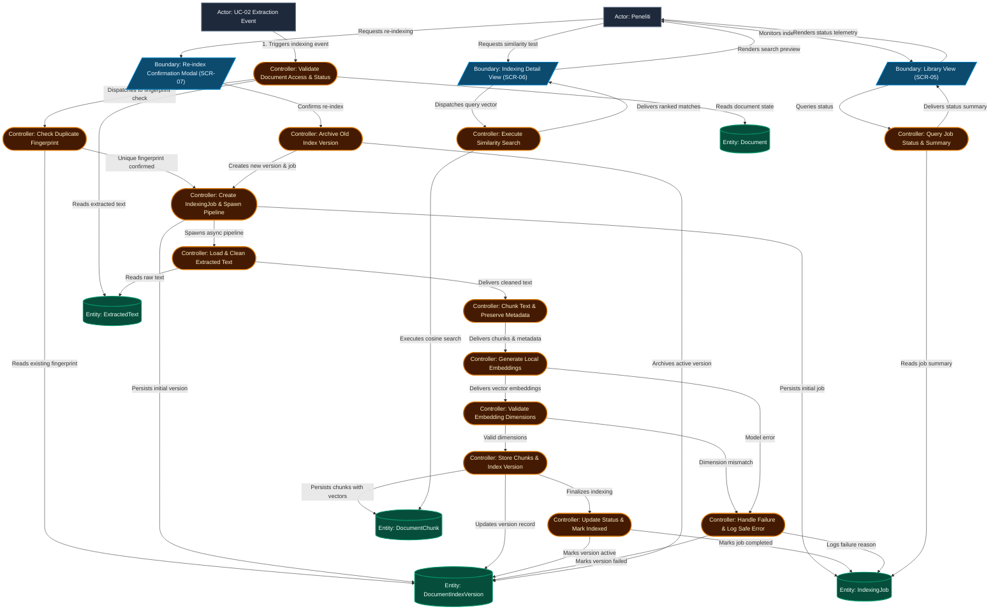
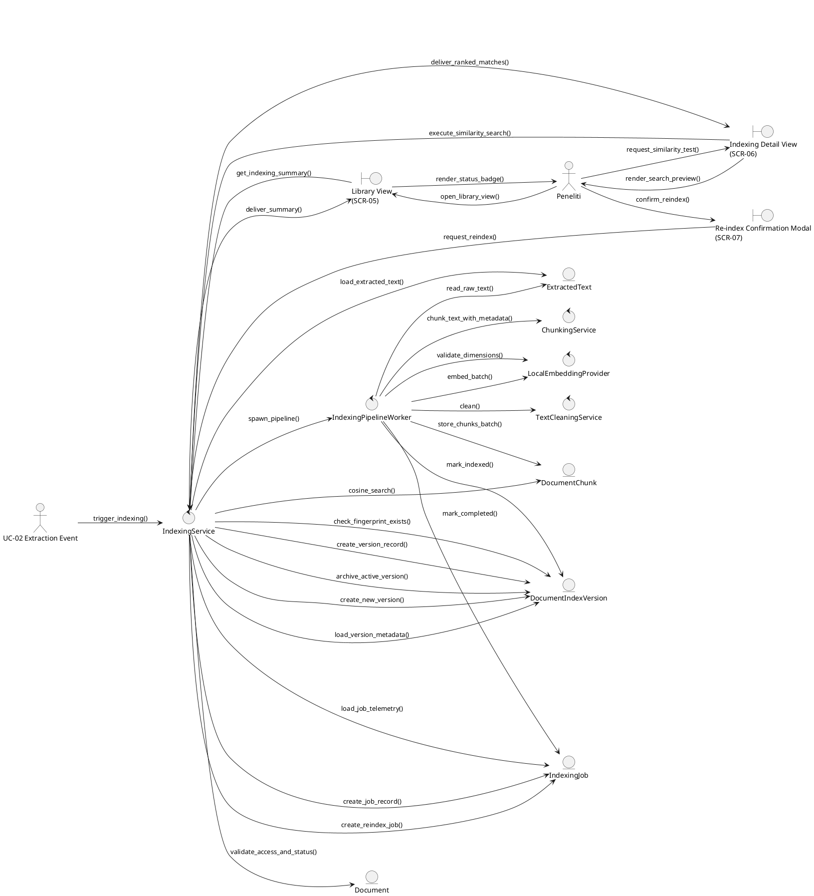
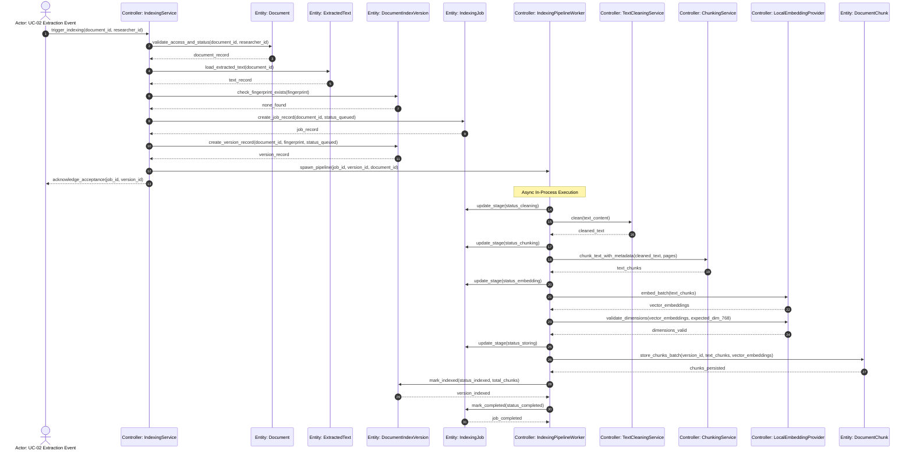
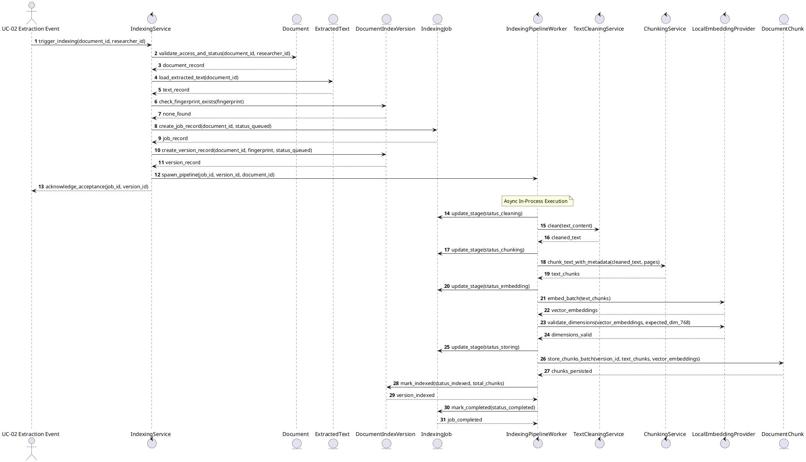
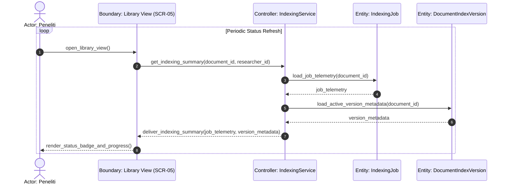
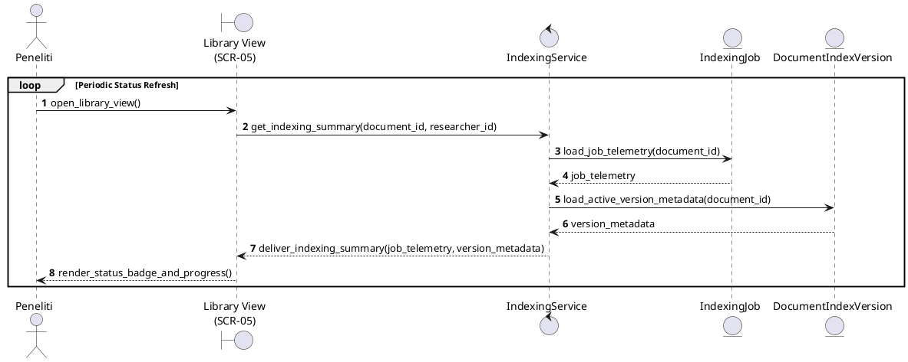
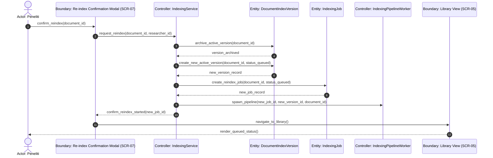
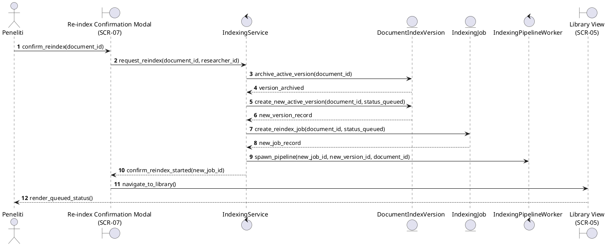

# Technical Plan: UC-03 Document Indexing and Local Embedding – ICONIX Process

**Branch**: `003-document-indexing-embedding` | **Date**: 2026-09-22 | **Spec**: [spec.md](./spec.md)
**Input**: Feature specification dari `/specs/003-document-indexing-embedding/spec.md`
**Methodology Reference**: Doug Rosenberg & Matt Stephens, *Use Case Driven Object Modeling with UML*

---

## 1. System Architecture & Technical Context

### Stack Mapping

| Layer | Technology | Role dalam UC-03 |
|---|---|---|
| **Frontend** | Next.js App Router + TypeScript + Bun | Status polling, SCR-05/06/07, Retry/Re-index UI |
| **Backend API** | FastAPI (Python 3.12) + Pydantic v2 | REST endpoints indexing, spawn background task |
| **Background Worker** | `FastAPI BackgroundTasks` + `asyncio.to_thread()` | Pipeline indexing in-process; CPU-bound embedding di thread pool |
| **ORM** | SQLModel + SQLAlchemy (async) | Model `DocumentIndexVersion`, `DocumentChunk`, `IndexingJob` |
| **Primary DB** | PostgreSQL 16 | Metadata, status, chunk text, relasi, **status job** |
| **Vector Extension** | pgvector (HNSW) | `VECTOR(768)` kolom cosine similarity |
| **Embedding Model** | `intfloat/multilingual-e5-base` (Hugging Face) | Local inference, dimensi 768 |
| **LangChain** | Hybrid (splitter + embedding wrapper) | `RecursiveCharacterTextSplitter`, `HuggingFaceEmbeddings` |

> [!NOTE] **Ponytail Engineering (Prinsip 6)** — Redis dihilangkan karena sistem ini berjalan single-instance lokal untuk kebutuhan TA. `FastAPI BackgroundTasks` cukup dan tidak membutuhkan infra tambahan. Trade-off didokumentasikan di [research.md](./research.md#r-01-background-processing).

### Architectural Pattern

```
Router (Boundary) → Service (Controller) → Repository (Controller) → Model/DB (Entity)
```

- **UC-03 dilarang keras** menggunakan Gemini Text Embedding API atau external embedding service.
- **UC-03 tidak mengimplementasi ulang** Google OAuth, Drive API, atau logika UC-02. Hanya mengkonsumsi hasil UC-02.
- **UC-03 tidak menyentuh** outline paper, LLM generatif, citation validation, atau rendering LaTeX.

### Module Boundaries

```
backend/
├── src/
│   ├── indexing/              ← Module utama UC-03
│   │   ├── router.py          ← Boundary: REST API endpoints
│   │   ├── service.py         ← Controller: DocumentIndexingService
│   │   ├── repository.py      ← Controller: IndexingRepository + ChunkMetadataRepository
│   │   ├── models.py          ← Entity: DocumentIndexVersion, DocumentChunk, IndexingJob
│   │   ├── schemas.py         ← Pydantic DTOs request/response
│   │   ├── worker.py          ← Background pipeline: run_indexing_pipeline() (asyncio + to_thread)
│   │   ├── embedding.py       ← LocalEmbeddingProvider (singleton HuggingFaceEmbeddings)
│   │   ├── chunker.py         ← ChunkingService (LangChain RecursiveCharacterTextSplitter)
│   │   ├── cleaner.py         ← TextCleaningService
│   │   ├── fingerprint.py     ← ChecksumService (deterministic fingerprint)
│   │   └── exceptions.py      ← IndexingError, DimensionMismatchError, dll.
│   ├── documents/             ← Entity UC-02 (read-only dari UC-03)
│   └── shared/
│       ├── access_control.py  ← researcher_id guard
│       └── db.py              ← SQLAlchemy async session
frontend/
└── src/
    ├── components/features/indexing/
    │   ├── IndexingStatusBadge.tsx
    │   ├── IndexingDetailPanel.tsx
    │   └── ReindexConfirmModal.tsx    ← SCR-07
    └── app/(dashboard)/library/
        └── page.tsx                  ← SCR-05 extended
```

### Frontend Styling System & @theme Mapping (Academic Editorial Canvas)

Sesuai Konstitusi Telaah v1.3.0 Prinsip 7 dan [DESIGN.md](file:///Users/gzaaa19/Telaah/DESIGN.md), frontend Telaah mengimplementasikan sistem desain **Academic Editorial Canvas** yang dibangun di atas Tailwind CSS v4 dengan pemetaan token `@theme`:

```css
@import "tailwindcss";

@theme {
  /* Typography Families */
  --font-serif: var(--font-newsreader), Georgia, serif;
  --font-sans: var(--font-inter), -apple-system, BlinkMacSystemFont, sans-serif;
  --font-mono: var(--font-jetbrains-mono), Menlo, Monaco, Consolas, monospace;

  /* Surfaces & Canvas */
  --color-canvas-base: #fcf9f8;        /* Warm parchment document canvas */
  --color-canvas-sidebar: #f7f6f3;     /* Warm-grey paper sidebar / inspector */
  --color-canvas-card: #ffffff;        /* Pure card & dialog background */
  --color-border-hairline: #e5e7eb;    /* 1px neutral structural rule */
  --color-border-subtle: #e2e8f0;      /* Subtle inner divider */

  /* Ink & Typography */
  --color-ink-primary: #191919;        /* Deep Carbon Ink for headings & body */
  --color-ink-secondary: #434655;      /* Sub-headings and active secondary text */
  --color-ink-muted: #64748b;          /* Metadata labels, timestamp, line numbers */

  /* Academic Accents & Semantic Signals */
  --color-academic-blue: #1d4ed8;      /* Primary CTA, active tab, focus ring */
  --color-academic-blue-hover: #1e40af;
  --color-archival-emerald: #006c4a;   /* Indexed status, verified telemetry */
  --color-archival-emerald-bg: #ecfdf5;
  --color-archival-emerald-border: #a7f3d0;
  --color-archival-amber: #d97706;     /* Reindex warning, retry signals */
  --color-archival-amber-bg: #fef3c7;
  --color-archival-crimson: #b91c1c;   /* Indexing failed status */
  --color-archival-crimson-bg: #fef2f2;
}
```

#### Component & Layout Mapping for UC-03
1. **Font Loading & Injection** (`frontend/src/app/layout.tsx`):
   - `Newsreader`: Headings, display titles, modal document titles (`--font-newsreader`).
   - `Inter`: Running copy, table content, control buttons, status labels (`--font-inter`).
   - `JetBrains Mono`: Dimensionality (768), vector metadata, chunk count, SHA-256 fingerprint (`--font-jetbrains-mono`).
2. **Three-Pane Architecture**:
   - Left Navigation (`260px`): `#F7F6F3` with 1px `#E5E7EB` right hairline.
   - Main Document Library (`SCR-05`): `#FCF9F8` warm-paper canvas, max width `1120px`.
   - Inspection Panel / Modals (`SCR-06`, `SCR-07`): `#FFFFFF` with 8px radius (`rounded-lg`) and 1px `#E5E7EB` border.
3. **Index-Card Geometry**:
   - Status badges use physical 4px corner geometry (`rounded-sm`), 6px solid status pips, and monospaced indicators.
   - Strict ban on `lucide-react` is preserved; all UI icons utilize `@phosphor-icons/react`.

---

## 2. Updated Domain Model



### Database Schema Notes

- **`document_index_versions`**: `is_active = TRUE` hanya pada satu record per `document_id` pada satu waktu; record lama di-set `is_active = FALSE` (status `archived`).
- **`document_chunks`**: Kolom `embedding VECTOR(768)` — HNSW index dengan `vector_cosine_ops`.
- **`index_fingerprint`**: Hash deterministik dari `source_checksum + model_name + model_version + embedding_dimension + chunk_size + chunk_overlap + preprocessing_version`.
- **`indexing_jobs`**: `heartbeat_at` diperbarui setiap 30 detik oleh background task; job dengan `heartbeat_at` lebih dari 5 menit tanpa completion dan status non-terminal dianggap stale — dapat di-retry manual oleh peneliti.

---

## 3. ICONIX Robustness Analysis

### Robustness Diagram: UC-03 Document Indexing and Local Embedding



<details>
<summary><b>Canonical PlantUML: UC-03 Robustness Diagram (Native BCE Icons)</b></summary>


</details>

### BCE Inventory & Method Allocation

| BCE Type | Element | Responsibility → Implementation |
|---|---|---|
| **Boundary** | `Library View (SCR-05)` | `frontend/.../library/page.tsx` |
| **Boundary** | `Indexing Detail View (SCR-06)` | `frontend/.../IndexingDetailPanel.tsx` |
| **Boundary** | `Re-index Confirmation Modal (SCR-07)` | `frontend/.../ReindexConfirmModal.tsx` |
| **Controller** | `Validate Document Access & Status` | `IndexingService.validate_document_access()` |
| **Controller** | `Check Duplicate Fingerprint` | `IndexingService.check_duplicate_fingerprint()` |
| **Controller** | `Create IndexingJob & Spawn Pipeline` | `IndexingService.create_job_and_spawn()` |
| **Controller** | `Load & Clean Extracted Text` | `TextCleaningService.clean()` |
| **Controller** | `Chunk Text & Preserve Metadata` | `ChunkingService.chunk_with_metadata()` |
| **Controller** | `Generate Local Embeddings` | `LocalEmbeddingProvider.embed_batch()` |
| **Controller** | `Validate Embedding Dimensions` | `LocalEmbeddingProvider.validate_dimensions()` |
| **Controller** | `Store Chunks & Index Version` | `IndexingRepository.save_chunks_transactional()` |
| **Controller** | `Update Status & Mark Indexed` | `IndexingService.finalize()` |
| **Controller** | `Handle Failure & Log Safe Error` | `IndexingService.handle_failure()` |
| **Controller** | `Archive Old Index Version` | `IndexingRepository.archive_index_version()` |
| **Controller** | `Execute Similarity Search` | `IndexingService.similarity_search()` |
| **Controller** | `Query Job Status & Summary` | `IndexingRepository.get_job_with_summary()` |
| **Entity** | `Document` | `documents/models.py` → `Document` |
| **Entity** | `ExtractedText` | `documents/models.py` → `ExtractedText` |
| **Entity** | `DocumentIndexVersion` | `indexing/models.py` → `DocumentIndexVersion` |
| **Entity** | `DocumentChunk` | `indexing/models.py` → `DocumentChunk` |
| **Entity** | `IndexingJob` | `indexing/models.py` → `IndexingJob` |

### BCE Rule Compliance Audit

- [x] **Rule 1**: Peneliti dan UC-02 hanya berinteraksi dengan Boundary (Client UI dan Upstream Event).
- [x] **Rule 2**: Semua Boundary UI hanya memanggil Controller — tidak menyentuh Entity langsung.
- [x] **Rule 3**: Entity (`DocumentChunk`, `DocumentIndexVersion`, `IndexingJob`, `Document`, `ExtractedText`) hanya diakses dan dimutasi melalui Controller.
- [x] **Rule 4**: Controller tidak berinteraksi langsung ke Actor; hasil dikembalikan melalui Boundary ke Actor.
- [x] **Zero Direct Boundary-to-Entity Links**: Tidak ada link langsung dari UI ke model database.

---

## 4. Preliminary Design Review (PDR) Checkpoint Gate

| PDR Criteria | Status | Evidence |
|---|:---:|---|
| **1. Use Case Coverage** | ✅ PASS | Semua langkah sunny-day dan rainy-day tercakup di robustness analysis |
| **2. Alternate Courses Handled** | ✅ PASS | Alt-1 (C1), Alt-2 (C4), Alt-3 (C6→C10), Alt-4 (C7→C10), Alt-5 (C2), Alt-6 (C11→C3) |
| **3. Domain Model Updated** | ✅ PASS | Entitas domain sesuai skema database SQLModel |
| **4. Strict BCE Adherence** | ✅ PASS | Zero direct Boundary-to-Entity links. Boundary murni Client UI |

*GATE STATUS*: **✅ APPROVED TO PROCEED TO DETAILED DESIGN**

---

## 5. Detailed Design: Sequence Diagrams

### Sequence Diagram 1: UC-03 Sunny Day — Full Indexing Pipeline



<details>
<summary><b>Canonical PlantUML: UC-03 Sequence Diagram (Sunny Day Pipeline) (Native BCE Lifeline Icons)</b></summary>


</details>

### Sequence Diagram 2: UC-03a — Monitor Status (Polling)



<details>
<summary><b>Canonical PlantUML: UC-03a Sequence Diagram (Monitor Status)</b></summary>


</details>

### Sequence Diagram 3: UC-03c — Re-index (Archive + New Pipeline)



<details>
<summary><b>Canonical PlantUML: UC-03c Sequence Diagram (Re-index)</b></summary>


</details>


---

## 6. Detailed Design: Static Class Model

```mermaid
classDiagram
    class IndexingRouter {
        +trigger_indexing(doc_id: UUID, researcher: ResearcherDep) JobResponseDTO
        +get_job_status(job_id: UUID, researcher: ResearcherDep) JobStatusDTO
        +get_index_status(doc_id: UUID, researcher: ResearcherDep) IndexStatusDTO
        +request_reindex(doc_id: UUID, researcher: ResearcherDep) ReindexResponseDTO
        +get_index_summary(doc_id: UUID, researcher: ResearcherDep) IndexSummaryDTO
        +similarity_search_verify(query: str, doc_id: UUID, researcher: ResearcherDep) SearchResultDTO
    }

    class DocumentIndexingService {
        -repo: IndexingRepository
        -chunk_repo: ChunkMetadataRepository
        -embedder: LocalEmbeddingProvider
        -chunker: ChunkingService
        -cleaner: TextCleaningService
        +validate_document_access(doc_id, researcher_id) Document
        +check_duplicate_fingerprint(doc_id, fingerprint) bool
        +create_and_enqueue_job(doc_id, researcher_id) IndexingJob
        +update_status(job_id, stage, heartbeat) void
        +finalize_and_notify(index_version_id) void
        +handle_failure(job_id, error) void
        +request_reindex(doc_id, researcher_id) IndexingJob
        +similarity_search(query, doc_id, researcher_id, top_k) List~SearchResult~
    }

    class IndexingRepository {
        -db: AsyncSession
        +get_document_with_access(doc_id, researcher_id) Document
        +get_extracted_text(doc_id) ExtractedText
        +get_extracted_pages(doc_id) List~ExtractedPage~
        +find_by_fingerprint(fingerprint) DocumentIndexVersion|None
        +create_index_version(dto) DocumentIndexVersion
        +create_indexing_job(dto) IndexingJob
        +update_job_status(job_id, status, stage, heartbeat) void
        +save_chunks_transactional(chunks: List~ChunkDTO~, index_version_id) void
        +archive_index_version(version_id) void
        +get_job_with_summary(doc_id, researcher_id) JobSummaryDTO
        +get_stale_jobs(threshold_minutes) List~IndexingJob~
    }

    class ChunkMetadataRepository {
        -db: AsyncSession
        +similarity_search(query_vector, researcher_id, doc_id, top_k) List~SearchResult~
        +get_chunk_count(index_version_id) int
        +delete_chunks_by_version(version_id) void
    }

    class LocalEmbeddingProvider {
        -_instance: HuggingFaceEmbeddings
        -model_name: str
        -model_version: str
        -embedding_dim: int
        +get_instance() HuggingFaceEmbeddings
        +embed_batch(texts: List~str~, batch_size: int) List~Vector~
        +validate_dimensions(vectors, expected: int) void
        +get_model_metadata() EmbeddingModelMetadata
    }

    class ChunkingService {
        -splitter: RecursiveCharacterTextSplitter
        -chunk_size: int
        -chunk_overlap: int
        +chunk_with_metadata(text, pages, sections) List~ChunkWithMeta~
        +get_configuration() ChunkingConfiguration
    }

    class TextCleaningService {
        +clean(raw_text: str) str
        +remove_control_chars(text: str) str
        +normalize_whitespace(text: str) str
        +strip_extraction_artifacts(text: str) str
    }

    class ChecksumService {
        +compute_document_checksum(text: str) str
        +compute_index_fingerprint(checksum, model_name, model_version, dim, chunk_size, chunk_overlap, preproc_version) str
    }

    IndexingRouter ..> DocumentIndexingService : invokes
    DocumentIndexingService --> IndexingRepository : delegates
    DocumentIndexingService --> ChunkMetadataRepository : delegates
    DocumentIndexingService --> LocalEmbeddingProvider : uses
    DocumentIndexingService --> ChunkingService : uses
    DocumentIndexingService --> TextCleaningService : uses
    DocumentIndexingService --> ChecksumService : uses
```



### Concrete File & Method Signatures

**Boundaries (Router)**
- `backend/src/indexing/router.py`
  - `POST /api/indexing/documents/{document_id}` → `trigger_indexing(...) → JobResponseDTO`
  - `GET /api/indexing/jobs/{job_id}` → `get_job_status(...) → JobStatusDTO`
  - `GET /api/documents/{document_id}/index-status` → `get_index_status(...) → IndexStatusDTO`
  - `POST /api/documents/{document_id}/reindex` → `request_reindex(...) → ReindexResponseDTO`
  - `GET /api/documents/{document_id}/index-summary` → `get_index_summary(...) → IndexSummaryDTO`
  - `GET /api/search/similarity` → `similarity_search_verify(...) → SearchResultDTO`

**Controllers (Service)**
- `backend/src/indexing/service.py` → `class DocumentIndexingService`
- `backend/src/indexing/repository.py` → `class IndexingRepository`, `class ChunkMetadataRepository`
- `backend/src/indexing/embedding.py` → `class LocalEmbeddingProvider` (singleton)
- `backend/src/indexing/chunker.py` → `class ChunkingService`
- `backend/src/indexing/cleaner.py` → `class TextCleaningService`
- `backend/src/indexing/fingerprint.py` → `class ChecksumService`

**Workers**
- `backend/src/indexing/worker.py`
  - `async def run_indexing_pipeline(job_id: UUID, db_session_factory: Callable) → None`
  - Dipanggil via `background_tasks.add_task(run_indexing_pipeline, job_id, ...)` dari router
  - Embedding step menggunakan `await asyncio.to_thread(embedder.embed_documents, texts)` agar tidak memblok event loop

**Entities**
- `backend/src/indexing/models.py`
  - `class DocumentIndexVersion(SQLModel, table=True)`
  - `class DocumentChunk(SQLModel, table=True)` — dengan kolom `embedding: Vector(768)`
  - `class IndexingJob(SQLModel, table=True)`

---

## 7. Critical Design Review (CDR) Checkpoint Gate

| CDR Criteria | Status | Evidence |
|---|:---:|---|
| **1. Method Allocation** | ✅ PASS | Semua pesan di sequence diagram dipetakan ke method pada Section 6 |
| **2. Class Signatures** | ✅ PASS | Parameter types, return types, dan exception types terdefinisi |
| **3. Test Plan Feasibility** | ✅ PASS | Setiap controller method unit-testable; embedding provider dapat di-mock; BackgroundTasks dapat diuji via `TestClient` dengan `app.dependency_overrides` |
| **4. PDR Traceability** | ✅ PASS | Semua controller dari robustness diagram (C1–C12) ada di class model |

*GATE STATUS*: **✅ APPROVED TO PROCEED TO IMPLEMENTATION**

---

## 8. Constitution Check

| Prinsip Constitution | Compliance Status | Catatan |
|---|:---:|---|
| **P1: Scientific Structure Integrity** | ✅ N/A | UC-03 tidak generate paper — hanya indexing |
| **P2: Secure Auth & Data Access** | ✅ PASS | `researcher_id` divalidasi setiap query; token tidak disimpan plaintext |
| **P3: Retrieval Accuracy (RAG)** | ✅ PASS | pgvector HNSW, traceable ke doc+page, anti-hallucination via `FR-010` |
| **P4: AI-Assisted but Reviewable** | ✅ PASS | Spec Kit flow diikuti; code sensitif di-review |
| **P5: Performance & Runtime** | ✅ PASS | FastAPI backend, Bun frontend, model loaded sekali |
| **P6: Ponytail Engineering** | ✅ PASS | Hybrid LangChain (splitter+embedder only), YAGNI, minimal abstraksi |
| **P7: Anti-Slop Frontend** | ✅ PASS | Academic Editorial Canvas: Newsreader, Inter, JetBrains Mono, warm paper #FCF9F8, Royal Blue #1D4ED8, Archival Emerald #006C4A, @phosphor-icons/react (Constitution v1.3.0) |
| **No Gemini Embedding** | ✅ ENFORCED | FR-010 + SC-003 + test assertion wajib |
| **No Drive/OAuth in UC-03** | ✅ ENFORCED | UC-03 tidak mengakses Drive API |

---

## 9. Version Control & Git Milestone Plan

| Milestone | Scope | Commit | Verifikasi |
|---|---|---|---|
| **M1: Foundation** | Migrations, models, Alembic | `feat(core): setup UC-03 DB schema — document_index_versions, document_chunks, indexing_jobs` | Migration up/down green |
| **M2: Core Pipeline** | Cleaner, chunker, embedding provider, indexing service | `feat(UC-03): implement text cleaning, chunking, local embedding (multilingual-e5-base)` | Unit tests green |
| **M3: Worker & Pipeline** | BackgroundTasks, asyncio.to_thread(), status machine | `feat(UC-03): implement FastAPI BackgroundTasks indexing pipeline with status tracking` | Integration test green |
| **M4: API Layer** | FastAPI router, endpoints, DTOs | `feat(UC-03): implement indexing REST API endpoints with researcher isolation` | API contract tests green |
| **M5: Retry & Re-index** | Retry logic, archive, re-index flow, stale detector | `feat(UC-03b/c): implement retry, re-index, and archived version management` | Alt-6/7/8 tests green |
| **M6: Similarity Search** | Verification search endpoint | `feat(UC-03): implement similarity search verification endpoint` | SC-006/007 tests green |
| **M7: Frontend** | SCR-05/06/07 components, polling | `feat(UC-03): implement indexing status UI — library column, detail panel, reindex modal` | E2E polling test green |
| **M8: Release** | Full test suite, observability, docs | `chore(release): complete UC-03 verification and documentation` | All tests green |

---

## 9. Observability Plan

### Logging

| Event | Level | Fields | Dilarang |
|-------|-------|--------|----------|
| Job enqueued | INFO | `job_id`, `doc_id`, `researcher_id` | ❌ Isi dokumen, token |
| Stage transition | INFO | `job_id`, `stage`, `timestamp` | ❌ `chunk_text`, stack trace internal |
| Embedding batch | DEBUG | `batch_size`, `duration_ms` | ❌ Vektor raw |
| Job failed | ERROR | `job_id`, `error_type`, `safe_message` | ❌ Stack trace ke researcher |
| Heartbeat update | DEBUG | `job_id`, `heartbeat_at` | — |

### Metrics (Prometheus format)

```
indexing_job_duration_seconds{stage="cleaning|chunking|embedding|storing"} histogram
embedding_throughput_chunks_per_second gauge
total_chunks_indexed_total counter
indexing_failure_total{error_type="model_load|dim_mismatch|db_error"} counter
indexing_retry_total counter
similarity_search_latency_seconds histogram
```

---

## 10. Design Artifacts Reference

| Artifact | Path | Description |
|----------|------|-------------|
| **Spec** | [spec.md](./spec.md) | Use case, requirements, acceptance criteria |
| **Research** | [research.md](./research.md) | Keputusan teknis: BackgroundTasks vs ARQ, embedding, chunking, pgvector |
| **Data Model** | [data-model.md](./data-model.md) | Entity definitions, SQL, SQLModel, Alembic |
| **API Contracts** | [contracts/api.md](./contracts/api.md) | 6 endpoint, DTOs, error codes |
| **Quickstart** | [quickstart.md](./quickstart.md) | 9 validation scenarios, unit test checklist |

