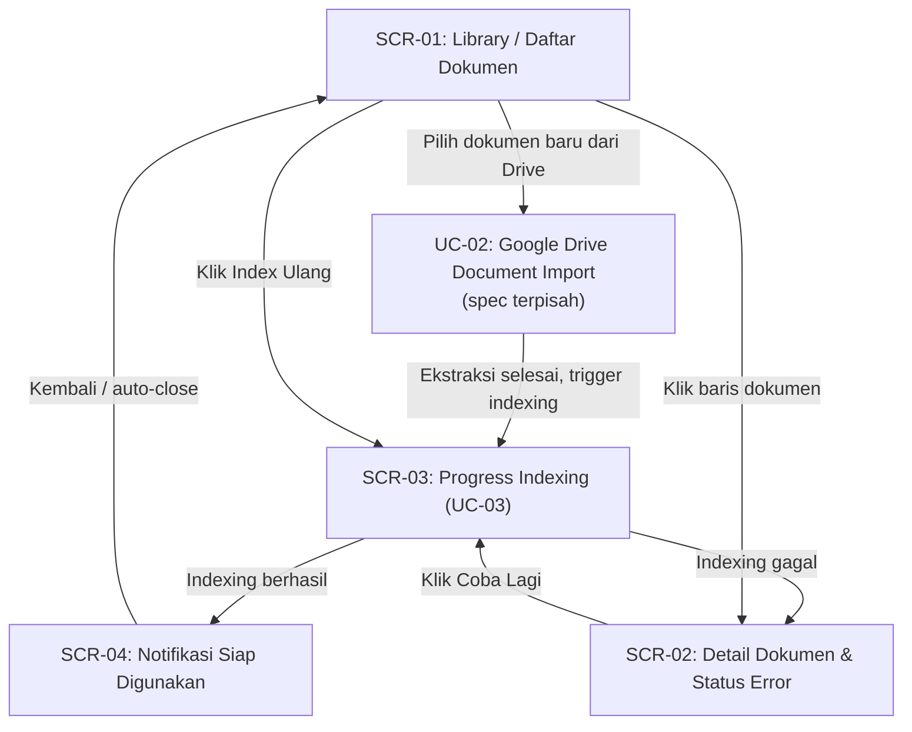
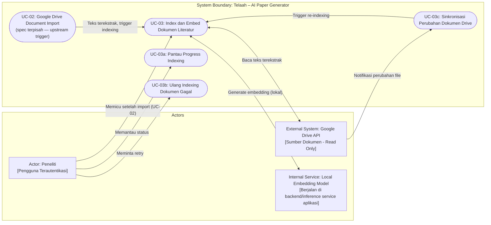
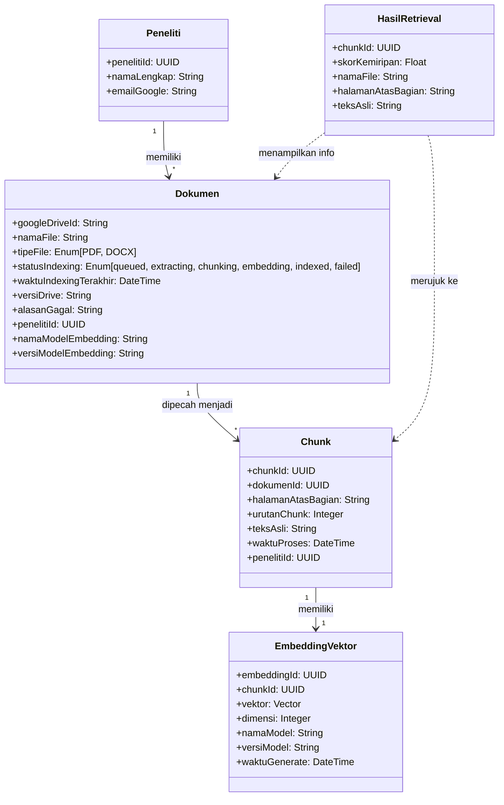

# Feature Specification: Document Indexing & Embedding – ICONIX Process

**Feature Branch**: `003-document-indexing-embedding`
**Created**: 2026-09-19
**Status**: Draft
**Input**: User description: "Revisi spesifikasi UC 2 dengan menambahkan tahap indexing dan embedding dokumen setelah proses import dan ekstraksi teks."
**Methodology Reference**: Doug Rosenberg & Matt Stephens, *Use Case Driven Object Modeling with UML*

> **Catatan Dekomposisi UC**: Spec ini mencakup **UC-03: Document Indexing & Embedding** saja. Browse dokumen dari Google Drive dan proses import/ekstraksi teks dipisahkan ke **UC-02: Google Drive Document Import** (spec terpisah, dibuat via `/speckit-specify`). UC-01 hanya mencakup Google OAuth login dan grant permission `drive.readonly`.

---

## 1. Overview & System Context

Fitur ini merupakan kelanjutan dari UC-02 (Google Drive Document Import). Setelah dokumen berhasil diimpor dan teks diekstrak oleh UC-02, sistem Telaah harus memprosesnya melalui pipeline *indexing* dan *embedding* agar dokumen tersebut dapat digunakan dalam proses *semantic retrieval* saat menghasilkan draf paper ilmiah.

**Target Aktor**: Peneliti yang telah mengautentikasi akunnya dan memiliki dokumen literatur yang sudah diimpor dari Google Drive (oleh UC-02).

**Masalah yang Diselesaikan**: Tanpa tahap indexing dan embedding, dokumen yang diimpor hanya tersimpan sebagai file mentah dan tidak dapat digunakan secara semantik oleh sistem AI. Fitur ini mengubah dokumen mentah menjadi representasi vektor yang dapat dicari secara presisi, memungkinkan sistem untuk menemukan bagian dokumen yang relevan berdasarkan konteks penulisan paper.

**Nilai Bisnis**: Menjamin setiap dokumen literatur yang diimpor peneliti dapat digunakan secara efektif dalam proses asistansi penulisan paper ilmiah, dengan keterlacakan penuh ke sumber aslinya untuk integritas sitasi.

**Keputusan Arsitektur Kunci**: Seluruh proses *vector embedding* dokumen referensi menggunakan **model embedding lokal** yang berjalan di dalam environment backend atau inference service milik aplikasi. Gemini Text Embedding API atau layanan cloud embedding lainnya **tidak boleh digunakan** untuk proses indexing dokumen. Gemini API hanya diperbolehkan untuk proses generasi atau transformasi teks pada use case lain jika memang dibutuhkan.

---

## 2. GUI Storyboards & Screen Navigation

### Screen Inventory

| Screen / View ID | Screen Name | Key UI Elements | Next Screen / Action Trigger |
|---|---|---|---|
| `SCR-01` | Library / Daftar Dokumen | Tabel dokumen, kolom status indexing (badge), tombol "Index Ulang", tombol "Tambah Dokumen" | Klik baris → `SCR-02`; Klik "Tambah Dokumen" → UC-02 (Drive Import) |
| `SCR-02` | Detail Dokumen & Status Indexing | Nama file, status pipeline (progress stepper), rincian error (jika gagal), tombol "Coba Lagi" | Klik "Coba Lagi" → memulai ulang indexing; Klik kembali → `SCR-01` |
| `SCR-03` | Progress Indexing (Inline / Notifikasi) | Progress bar atau indikator langkah (Queued → Extracting → Chunking → Embedding → Indexed), pesan status terkini | Auto-update saat status berubah; Selesai → badge "Indexed" di `SCR-01` |
| `SCR-04` | Notifikasi Siap Digunakan | Banner/toast "Dokumen siap untuk semantic retrieval" | Ditutup otomatis atau manual; status tersimpan di `SCR-01` |

### Storyboard Navigation Flow

---

## 3. Use Case Model (Doug Rosenberg Canonical)

### 3.1 Use Case Diagram (Actors & System Boundary)

---

### 3.2 Detailed Use Case Specifications

### UC-03: Index dan Embed Dokumen Literatur

- **Primary Actor**: Peneliti (dipicu otomatis setelah ekstraksi teks oleh UC-02 selesai; dapat juga dipicu manual)
- **Goal in Context**: Peneliti memiliki dokumen literatur yang telah diindeks dan siap digunakan untuk pencarian semantik dalam proses penulisan paper
- **Preconditions**:
  - Peneliti telah berhasil login via Google OAuth 2.0
  - Dokumen PDF atau DOCX telah diimpor dari Google Drive dan teks telah berhasil diekstrak oleh UC-02 (Google Drive Document Import)
  - Dokumen belum dalam status `indexed`, atau dokumen telah berubah sejak indexing terakhir
  - Model embedding lokal tersedia dan dapat menerima permintaan inference
- **Postconditions (Success Guarantees)**:
  - Teks dokumen telah dibersihkan, dipecah menjadi chunk-chunk, dan setiap chunk memiliki embedding vektor tersimpan di sistem
  - Metadata lengkap setiap chunk tersimpan dan dapat ditelusuri ke dokumen sumber, termasuk nama model, versi model, dan dimensi vektor yang digunakan
  - Status dokumen berubah menjadi `indexed`
  - Peneliti mendapat notifikasi bahwa dokumen siap untuk semantic retrieval
- **Trigger**: Penyelesaian proses ekstraksi teks oleh UC-02 (otomatis), atau permintaan manual dari peneliti

#### Basic Course of Events (Sunny Day Flow)

| Step | Actor Action | System Response |
|:---:|---|---|
| 1 | UC-02 menyelesaikan ekstraksi teks dari dokumen yang diimpor. | Sistem mengubah status dokumen menjadi `queued` dan menambahkan dokumen ke antrian pemrosesan indexing. |
| 2 | — (proses otomatis) | Sistem mengambil dokumen dari antrian, mengubah status menjadi `extracting`, dan membersihkan teks hasil ekstraksi dari karakter atau struktur yang tidak diperlukan (header/footer berulang, karakter khusus, spasi berlebih). Pembersihan mendukung teks berbahasa Indonesia maupun Inggris. |
| 3 | — (proses otomatis) | Sistem mengubah status menjadi `chunking`, memecah teks menjadi potongan-potongan (chunk) dengan ukuran yang sesuai dan overlap yang memadai untuk menjaga konteks antar-chunk. |
| 4 | — (proses otomatis) | Sistem menyimpan metadata setiap chunk: identitas dokumen Google Drive, nama file, halaman/bagian dokumen, urutan chunk, teks asli chunk, waktu proses, identitas peneliti pemilik dokumen, nama model embedding lokal yang akan digunakan, versi model, dan dimensi vektor yang diharapkan. |
| 5 | — (proses otomatis) | Sistem mengubah status menjadi `embedding` dan mengirimkan setiap chunk ke **model embedding lokal** (berjalan di dalam environment backend atau inference service aplikasi) untuk menghasilkan representasi vektor. Tidak ada panggilan ke Gemini Text Embedding API atau layanan cloud embedding eksternal pada tahap ini. |
| 6 | — (proses otomatis) | Sistem menerima vektor dari model lokal, memverifikasi konsistensi dimensi vektor terhadap kolom penyimpanan vektor, kemudian menyimpan hasil embedding beserta metadata chunk (termasuk nama model, versi, dimensi) ke penyimpanan vektor. |
| 7 | — (proses otomatis) | Sistem mengubah status dokumen menjadi `indexed` dan memperbarui waktu indexing terakhir. |
| 8 | Peneliti membuka halaman Library. | Sistem menampilkan status dokumen sebagai `Indexed` dengan badge visual dan menampilkan notifikasi bahwa dokumen siap digunakan untuk penulisan paper. |

#### Alternate & Exception Courses (Rainy Day Flows)

- **Alt-1: Dokumen Sama Tanpa Perubahan (Duplikasi Dicegah)**
  - **Pada Step 1**: Jika dokumen yang sama (berdasarkan identitas Google Drive) telah dalam status `indexed` dan tidak ada perubahan sejak indexing terakhir:
  - Sistem melewati proses indexing, mempertahankan status `indexed`, dan menginformasikan bahwa indexing tidak diperlukan.

- **Alt-2: Dokumen Berubah di Google Drive (Re-indexing)**
  - **Pada Step 1**: Jika sistem mendeteksi perubahan file di Google Drive (melalui perbandingan versi/hash):
  - Sistem menghapus data embedding lama dari dokumen tersebut dan memulai ulang pipeline indexing dari awal.

- **Alt-3: Kegagalan pada Tahap Pembersihan atau Chunking**
  - **Pada Step 2–3**: Jika teks tidak dapat dibersihkan atau dipecah (misalnya dokumen terenkripsi atau korup):
  - Sistem mengubah status menjadi `failed`, menyimpan alasan kegagalan yang dapat dibaca peneliti, dan menampilkan opsi "Coba Lagi" di antarmuka.

- **Alt-4: Kegagalan pada Tahap Embedding — Model Lokal Tidak Tersedia**
  - **Pada Step 5**: Jika model embedding lokal tidak dapat dijangkau (tidak berjalan, habis memori, atau tidak responsif):
  - Sistem mengubah status menjadi `failed`, menyimpan pesan error yang jelas dan dapat dibaca peneliti (misalnya: "Model embedding lokal tidak tersedia. Periksa status inference service."), dan menyediakan opsi retry. Sistem tidak beralih ke layanan cloud embedding sebagai fallback.

- **Alt-4b: Kegagalan pada Tahap Embedding — Dimensi Vektor Tidak Sesuai**
  - **Pada Step 6**: Jika vektor yang dikembalikan model lokal memiliki dimensi berbeda dari yang dikonfigurasi pada kolom penyimpanan vektor:
  - Sistem menolak penyimpanan, mengubah status menjadi `failed`, dan menyimpan detail ketidaksesuaian dimensi. Ini mencegah pencampuran vektor dari model berbeda.

- **Alt-5: Sinkronisasi Penghapusan Dokumen di Drive**
  - **Kapan saja**: Jika dokumen sumber dihapus dari Google Drive:
  - Sistem menandai dokumen sebagai tidak tersedia, menghapus data embedding terkait, dan menginformasikan peneliti bahwa dokumen tidak lagi dapat digunakan.

- **Alt-6: Hak Akses Tidak Memadai**
  - **Kapan saja**: Jika peneliti mencoba melihat atau memicu indexing dokumen milik peneliti lain:
  - Sistem menolak akses dan tidak menampilkan data embedding atau metadata chunk yang bukan milik peneliti tersebut.

- **Alt-7: Pergantian Model Embedding (Versioning)**
  - **Di luar siklus normal**: Jika model embedding lokal yang digunakan diganti dengan model lain (menghasilkan dimensi atau representasi berbeda):
  - Sistem harus dapat mengidentifikasi dokumen yang diindeks menggunakan model lama dan menyediakan mekanisme untuk re-indexing selektif. Vektor dari model berbeda tidak boleh bercampur dalam satu kolom penyimpanan vektor.

---

### UC-03a: Pantau Progress Indexing

- **Primary Actor**: Peneliti
- **Goal in Context**: Peneliti dapat memantau tahapan indexing dokumen secara real-time
- **Preconditions**: Dokumen sedang dalam proses indexing (status bukan `indexed` atau `failed`)
- **Postconditions**: Peneliti melihat status terkini pipeline indexing

#### Basic Course of Events

| Step | Actor Action | System Response |
|:---:|---|---|
| 1 | Peneliti membuka halaman Library atau Detail Dokumen. | Sistem menampilkan status pipeline terkini: `queued`, `extracting`, `chunking`, `embedding`, `indexed`, atau `failed`. |
| 2 | — (otomatis) | Sistem memperbarui indikator status secara berkala tanpa perlu refresh halaman manual. |
| 3 | Peneliti melihat status berubah menjadi `indexed`. | Sistem menampilkan notifikasi bahwa dokumen siap digunakan untuk semantic retrieval. |

---

### UC-03b: Ulang Indexing Dokumen Gagal

- **Primary Actor**: Peneliti
- **Goal in Context**: Peneliti dapat memulai ulang proses indexing untuk dokumen yang gagal diproses
- **Preconditions**: Status dokumen adalah `failed`
- **Postconditions**: Proses indexing dimulai ulang dari awal

#### Basic Course of Events

| Step | Actor Action | System Response |
|:---:|---|---|
| 1 | Peneliti membuka Detail Dokumen dengan status `failed`. | Sistem menampilkan alasan kegagalan (termasuk keterangan spesifik apakah kegagalan karena model lokal tidak tersedia atau karena dimensi vektor tidak sesuai) dan tombol "Coba Lagi". |
| 2 | Peneliti mengklik "Coba Lagi". | Sistem mengubah status menjadi `queued` dan memasukkan kembali dokumen ke antrian indexing. |
| 3 | — (otomatis) | Sistem memulai ulang pipeline indexing seperti pada UC-03 Sunny Day Flow. |

---

## 4. Initial Domain Model (Noun-Phrase Extraction)

- **Dokumen**: Representasi file literatur ilmiah yang sudah diimpor melalui UC-02. Menyimpan status pipeline indexing, referensi ke pemilik (peneliti), serta nama dan versi model embedding lokal yang digunakan saat indexing.
- **Chunk**: Potongan teks dari dokumen, unit terkecil yang diproses dan disimpan bersama metadata sumbernya untuk keterlacakan.
- **EmbeddingVektor**: Representasi numerik vektor dari sebuah chunk yang digunakan untuk pencarian semantik. Terikat erat ke chunk sumber dan mencatat nama model, versi model, serta dimensi vektor yang digunakan — memungkinkan deteksi ketidaksesuaian saat model diganti.
- **Peneliti**: Pengguna sistem yang memiliki hak akses eksklusif atas dokumen dan embedding miliknya.
- **HasilRetrieval**: Struktur hasil pencarian semantik yang mengembalikan chunk relevan beserta konteks dokumen sumber (nama file, lokasi chunk).

---

## 5. Requirements Traceability

### Functional Requirements (FR)

- **FR-001**: Sistem HARUS membersihkan teks hasil ekstraksi dari karakter atau struktur yang tidak diperlukan sebelum melakukan chunking. *(UC-03 Step 2)*
- **FR-002**: Sistem HARUS memecah teks menjadi chunk-chunk dengan ukuran yang sesuai dan overlap yang memadai untuk menjaga konteks. *(UC-03 Step 3)*
- **FR-003**: Sistem HARUS menyimpan metadata setiap chunk, mencakup minimal: identitas dokumen Google Drive, nama file, halaman/bagian dokumen, urutan chunk, teks asli chunk, waktu proses, identitas peneliti pemilik, nama model embedding lokal yang digunakan, versi model, dan dimensi vektor. *(UC-03 Step 4)*
- **FR-004**: Sistem HARUS menghasilkan embedding vektor untuk setiap chunk menggunakan **model embedding lokal** yang berjalan di dalam environment backend atau inference service milik aplikasi. Gemini Text Embedding API dan layanan cloud embedding eksternal lainnya **dilarang digunakan** untuk proses indexing dokumen referensi. *(UC-03 Step 5)*
- **FR-005**: Sistem HARUS menyimpan embedding dan metadata chunk ke penyimpanan vektor. *(UC-03 Step 6)*
- **FR-006**: Sistem HARUS memverifikasi konsistensi dimensi vektor antara model embedding lokal dan kolom penyimpanan vektor sebelum penyimpanan; penyimpanan vektor dengan dimensi tidak sesuai harus ditolak. *(UC-03 Step 6)*
- **FR-007**: Sistem HARUS menandai status indexing dokumen dengan salah satu dari: `queued`, `extracting`, `chunking`, `embedding`, `indexed`, atau `failed`. *(UC-03 Step 1–7)*
- **FR-008**: Sistem HARUS mencegah duplikasi indexing apabila dokumen yang sama tidak mengalami perubahan sejak indexing terakhir. *(Alt-1)*
- **FR-009**: Sistem HARUS memproses ulang dokumen apabila file di Google Drive mengalami perubahan sejak indexing terakhir. *(Alt-2)*
- **FR-010**: Sistem HARUS menyimpan alasan kegagalan yang dapat dibaca peneliti apabila proses indexing gagal, dan menyediakan opsi untuk memulai ulang proses. *(Alt-3, Alt-4)*
- **FR-011**: Sistem HARUS menampilkan progress indexing (status pipeline) kepada peneliti secara real-time. *(UC-03a)*
- **FR-012**: Sistem HARUS memberikan informasi bahwa dokumen telah siap digunakan untuk semantic retrieval setelah indexing berhasil. *(UC-03 Step 8)*
- **FR-013**: Sistem HARUS memastikan setiap embedding dapat ditelusuri kembali ke dokumen dan chunk sumbernya. *(FR-003 + FR-005)*
- **FR-014**: Sistem HARUS memastikan data embedding dan isi dokumen hanya dapat diakses oleh peneliti pemilik dokumen tersebut. *(Alt-6)*
- **FR-015**: Sistem HARUS menyinkronisasi penghapusan dokumen di Google Drive dengan penghapusan data indexing terkait di aplikasi. *(Alt-5)*
- **FR-016**: Sistem TIDAK BOLEH mengubah atau memodifikasi dokumen asli di Google Drive dalam proses apapun. *(Constraint)*
- **FR-017**: Hasil pencarian semantik (similarity search) HARUS menampilkan nama dokumen dan lokasi chunk sumber. *(HasilRetrieval)*
- **FR-018**: Model embedding lokal HARUS mampu menghasilkan representasi vektor untuk teks berbahasa Indonesia dan bahasa Inggris karena dokumen referensi dapat menggunakan salah satu atau keduanya. *(UC-03 Step 2, Clarification)*
- **FR-019**: Sistem HARUS dapat menjalankan seluruh pipeline indexing tanpa bergantung pada Gemini Text Embedding API atau layanan cloud embedding eksternal; indexing HARUS berfungsi penuh bahkan ketika tidak ada koneksi ke layanan cloud embedding. *(UC-03 Step 5, Clarification)*
- **FR-020**: Apabila model embedding lokal tidak tersedia atau tidak responsif, sistem HARUS menampilkan pesan error yang jelas kepada peneliti dan TIDAK BOLEH mengalihkan proses ke layanan cloud embedding sebagai fallback. *(Alt-4, Clarification)*
- **FR-021**: Metadata setiap chunk dan dokumen HARUS mencatat nama model embedding, versi model, dan dimensi vektor yang digunakan saat indexing. *(UC-03 Step 4 & 6, Clarification)*
- **FR-022**: Apabila model embedding lokal diganti dengan model berbeda, sistem HARUS memiliki mekanisme versioning yang mencegah percampuran vektor dari model berbeda dalam satu kolom penyimpanan vektor, dan HARUS menyediakan kemampuan re-indexing selektif untuk dokumen yang diindeks oleh model lama. *(Alt-7, Clarification)*

### Non-Functional Requirements (NFR)

- **NFR-001 (Performa)**: Proses indexing keseluruhan untuk dokumen berukuran rata-rata (≤ 50 halaman) harus selesai dalam waktu yang wajar sehingga peneliti tidak perlu menunggu lama; dokumen tetap dapat digunakan secara semantik sesegera mungkin setelah selesai.
- **NFR-002 (Keamanan & Privasi)**: Data embedding dan teks chunk hanya dapat diakses oleh peneliti yang memiliki hak atas dokumen tersebut; tidak boleh ada kebocoran data lintas peneliti.
- **NFR-003 (Keterlacakan)**: Setiap hasil retrieval harus dapat ditelusuri sampai ke dokumen sumber dan nomor halaman/bagian aslinya, mendukung integritas sitasi ilmiah.
- **NFR-004 (Integritas Data)**: Sistem harus menjaga konsistensi antara dimensi vektor model embedding yang digunakan dan kolom penyimpanan vektor; penyimpanan vektor dengan dimensi tidak sesuai harus ditolak secara eksplisit.
- **NFR-005 (Non-Destruktif)**: Proses indexing tidak boleh dalam kondisi apapun mengubah, memindahkan, atau menghapus dokumen asli di Google Drive.
- **NFR-006 (Ketahanan Gagal)**: Kegagalan pada satu dokumen tidak boleh menghentikan pemrosesan dokumen lain di antrian.
- **NFR-007 (Kemandirian dari Cloud Embedding)**: Proses indexing harus berjalan sepenuhnya di dalam environment yang dikendalikan aplikasi (backend/inference service). Sistem tidak boleh bergantung pada layanan embedding cloud pihak ketiga (termasuk Gemini Text Embedding API) untuk menghasilkan vektor dokumen referensi; ketergantungan eksternal pada tahap ini meningkatkan risiko privasi data dan ketergantungan layanan.
- **NFR-008 (Dukungan Multibahasa)**: Model embedding lokal yang dipilih harus mendukung teks berbahasa Indonesia dan bahasa Inggris secara memadai, mengingat dokumen referensi ilmiah dapat menggunakan salah satu atau kedua bahasa tersebut.

---

## 6. Success Criteria & Scope Boundaries

- **SC-001**: Dokumen PDF atau DOCX yang sudah diimpor melalui UC-02 berhasil dipecah menjadi chunk yang valid — terverifikasi ketika setiap chunk memiliki teks yang bermakna dan metadata sumber yang lengkap.
- **SC-002**: Setiap chunk memiliki metadata sumber yang valid, mencakup identitas dokumen, nama file, informasi halaman/bagian, urutan chunk, teks asli, waktu proses, dan identitas peneliti.
- **SC-003**: Embedding berhasil dibuat dan tersimpan, dengan setiap embedding terikat ke chunk sumber yang dapat dilacak.
- **SC-004**: Pencarian semantik (similarity search) berhasil menemukan chunk yang relevan berdasarkan query uji dalam bahasa alami.
- **SC-005**: Hasil pencarian menampilkan nama dokumen dan lokasi chunk sumber (halaman/bagian) untuk setiap hasil yang dikembalikan.
- **SC-006**: Dokumen yang sama tidak menghasilkan embedding duplikat ketika tidak ada perubahan pada file di Google Drive.
- **SC-007**: Dokumen yang mengalami perubahan di Google Drive dapat diindeks ulang, menggantikan embedding lama dengan yang baru.
- **SC-008**: Kegagalan pada tahap pembersihan, chunking, atau embedding dapat ditampilkan kepada peneliti dengan deskripsi yang jelas dan opsi untuk mencoba ulang.
- **SC-009**: Proses indexing berjalan tanpa memodifikasi dokumen asli di Google Drive.
- **SC-010**: Data embedding satu peneliti tidak dapat diakses oleh peneliti lain.
- **SC-011**: Indexing satu dokumen berhasil diselesaikan **tanpa** memanggil Gemini Text Embedding API atau layanan cloud embedding eksternal lainnya — dapat diverifikasi melalui log atau monitoring jaringan.
- **SC-012**: Setiap chunk memiliki vector embedding lokal yang tersimpan di penyimpanan vektor, dapat diambil dan digunakan untuk similarity search.
- **SC-013**: Metadata setiap chunk dan dokumen mencatat nama model embedding, versi model, dimensi vektor, dan waktu embedding dibuat.
- **SC-014**: Similarity search berhasil mengambil chunk yang relevan menggunakan vektor hasil model lokal berdasarkan query uji dalam bahasa Indonesia maupun bahasa Inggris.
- **SC-015**: Apabila model embedding lokal tidak tersedia saat proses indexing berjalan, sistem menampilkan pesan error yang jelas dan spesifik (bukan pesan generik) tanpa mencoba memanggil layanan cloud embedding sebagai pengganti.
- **SC-016**: Vektor dari model embedding versi berbeda tidak bercampur dalam satu kolom penyimpanan — sistem dapat mengidentifikasi dokumen mana yang perlu di-index ulang ketika model diganti.

**Out of Scope**:
- Browse, pemilihan, dan impor dokumen dari Google Drive (menjadi **UC-02: Google Drive Document Import**, spec terpisah)
- Ekstraksi teks dari file PDF/DOCX (bagian dari UC-02)
- Pemilihan atau konfigurasi model embedding oleh peneliti melalui antarmuka (ditentukan pada tahap perencanaan teknis `/speckit-plan`)
- Ukuran chunk spesifik dan nilai overlap (dikonfigurasi pada tahap teknis)
- Antarmuka pencarian semantik mandiri (bagian dari fitur generasi paper)
- Pengindeksan dokumen selain PDF dan DOCX
- Sinkronisasi real-time berbasis webhook Google Drive (dapat ditambahkan di iterasi mendatang)
- Penggunaan Gemini Text Embedding API atau layanan cloud embedding untuk indexing dokumen referensi (eksplisit di luar scope dan dilarang)

---

## 7. Assumptions

- UC-02 (Google Drive Document Import) menghasilkan teks mentah yang tersimpan dan siap dikonsumsi oleh pipeline indexing UC-03 ini.
- Model embedding lokal yang digunakan telah ditentukan pada tahap perencanaan teknis, mendukung teks berbahasa Indonesia dan bahasa Inggris, dan dimensi vektornya bersifat tetap selama lifecycle aplikasi untuk satu versi model.
- Apabila model embedding lokal diganti, proses re-indexing dokumen lama menjadi tanggung jawab operasional yang harus difasilitasi oleh sistem (bukan hanya manual migration).
- Sistem sudah memiliki mekanisme untuk mendeteksi versi/perubahan file di Google Drive (misalnya melalui `modifiedTime` atau checksum) — mekanisme ini dapat berasal dari UC-02 atau UC-03c.
- Proses indexing dijalankan sebagai tugas latar belakang (background job) dan tidak memblokir interaksi peneliti dengan bagian lain aplikasi.
- Hak akses dokumen mengikuti kepemilikan dokumen di Google Drive: hanya peneliti yang mengimpor dokumen yang dapat mengaksesnya di Telaah.
- Gemini API (untuk generasi teks) dan model embedding lokal (untuk indexing) adalah dua komponen terpisah dan tidak saling menggantikan.

---

## 8. Git & Version Control Strategy

- **Feature Branch**: `003-document-indexing-embedding`
- **Conventional Commits Standard**:
  - `feat(scope)`: Fitur baru atau kapabilitas baru
  - `test(scope)`: Penambahan atau pembaruan tes
  - `refactor(scope)`: Perbaikan struktur internal
  - `chore(scope)`: Scaffolding, konfigurasi, atau dokumentasi
- **Major Milestone Checkpoints**:
  - **Milestone 1 (Foundation)**: `feat(indexing): setup document chunk schema and indexing queue`
  - **Milestone 2 (Pipeline)**: `feat(UC-03): complete text cleaning, chunking, and metadata storage`
  - **Milestone 3 (Embedding)**: `feat(UC-03): integrate local embedding model and persist vectors to pgvector`
  - **Milestone 4 (Release)**: `chore(release): complete UC-03 indexing pipeline verification and documentation`

---

## Clarifications

### Session 2026-09-19

- Q: Apakah model embedding yang digunakan untuk indexing dokumen harus berjalan secara lokal (bukan layanan cloud seperti Gemini Text Embedding API)? → A: Ya, model embedding lokal wajib digunakan. Gemini Text Embedding API dan layanan cloud embedding lainnya dilarang untuk proses indexing dokumen referensi. Gemini API hanya boleh digunakan untuk generasi/transformasi teks pada use case lain.
- Q: Apakah model embedding lokal harus mendukung multibahasa (Indonesia dan Inggris)? → A: Ya. Dokumen referensi dapat menggunakan bahasa Indonesia atau bahasa Inggris, sehingga model lokal yang dipilih harus mampu menghasilkan representasi vektor yang memadai untuk kedua bahasa tersebut.
- Q: Metadata apa yang harus dicatat per chunk/embedding terkait model yang digunakan? → A: Metadata wajib mencatat nama model embedding, versi model, dimensi vektor, dan waktu embedding dibuat — disimpan di level chunk dan dokumen.
- Q: Bagaimana sistem menangani pergantian model embedding? → A: Sistem harus memiliki strategi versioning: vektor dari model berbeda tidak boleh bercampur, dan sistem harus menyediakan kemampuan re-indexing selektif untuk dokumen yang diindeks oleh model lama.
- Q: Apa yang harus dilakukan sistem jika model embedding lokal tidak tersedia saat indexing? → A: Sistem mengubah status menjadi `failed`, menampilkan pesan error yang jelas dan spesifik, dan tidak boleh beralih ke layanan cloud embedding sebagai fallback.
- Q: Apakah use case koneksi/browse Google Drive dan document indexing sebaiknya dipisah menjadi UC tersendiri? → A: Ya, dipisah. UC-01 = Google OAuth login & grant permission. UC-02 = Google Drive Document Import (browse, pilih file, ekstraksi teks) — spec baru dibuat via `/speckit-specify`. UC-03 = Document Indexing & Embedding (spec ini).
