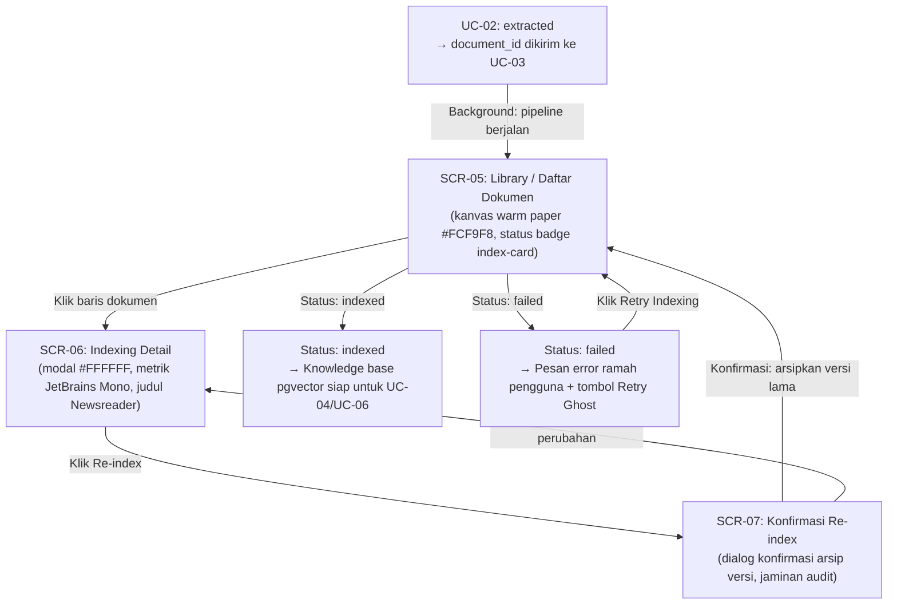
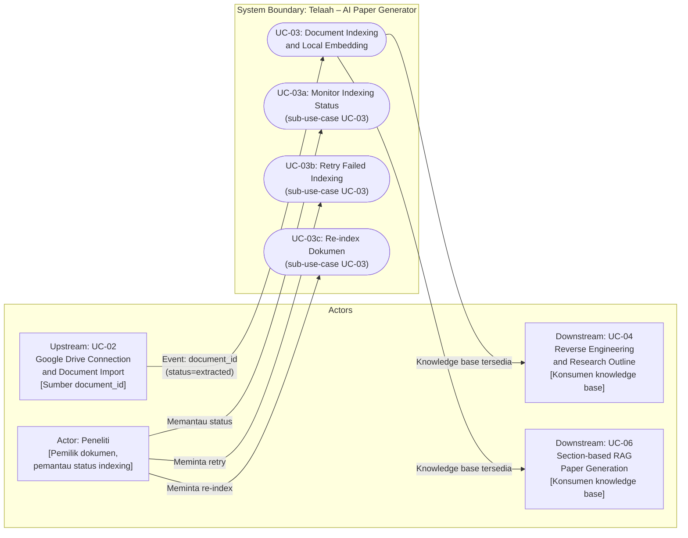
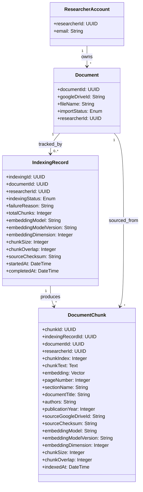

# Feature Specification: UC-03 Document Indexing and Local Embedding – ICONIX Process

**Feature Branch**: `003-document-indexing-embedding`
**Created**: 2026-09-21
**Status**: Completed (Implemented & Verified)
**Input**: User description: "UC-03: Document Indexing and Local Embedding — mengubah hasil ekstraksi dokumen menjadi knowledge base berbasis vektor untuk semantic retrieval pada paper generator iciCos."
**Methodology Reference**: Doug Rosenberg & Matt Stephens, *Use Case Driven Object Modeling with UML*

> **Catatan Dekomposisi UC**: Spec ini mencakup **UC-03: Document Indexing and Local Embedding** — mulai dari penerimaan `document_id` dari UC-02, cleaning teks, chunking, pembuatan embedding lokal, hingga penyimpanan vector dan metadata ke PostgreSQL/pgvector. UC-03 **berhenti** setelah status dokumen menjadi `indexed` dan knowledge base siap digunakan oleh UC-04 (Reverse Engineering and Research Outline) serta UC-06 (Section-based RAG Paper Generation). UC-03 **tidak melakukan** pembuatan outline paper, pemanggilan LLM generatif, citation validation, rendering LaTeX/PDF, atau koneksi ke Google Drive.

---

## 1. Overview & System Context

Setelah UC-02 (Google Drive Connection and Document Import) berhasil mengekstrak teks dokumen dan mengubah status menjadi `extracted`, UC-03 menerima sinyal berupa `document_id` dan menjalankan pipeline transformasi: membersihkan teks, memecahnya menjadi chunk terkelola, menghasilkan representasi vektor menggunakan model embedding yang berjalan secara lokal, lalu menyimpan seluruh chunk beserta metadata keterlacakannya ke PostgreSQL dengan ekstensi pgvector.

**Target Aktor**: Peneliti yang memiliki dokumen dengan status `extracted` di sistem Telaah. Proses berjalan secara otomatis di background; peneliti dapat memantau status indexing dan melihat ringkasan hasilnya.

**Masalah yang Diselesaikan**: Teks mentah hasil ekstraksi UC-02 tidak dapat langsung digunakan untuk semantic retrieval. Tanpa indexing dan embedding, sistem tidak dapat menemukan bagian dokumen yang relevan berdasarkan konteks penulisan paper. Fitur ini mengubah teks mentah menjadi knowledge base yang dapat dicari secara presisi, sambil menjaga keterlacakan setiap chunk ke dokumen dan halaman sumbernya.

**Nilai Bisnis**: Memungkinkan generator paper iciCos (UC-04 dan UC-06) menggunakan koleksi literatur yang telah diimpor peneliti untuk melakukan semantic retrieval yang akurat, tertelusuri, dan bebas dari fabrikasi sitasi.

**Independensi dari API Cloud**: Seluruh proses pembuatan embedding dilakukan oleh model yang berjalan lokal — tidak ada ketergantungan pada Gemini Text Embedding API atau layanan embedding cloud manapun. Hal ini menjamin reprodusibilitas, kontrol versi model, dan ketersediaan sistem tanpa bergantung pada kuota atau biaya API eksternal.

---

## Clarifications

### Session 2026-09-21

- Q: Model embedding yang digunakan? → A: Model Hugging Face lokal, kandidat utama `intfloat/multilingual-e5-base`. Harus mendukung Bahasa Indonesia dan Bahasa Inggris. Model dimuat sekali dan digunakan kembali.
- Q: Apakah Gemini Text Embedding API boleh digunakan untuk indexing? → A: Tidak. UC-03 dilarang menggunakan Gemini Text Embedding API atau external embedding API untuk proses indexing.
- Q: Prefix pada chunk saat indexing? → A: Setiap chunk diberi prefix `"passage: "` sebelum di-embed (sesuai konvensi multilingual-e5). Query retrieval pada UC-04/UC-06 menggunakan prefix `"query: "`.
- Q: Apakah LangChain digunakan? → A: Ya, secara hybrid — untuk text splitter, HuggingFace embeddings wrapper, dan prompt/retriever interface bila diperlukan. Komponen inti (service, repository, metadata, status, deduplication, retry) diimplementasi sebagai kode aplikasi sendiri.
- Q: Apakah model/konfigurasi chunking dapat diubah oleh peneliti? → A: Tidak pada versi awal. Model dan konfigurasi chunking dikelola sistem (environment config), bukan oleh peneliti secara bebas.
- Q: Berapa chunk_size dan chunk_overlap baseline? → A: Nilai default dapat dikonfigurasi melalui environment variable; nilai spesifik ditentukan saat planning/implementation.
- Q: Dari mana metadata bibliografi berasal? → A: Metadata utama diekstrak pada UC-02; UC-03 hanya meneruskan dan menyimpan metadata tersebut — tidak mengekstrak metadata bibliografi secara mandiri.
- Q: Apakah satu dokumen dapat memiliki beberapa index version? → A: Ya. Setiap perubahan model atau konfigurasi chunking menghasilkan `IndexingRecord` baru (index version baru). Index lama dipertahankan sementara untuk keperluan audit sebelum dapat dibersihkan.
- Q: Apa yang terjadi pada index lama saat re-indexing? → A: Index lama ditandai sebagai `archived` (bukan langsung dihapus). Index baru menjadi `active`. Pembersihan index lama dilakukan secara terpisah oleh administrator atau mekanisme cleanup.
- Q: Apakah similarity search dasar ada di UC-03? → A: Ya — similarity search dasar berada di UC-03 untuk verifikasi bahwa index berfungsi. Retrieval berbasis section untuk paper generation berada di UC-06.
- Q: Apakah dokumen hanya dapat diakses oleh pemiliknya? → A: Ya. Dokumen dan chunk hanya dapat diakses oleh `researcher_id` pemiliknya.
- Q: Apa fallback jika model lokal gagal dimuat? → A: Sistem memberikan pesan error yang jelas dan mengubah status menjadi `failed`. Fallback ke model ringan hanya dilakukan jika dikonfigurasi secara eksplisit di environment — tidak ada fallback otomatis tanpa konfigurasi.
- Q: Apakah teks chunk disimpan penuh? → A: Ya. Teks chunk lengkap beserta metadata disimpan agar hasil retrieval dapat ditelusuri langsung tanpa join ke tabel ekstraksi.

### Session 2026-09-22

- Q: Apakah chunk lama dihapus atau diarsipkan saat re-indexing dikonfirmasi? → A: Diarsipkan (`archived`) — `IndexingRecord` lama dan seluruh chunk-nya ditandai `archived`, tetap tersimpan untuk keperluan audit; tidak ada penghapusan otomatis saat re-indexing dikonfirmasi. Pembersihan dilakukan secara terpisah oleh administrator atau cleanup job.
- Q: Konfirmasi: model default, trigger otomatis, konfigurasi sistem-managed, env-configurable chunking, metadata dari UC-02, multi-version index, similarity search di UC-03, isolasi per peneliti, background job, fallback eksplisit, dan full-text chunk — semua dikonfirmasi sesuai session 2026-09-21. → A: Seluruh 12 poin dikonfirmasi tanpa perubahan dari keputusan sesi sebelumnya.

---

## 2. GUI Storyboards & Screen Navigation

UC-03 berjalan sebagai background pipeline. Antarmuka pengguna hanya menyediakan visibilitas status dan hasil — peneliti tidak mengoperasikan pipeline secara langsung. Seluruh elemen antarmuka mematuhi **Academic Editorial Canvas** ([DESIGN.md](file:///Users/gzaaa19/Telaah/DESIGN.md)) dan Konstitusi Telaah v1.3.0 Prinsip 7: kanvas kertas hangat (*warm paper* `#FCF9F8`), tipografi serif terkurasi (*Newsreader*), kontrol fungsional (*Inter*), data teknis & kode (*JetBrains Mono*), dan aksen *Scholarly Royal Blue* (`#1D4ED8`) serta *Archival Emerald* (`#006C4A`).

### Screen Inventory

| Screen / View ID | Screen Name | Key UI Elements | Next Screen / Action Trigger |
|---|---|---|---|
| `SCR-05` | Library / Daftar Dokumen (extended) | Tabel dokumen terimport dengan kolom status indexing (`queued`, `cleaning`, `chunking`, `embedding`, `storing`, `indexed`, `failed`), jumlah chunk, tombol "Retry Indexing" pada status `failed` | Klik "Retry Indexing" → restart pipeline UC-03; Status berubah otomatis saat pipeline berjalan |
| `SCR-06` | Indexing Detail | Ringkasan hasil indexing: total chunk, model embedding, dimensi vektor, waktu selesai; log status bertahap; tombol "Re-index Dokumen" | Klik "Re-index" → konfirmasi modal → restart pipeline |
| `SCR-07` | Konfirmasi Re-index | Pesan konfirmasi bahwa index version baru akan dibuat dan index lama akan dipertahankan sementara sebagai `archived` untuk keperluan audit sebelum dibersihkan; tombol "Ya, Re-index" dan "Batal" | Konfirmasi → pipeline baru dijalankan, index lama diarsipkan; Batal → kembali ke SCR-06 |

### Visual Design Specifications (Academic Editorial Canvas)

Setiap layar mengimplementasikan sistem desain terstruktur sesuai token visual berikut:

#### 1. SCR-05: Library / Pustaka Dokumen (Extended)
- **Struktur Tata Letak**: Multi-pane layout asimetris dengan sidebar navigasi statis `#F7F6F3` (lebar 260px) dan kanvas pustaka utama `#FCF9F8` (fluid dengan max reading area 1120px) dibatasi oleh pembatas hairline 1px `#E5E7EB`.
- **Tipografi**:
  - Judul Halaman: `Newsreader` 2rem (`headline-lg`), font-weight 600, warna Deep Carbon Ink `#191919`.
  - Subjudul / Panduan: `Inter` 0.875rem (`body-sm`), font-weight 400, warna Muted Slate `#64748B`.
  - Judul Dokumen pada Baris Tabel: `Newsreader` 1.125rem, font-weight 500, warna Carbon Ink `#191919`.
  - Metadata Dokumen (ukuran, ekstensi, timestamp): `Inter` 0.75rem (`label-sm`), warna `#64748B`.
- **Indexing Status Cell (Badge Indeks)**:
  - Mengadopsi karakter fisik kartu indeks katalog perpustakaan (*library index-card character*) dengan sudut `rounded-sm` (4px / 0.25rem), bukan pill bulat generik, font `JetBrains Mono` 0.75rem (`code-sm`):
    - **`indexed`**: Latar `#ECFDF5`, border 1px `#A7F3D0`, teks `#065F46` (Archival Emerald), ikon `@phosphor-icons/react` `CheckCircle`, status pip 6px hijau padat.
    - **`embedding` / `chunking` / `cleaning`**: Latar `#EFF6FF`, border 1px `#BFDBFE`, teks `#1D4ED8` (Academic Royal Blue), ikon `CircleNotch` dengan animasi rotasi kontinu.
    - **`queued`**: Latar `#F8FAFC`, border 1px `#E2E8F0`, teks `#64748B` (Muted Slate), ikon `Clock`.
    - **`failed`**: Latar `#FEF2F2`, border 1px `#FECACA`, teks `#B91C1C` (Archival Crimson), ikon `Warning`.
- **Aksi Coba Lagi (Retry)**:
  - Muncul otomatis pada baris dokumen berstatus `failed`.
  - Tombol bertipe Ghost: border 1px `#E5E7EB`, latar `#FFFFFF`, teks `#191919`, hover `#F7F6F3`, ikon `ArrowClockwise` (`@phosphor-icons/react`), tinggi 28px, sudut 4px.

#### 2. SCR-06: Indexing Detail (Modal / Inspector Panel)
- **Permukaan (Surface)**: Modal dialog solid `#FFFFFF` dengan sudut terdisiplin `rounded-lg` (8px / 0.5rem), border hairline 1px `#E5E7EB`, dan lapisan latar *backdrop blur* `rgba(247, 246, 243, 0.8)`.
- **Header Modal**:
  - Judul Dokumen: `Newsreader` 1.5rem (`headline-md`), font-weight 600, warna `#191919`.
  - Label Versi Aktif: Chip `JetBrains Mono` 0.75rem berlatar `#F1F5F9`, border `#E2E8F0`, teks `#475569`.
- **Panel Metrik Telemetri (2x2 Grid)**:
  - Kontainer metrik berlatar `#F8FAFC` dengan border 1px `#E2E8F0` dan sudut 4px:
    - **Total Chunk**: Angka tebal dalam `JetBrains Mono` 1.5rem, label deskriptif "Potongan Vektor" dalam `Inter` 0.75rem.
    - **Model Embedding**: Nama model `intfloat/multilingual-e5-base` dalam `JetBrains Mono` 0.8125rem dengan tag versi `v1`.
    - **Dimensi Vektor**: Nilai `768 Dimensi` dan tipe indeks `HNSW pgvector Cosine (<=>)`.
    - **Integritas Checksum**: SHA-256 fingerprint ditampilkan dalam blok `JetBrains Mono` 0.75rem ringkas dengan badge verifikasi hijau Archival Emerald.
- **Tahapan Pipeline (Visual Progress Stepper)**:
  - Stepper horizontal dengan garis hubung 1px `#E5E7EB` yang menghubungkan titik-titik tahapan: `queued` → `cleaning` → `chunking` → `embedding` → `storing` → `indexed`.
  - Tahap aktif ditandai lingkaran biru Academic Royal Blue `#1D4ED8` dengan denyut halus (*ambient pulse*).
- **Aksi Kontrol**:
  - Tombol "Re-index Dokumen": Tombol Sekunder/Ghost, border 1px `#E5E7EB`, teks `#191919`, sudut 4px.
  - Tombol "Uji Similarity Search": Tombol Primer Academic Royal Blue `#1D4ED8`, teks putih `#FFFFFF`, sudut 4px.

#### 3. SCR-07: Konfirmasi Re-index (Confirmation Dialog)
- **Permukaan**: Modal ringkas (lebar 440px) solid `#FFFFFF`, sudut `rounded-lg` (8px), border 1px `#E5E7EB`.
- **Simbol Peringatan**: Ikon `Warning` (`@phosphor-icons/react`) berwarna Archival Amber `#D97706` dalam kontainer `#FEF3C7` (radius 6px).
- **Tipografi Narasi**:
  - Judul Konfirmasi: `Newsreader` 1.25rem (`headline-sm`), semibold, warna `#191919`.
  - Isi Penjelasan: `Inter` 0.875rem (`body-md`), warna `#434655`.
  - Kotak Jaminan Audit Ilmiah: Kontainer penjelasan berlatar `#F8FAFC` dengan border 1px `#E2E8F0`, sudut 4px, menguraikan bahwa versi lama ditandai sebagai `archived` dan potongan teks lama tetap dipertahankan untuk audit keterlacakan sitasi ilmiah tanpa penghapusan paksa.
- **Tombol Keputusan**:
  - "Ya, Re-index Dokumen": Tombol Primer Academic Royal Blue (`#1D4ED8`, teks putih, tinggi 34px, sudut 4px).
  - "Batal": Tombol Sekunder Ghost (border `#E5E7EB`, teks `#191919`, hover `#F7F6F3`, sudut 4px).

### Storyboard Navigation Flow

---

## 3. Use Case Model (Doug Rosenberg Canonical)

### 3.1 Use Case Diagram (Actors & System Boundary)

---

### 3.2 Detailed Use Case Specifications

### UC-03: Document Indexing and Local Embedding

- **Primary Actor**: Sistem (dipicu otomatis oleh UC-02); Peneliti sebagai pemantau
- **Goal in Context**: Mengubah teks hasil ekstraksi UC-02 menjadi knowledge base berbasis vektor yang dapat digunakan untuk semantic retrieval oleh UC-04 dan UC-06
- **Preconditions**:
  - Dokumen memiliki status `extracted` (ditetapkan oleh UC-02)
  - `ExtractedText` dan `ExtractedPage` tersedia di sistem untuk `document_id` tersebut
  - Model embedding lokal tersedia dan dapat dimuat
  - PostgreSQL dengan pgvector tersedia
- **Postconditions (Success Guarantees)**:
  - Seluruh chunk teks beserta embedding dan metadata tersimpan di PostgreSQL/pgvector
  - Status dokumen berubah menjadi `indexed`
  - Setiap chunk dapat ditelusuri ke dokumen, halaman, dan section sumbernya
  - Knowledge base siap digunakan oleh UC-04 dan UC-06
  - Tidak ada chunk duplikat berdasarkan kombinasi `document_id`, checksum, versi model, dan konfigurasi chunking
- **Trigger**: UC-02 mengirimkan event/job berisi `document_id` setelah status dokumen menjadi `extracted`

#### Basic Course of Events (Sunny Day Flow)

| Step | Actor Action | System Response |
|:---:|---|---|
| 1 | — (event otomatis dari UC-02) | Sistem menerima `document_id`, memverifikasi hak akses `researcher_id`, dan memvalidasi status dokumen `extracted`. Status berubah menjadi `queued`. |
| 2 | — (proses otomatis) | Sistem mengambil seluruh teks, halaman, section, dan metadata dokumen dari hasil ekstraksi UC-02. |
| 3 | — (proses otomatis) | Sistem membersihkan teks: menghapus karakter kendali, spasi berlebih, dan artefak ekstraksi tanpa menghilangkan informasi ilmiah penting. Status berubah menjadi `cleaning`. |
| 4 | — (proses otomatis) | Sistem memecah teks menjadi chunk dengan ukuran dan overlap yang dikonfigurasi, mempertahankan metadata `page_number`, `section_name`, dan `chunk_index` pada setiap chunk. Status berubah menjadi `chunking`. |
| 5 | — (proses otomatis) | Sistem menambahkan prefix `"passage: "` pada setiap chunk dan menghasilkan embedding menggunakan model Hugging Face lokal. Status berubah menjadi `embedding`. |
| 6 | — (proses otomatis) | Sistem menyimpan seluruh chunk, embedding, dan metadata ke PostgreSQL/pgvector secara batch. Menyimpan pula konfigurasi indexing: nama model, versi, dimensi embedding, checksum dokumen, `chunk_size`, dan `chunk_overlap`. Status berubah menjadi `storing`. |
| 7 | — (proses otomatis) | Sistem memvalidasi kesesuaian dimensi embedding dengan konfigurasi pgvector. Setelah seluruh chunk tersimpan dan tervalidasi, status berubah menjadi `indexed`. |
| 8 | Peneliti membuka halaman Library atau Indexing Detail. | Sistem menampilkan status `indexed`, jumlah chunk yang dihasilkan, nama model, dimensi vektor, dan waktu selesai. |

#### Alternate & Exception Courses (Rainy Day Flows)

- **Alt-1: Dokumen Belum Berstatus `extracted`**
  - **Pada Step 1**: Jika `import_status` bukan `extracted`:
  - Sistem menolak proses, mencatat alasan penolakan, dan tidak mengubah status dokumen. Pipeline berhenti tanpa side effect.

- **Alt-2: Hasil Ekstraksi Kosong**
  - **Pada Step 2**: Jika `ExtractedText.full_text` kosong atau semua halaman tidak mengandung teks bermakna:
  - Sistem mengubah status menjadi `failed`, menyimpan alasan: "Tidak ada teks yang dapat diindeks — hasil ekstraksi kosong." Pipeline berhenti.

- **Alt-3: Model Lokal Gagal Dimuat**
  - **Pada Step 5**: Jika model tidak tersedia di cache atau gagal diinisialisasi:
  - Sistem mengubah status menjadi `failed` dan menyimpan pesan error yang dapat dibaca peneliti. Fallback ke model embedding alternatif yang lebih ringan hanya dilakukan jika dikonfigurasi secara eksplisit di environment — tidak ada fallback otomatis tanpa konfigurasi eksplisit.

- **Alt-4: Ketidaksesuaian Dimensi Embedding**
  - **Pada Step 7**: Jika dimensi embedding tidak cocok dengan konfigurasi kolom pgvector:
  - Sistem mengubah status menjadi `failed`, menyimpan alasan: "Dimensi embedding tidak sesuai dengan konfigurasi database." Tidak ada chunk yang tersimpan secara parsial.

- **Alt-5: Dokumen Sudah Pernah Di-index (Duplikasi)**
  - **Pada Step 1**: Jika kombinasi `document_id`, checksum, versi model, dan konfigurasi chunking sudah ada dan `IndexingRecord` sudah berstatus `indexed`:
  - Sistem menolak proses duplikasi dan melaporkan bahwa index version yang identik sudah ada. Tidak ada perubahan pada data yang sudah tersimpan.

- **Alt-6: Dokumen Berubah atau Konfigurasi Berubah (Re-index → Index Version Baru)**
  - **Trigger manual oleh Peneliti**: Jika peneliti meminta re-index (checksum berbeda atau konfigurasi berubah):
  - Sistem menampilkan konfirmasi SCR-07. Setelah konfirmasi, `IndexingRecord` lama ditandai `archived` (chunk dan embedding lama tetap tersimpan sementara untuk audit). `IndexingRecord` baru dibuat dengan status `queued` dan menjadi index aktif. Sistem menjalankan ulang pipeline dari Step 2. Pembersihan chunk `archived` dilakukan secara terpisah.

- **Alt-7: Kegagalan Parsial Batch Embedding**
  - **Pada Step 5–6**: Jika sebagian batch berhasil dan sebagian gagal:
  - Sistem tidak menyimpan hasil parsial. Status berubah menjadi `failed` dengan informasi batch yang gagal. Retry menjalankan ulang pipeline dari awal.

- **Alt-8: Worker Berhenti Saat Indexing**
  - **Di titik mana pun**: Jika worker/proses background berhenti tidak terduga:
  - Status dokumen tetap pada status terakhir yang dicatat (bukan `indexed`). Sistem mendeteksi job stale dan memungkinkan retry manual oleh peneliti.

- **Alt-9: Peneliti Tidak Memiliki Hak Akses**
  - **Pada Step 1**: Jika `researcher_id` pada dokumen tidak cocok dengan peneliti yang memicu pipeline:
  - Sistem menolak akses dan tidak memproses dokumen. Tidak ada informasi dokumen yang bocor lintas peneliti.

---

### UC-03a: Monitor Indexing Status

- **Primary Actor**: Peneliti
- **Goal in Context**: Peneliti dapat memantau progres dan hasil indexing dokumen yang sedang atau sudah diproses
- **Sub-use-case dari**: UC-03 (Document Indexing and Local Embedding)
- **Preconditions**: Peneliti telah login; dokumen telah memasuki pipeline UC-03
- **Postconditions**: Peneliti mengetahui status terkini dan ringkasan hasil indexing

#### Basic Course of Events

| Step | Actor Action | System Response |
|:---:|---|---|
| 1 | Peneliti membuka halaman Library. | Sistem menampilkan daftar dokumen beserta kolom status indexing yang diperbarui secara berkala. |
| 2 | Peneliti mengklik baris dokumen yang sedang atau sudah di-index. | Sistem menampilkan halaman Indexing Detail: status bertahap, jumlah chunk, model embedding, dimensi, dan waktu selesai (atau pesan error jika gagal). |

---

### UC-03b: Retry Failed Indexing

- **Primary Actor**: Peneliti
- **Goal in Context**: Peneliti dapat memulai ulang proses indexing untuk dokumen yang gagal
- **Sub-use-case dari**: UC-03 (Document Indexing and Local Embedding)
- **Preconditions**: Status indexing dokumen adalah `failed`
- **Postconditions**: Proses indexing dimulai ulang dari awal pipeline

#### Basic Course of Events

| Step | Actor Action | System Response |
|:---:|---|---|
| 1 | Peneliti melihat dokumen dengan status `failed` dan mengklik "Retry Indexing". | Sistem mengubah status menjadi `queued` dan memasukkan kembali job ke antrean. Pipeline dijalankan ulang dari Step 1 UC-03. |

---

### UC-03c: Re-index Dokumen

- **Primary Actor**: Peneliti
- **Goal in Context**: Peneliti dapat memicu re-indexing jika dokumen sumber berubah atau konfigurasi indexing diperbarui
- **Sub-use-case dari**: UC-03 (Document Indexing and Local Embedding)
- **Preconditions**: Status indexing dokumen adalah `indexed`; terdapat perubahan pada checksum dokumen atau konfigurasi indexing
- **Postconditions**: `IndexingRecord` lama dan seluruh chunk-nya ditandai `archived` (tetap tersimpan untuk audit); `IndexingRecord` baru dibuat dan menjadi index aktif setelah pipeline selesai

#### Basic Course of Events

| Step | Actor Action | System Response |
|:---:|---|---|
| 1 | Peneliti mengklik "Re-index Dokumen" pada halaman Indexing Detail. | Sistem menampilkan modal konfirmasi SCR-07: menjelaskan bahwa `IndexingRecord` lama dan seluruh chunk-nya akan diarsipkan (`archived`) dan `IndexingRecord` baru akan dibuat — chunk lama tetap tersimpan untuk keperluan audit hingga dibersihkan administrator. |
| 2 | Peneliti mengklik "Ya, Re-index". | Sistem menandai `IndexingRecord` lama dan seluruh chunk-nya sebagai `archived`, membuat `IndexingRecord` baru dengan status `queued`, dan menjalankan ulang pipeline UC-03 dari awal. |

---

## 4. Initial Domain Model (Noun-Phrase Extraction)

- **IndexingRecord**: Rekam jejak satu siklus indexing untuk satu dokumen. Satu dokumen dapat memiliki lebih dari satu `IndexingRecord` (multi-version) — satu berstatus `active`/`indexed`, sisanya berstatus `archived`. Menyimpan konfigurasi yang digunakan (model, dimensi, chunk size, overlap, checksum), status bertahap, dan waktu eksekusi. Memungkinkan deteksi perubahan untuk re-indexing.
- **DocumentChunk**: Unit terkecil knowledge base. Menyimpan teks chunk, vektor embedding, dan metadata keterlacakan lengkap (halaman, section, posisi, bibliografi, model yang digunakan). Diakses langsung oleh UC-04 dan UC-06 saat retrieval.
- **Document**: Entitas dari UC-02 yang menjadi sumber. UC-03 membaca status dan teks ekstraksi dari entitas ini, serta memperbarui status indexing.
- **ResearcherAccount**: Pemilik dokumen. Memastikan isolasi data — satu peneliti tidak dapat mengakses chunk milik peneliti lain.

---

## 5. Requirements Traceability

### Functional Requirements (FR)

- **FR-001**: Sistem HARUS menerima `document_id` dari UC-02 sebagai trigger indexing. *(UC-03 Step 1)*
- **FR-002**: Sistem HARUS memverifikasi `researcher_id` sebelum mengakses dokumen dan menolak akses jika tidak sesuai. *(UC-03 Step 1, Alt-9)*
- **FR-003**: Sistem HARUS memproses dokumen hanya jika `import_status` adalah `extracted`; menolak dan mencatat alasan jika tidak. *(UC-03 Step 1, Alt-1)*
- **FR-004**: Sistem HARUS mengambil teks, halaman, section, dan metadata dari hasil ekstraksi UC-02. *(UC-03 Step 2)*
- **FR-005**: Sistem HARUS membersihkan teks dari karakter kendali dan artefak ekstraksi tanpa menghilangkan informasi ilmiah. *(UC-03 Step 3)*
- **FR-006**: Sistem HARUS memecah teks menjadi chunk dengan `chunk_size` dan `chunk_overlap` yang dikonfigurasi. *(UC-03 Step 4)*
- **FR-007**: Sistem HARUS mempertahankan metadata `chunk_index`, `page_number`, dan `section_name` (jika tersedia) pada setiap chunk. *(UC-03 Step 4, FR-007)*
- **FR-008**: Sistem HARUS menambahkan prefix `"passage: "` pada setiap chunk sebelum proses embedding. *(UC-03 Step 5)*
- **FR-009**: Sistem HARUS menghasilkan embedding menggunakan model Hugging Face yang berjalan secara lokal. *(UC-03 Step 5)*
- **FR-010**: Sistem TIDAK BOLEH menggunakan Gemini Text Embedding API atau external embedding API manapun untuk proses indexing. *(UC-03 Step 5, Alt-3)*
- **FR-011**: Sistem HARUS menyimpan chunk, embedding, dan metadata ke PostgreSQL dengan ekstensi pgvector. *(UC-03 Step 6)*
- **FR-012**: Sistem HARUS memvalidasi kesesuaian dimensi embedding dengan konfigurasi kolom pgvector sebelum menyimpan. *(UC-03 Step 7, Alt-4)*
- **FR-013**: Sistem HARUS menyimpan metadata konfigurasi indexing: nama model, versi model, dimensi embedding, checksum dokumen, `chunk_size`, dan `chunk_overlap`. *(UC-03 Step 6)*
- **FR-014**: Sistem HARUS mengelola status indexing secara bertahap: `queued → cleaning → chunking → embedding → storing → indexed | failed`. *(UC-03 Step 1–7)*
- **FR-015**: Sistem HARUS mencegah duplikasi berdasarkan kombinasi `document_id`, checksum, versi model, dan konfigurasi chunking. *(Alt-5)*
- **FR-016**: Sistem HARUS mendukung re-indexing dengan menandai `IndexingRecord` lama dan seluruh chunk-nya sebagai `archived` (tetap tersimpan untuk audit), membuat `IndexingRecord` baru, dan menjalankan pipeline baru setelah konfirmasi peneliti — tidak ada penghapusan otomatis. *(UC-03c, Alt-6)*
- **FR-016a**: Pembersihan `IndexingRecord` berstatus `archived` HARUS dilakukan secara terpisah oleh mekanisme administratif atau cleanup job — bukan otomatis saat re-indexing. *(Alt-6, UC-03c)*
- **FR-017**: Sistem HARUS menyediakan retry untuk kegagalan yang dapat diulang (error transient seperti resource sementara tidak tersedia). *(UC-03b, Alt-7, Alt-8)*
- **FR-018**: Sistem HARUS menyediakan similarity search dasar untuk verifikasi bahwa index berfungsi dengan benar. *(SC-006)*
- **FR-019**: Sistem HARUS mengembalikan metadata sumber (`document_id`, `page_number`, `section_name`, `document_title`) pada setiap hasil similarity search. *(SC-007)*
- **FR-020**: Sistem HARUS menampilkan status dan ringkasan hasil indexing kepada peneliti secara berkala tanpa reload halaman. *(UC-03a, SCR-05, SCR-06)*
- **FR-021**: Sistem HARUS memuat model embedding sekali dan menggunakannya kembali untuk semua dokumen tanpa reload per dokumen. *(NFR-001)*
- **FR-022**: Sistem TIDAK BOLEH mengizinkan satu peneliti mengakses chunk milik peneliti lain. *(Alt-9)*
- **FR-023**: Sistem HARUS menyimpan metadata bibliografi (`authors`, `publication_year`) jika tersedia; menandai sebagai kosong jika tidak ada — tidak boleh mengarang metadata. *(Traceability)*
- **FR-024**: Sistem HARUS mendukung batch embedding untuk memproses banyak chunk sekaligus secara efisien. *(NFR-003)*

### Non-Functional Requirements (NFR)

- **NFR-001 (Efisiensi Model)**: Model embedding HARUS dimuat sekali ke memori saat startup worker dan digunakan kembali untuk semua permintaan indexing — tidak boleh di-reload per dokumen.
- **NFR-002 (Background Processing)**: Seluruh pipeline indexing HARUS berjalan sebagai background job yang tidak memblokir antarmuka pengguna atau API layer.
- **NFR-003 (Batch Embedding)**: Sistem HARUS memproses chunk dalam batch untuk mengurangi overhead model inference; ukuran batch dapat dikonfigurasi.
- **NFR-004 (Memory Safety)**: Sistem HARUS membatasi penggunaan memori saat memproses dokumen besar dengan melakukan chunking dan batch embedding secara bertahap — tidak memuat seluruh teks dokumen ke memori sekaligus saat embedding.
- **NFR-005 (Privasi & Isolasi Data)**: Chunk, embedding, dan metadata indexing HARUS terisolasi per `researcher_id`; tidak ada endpoint atau query yang mengembalikan data lintas peneliti.
- **NFR-006 (Reprodusibilitas)**: Dengan model dan konfigurasi yang sama, embedding yang dihasilkan untuk teks yang sama HARUS menghasilkan vektor yang identik — memungkinkan deteksi perubahan via checksum.
- **NFR-007 (Ketahanan Gagal)**: Kegagalan indexing satu dokumen TIDAK BOLEH menghentikan atau mempengaruhi proses indexing dokumen lain yang sedang berjalan.
- **NFR-008 (Pemisahan Concern)**: Logic indexing HARUS dipisahkan dari komponen Google Drive (UC-02) dan paper generation (UC-04, UC-06) — tidak ada dependency langsung dari indexing ke Drive API atau LLM generatif.
- **NFR-009 (Visibilitas Progres)**: Peneliti HARUS dapat melihat status indexing bertahap yang diperbarui tanpa interval lebih dari 5 detik.
- **NFR-010 (Keamanan Token)**: Semua akses ke data dokumen dan chunk HARUS divalidasi terhadap sesi aktif peneliti — tidak ada akses anonim ke knowledge base.

---

## 6. Success Criteria & Scope Boundaries

- **SC-001**: Minimal satu dokumen PDF dan satu dokumen DOCX yang telah di-ekstrak oleh UC-02 berhasil di-index sepenuhnya — seluruh chunk tersimpan dan terverifikasi di pgvector.
- **SC-002**: Semua chunk yang dihasilkan memiliki metadata keterlacakan lengkap: `document_id`, `chunk_index`, dan setidaknya salah satu dari `page_number` atau `section_name`.
- **SC-003**: Pipeline indexing berjalan tanpa satu pun pemanggilan ke Gemini Text Embedding API atau external embedding service — dapat diverifikasi melalui network log atau test assertion.
- **SC-004**: Knowledge base yang dihasilkan dapat digunakan oleh UC-04 dan UC-06 untuk similarity search — terverifikasi dengan minimal satu query test yang mengembalikan chunk relevan beserta sumber dokumen dan lokasi chunk.
- **SC-005**: Indexing ulang dokumen yang sama (tanpa perubahan checksum) tidak menghasilkan chunk duplikat di database.
- **SC-006**: Similarity search dasar (menggunakan prefix `"query: "`) menemukan setidaknya satu chunk relevan dari dokumen yang telah di-index untuk kueri uji yang representatif.
- **SC-007**: Setiap hasil similarity search mengembalikan metadata sumber yang lengkap: `document_title`, `page_number` atau `section_name`, dan `chunk_index`.
- **SC-008**: Implementasi mematuhi prinsip ICONIX (BCE architecture, TDD, sequence diagrams), Specification-Driven Development, serta sistem desain Academic Editorial Canvas sesuai constitution proyek Telaah v1.3.0.
- **SC-009**: Kegagalan indexing menampilkan pesan error yang dapat dibaca peneliti dan menyediakan opsi "Retry Indexing" — tanpa informasi teknis internal.
- **SC-010**: Status indexing diperbarui dan tampil di antarmuka peneliti tanpa interval lebih dari 5 detik selama pipeline berjalan.

**Out of Scope — UC-03 TIDAK BOLEH melakukan hal berikut:**

| Item | Tanggung Jawab |
|---|---|
| Google OAuth login dan pemberian izin | UC-01: Google OAuth Login |
| Koneksi, browse, atau download dari Google Drive | UC-02: Google Drive Connection and Document Import |
| Ekstraksi teks dari PDF atau DOCX | UC-02: Google Drive Connection and Document Import |
| Pembuatan outline paper atau penelitian | UC-04: Reverse Engineering and Research Outline |
| Konfigurasi template iciCos atau profil penulisan | UC-05: Paper Template and Writing Profile Configuration |
| Pembuatan isi paper atau pemanggilan LLM generatif | UC-06: Section-based RAG Paper Generation |
| Citation validation akhir atau review paper | UC-07: Citation Validation and Paper Review |
| Rendering LaTeX atau ekspor PDF | UC-08: LaTeX/PDF Export and Finalization |
| Training atau fine-tuning model embedding | Di luar scope sistem Telaah |
| Penggunaan Gemini Text Embedding API untuk indexing | Dilarang eksplisit (FR-010) |

---

## 7. Assumptions

- Dokumen dengan status `extracted` memiliki `ExtractedText` dan `ExtractedPage` yang valid dan tidak kosong di database.
- Model embedding Hugging Face (`intfloat/multilingual-e5-base` atau setara) telah tersedia di cache lokal server sebelum pipeline dijalankan; jika belum ada, sistem akan mengunduhnya saat pertama kali digunakan.
- PostgreSQL dengan ekstensi pgvector telah dikonfigurasi dengan dimensi kolom vektor yang sesuai dengan model yang digunakan.
- Setiap peneliti hanya dapat mengakses chunk dari dokumen yang diimpornya sendiri — tidak ada sharing knowledge base antar peneliti.
- Prefix `"passage: "` digunakan saat indexing chunk (embedding time), dan prefix `"query: "` digunakan saat retrieval oleh UC-04/UC-06 — sesuai konvensi model multilingual-e5.
- Konfigurasi chunk size dan overlap dapat diubah oleh administrator sistem; perubahan konfigurasi memerlukan re-indexing dokumen yang ada.
- Pipeline indexing berjalan secara asinkron di background (FastAPI BackgroundTasks secara in-process untuk lingkup TA lokal, dengan opsi upgrade ke ARQ/Redis jika diskalakan); status dan progres pipeline dicatat langsung pada database PostgreSQL.
- Metadata bibliografi (`authors`, `publication_year`) bersumber dari konten dokumen atau metadata Google Drive — sistem tidak mengarang atau mengisi otomatis dari sumber eksternal.
- UC-04 dan UC-06 menggunakan prefix `"query: "` pada kueri retrieval dan memanggil similarity search melalui interface yang disediakan UC-03.

---

## 8. Git & Version Control Strategy

- **Feature Branch**: `003-document-indexing-embedding`
- **Conventional Commits Standard**:
  - `feat(scope)`: Fitur baru atau kapabilitas baru
  - `test(scope)`: Penambahan atau pembaruan tes
  - `refactor(scope)`: Perbaikan struktur internal
  - `chore(scope)`: Scaffolding, konfigurasi, atau dokumentasi
- **Major Milestone Checkpoints**:
  - **Milestone 1 (Foundation)**: `feat(core): setup indexing schema migrations, IndexingRecord and DocumentChunk models`
  - **Milestone 2 (Pipeline)**: `feat(UC-03): implement text cleaning, chunking, local embedding, and pgvector storage`
  - **Milestone 3 (Retry & Re-index)**: `feat(UC-03b/c): implement retry and re-indexing flows`
  - **Milestone 4 (Search)**: `feat(UC-03): implement similarity search with source metadata`
  - **Milestone 5 (Release)**: `chore(release): complete UC-03 Document Indexing and Local Embedding verification and documentation`
