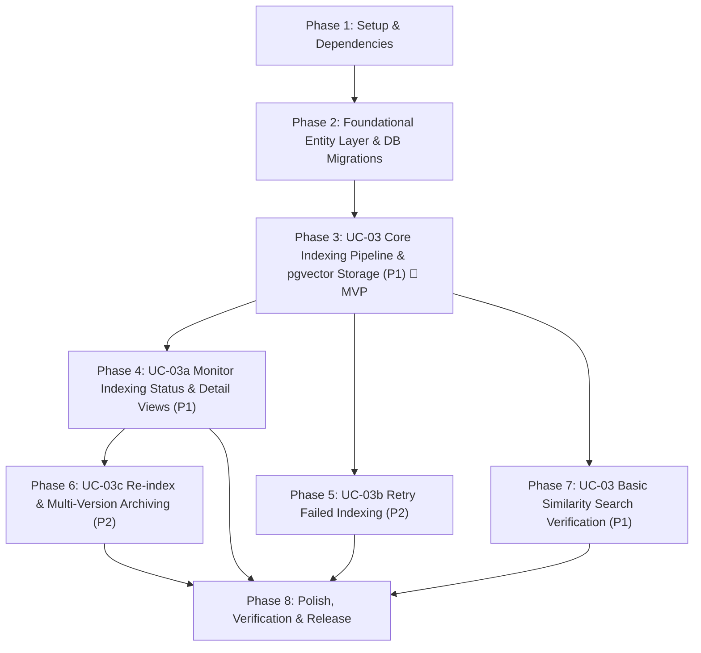

# Tasks: UC-03 Document Indexing and Local Embedding – ICONIX Implementation Plan

**Input**: Design documents from `specs/003-document-indexing-embedding/`  
**Prerequisites**: `plan.md` (PDR & CDR Approved), `spec.md`, `research.md`, `data-model.md`, `contracts/api.md`, `quickstart.md`  
**Methodology Reference**: Doug Rosenberg's ICONIX Process (BCE Architecture: Tests → Entity → Controller → Boundary)  

---

## Git Version Control Rules (Mandatory)

1. **Atomic Per-Task Commits**: After completing any implementation task and verifying its test, execute:  
   `git add <modified-files> && git commit -m "<type>(<scope>): <concise description>"`
2. **Major Checkpoint Commits**: At the conclusion of each Phase and upon completing each Use Case (ICONIX UC), execute the designated **Major Milestone Commit**.
3. **Commit Convention**: Follow Conventional Commits (`feat:`, `test:`, `refactor:`, `chore:`, `fix:`).

---

## Dependency Graph

---

## Phase 1: Setup & Environment Initialization

**Purpose**: Scaffolding directories, configurations, and dependencies for local embedding and vector indexing.

- [X] T001 Configure Python backend dependencies (`sentence-transformers>=3.0.0`, `langchain-text-splitters>=0.3.0`, `pgvector>=0.3.0`, `torch>=2.2.0`, `transformers>=4.40.0`) in `backend/requirements.txt`
- [X] T002 [P] Configure environment settings in `backend/src/core/config.py` (`EMBEDDING_MODEL_NAME="intfloat/multilingual-e5-base"`, `EMBEDDING_DIMENSION=768`, `CHUNK_SIZE=1200`, `CHUNK_OVERLAP=150`, `BATCH_SIZE=32`, `INDEXING_MAX_RETRIES=3`, `HEARTBEAT_TIMEOUT_MINUTES=5`)
- [X] T003 [P] Configure TypeScript interface contracts and type definitions for indexing jobs, versions, chunks, and similarity search in `frontend/src/types/indexing.ts`
- [X] T004 **Git Major Commit**: `git add . && git commit -m "chore(setup): scaffold UC-03 dependencies, types, and directory layout"`

---

## Phase 2: Foundational Entity Layer & Database Migrations

**Purpose**: Establish database schemas, entity models, and migration scripts required before use case controllers can run.

- [X] T005 Create Alembic migration script `backend/alembic/versions/003_indexing_schema.py` creating `document_index_versions`, `document_chunks`, and `indexing_jobs` tables with HNSW vector index `idx_chunks_embedding_hnsw USING hnsw (embedding vector_cosine_ops) WITH (m = 16, ef_construction = 128)`, unique partial index `idx_div_active_per_doc ON document_index_versions(document_id) WHERE is_active = TRUE`, and status check constraints verbatim from `data-model.md`
- [X] T006 Implement Entity SQLModel classes (`DocumentIndexVersion`, `DocumentChunk`, `IndexingJob`) with constraints verbatim from `data-model.md` (`status IN ('queued','cleaning','chunking','embedding','storing','indexed','failed','archived')`, `embedding: Vector(768)`, `chunk_index >= 0`, `source_metadata: JSONB`) in `backend/src/indexing/models.py`
- [X] T007 [P] Implement base repository query methods for indexing records, jobs, and chunks (`find_by_fingerprint`, `create_index_version`, `create_indexing_job`, `update_job_status`, `save_chunks_transactional`, `archive_index_version`) in `backend/src/indexing/repository.py`
- [X] T008 Run migration in database environment (`alembic upgrade head`) and verify table creation, HNSW index, and foreign key relations to `documents.id` and `researchers.id` in PostgreSQL
- [X] T009 **Git Major Commit**: `git add . && git commit -m "feat(core): setup UC-03 DB schema — document_index_versions, document_chunks, indexing_jobs"`

**PDR Verification Checkpoint**: Entity models conform to Updated Domain Model in `plan.md` and `data-model.md`.

---

## Phase 3: Use Case UC-03 – Core Pipeline: Cleaning, Chunking, Local Embedding & pgvector Storage (Priority: P1) 🎯 MVP

**Goal**: Sistem secara otomatis memproses dokumen berstatus `extracted`, membersihkan teks, memotong menjadi chunk terkelola dengan metadata keterlacakan (`page_number`, `section_name`), menghasilkan embedding lokal menggunakan `intfloat/multilingual-e5-base` (dengan prefix `"passage: "`), dan menyimpan vektor 768-dimensi secara transaksional ke PostgreSQL/pgvector.  
**Independent Test**: `pytest backend/tests/test_indexing_pipeline.py backend/tests/test_embedding_provider.py backend/tests/test_chunking_service.py`

### Step 3.1: Unit & Integration Tests (TDD - Write First)
- [x] T010 [P] [UC-03] Write unit tests for `TextCleaningService` covering control character removal, whitespace normalization, extraction artifact stripping, and scientific symbol preservation in `backend/tests/test_text_cleaner.py`
- [x] T011 [P] [UC-03] Write unit tests for `ChunkingService` covering `RecursiveCharacterTextSplitter`, size/overlap boundaries (`chunk_size=1200`, `chunk_overlap=150`), and `page_number`/`section_name` attribution in `backend/tests/test_chunking_service.py`
- [x] T012 [P] [UC-03] Write unit tests for `LocalEmbeddingProvider` verifying singleton instantiation, prefix `"passage: "` addition, batch inference, 768-dim output validation, and strict rejection of external Gemini APIs in `backend/tests/test_embedding_provider.py`
- [x] T013 [P] [UC-03] Write unit tests for `ChecksumService` verifying SHA-256 document checksum and deterministic index fingerprint computation in `backend/tests/test_indexing_fingerprint.py`
- [x] T014 [P] [UC-03] Write contract/integration tests for trigger endpoint `POST /api/indexing/documents/{document_id}` (handling 202 Accepted, 404 Not Found, 409 Duplicate Fingerprint, 422 Invalid Status) in `backend/tests/test_indexing_router.py`
- [x] T015 [UC-03] Verify tests FAIL prior to implementation (Red stage)
- [x] T016 [UC-03] **Git Commit (Tests)**: `git add backend/tests/ && git commit -m "test(UC-03): add failing test suite for core indexing pipeline, embedding, and router"`

### Step 3.2: Controller Layer (Services, Local Embedder & Background Worker)
- [x] T017 [P] [UC-03] Implement request/response Pydantic DTOs (`JobResponseDTO`, `JobStatusDTO`, `IndexStatusDTO`, `IndexSummaryDTO`, `SearchResultDTO`, `ReindexResponseDTO`) in `backend/src/indexing/schemas.py`
- [x] T018 [P] [UC-03] Implement `TextCleaningService` (`clean`, `remove_control_chars`, `normalize_whitespace`, `strip_extraction_artifacts`) in `backend/src/indexing/cleaner.py`
- [x] T019 [P] [UC-03] Implement `ChunkingService` using `RecursiveCharacterTextSplitter` preserving `page_number` and `section_name` in `backend/src/indexing/chunker.py`
- [x] T020 [P] [UC-03] Implement `LocalEmbeddingProvider` using `sentence-transformers` with lazy model loading, CPU batch embedding via `asyncio.to_thread()`, and dimension validation (768) in `backend/src/indexing/embedding.py`
- [x] T021 [P] [UC-03] Implement `ChecksumService` (`compute_document_checksum`, `compute_index_fingerprint`) in `backend/src/indexing/fingerprint.py`
- [x] T022 [UC-03] Implement `DocumentIndexingService` (`validate_document_access`, `check_duplicate_fingerprint`, `create_and_enqueue_job`, `update_status`, `finalize_and_notify`, `handle_failure`) in `backend/src/indexing/service.py`
- [x] T023 [UC-03] Implement background pipeline executor `run_indexing_pipeline` with status progression (`queued → cleaning → chunking → embedding → storing → indexed`), periodic heartbeat, and transactional chunk batch insertion in `backend/src/indexing/worker.py`
- [x] T024 [UC-03] Verify unit tests pass (Green stage)
- [x] T025 [UC-03] **Git Commit (Controller)**: `git add backend/src/indexing/ && git commit -m "feat(UC-03): implement cleaning, chunking, local embedding, and background pipeline executor"`

### Step 3.3: Boundary Layer (FastAPI API Router & Worker Wiring)
- [x] T026 [UC-03] Implement FastAPI Router endpoint `POST /api/indexing/documents/{document_id}` validating researcher session, verifying `import_status == extracted`, dispatching `run_indexing_pipeline` via `BackgroundTasks`, and returning HTTP 202 Accepted in `backend/src/indexing/router.py`
- [x] T027 [UC-03] Register `indexing_router` in `backend/src/main.py` with OpenAPI tags and route prefix
- [x] T028 [P] [UC-03] Implement frontend API client functions (`triggerIndexing`, `fetchIndexingJob`) in `frontend/src/lib/api/indexing.ts`

### Step 3.4: BCE Audit & Major Milestone Checkpoint
- [x] T029 [UC-03] **BCE Audit**: Confirm Frontend & Router (Boundary) never query Database (Entity) directly; all operations routed via `DocumentIndexingService` and `IndexingRepository`
- [x] T030 [UC-03] Run integration tests and confirm sunny-day indexing pipeline passes end-to-end with verified vectors stored in pgvector
- [x] T031 [UC-03] **Git Major Commit (Milestone)**: `git add . && git commit -m "feat(UC-03): complete core text cleaning, chunking, local embedding, and background indexing pipeline [MVP Milestone]"`

**Checkpoint**: Core indexing pipeline (UC-03) is fully functional and delivers an independently testable MVP.

---

## Phase 4: Use Case UC-03a – Monitor Indexing Status & Detail Views (Priority: P1)

**Goal**: Peneliti dapat memantau status bertahap dokumen secara real-time (`queued → cleaning → chunking → embedding → storing → indexed | failed`) di halaman Library, serta melihat ringkasan hasil indexing (total chunk, nama model, dimensi, waktu eksekusi) pada panel detail.  
**Independent Test**: `pytest backend/tests/test_indexing_router.py -k "test_status or test_summary"`

### Step 4.1: Unit & Integration Tests (TDD)
- [x] T032 [P] [UC-03a] Write contract/integration tests for `GET /api/indexing/jobs/{job_id}`, `GET /api/documents/{document_id}/index-status`, and `GET /api/documents/{document_id}/index-summary` in `backend/tests/test_indexing_status.py`
- [x] T033 [UC-03a] **Git Commit (Tests)**: `git add backend/tests/ && git commit -m "test(UC-03a): add test suite for indexing job status and summary endpoints"`

### Step 4.2: Controller & Boundary Implementation
- [x] T034 [UC-03a] Implement `get_job_status`, `get_index_status`, and `get_index_summary` in `backend/src/indexing/service.py` and endpoints in `backend/src/indexing/router.py`
- [x] T035 [P] [UC-03a] Implement React Query polling hook `useIndexingStatus` (polling every 3-5 seconds while non-terminal) in `frontend/src/hooks/useIndexingStatus.ts`
- [x] T036 [P] [UC-03a] Implement status badge component with stage indicators (`queued`, `cleaning`, `chunking`, `embedding`, `storing`, `indexed`, `failed`) using `@phosphor-icons/react` in `frontend/src/components/features/indexing/IndexingStatusBadge.tsx`
- [x] T037 [P] [UC-03a] Implement Indexing Detail Modal/Panel (`SCR-06`) displaying chunk count, model name, dimension, timestamp, and progress stage in `frontend/src/components/features/indexing/IndexingDetailModal.tsx`
- [x] T038 [UC-03a] Integrate indexing status column, badge, and detail modal trigger into Library Page (`SCR-05`) in `frontend/src/app/library/page.tsx`
- [x] T039 [UC-03a] **BCE Audit**: Confirm UI components interact solely through API client and hooks without internal entity leakage
- [x] T040 [UC-03a] **Git Major Commit (Milestone)**: `git add . && git commit -m "feat(UC-03a): complete indexing status monitoring and detail views end-to-end"`

---

## Phase 5: Use Case UC-03b – Retry Failed Indexing (Priority: P2)

**Goal**: Peneliti dapat melihat pesan error yang ramah pengguna apabila indexing gagal dan memicu proses coba lagi (retry) dari tahap awal; sistem juga mendeteksi stale jobs (tidak ada heartbeat > 5 menit).  
**Independent Test**: `pytest backend/tests/test_indexing_retry.py`

### Step 5.1: Tests (TDD)
- [x] T041 [P] [UC-03b] Write unit and integration tests for retry logic (`POST /api/indexing/documents/{document_id}` on failed document) and stale job detection threshold check in `backend/tests/test_indexing_retry.py`
- [x] T042 [UC-03b] **Git Commit (Tests)**: `git add backend/tests/ && git commit -m "test(UC-03b): add test suite for indexing retry and stale job recovery"`

### Step 5.2: Controller & Boundary Implementation
- [x] T043 [UC-03b] Implement retry validation in `DocumentIndexingService.create_and_enqueue_job` (allowing retry for `failed` or stale jobs, incrementing `retry_count`, and resetting `status = queued`) in `backend/src/indexing/service.py`
- [x] T044 [P] [UC-03b] Implement `get_stale_jobs` query and automatic recovery trigger in `backend/src/indexing/repository.py`
- [x] T045 [P] [UC-03b] Implement "Coba Lagi / Retry Indexing" button and error message display in `frontend/src/components/features/indexing/IndexingStatusBadge.tsx` and `frontend/src/components/features/indexing/IndexingDetailModal.tsx`
- [x] T046 [UC-03b] **BCE Audit**: Confirm strict adherence to Boundary-Controller-Entity separation in retry flow
- [x] T047 [UC-03b] **Git Major Commit (Milestone)**: `git add . && git commit -m "feat(UC-03b): complete retry failed indexing flow"`

---

## Phase 6: Use Case UC-03c – Re-index Dokumen & Multi-Version Archive Management (Priority: P2)

**Goal**: Peneliti dapat memicu re-indexing jika dokumen berubah atau konfigurasi diperbarui; index aktif lama ditandai sebagai `archived` (tetap tersimpan untuk keperluan audit ilmiah) dan index version baru dibuat dan menjadi aktif setelah pipeline selesai.  
**Independent Test**: `pytest backend/tests/test_reindex.py`

### Step 6.1: Tests (TDD)
- [x] T048 [P] [UC-03c] Write unit and integration tests for re-indexing flow (`POST /api/documents/{document_id}/reindex`), verifying version archival (`is_active=False, status=archived`), new version creation, and chunk isolation in `backend/tests/test_indexing_reindex.py`
- [x] T049 [UC-03c] **Git Commit (Tests)**: `git add backend/tests/ && git commit -m "test(UC-03c): add test suite for document re-indexing and version archival"`

### Step 6.2: Controller & Boundary Implementation
- [x] T050 [UC-03c] Implement `request_reindex` method in `DocumentIndexingService` (archiving current active index version, creating new `DocumentIndexVersion(status=queued, is_active=True)`, creating new `IndexingJob`, and adding task to `BackgroundTasks`) in `backend/src/indexing/service.py`
- [x] T051 [UC-03c] Implement endpoint `POST /api/documents/{document_id}/reindex` in `backend/src/indexing/router.py`
- [x] T052 [P] [UC-03c] Implement Re-index Confirmation Modal (`SCR-07`) explaining version archival and requesting user confirmation in `frontend/src/components/features/indexing/ReindexConfirmModal.tsx`
- [x] T053 [UC-03c] Wire "Re-index Dokumen" button in `IndexingDetailModal.tsx` to trigger `ReindexConfirmModal` and execute `requestReindex` mutation in `frontend/src/hooks/useReindex.ts`
- [x] T054 [UC-03c] **BCE Audit**: Confirm boundary and controller strict adherence
- [x] T055 [UC-03c] **Git Major Commit (Milestone)**: `git add . && git commit -m "feat(UC-03c): complete re-index and multi-version archive flow"`

---

## Phase 7: Use Case UC-03 – Basic Similarity Search Verification (Priority: P1)

**Goal**: Menyediakan endpoint similarity search dasar internal UC-03 (menggunakan prefix `"query: "`, cosine distance `<=>` operator pada pgvector, dan filtering multi-tenant `researcher_id`) untuk memvalidasi bahwa knowledge base yang dihasilkan siap dikonsumsi oleh UC-04 dan UC-06 dengan metadata sitasi tertelusuri.  
**Independent Test**: `pytest backend/tests/test_similarity_search.py`

### Step 7.1: Tests (TDD)
- [x] T056 [P] [UC-03] Write unit and integration tests for similarity search (`GET /api/search/similarity`), verifying query prefix `"query: "`, top-k ranking, threshold filtering, tenant isolation (`researcher_id`), and citation metadata completeness (`document_title`, `page_number`, `section_name`, `chunk_index`) in `backend/tests/test_similarity_search.py`
- [x] T057 [UC-03] **Git Commit (Tests)**: `git add backend/tests/ && git commit -m "test(UC-03): add test suite for pgvector similarity search verification"`

### Step 7.2: Controller & Boundary Implementation
- [x] T058 [UC-03] Implement `similarity_search` in `ChunkMetadataRepository` using pgvector cosine distance operator `<=>` with cosine similarity score conversion (`1 - (embedding <=> query_vector)`) in `backend/src/indexing/repository.py`
- [x] T059 [UC-03] Implement `similarity_search` service method in `DocumentIndexingService` encoding query with prefix `"query: "` via `LocalEmbeddingProvider` in `backend/src/indexing/service.py`
- [x] T060 [UC-03] Implement FastAPI Router endpoint `GET /api/search/similarity` with query parameters (`q`, `document_id`, `top_k`) in `backend/src/indexing/router.py`
- [x] T061 [P] [UC-03] Implement verification search test card component in `frontend/src/components/features/indexing/SimilaritySearchTest.tsx`
- [x] T062 [UC-03] **BCE Audit**: Confirm Boundary-Controller-Entity compliance for search flow
- [x] T063 [UC-03] **Git Major Commit (Milestone)**: `git add . && git commit -m "feat(UC-03): complete similarity search verification with citation attribution"`

---

## Phase 8: Verification, Documentation & Final Release

**Purpose**: Cross-cutting audit, full regression test, constitution compliance check, and release milestone.

- [x] T064 Run complete backend test suite (`rtk pytest backend/tests/ -v`) verifying 100% passing tests across auth, drive, documents, and indexing modules
- [x] T065 Run frontend typecheck and build (`rtk bun x tsc --noEmit && rtk bun run build`) verifying zero compile errors
- [x] T066 Validate all 9 scenarios in `specs/003-document-indexing-embedding/quickstart.md` (trigger, happy path, duplicate fingerprint 409, invalid status 422, status polling, retry failed, re-index archive, similarity search, tenant isolation)
- [x] T067 [P] Verify constitution compliance: strictly NO external Gemini embedding API calls for indexing (P2/FR-010), NO `lucide-react` imports (P7), all icons use `@phosphor-icons/react`, dark canvas aesthetic maintained, and RTK CLI proxy used for terminal operations (P6)
- [x] T068 [P] Update API documentation in `backend/src/main.py` FastAPI OpenAPI metadata and create contract export in `specs/003-document-indexing-embedding/contracts/`
- [x] T069 Code formatting, linting, and unused import cleanup across `backend/src/indexing/` and `frontend/src/components/features/indexing/`
- [x] T070 **Git Major Commit (Release)**: `git add . && git commit -m "chore(release): complete UC-03 Document Indexing and Local Embedding verification and documentation"`

---

## Implementation Strategy & MVP Scope

1. **MVP Scope (Phase 1 to Phase 3)**:
   - Setup dependencies, database models, and Alembic migration for `document_index_versions`, `document_chunks`, and `indexing_jobs` (T001–T009).
   - Core text cleaner, chunker, local Hugging Face embedder (`intfloat/multilingual-e5-base`), background pipeline worker, and trigger endpoint (T010–T031).
   - Deliverable: Documents with `import_status = extracted` can be indexed into pgvector with 768-dimensional local embeddings.
2. **Observability & Progress (Phase 4)**:
   - Polling endpoints and frontend status badge / detail modal (T032–T040).
   - Deliverable: Researchers can see step-by-step progress and indexing metrics in real time.
3. **Resilience & Versioning (Phase 5 & Phase 6)**:
   - Stale job detection, retry failed indexing (T041–T047), and multi-version re-indexing with audit archival (T048–T055).
   - Deliverable: Fault tolerance against network/resource drops and clean re-indexing without data loss.
4. **Knowledge Base Readiness (Phase 7 & Phase 8)**:
   - Local similarity search verification with citation attribution (T056–T063) and full release validation (T064–T070).
   - Deliverable: Fully verified semantic knowledge base ready for UC-04 and UC-06.
