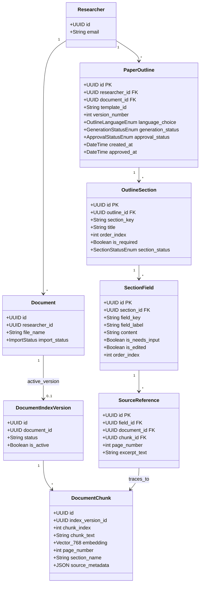
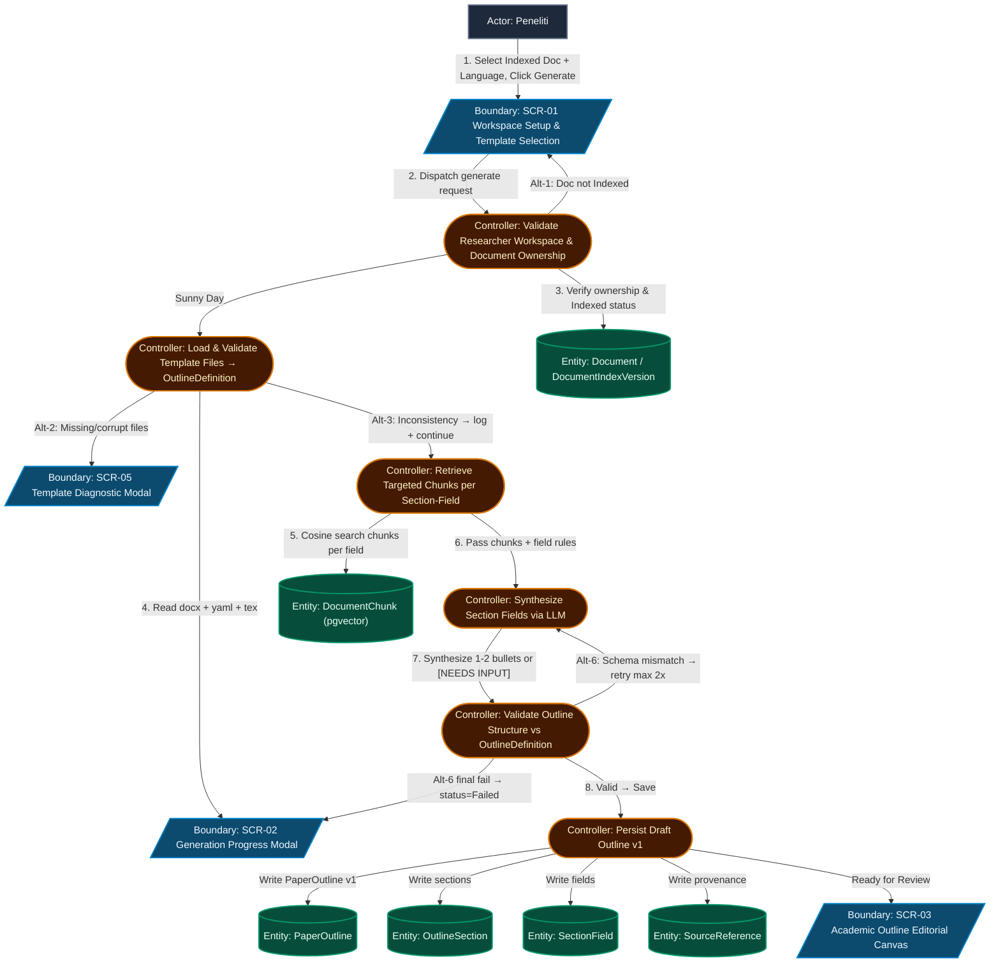
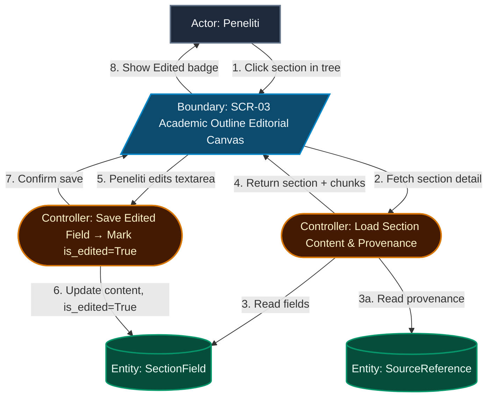
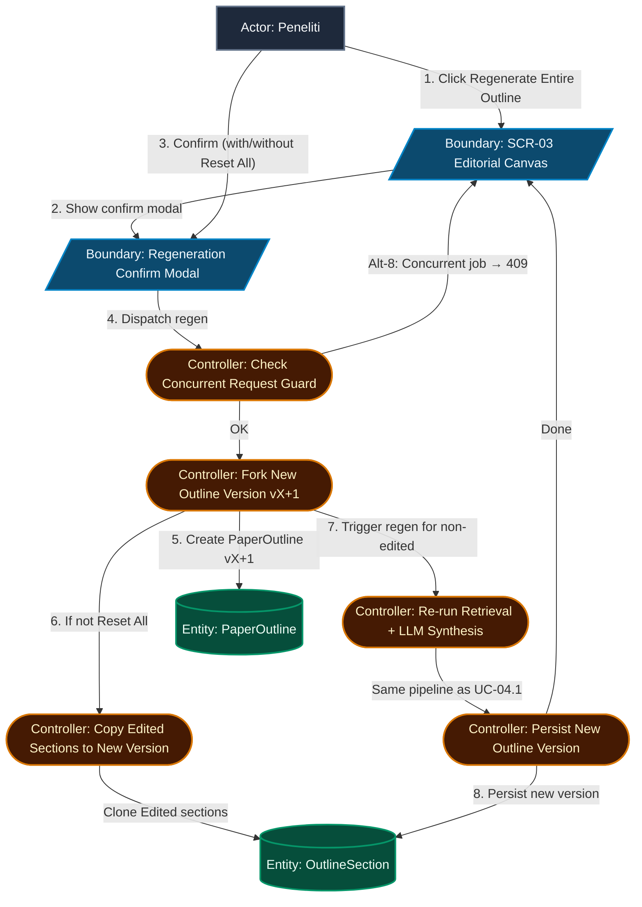
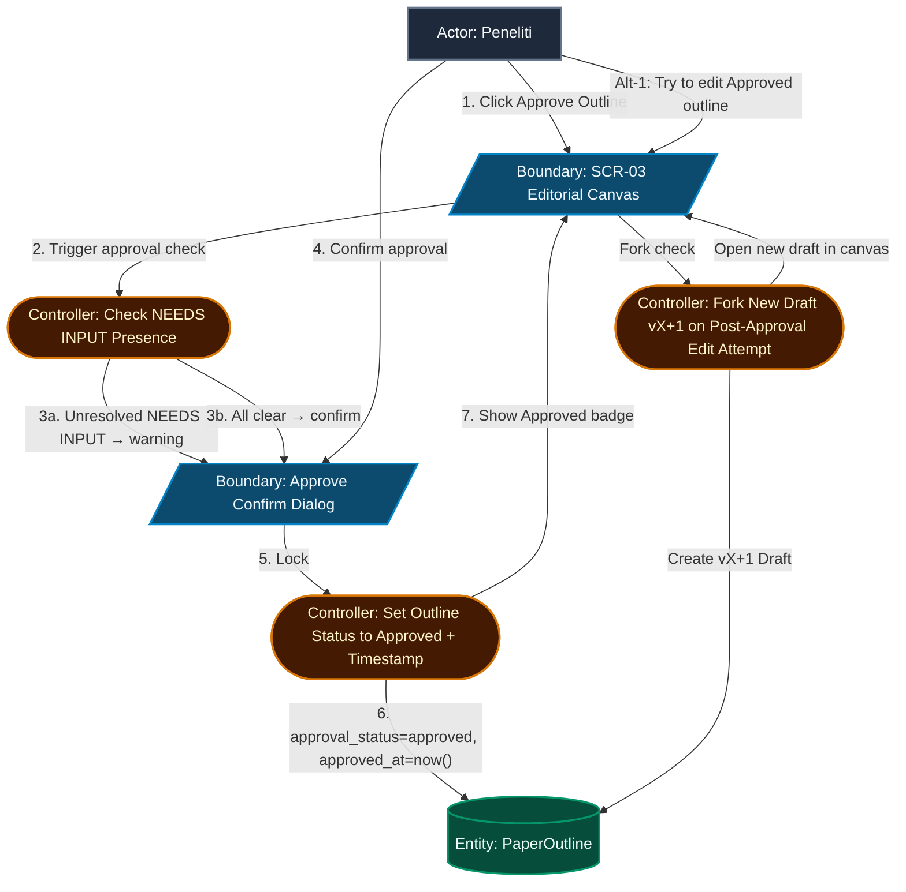
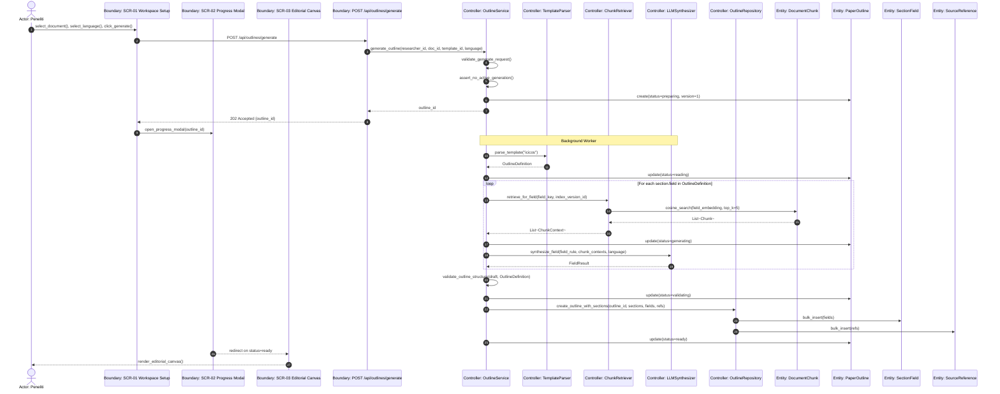
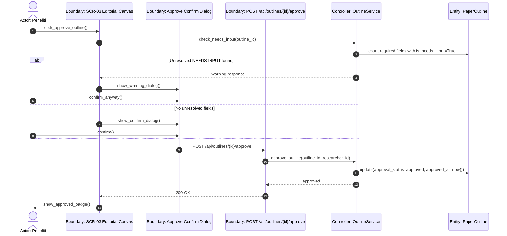
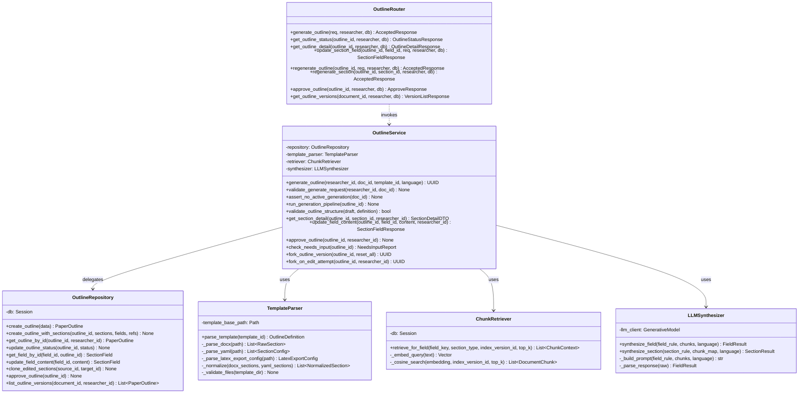

# Technical Plan: UC-04 Template-Based Paper Outline Generation – ICONIX Process

**Branch**: `004-paper-outline-generation` | **Date**: 2026-09-29 | **Spec**: [spec.md](./spec.md)
**Input**: Feature specification from `specs/004-paper-outline-generation/spec.md`
**Methodology Reference**: Doug Rosenberg & Matt Stephens, *Use Case Driven Object Modeling with UML*

---

## 1. System Architecture & Technical Context

### Technology Stack (Telaah Constitution v1.3.0 Compliant)

| Layer | Technology | Role in UC-04 |
|---|---|---|
| **Frontend** | Next.js 14 App Router, TypeScript, Tailwind CSS, shadcn/ui, `@phosphor-icons/react` | Academic Outline Editorial Canvas (SCR-01–SCR-05) |
| **Backend API** | FastAPI (Python 3.12), Pydantic v2, SQLModel/SQLAlchemy | Outline generation orchestration, template ingestion, LLM integration |
| **Persistence** | PostgreSQL + `pgvector` | New outline/section/field tables + existing chunk vector table |
| **Async Workers** | Existing worker pattern (`backend/src/workers/`) | Async outline generation job (non-blocking, < 45 sec) |
| **LLM Provider** | Google Gemini (`gemini-2.0-flash`) via `google-generativeai` | Section-field synthesis with template constraint prompting |
| **Template Parsing** | `python-docx` (DOCX), `re`/stdlib (LaTeX), `PyYAML` (outline-sections.yaml) | Normalized Outline Definition construction |
| **Embedding/Retrieval** | `pgvector` cosine similarity on existing `document_chunks` table (UC-03) | Section- & field-targeted chunk retrieval |

### Architectural Pattern
**Router (Boundary) → Service (Controller) → Repository (Entity)**
Matching the existing pattern used in `backend/src/documents/` and `backend/src/indexing/`.

### Directory Layout for New Code

```
backend/src/
├── templates/
│   └── icicos/                    ← NEW: iciCos template assets
│       ├── template.docx          ← (reorganized from conference-template-a4.docx)
│       ├── template.tex           ← NEW: LaTeX export structure reference
│       └── outline-sections.yaml  ← NEW: Body section field declarations
├── outlines/                      ← NEW: UC-04 feature module
│   ├── __init__.py
│   ├── models.py                  ← PaperOutline, OutlineSection, SectionField, SourceReference
│   ├── schemas.py                 ← Pydantic DTOs for API and internal types
│   ├── router.py                  ← FastAPI route boundary
│   ├── service.py                 ← Business logic controller
│   ├── repository.py              ← DB access entity layer
│   ├── template_parser.py         ← DOCX + YAML + LaTeX → OutlineDefinition
│   ├── retriever.py               ← Section- & field-targeted chunk retrieval
│   ├── llm_synthesizer.py         ← LLM prompt builder + response parser
│   └── worker.py                  ← Async outline generation job

frontend/src/
├── app/workspace/outline/
│   ├── page.tsx                   ← SCR-01: Workspace Setup & Template Selection
│   └── [outlineId]/
│       └── page.tsx               ← SCR-03: Academic Outline Editorial Canvas
├── components/features/outline/
│   ├── TemplateSelectionCard.tsx
│   ├── GenerationProgressModal.tsx ← SCR-02: Stepper progress
│   ├── OutlineEditorCanvas.tsx     ← SCR-03: Main editorial canvas
│   ├── SectionTreeNav.tsx
│   ├── SectionFieldEditor.tsx
│   ├── ProvenanceDrawer.tsx        ← SCR-03: Right panel chunk references
│   ├── VersionHistoryDrawer.tsx    ← SCR-04
│   └── TemplateDiagnosticModal.tsx ← SCR-05
```

### Constitution Check

| Principle | Status | Evidence |
|---|:---:|---|
| **P1 (Scientific Structure – IMRaD)** | ✅ PASS | Outline sections follow IMRaD-aligned iciCos template; body sections declared in `outline-sections.yaml` |
| **P2 (Secure Auth & Tenant Isolation)** | ✅ PASS | FR-014 mandates workspace ownership checks on all outline endpoints |
| **P3 (Retrieval Accuracy / Anti-Hallucination)** | ✅ PASS | FR-007, FR-009: `[NEEDS INPUT]` for missing evidence; chunk references mandatory per field |
| **P4 (AI-Assisted but Reviewable)** | ✅ PASS | Full Spec Kit workflow followed; human approval gate (FR-012) |
| **P5 (Performance / Runtime)** | ✅ PASS | Async worker + non-blocking API; NFR-001 < 45 sec target |
| **P6 (Ponytail – No Over-Engineering)** | ✅ PASS | Reuses UC-03 chunk table & embedding infrastructure; no new vector store |
| **P7 (Academic Editorial Canvas)** | ✅ PASS | SCR-03 uses Newsreader/Inter/JetBrains Mono, warm paper #FCF9F8, `@phosphor-icons/react`; NO lucide-react |

---

## 2. Phase 0: Research & Resolved Unknowns

### Key Technical Decisions

| Decision | Choice | Rationale |
|---|---|---|
| **DOCX Parsing** | `python-docx` | Extracts paragraph styles (Heading 1/2) cleanly; already in Python ecosystem |
| **LaTeX Parsing** | Regex on `\section{}` / `\subsection{}` commands | LaTeX used only for export config (document class, bib setup) — not outline authority |
| **YAML Parsing** | `PyYAML` | `outline-sections.yaml` is the primary body section definition source |
| **LLM Provider** | Google Gemini (`gemini-2.0-flash`) via `google-generativeai` | Already in Telaah stack; supports structured JSON output |
| **Chunk Retrieval** | pgvector cosine similarity on `document_chunks.embedding` filtered by `index_version_id` | Reuses UC-03 embedding; avoids separate vector store (Ponytail P6) |
| **Retrieval Strategy** | Embed field keyword → top-k cosine search + section_name metadata filter | Directed retrieval per spec; efficient token usage |
| **Async Execution** | FastAPI `BackgroundTasks` (or Celery if already configured) + status polling | Matches UC-03 worker pattern; non-blocking |
| **LLM Structured Output** | `response_mime_type="application/json"` with JSON schema in prompt | Ensures parseable, schema-valid section field responses |
| **Outline Versioning** | `version_number` integer on `PaperOutline`; approved rows immutable via application-level guard | FR-013: no in-place mutation of approved versions |
| **PaperTemplate Registry** | Read from disk at runtime (not persisted in DB) | Adding new templates requires only a new subfolder, zero DB migrations (Ponytail P6) |

---

## 3. Updated Domain Model



### New Enum Types

```python
class OutlineLanguageEnum(str, Enum):
    en_ieee = "en_ieee"        # English — Academic IEEE style
    id_formal = "id_formal"   # Bahasa Indonesia

class GenerationStatusEnum(str, Enum):
    preparing = "preparing"
    reading = "reading"
    generating = "generating"
    validating = "validating"
    ready = "ready"
    failed = "failed"

class ApprovalStatusEnum(str, Enum):
    draft = "draft"
    approved = "approved"

class SectionStatusEnum(str, Enum):
    filled = "filled"
    needs_input = "needs_input"
    edited = "edited"
```

### Database Schema Additions (Alembic migrations required)
- `paper_outlines` — main outline record with versioning and status
- `outline_sections` — one row per section per outline version
- `section_fields` — one row per field per section (content + flags)
- `source_references` — provenance records linking field → chunk

`PaperTemplate` is **not persisted** in DB — read from disk at runtime (Ponytail P6).

---

## 4. ICONIX Robustness Analysis

### UC-04.1: Generate Paper Outline



### UC-04.2: Review & Edit Outline Sections



### UC-04.3: Regenerate Outline or Single Section



### UC-04.4: Approve & Version Paper Outline



### BCE Inventory & Method Allocation

| BCE Type | Element Name | Concrete Allocation |
|---|---|---|
| **Boundary** | SCR-01 Workspace Setup View | `frontend/src/app/workspace/outline/page.tsx` |
| **Boundary** | SCR-02 Generation Progress Modal | `frontend/src/components/features/outline/GenerationProgressModal.tsx` |
| **Boundary** | SCR-03 Academic Outline Editorial Canvas | `frontend/src/app/workspace/outline/[outlineId]/page.tsx` + `OutlineEditorCanvas.tsx` |
| **Boundary** | SCR-04 Version History Drawer | `frontend/src/components/features/outline/VersionHistoryDrawer.tsx` |
| **Boundary** | SCR-05 Template Diagnostic Modal | `frontend/src/components/features/outline/TemplateDiagnosticModal.tsx` |
| **Controller** | Validate Researcher Workspace & Document Ownership | `OutlineService.validate_generate_request()` |
| **Controller** | Load & Validate Template Files → OutlineDefinition | `TemplateParser.parse_template()` |
| **Controller** | Retrieve Targeted Chunks per Section-Field | `ChunkRetriever.retrieve_for_field()` |
| **Controller** | Synthesize Section Fields via LLM | `LLMSynthesizer.synthesize_field()` |
| **Controller** | Validate Outline Structure vs OutlineDefinition | `OutlineService.validate_outline_structure()` |
| **Controller** | Persist Draft Outline v1 | `OutlineRepository.create_outline_with_sections()` |
| **Controller** | Load Section Content & Provenance | `OutlineService.get_section_detail()` |
| **Controller** | Save Edited Section Field → Mark Edited | `OutlineService.update_field_content()` |
| **Controller** | Check Concurrent Request Guard | `OutlineService.assert_no_active_generation()` |
| **Controller** | Fork New Outline Version vX+1 | `OutlineService.fork_outline_version()` |
| **Controller** | Copy Edited Sections to New Version | `OutlineRepository.clone_edited_sections()` |
| **Controller** | Check NEEDS INPUT Presence | `OutlineService.check_needs_input()` |
| **Controller** | Set Outline Status to Approved & Timestamp | `OutlineService.approve_outline()` |
| **Controller** | Fork New Draft vX+1 on Post-Approval Edit Attempt | `OutlineService.fork_on_edit_attempt()` |
| **Entity** | `PaperOutline` | `backend/src/outlines/models.py` |
| **Entity** | `OutlineSection` | `backend/src/outlines/models.py` |
| **Entity** | `SectionField` | `backend/src/outlines/models.py` |
| **Entity** | `SourceReference` | `backend/src/outlines/models.py` |
| **Entity** | `DocumentChunk` (read-only, UC-03) | `backend/src/indexing/models.py` |

### BCE Rule Compliance Audit

- [x] **Rule 1 (Actors talk only to Boundaries)**: Peneliti interacts exclusively with SCR-01 through SCR-05 UI boundary objects.
- [x] **Rule 2 (Boundaries talk only to Controllers and Actors)**: UI screens dispatch to service/controller methods only.
- [x] **Rule 3 (Entities talk only to Controllers)**: Domain models accessed exclusively via `OutlineRepository` and `OutlineService`.
- [x] **Rule 4 (Controllers talk to Boundaries, Controllers, Entities; not to Actors)**: No controller references actor directly.
- [x] **Zero Direct Boundary-to-Entity Links**: Confirmed — no screen component imports SQLModel entities.

---

## 5. Preliminary Design Review (PDR) Checkpoint Gate

| PDR Criteria | Status | Evidence / Notes |
|---|:---:|---|
| **1. Use Case Coverage** | ✅ PASS | All 4 UCs (04.1–04.4) fully represented with sunny-day steps |
| **2. Alternate Courses Handled** | ✅ PASS | Alt-1 through Alt-8 (UC-04.1) + Alt-1 (UC-04.4) wired through controllers |
| **3. Domain Model Updated** | ✅ PASS | 4 new entities: PaperOutline, OutlineSection, SectionField, SourceReference |
| **4. Strict BCE Adherence** | ✅ PASS | Zero direct Boundary-to-Entity connections confirmed |

*GATE STATUS*: **APPROVED TO PROCEED TO DETAILED DESIGN**

---

## 6. Detailed Design: Sequence Diagrams

### UC-04.1: Generate Paper Outline (Sunny Day + Async Worker)



### UC-04.4: Approve Outline



---

## 7. Detailed Design: Static Class Model



### Concrete File & Method Signatures

**Boundary** — `backend/src/outlines/router.py`
- `POST /api/outlines/generate` → 202 Accepted `{outline_id}`
- `GET /api/outlines/{outline_id}/status` → `OutlineStatusResponse`
- `GET /api/outlines/{outline_id}` → `OutlineDetailResponse`
- `PATCH /api/outlines/{outline_id}/fields/{field_id}` → `SectionFieldResponse`
- `POST /api/outlines/{outline_id}/regenerate` → 202 Accepted
- `POST /api/outlines/{outline_id}/sections/{section_id}/regenerate` → 202 Accepted
- `POST /api/outlines/{outline_id}/approve` → `ApproveResponse`
- `GET /api/outlines/document/{document_id}/versions` → `VersionListResponse`

**Controller** — `backend/src/outlines/service.py`
- `class OutlineService` with all methods per class diagram

**Template Parser** — `backend/src/outlines/template_parser.py`
- `class TemplateParser` with `parse_template(template_id: str) → OutlineDefinition`

**Retriever** — `backend/src/outlines/retriever.py`
- `class ChunkRetriever` with `retrieve_for_field(field_key, section_type, index_version_id, top_k=5) → List[ChunkContext]`

**LLM Synthesizer** — `backend/src/outlines/llm_synthesizer.py`
- `class LLMSynthesizer` with `synthesize_field(field_rule, chunks, language) → FieldResult`

**Entity** — `backend/src/outlines/models.py`
- `class PaperOutline(SQLModel, table=True)`
- `class OutlineSection(SQLModel, table=True)`
- `class SectionField(SQLModel, table=True)`
- `class SourceReference(SQLModel, table=True)`

**Frontend Pages**
- `frontend/src/app/workspace/outline/page.tsx` — SCR-01
- `frontend/src/app/workspace/outline/[outlineId]/page.tsx` — SCR-03

**Frontend Components** — `frontend/src/components/features/outline/`
- `GenerationProgressModal.tsx` — SCR-02: 6-state stepper
- `OutlineEditorCanvas.tsx` — 3-panel layout
- `SectionTreeNav.tsx` — Section list with status badges
- `SectionFieldEditor.tsx` — Textarea + per-field regenerate
- `ProvenanceDrawer.tsx` — Right panel: chunk ID, page, excerpt
- `VersionHistoryDrawer.tsx` — SCR-04: Version list + restore
- `TemplateDiagnosticModal.tsx` — SCR-05: Template error details

---

## 8. Critical Design Review (CDR) Checkpoint Gate

| CDR Criteria | Status | Evidence / Notes |
|---|:---:|---|
| **1. Method Allocation** | ✅ PASS | Every sequence diagram message maps to a named class method |
| **2. Class Signatures** | ✅ PASS | Parameter types and return types defined for all public methods |
| **3. Test Plan Feasibility** | ✅ PASS | Each controller method independently unit-testable; router endpoints testable via FastAPI TestClient |
| **4. PDR Traceability** | ✅ PASS | All controllers from robustness diagrams present in class model |

*GATE STATUS*: **APPROVED TO PROCEED TO IMPLEMENTATION**

---

## 9. Version Control & Git Milestone Plan

| Milestone | Scope | Commit Message | Verification |
|---|---|---|---|
| **M1: Template Asset Scaffold** | `backend/src/templates/icicos/` + `outline-sections.yaml` | `chore(template): scaffold icicos subfolder with docx, tex, yaml` | Files present; YAML parses correctly |
| **M2: DB Models & Migration** | `backend/src/outlines/models.py` + Alembic migration | `feat(outline): add PaperOutline, OutlineSection, SectionField, SourceReference models` | `alembic upgrade head` green |
| **M3: Template Parser** | `template_parser.py` | `feat(outline): implement DOCX + YAML + LaTeX template parser → OutlineDefinition` | Unit test: correct sections from icicos template |
| **M4: Chunk Retriever** | `retriever.py` | `feat(outline): implement field-targeted chunk retrieval via pgvector cosine search` | Integration test: relevant chunks returned for known fields |
| **M5: LLM Synthesizer** | `llm_synthesizer.py` | `feat(outline): implement Gemini field synthesizer with [NEEDS INPUT] fallback` | Unit test with mocked LLM: correct FieldResult schema |
| **M6: Service + Worker** | `service.py` + `worker.py` | `feat(outline): implement generation pipeline service with async worker and retry` | Integration test: full generate → validate → persist flow |
| **M7: REST API Router** | `router.py` | `feat(outline): add FastAPI outline router with all endpoints` | OpenAPI schema correct; 202/200/409 verified |
| **M8: Frontend SCR-01 & SCR-02** | Workspace Setup + Progress Modal | `feat(ui): implement template selection and generation progress screens` | Manual: progress steps cycle correctly |
| **M9: Frontend SCR-03 Canvas** | Editorial Canvas + Section Tree + Provenance | `feat(ui): implement Academic Outline Editorial Canvas` | Manual: edit → Edited badge; provenance shows chunk refs |
| **M10: Frontend SCR-04 & SCR-05** | Version History + Diagnostic Modal | `feat(ui): implement version history drawer and template diagnostic modal` | Manual: version restore and error modal |
| **M11: E2E Verification** | All layers | `test(outline): verify end-to-end template adherence, versioning, and approval gate` | All SC-001–SC-006 criteria verified |
