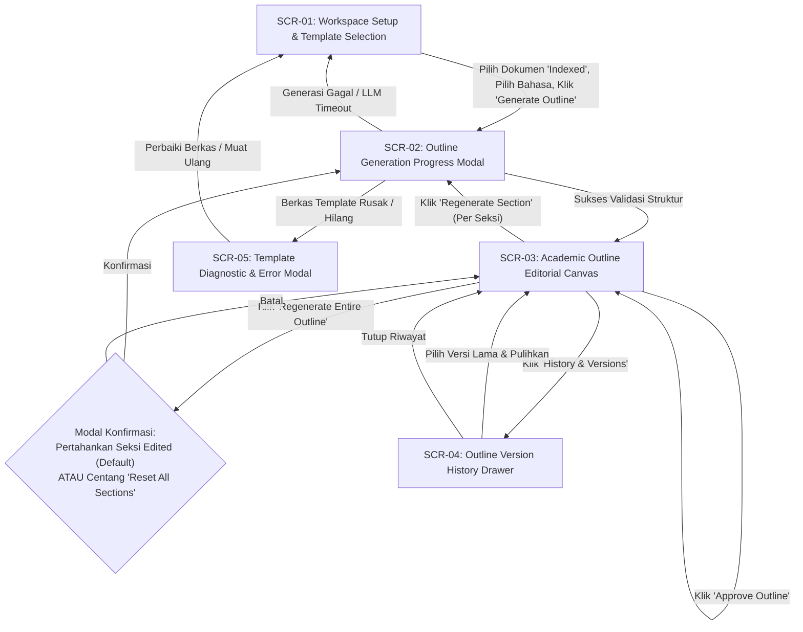
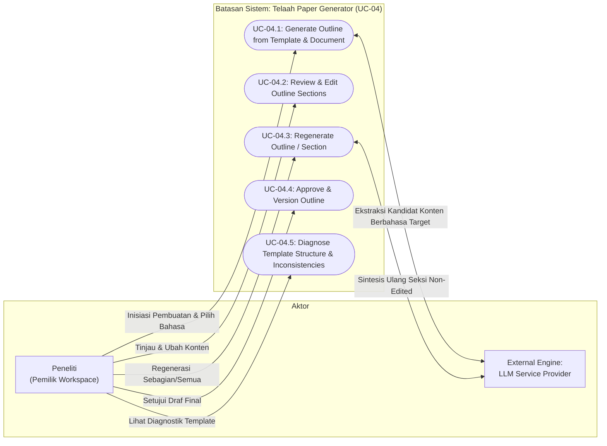
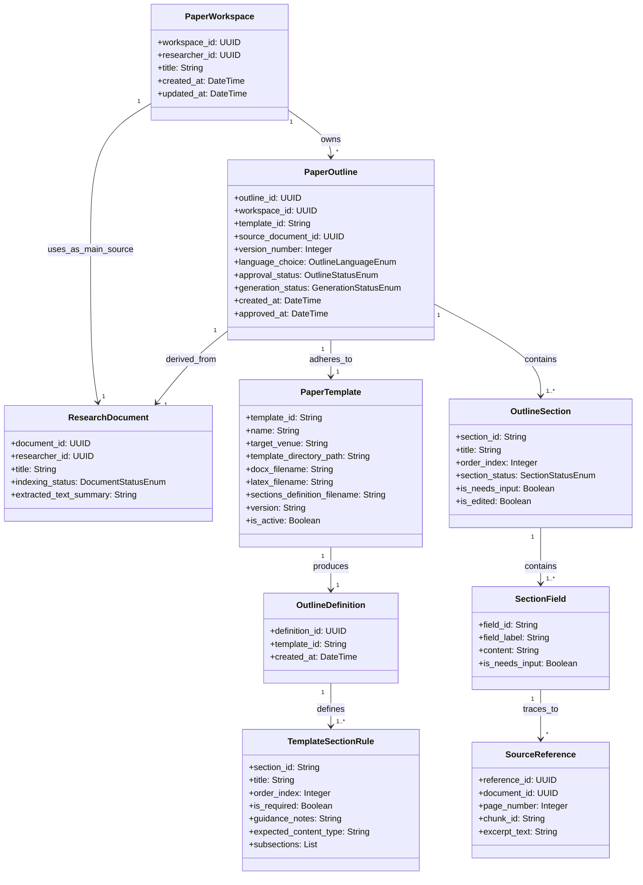

# Feature Specification: UC-04 Template-Based Paper Outline Generation – ICONIX Process

**Feature Branch**: `004-paper-outline-generation`  
**Created**: 2026-09-29  
**Status**: Draft  
**Input**: User description: "UC-04: Template-Based Paper Outline Generation (iciCos DOCX and LaTeX Templates)"  
**Methodology Reference**: Doug Rosenberg & Matt Stephens, *Use Case Driven Object Modeling with UML*  

> **Decomposition & Boundary Notice**:  
> Fitur ini mencakup **UC-04: Template-Based Paper Outline Generation**. Outline paper dibangun secara deterministik dari dua input utama:
> 1. Konten terekstraksi dan terindeks dari satu dokumen riset utama (*main research document*) yang berstatus `Indexed` (output dari UC-03).
> 2. Berkas template resmi konferensi (dimulai dengan template **iciCos**) yang tersimpan sebagai berkas statis di direktori sistem dalam format ganda: DOCX dan LaTeX, dilengkapi berkas deklarasi seksi `outline-sections.yaml`.
>
> Fitur ini **TIDAK MENGGUNAKAN** "Framework A" ataupun metodologi *reverse-engineering* terpisah. Struktur outline semata-mata diturunkan dari struktur template yang dinormalisasi (*Single Source of Truth*), sedangkan kandidat konten draf diisi oleh Large Language Model (LLM) di bawah batasan ketat template dan referensi dokumen sumber.  
> Fitur ini **TIDAK MELAKUKAN**: penulisan draf paragraf/seksi lengkap (masuk pada UC-06), pencarian semantik lintas basis pengetahuan multi-dokumen (UC-05), validasi sitasi dan kompilasi ekspor LaTeX/PDF (UC-07), ataupun penilaian orisinalitas/plagiarisme.

---

## Clarifications

### Baseline Architectural & Scope Decisions (Ratified)
1. **Framework Exclusion**: Framework A (atau metodologi reverse-engineering terpisah) TIDAK DIGUNAKAN. Outline semata-mata merupakan sintesis dari struktur template + konten terekstraksi dari dokumen riset utama terindeks yang diisi LLM di bawah batasan ketat template.
2. **Template Source**: Berkas template adalah berkas statis di direktori proyek (`backend/src/templates/`), bukan berkas yang diunggah oleh pengguna (*no user-uploaded templates*).
3. **Format & Precedence**: Disediakan format ganda DOCX dan LaTeX. Struktur dan urutan seksi outline didefinisikan oleh DOCX; struktur ekspor (document class, bibliography setup) didefinisikan oleh LaTeX.
4. **Section Invariance**: Seksi wajib template DILARANG KERAS ditambah, dihapus, diubah namanya, atau diubah urutannya oleh LLM.
5. **Anti-Hallucination**: Informasi yang tidak memiliki bukti dukung pada dokumen sumber ditandai secara transparan sebagai `[NEEDS INPUT]`, tidak boleh dikarang (*never invented*).
6. **Explicit Approval & Versioning**: Peneliti wajib menyetujui (*explicit approval*) outline sebelum dianggap final; regenerasi outline menciptakan versi baru dan tidak menimpa versi approved.
7. **Tech Stack Boundaries**: Pemilihan framework, library, dan detail teknologi diserahkan sepenuhnya ke tahap perancangan teknis (`/speckit-plan`), bukan pada spesifikasi kebutuhan.

### Session 2026-09-29
- Q: Template Directory Structure & Multi-File Organization? → A: Subdirektori per template `backend/src/templates/icicos/` yang memuat `template.docx`, `template.tex`, dan `outline-sections.yaml`.
- Q: Multi-Language Policy? → A: Judul seksi mengikuti template (English), isi seksi mengikuti pilihan bahasa di antarmuka (default English, opsi Bahasa Indonesia), nama proper dan citation key tidak diterjemahkan.
- Q: Preservation of Manually Edited Sections on Regeneration? → A: Seksi berstatus `Edited` dipertahankan secara default saat regenerasi outline, seksi non-edited dibuat ulang oleh LLM, dan opsi "Reset All Sections" disediakan untuk reset total.
- Q: Definisi Seksi Batang Tubuh Manuskrip yang Tidak Diresepkan Eksplisit di DOCX? → A: Komponen bawaan template DOCX (Title, Abstract, Keywords, Acknowledgment, References) dipertahankan sebagai komponen wajib, digabungkan dengan definisi seksi batang tubuh default (Introduction, Related Work, Methodology, Results and Discussion, Conclusion) yang dideklarasikan secara eksternal melalui berkas `outline-sections.yaml` di samping berkas template tanpa perubahan kode logika.
- Q: Granularitas & Batasan Format Konten Seksi Outline? → A: Format sub-elemen terstruktur kaku per seksi (didefinisikan dalam `outline-sections.yaml`, misal Introduction memuat field: Background, Problem Statement, Research Gap, Objective; Methodology memuat field: Dataset/Materials, Proposed Method, Evaluation Metrics; Results memuat field: Key Findings, Comparison; Conclusion memuat field: Summary, Future Work). Setiap field dibatasi ringkas (1–3 kalimat terarah per field) dan wajib memiliki keterlacakan sumber individual (*chunk reference*) atau ditandai `[NEEDS INPUT]`.
- Q: Strategi Penyediaan Konteks Dokumen untuk Dokumen Panjang? → A: Pengambilan chunk terarah (*section- & field-targeted retrieval*) berbasis tipe seksi, kata kunci field, metadata bab, dan skor kemiripan dari indeks UC-03. Hanya kumpulan chunk terpilih yang relevan dan metadatanya yang dikirimkan sebagai konteks LLM untuk menghasilkan 1–2 bullet point per field, menjamin efisiensi token, latensi cepat, dan keterlacakan presisi (*source page & chunk reference*) tanpa mengirimkan teks mentah seluruh dokumen.
- Q: Perilaku Penyuntingan pada Outline yang Berstatus Approved? → A: Imutabilitas versi approved (*immutable versioning*). Versi Approved dikunci (*read-only*). Setiap upaya penyuntingan oleh peneliti akan memicu pembuatan draf versi baru (*fork to new draft* vX+1), menjaga versi approved sebelumnya tetap utuh dan stabil di riwayat.
- Q: Pemanfaatan Berkas Template Eksisting di Folder Backend? → A: Template acuan iciCos memanfaatkan aset resmi IEEE yang telah tersedia di `backend/src/templates/` (khususnya `conference-template-a4.docx` dan berkas bibliografi `IEEEtran.bst`, `IEEEabrv.bib`) yang diselaraskan dengan berkas LaTeX `conference-template.tex` dan skema deklaratif `outline-sections.yaml`.

---

## 1. Overview & System Context

Telaah adalah platform penyusun draf manuskrip ilmiah yang dirancang untuk membantu akademisi, dosen, dan peneliti menyusun artikel ilmiah yang siap dipublikasikan ke konferensi atau jurnal bereputasi. Setelah UC-01 (Autentikasi Google OAuth), UC-02 (Impor Dokumen Google Drive), dan UC-03 (Indexing Dokumen & Embedding Lokal), dokumen riset utama peneliti telah terindeks dan siap dijadikan landasan konten.

Fitur **UC-04 (Template-Based Paper Outline Generation)** bertugas menjembatani dokumen sumber hasil riset dengan format publikasi target (diawali dengan template konferensi **iciCos**). Sistem membaca template statis (DOCX, LaTeX, dan konfigurasi seksi), menurunkan definisi outline terpadu (*Normalized Outline Definition*), mengekstrak konten kunci dari dokumen terindeks, dan menghasilkan outline artikel ilmiah yang terstruktur rapi, tertelusuri hingga ke nomor halaman dan chunk sumber, serta bebas dari fabrikasi data.

### Target Actors
- **Peneliti (Researcher / Author)**: Pemilik workspace paper yang memilih dokumen riset utama, memilih template target, menentukan preferensi bahasa outline, memantau kemajuan pembuatan outline, mereview, mengedit per seksi, melakukan regenerasi seksi atau outline (dengan perlindungan seksi editan manual), dan menyetujui draf outline final.
- **LLM Synthesis Engine (System Component)**: Layanan pemrosesan bahasa alami yang memetakan konten dokumen sumber ke dalam bidang-bidang terstruktur seksi template dengan batasan anti-halusinasi ketat dan preservasi istilah teknis.

### Core Business Value & Problem Statement
- **Kepatuhan Struktur Konferensi Target**: Peneliti sering kali kesulitan menyesuaikan draf awal dengan struktur dan instruksi gaya selingkung konferensi (seperti IEEE iciCos). Dengan menggunakan template sebagai acuan mutlak (*Single Source of Truth*), seluruh seksi wajib hadir dalam urutan yang tepat.
- **Integritas Ilmiah & Anti-Halusinasi**: Penulisan outline tidak boleh memuat angka, kesimpulan, sitasi, atau klaim yang tidak berdasar dari dokumen sumber. Bagian yang tidak memiliki bukti dukung ditandai secara transparan sebagai `[NEEDS INPUT]`.
- **Keterlacakan Sumber (Source Provenance)**: Setiap poin ringkasan latar belakang, masalah, metode, dan hasil dapat dilacak balik (*traceable*) ke potongan teks (chunk) dan halaman dokumen sumber.
- **Kendali Manusia (Human-in-the-Loop Approval & Revision Preservation)**: Tidak ada outline yang dianggap final sebelum peneliti meninjau, mengedit jika perlu, dan menyetujuinya (*explicit approval*). Revisi manual peneliti terlindungi dari penimpaan tidak sengaja saat regenerasi.

---

## 2. GUI Storyboards & Screen Navigation

Antarmuka pengguna mematuhi **Academic Editorial Canvas** dan Konstitusi Telaah v1.3.0 Prinsip 7: permukaan kertas hangat (*Warm Paper Surface* `#FCF9F8`), tipografi serif berwibawa (*Newsreader* untuk display/judul seksi), sans-serif ergonomis (*Inter* untuk kontrol editorial dan teks isi), monospace presisi (*JetBrains Mono* untuk kode, chunk ID, dan tag metadata), serta aksen *Scholarly Royal Blue* (`#1D4ED8`) dan *Archival Emerald* (`#006C4A`). Seluruh ikon antarmuka wajib berasal dari keluarga `@phosphor-icons/react`.

### Screen Inventory

| Screen / View ID | Screen Name | Key UI Elements | Next Screen / Action Trigger |
|---|---|---|---|
| `SCR-01` | Workspace Setup & Template Selection View | - Dropdown pemilihan dokumen sumber (hanya status `Indexed` yang aktif; dokumen non-indexed diberi badge disabled beserta tooltip alasan) - Kartu pemilih Template Target (default: `iciCos IEEE Conference Template`) - Ringkasan metadata template (`template.docx`, `template.tex`, `outline-sections.yaml`) - Pilihan Radio Bahasa Outline (*Outline Language*: `English — Academic IEEE style` [Default] / `Bahasa Indonesia`) - Tombol primer "Generate Outline" | Klik "Generate Outline" -> `SCR-02` |
| `SCR-02` | Outline Generation Progress Modal | Stepper visual kemajuan dengan 6 status: Preparing Template → Reading Document → Generating Outline → Validating Structure → Ready for Review (atau Failed), Indikator waktu berjalan, Tombol "Batalkan", Banner error aksi lanjut jika gagal | Transisi sukses -> `SCR-03` Gagal / Timeout -> Kembali ke `SCR-01` dengan dialog diagnostik `SCR-05` |
| `SCR-03` | Academic Outline Editorial Canvas | **Panel Kiri**: Pohon Navigasi Seksi Template (daftar seksi terurut, indikator status: *Filled*, *Needs Input*, *Edited* [badge proteksi editan], badge *Required*). **Area Tengah**: Editor Seksi Aktif (Judul seksi resmi template, petunjuk penulisan resmi template, textarea konten kandidat dalam bahasa pilihan, tombol per-seksi "Regenerate Section", penanda status seksi). **Panel Kanan**: Panel Keterlacakan Sumber (*Provenance Drawer* menampilkan chunk ID, nomor halaman, cuplikan teks dokumen sumber asli). **Header Aksi**: Tombol "Regenerate Entire Outline" (membuka modal opsi regenerasi / reset), Tombol "History & Versions" -> `SCR-04`, Tombol primer "Approve Outline". | Klik "History" -> `SCR-04` Klik "Regenerate Entire Outline" -> Buka dialog konfirmasi regenerasi Klik "Approve Outline" -> Dialog konfirmasi approval, status berubah menjadi *Approved* |
| `SCR-04` | Outline Version History Drawer | Daftar riwayat versi outline (v1, v2, ...), tanggal pembuatan, pemicu (inisiasi/regenerasi), label status (*Draft* / *Approved*), pratinjau ringkas, tombol "Pulihkan Versi Ini" / "Bandingkan dengan Versi Aktif" | Klik "Pulihkan Versi" -> Konfirmasi pergantian draf aktif di `SCR-03` |
| `SCR-05` | Template Diagnostic & Error Modal | Rincian pesan kesalahan saat berkas template hilang, korup, atau tidak terbaca di subfolder `backend/src/templates/<template_id>/`; rincian peringatan inkonsistensi struktur antara DOCX dan LaTeX beserta penjelasan aturan preseden yang diterapkan otomatis | Klik "Tutup" / "Muat Ulang Template" -> Kembali ke `SCR-01` |

### Storyboard Navigation Flow

---

## 3. Use Case Model (Doug Rosenberg Canonical)

### 3.1 Use Case Diagram (Actors & System Boundary)

---

### 3.2 Detailed Use Case Specifications

#### UC-04.1: Generate Paper Outline from Template & Indexed Document

- **Primary Actor**: Peneliti (Pemilik Workspace Paper)
- **Goal in Context**: Menghasilkan draf outline terstruktur awal berdasarkan seksi template resmi (iciCos) yang terisi dengan ringkasan konten dari dokumen sumber terindeks dalam bahasa pilihan peneliti serta dilengkapi data keterlacakan (*provenance*).
- **Preconditions**:
  1. Peneliti telah terautentikasi dan memiliki Paper Workspace yang valid.
  2. Dokumen riset utama telah melalui UC-03 dengan status `Indexed`.
  3. Berkas template target (`template.docx`, `template.tex`, `outline-sections.yaml`) tersedia pada subdirektori template sistem (`backend/src/templates/icicos/`).
- **Postconditions (Success Guarantees)**:
  1. Definisi outline ternormalisasi (*Normalized Outline Definition*) berhasil dibaca dari kombinasi template DOCX, LaTeX, dan konfigurasi deklaratif `outline-sections.yaml`.
  2. Draf outline versi awal (`v1`) berstatus `Draft` tersimpan dalam Paper Workspace dengan metadata bahasa pilihan tercatat.
  3. Seluruh seksi wajib template hadir sesuai urutan baku tanpa ada penambahan atau pengurangan seksi.
  4. Judul seksi mempertahankan bahasa template resmi, sedangkan isi kandidat konten disusun sesuai bahasa pilihan peneliti.
  5. Setiap isian seksi memuat tautan referensi chunk dokumen sumber, atau ditandai `[NEEDS INPUT]` jika bukti dokumen tidak ditemukan.
  6. Status proses beralih menjadi `Ready for review`.
- **Trigger**: Peneliti memilih dokumen riset terindeks, memilih template iciCos, memilih bahasa outline, dan menekan tombol "Generate Outline" pada `SCR-01`.

##### Basic Course of Events (Sunny Day Flow)

| Step | Actor Action | System Response |
|:---:|---|---|
| 1 | Peneliti memilih dokumen riset utama (`Indexed`), memilih template `iciCos`, dan memilih bahasa outline (default: `English — Academic IEEE style` atau `Bahasa Indonesia`). | Sistem memverifikasi kepemilikan workspace, ketersediaan dokumen sumber, dan kelengkapan subfolder template `backend/src/templates/icicos/`. Menampilkan ringkasan template dan mengaktifkan tombol "Generate Outline". |
| 2 | Peneliti menekan tombol "Generate Outline". | Sistem menampilkan modal kemajuan (`SCR-02`) dengan status awal: `Preparing template`. |
| 3 | - | Sistem memuat berkas template (`template.docx`, `template.tex`, `outline-sections.yaml`), memeriksa integritasnya, dan menghasilkan *Normalized Outline Definition*. Memperbarui status: `Reading document`. |
| 4 | - | Sistem melakukan pengambilan chunk terarah (*section- & field-targeted retrieval*) dari indeks dokumen UC-03 berdasarkan tipe seksi, kata kunci field, metadata bab, dan kemiripan semantik untuk setiap field target. Memperbarui status: `Generating outline`. |
| 5 | - | Sistem mengirimkan pasangan chunk terpilih beserta aturan seksi dan batasan field template ke LLM Engine: menghasilkan 1–2 bullet point terarah per field dalam bahasa pilihan (default: English), mencatat referensi chunk dan nomor halaman sumber, menandai field tanpa bukti sebagai `[NEEDS INPUT]`, dan mempertahankan istilah teknis tanpa distorsi. |
| 6 | - | Sistem menerima respons LLM dan memperbarui status menjadi `Validating`. Sistem memvalidasi struktur output terhadap *Normalized Outline Definition*: memastikan seluruh seksi wajib hadir, urutan konsisten, dan format field valid. |
| 7 | - | Sistem menyimpan hasil generasi sebagai `PaperOutline` baru berstatus `Draft` (versi `v1`) yang terikat pada workspace peneliti beserta preferensi bahasa outline. |
| 8 | - | Sistem memperbarui status modal menjadi `Ready for review` dan mengalihkan tampilan ke Academic Outline Editorial Canvas (`SCR-03`). |

##### Alternate & Exception Courses (Rainy Day Flows)

- **Alt-1: Dokumen Sumber Belum Berstatus `Indexed`**
  - **Pada langkah 1**: Jika dokumen riset yang dipilih masih berstatus `extracting`, `indexing`, atau `failed`:
  - Sistem menonaktifkan opsi pemilihan dokumen, menampilkan badge status aktual (misal: "Indexing in progress" atau "Indexing failed"), dan memunculkan tooltip informatif bahwa outline hanya dapat dibangun dari dokumen yang selesai diindeks.
- **Alt-2: Berkas Template Hilang atau Korup**
  - **Pada langkah 3**: Jika subfolder `backend/src/templates/icicos/` tidak memuat berkas `template.docx`, `template.tex`, atau `outline-sections.yaml`, rusak, atau gagal diparsing:
  - Sistem menghentikan alur generasi, mencatat log audit, memperbarui status menjadi `Failed`, dan menampilkan modal diagnostik `SCR-05` dengan pesan ramah pengguna: "Berkas template konferensi tidak lengkap atau tidak dapat dibaca. Hubungi administrator sistem." Transaksi dibatalkan tanpa membuat draf baru.
- **Alt-3: Inkonsistensi Struktur Antara DOCX dan LaTeX**
  - **Pada langkah 3**: Jika seksi pada berkas DOCX berbeda dari seksi pada berkas LaTeX:
  - Sistem menerapkan aturan preseden: **DOCX menjadi acuan struktur outline dan urutan seksi penulisan** (didukung pemetaan `outline-sections.yaml`), sedangkan **LaTeX menjadi acuan struktur konfigurasi ekspor**. Sistem mencatat rincian ketidaksesuaian ke dalam log metadata outline dan memunculkan notifikasi peringatan non-blocking pada layar editorial.
- **Alt-4: Dokumen Sumber Terlalu Singkat atau Kurang Teks**
  - **Pada langkah 4**: Jika teks dokumen yang terindeks sangat minim (< 150 kata) sehingga tidak mencukupi untuk ekstraksi latar belakang atau metode:
  - Sistem melanjutkan proses, namun seksi-seksi yang tidak memiliki bukti dukung ditandai secara eksplisit dengan `[NEEDS INPUT]`, dan sistem memberikan banner catatan pada `SCR-03`: "Dokumen sumber sangat singkat. Sebagian besar seksi memerlukan input manual peneliti."
- **Alt-5: Penanganan Perbedaan Bahasa Dokumen Sumber vs Bahasa Target Outline**
  - **Pada langkah 5**: Dokumen riset sumber berbahasa Indonesia, sedangkan peneliti memilih target `English — Academic IEEE style` (atau sebaliknya).
  - Sistem menginstruksikan LLM Engine untuk:
    1. Mempertahankan heading judul seksi asli dari template (misal: "I. INTRODUCTION", "II. METHODOLOGY").
    2. Menyintesis isi/ringkasan seksi ke dalam bahasa yang dipilih peneliti dengan register akademik formal.
    3. Mempertahankan istilah teknis khusus, nama algoritma/alat, nama entitas, dan citation key tanpa penerjemahan literal yang merusak makna asli.
- **Alt-6: Kegagalan Format Output LLM (Validasi Gagal) & Retry Terbatas**
  - **Pada langkah 6**: Jika LLM mengembalikan format yang tidak sesuai skema (misal ada seksi wajib yang hilang atau urutan tertukar):
  - Sistem melakukan percobaan ulang (*retry*) otomatis hingga maksimal 2 kali dengan prompt perbaikan kesalahan (*error correction prompt*).
  - Jika setelah 2 kali retry validasi tetap gagal, status generasi diubah menjadi `Failed`. Modal menampilkan pesan: "Pembuatan outline otomatis gagal memenuhi validasi struktur template. Silakan coba kembali." Tombol "Coba Lagi" disediakan pada `SCR-02`.
- **Alt-7: Layanan LLM Tidak Tersedia atau Waktu Habis (*Timeout*)**
  - **Pada langkah 5**: Jika koneksi ke penyedia LLM terputus atau melebihi batas waktu (timeout > 60 detik):
  - Sistem memperbarui status menjadi `Failed` dan menampilkan pesan: "Layanan kecerdasan buatan sedang tidak merespons. Dokumen dan template Anda tetap aman. Silakan klik Coba Lagi beberapa saat lagi."
- **Alt-8: Permintaan Generasi Ganda Bersamaan (*Concurrent Requests*)**
  - **Pada langkah 2**: Jika ada dua permintaan generasi untuk workspace yang sama dalam waktu berdekatan:
  - Sistem menolak permintaan kedua dengan status HTTP 409 / pesan "Proses pembuatan outline untuk workspace ini sedang berlangsung."

---

#### UC-04.2: Review & Edit Outline Sections

- **Primary Actor**: Peneliti
- **Goal in Context**: Meninjau setiap seksi outline yang diisi otomatis, membaca referensi chunk asal, memperbaiki atau melengkapi teks seksi, dan menyelesaikan seksi berstatus `[NEEDS INPUT]`.
- **Preconditions**: Draf outline aktif terbuka di `SCR-03`.
- **Postconditions**: Konten seksi diperbarui, status seksi beralih menjadi `Edited` (mendapat badge proteksi editan manual), dan perubahan tersimpan otomatis (*auto-save*) atau manual ke draf aktif.
- **Trigger**: Peneliti mengklik salah satu seksi di pohon navigasi seksi `SCR-03` dan mengetik perubahan di editor teks.

##### Basic Course of Events
1. Peneliti memilih seksi tertentu dari pohon navigasi (misal: "Section II: Methodology").
2. Sistem memuat teks seksi, aturan panduan resmi template untuk seksi tersebut, dan daftar chunk sumber di panel keterlacakan kanan.
3. Peneliti meninjau kandidat teks dan membaca cuplikan teks asli pada panel referensi untuk memastikan kesesuaian fakta.
4. Peneliti menyunting teks langsung pada editor (misal melengkapi bagian yang sebelumnya bertanda `[NEEDS INPUT]`).
5. Sistem memvalidasi perubahan dan menyimpan pembaruan ke draf seksi, menandai status seksi sebagai `Edited`. Seksi ini kini berstatus terproteksi dari regenerasi massal default.

---

#### UC-04.3: Regenerate Outline or Single Section

- **Primary Actor**: Peneliti
- **Goal in Context**: Melakukan regenerasi konten draf dengan LLM, baik hanya untuk satu seksi spesifik maupun untuk seluruh outline sekaligus dengan perlindungan seksi yang telah diedit manual atau opsi reset total.
- **Preconditions**: Draf outline aktif terbuka di `SCR-03`.
- **Postconditions**: 
  - Jika regenerasi per-seksi: hanya konten seksi tersebut yang disintesis ulang dan diperbarui pada draf aktif.
  - Jika regenerasi seluruh outline (default): seksi berstatus `Edited` dipertahankan utuh, sedangkan seksi `Filled` atau `Needs Input` disintesis ulang. Draf disimpan sebagai versi baru (`vX+1`), versi lama tetap ada di riwayat.
  - Jika regenerasi seluruh outline dengan opsi "Reset All Sections": seluruh status `Edited` dihapus, seluruh seksi dibuat ulang dari awal oleh LLM dalam versi baru (`vX+1`).
- **Trigger**: Peneliti menekan tombol "Regenerate Section" pada editor seksi aktif, ATAU menekan tombol "Regenerate Entire Outline" pada header `SCR-03`.

##### Basic Course of Events (Regenerasi Seluruh Outline)
1. Peneliti menekan tombol "Regenerate Entire Outline".
2. Sistem menampilkan modal konfirmasi regenerasi:
   - Pesan informasi: *"Seksi yang telah Anda edit (Edited) akan tetap dipertahankan secara default. Hanya seksi yang belum diedit yang akan dibuat ulang oleh AI."*
   - Daftar seksi yang akan dipertahankan vs dibuat ulang.
   - Checkbox opsi alternatif: *"[ ] Reset All Sections (Hapus seluruh editan manual dan buat ulang semua seksi dari awal)"*.
3. Peneliti mengonfirmasi pilihan (dengan atau tanpa mencentang Reset All Sections).
4. Sistem memicu pipeline generasi:
   - Jika Reset All Sections tidak dicentang: LLM hanya dipanggil untuk menyintesis seksi non-edited; seksi `Edited` disalin langsung ke draf baru.
   - Jika Reset All Sections dicentang: LLM menyintesis seluruh seksi dari awal.
5. Sistem menyimpan draf baru dengan nomor versi incremented (`vX+1`) dan status `Draft`.
6. Sistem menampilkan draf baru tersebut pada `SCR-03` dengan riwayat versi diperbarui pada `SCR-04`.

---

#### UC-04.4: Approve & Version Paper Outline

- **Primary Actor**: Peneliti
- **Goal in Context**: Memberikan persetujuan eksplisit (*explicit human approval*) terhadap draf outline sehingga statusnya terkunci sebagai draf outline yang siap digunakan untuk tahapan penulisan naskah (UC-06).
- **Preconditions**: 
  - Peneliti telah meninjau draf outline pada `SCR-03`.
  - Seluruh seksi wajib terisi (tidak ada seksi wajib yang kosong total).
- **Postconditions**:
  - Draf outline aktif ditandai dengan status `Approved`.
  - Outline disematkan sebagai acuan resmi workspace paper peneliti.
  - Jika di kemudian hari peneliti melakukan regenerasi, draf baru akan dibuat tanpa menimpa versi `Approved` yang sudah ada.
- **Trigger**: Peneliti menekan tombol "Approve Outline" pada header `SCR-03`.

##### Basic Course of Events
1. Peneliti menekan tombol "Approve Outline".
2. Sistem memeriksa apakah masih terdapat penanda `[NEEDS INPUT]` pada seksi wajib.
   - Jika masih ada: Sistem memunculkan dialog peringatan: *"Masih terdapat seksi dengan penanda [NEEDS INPUT]. Apakah Anda yakin ingin menyetujui outline ini sekarang?"* Peneliti dapat memilih untuk melengkapi terlebih dahulu atau tetap menyetujui.
3. Peneliti mengonfirmasi persetujuan.
4. Sistem memperbarui status draf outline menjadi `Approved`, mencatat waktu persetujuan (*approved_at*), dan menampilkan badge visual *Approved* di antarmuka.

##### Alternate Courses (Rainy Day Flows)
- **Alt-1: Penyuntingan Setelah Berstatus Approved**
  - **Pemicu**: Peneliti mencoba menyunting field/seksi pada outline yang berstatus `Approved`.
  - **Respons Sistem**: Sistem mengunci outline approved (*read-only*), memunculkan notifikasi/dialog konfirmasi: *"Outline ini telah disetujui. Menyunting akan membuat versi draf baru (vX+1)."* Setelah dikonfirmasi, sistem membuat salinan draf baru (`vX+1`, status `Draft`), membuka draf baru tersebut di editor canvas `SCR-03`, dan mencatat perubahan di draf baru tanpa memutasi versi `Approved` asli.

---

## 4. Initial Domain Model (Noun-Phrase Extraction)

Berdasarkan ekstraksi konsep bisnis dari *use case* dan kamus istilah akademis, berikut model domain konseptual untuk UC-04:

### Domain Concept Definitions

- **`PaperWorkspace`**: Lingkungan kerja digital seorang peneliti yang menampung artikel ilmiah yang sedang disusun, dokumen riset utama yang digunakan, konfigurasi template target, serta riwayat versi draf outline dan manuskrip.
- **`ResearchDocument`**: Berkas riset utama milik peneliti yang telah diimpor dari Google Drive (UC-02) dan berhasil diproses serta diindeks ke dalam basis data embedding lokal (UC-03).
- **`PaperTemplate`**: Konfigurasi template statis yang tersimpan dalam sistem dalam subdirektori per template (`backend/src/templates/<template_id>/`, diawali dengan `icicos`). Mengacu pada aset template resmi IEEE yang telah tersedia di folder `backend/src/templates/` (berkas DOCX `conference-template-a4.docx`, berkas bibliografi `IEEEtran.bst`, `IEEEabrv.bib`), dipadukan dengan berkas LaTeX (`conference-template.tex`), dan berkas deklarasi seksi penelitian (`outline-sections.yaml`).
- **`OutlineDefinition`**: Definisi skema outline ternormalisasi yang dihasilkan dari pemindaian dan penggabungan berkas template DOCX, LaTeX, dan konfigurasi deklaratif `outline-sections.yaml`. Menjadi acuan tunggal (*Single Source of Truth*) bagi susunan seksi artikel ilmiah.
- **`TemplateSectionRule`**: Aturan seksi individu dalam definisi template, mendefinisikan pengenal seksi (`section_id`), judul resmi template (`title`), urutan seksi (`order_index`), sifat wajib/opsional (`is_required`), panduan penulisan resmi template (`guidance_notes`), dan daftar subseksi jika ada.
- **`PaperOutline`**: Objek draf outline artikel ilmiah pada workspace tertentu. Memiliki versi eksplisit (`version_number`), preferensi bahasa (`language_choice`: `en_ieee` atau `id_formal`), status pembuatan (`generation_status`: *Preparing*, *Reading*, *Generating*, *Validating*, *Ready for Review*, *Failed*), serta status persetujuan (`approval_status`: *Draft*, *Approved*).
- **`OutlineSection`**: Butir seksi nyata dalam draf outline yang memuat kumpulan sub-field terstruktur (`SectionField`) yang disintesis LLM atau disunting manual oleh peneliti, serta status seksi (`Filled`, `Needs Input`, `Edited`).
- **`SectionField`**: Butir isian terstruktur dalam seksi outline (misal `Research Problem`, `Methodology`, `Key Results`) yang dibatasi ringkas (1–3 kalimat) dengan keterlacakan sumber individual.
- **`SourceReference`**: Rekaman bukti dukung keterlacakan (*provenance record*) yang mengaitkan teks kandidat field ke lokasi fisik dokumen sumber: ID dokumen, nomor halaman asli, dan ID chunk embedding dari UC-03.

---

## 5. Requirements Traceability

### Functional Requirements (FR)

- **FR-001 (Main Source Document Selection)**: Sistem HARUS mengizinkan peneliti memilih dokumen riset utama hanya dari dokumen milik workspace peneliti yang memiliki status `Indexed`. Dokumen dengan status selain `Indexed` (`uploading`, `extracting`, `indexing`, `failed`) HARUS dinonaktifkan dari pemilihan disertai penjelasan alasan yang jelas pada antarmuka. *(Ditelusuri ke UC-04.1 Step 1, Alt-1)*
- **FR-002 (Target Template Selection & Modular Directory Structure)**: Sistem HARUS mengorganisasikan berkas template ke dalam subdirektori per template di `backend/src/templates/<template_id>/` (dimulai dengan `icicos/` yang memuat `template.docx`, `template.tex`, dan `outline-sections.yaml`). Penambahan template baru di masa mendatang HANYA memerlukan penambahan subfolder baru tanpa mengubah logika bisnis aplikasi. *(Ditelusuri ke UC-04.1 Step 1, Decision 1)*
- **FR-003 (Template Parsing & Validation)**: Sistem HARUS membaca berkas template DOCX, LaTeX, dan `outline-sections.yaml` serta menghasilkan `OutlineDefinition` yang ternormalisasi. Jika berkas template hilang, tidak lengkap, atau rusak, sistem HARUS memblokir proses generasi dan menampilkan pesan kesalahan yang jelas dan dapat ditindaklanjuti. *(Ditelusuri ke UC-04.1 Step 3, Alt-2)*
- **FR-004 (Template Precedence Rule on Inconsistency)**: Jika terjadi perbedaan struktur seksi antara berkas DOCX dan LaTeX pada template yang sama, sistem HARUS mencatat laporan inkonsistensi tersebut dan menerapkan aturan preseden baku: berkas DOCX (didukung `outline-sections.yaml`) menentukan struktur dan urutan seksi penulisan outline, sedangkan berkas LaTeX menentukan struktur perintah ekspor dokumen. *(Ditelusuri ke UC-04.1 Step 3, Alt-3)*
- **FR-005 (Document-to-Section Content Synthesis, Sub-Field Granularity & Language Policy)**: Sistem HARUS memanfaatkan konten terekstraksi dari dokumen riset utama untuk mengisi setiap seksi template dengan struktur sub-field kaku yang didefinisikan dalam `outline-sections.yaml` (misal: Background, Problem Statement, Research Gap, Objective untuk Introduction; Dataset/Materials, Proposed Method, Evaluation Metrics untuk Methodology). Setiap field berukuran ringkas (1–3 kalimat terarah), wajib memiliki keterlacakan sumber individual, atau diberi penanda `[NEEDS INPUT]`. Judul seksi HARUS selalu mengikuti bahasa resmi template, sedangkan isi ringkasan disusun dalam bahasa yang dipilih peneliti (`English — Academic IEEE style` [default] atau `Bahasa Indonesia`). Sistem DILARANG menerjemahkan nama proper, istilah teknis baku, atau citation key secara sembarangan. *(Ditelusuri ke UC-04.1 Step 4-5, Alt-5, Decision 2, Decision Q2)*
- **FR-006 (Strict Template Section Invariance)**: Outline yang dihasilkan HARUS memuat seluruh seksi wajib dari template dalam urutan yang tepat sesuai `TemplateSectionRule`. Mesin LLM DILARANG menambah seksi baru di luar template, menghapus seksi wajib, mengubah nama judul seksi resmi, atau mengubah urutan seksi. *(Ditelusuri ke UC-04.1 Step 5-6)*
- **FR-007 (Transparent Needs Input Marker)**: Jika dokumen riset sumber tidak memuat informasi atau bukti dukung untuk suatu seksi atau butir isian tertentu, sistem HARUS membubuhkan penanda eksplisit `[NEEDS INPUT]` dan DILARANG KERAS mengarang (*hallucinating/inventing*) konten fiktif. *(Ditelusuri ke UC-04.1 Step 5, Alt-4)*
- **FR-008 (Source Provenance Tracking)**: Setiap butir kandidat konten yang berhasil diisi HARUS mencatat dan menampilkan metadata lokasi sumbernya pada dokumen asli: nama/ID dokumen, nomor halaman asli, dan referensi chunk UC-03, sehingga peneliti dapat memverifikasi keabsahannya. *(Ditelusuri ke UC-04.1 Step 5, UC-04.2 Step 3)*
- **FR-009 (Strict Anti-Fabrication Rule)**: Sistem DILARANG mengarang angka metrik hasil eksperimen, kesimpulan yang tidak ada dalam dokumen, maupun sitasi/referensi fiktif. Setiap sitasi yang tidak termaktub dalam dokumen sumber riset utama HARUS dikecualikan dari outline. *(Ditelusuri ke UC-04.1 Step 5)*
- **FR-010 (Pre-Display Structure Validation & Limited Retry)**: Sistem HARUS memvalidasi draf outline hasil generasi terhadap `OutlineDefinition` (kehadiran seluruh seksi wajib, urutan, tipe data field) sebelum menampilkannya ke peneliti. Jika validasi gagal, sistem HARUS mencoba ulang secara otomatis maksimal 2 kali; jika tetap gagal, sistem beralih ke status `Failed` dengan tombol coba lagi (*retry*). *(Ditelusuri ke UC-04.1 Step 6, Alt-6)*
- **FR-011 (Interactive Editorial & Preservation of Edited Sections)**: Peneliti DAPAT meninjau konten, menyunting teks seksi secara manual (menandai status `Edited`), meminta regenerasi per seksi tunggal, atau meregenerasi seluruh outline. Pada regenerasi seluruh outline, seksi berstatus `Edited` HARUS dipertahankan secara default, kecuali jika peneliti secara eksplisit mencentang opsi "Reset All Sections". *(Ditelusuri ke UC-04.2, UC-04.3, Decision 3)*
- **FR-012 (Explicit Human Approval Gate)**: Tidak ada draf outline yang dianggap final sebelum disetujui secara sadar dan eksplisit oleh peneliti melalui tindakan *Approve Outline*. *(Ditelusuri ke UC-04.4)*
- **FR-013 (Immutable Versioning, Post-Approval Protection & Overwrite Prevention)**: Draf outline yang disetujui HARUS disimpan secara permanen dan imutabel (*read-only*). Setiap upaya penyuntingan maupun tindakan regenerasi setelah outline disetujui HARUS menciptakan versi draf baru (misal `v2`) dan DILARANG KERAS menimpa atau memutasi secara langsung (*no in-place mutation / silent overwrite*) versi draf yang telah disetujui. *(Ditelusuri ke UC-04.3, UC-04.4 Alt-1)*
- **FR-014 (Workspace Authorization & Tenant Isolation)**: Peneliti HANYA dapat melihat, membuat, mengedit, meregenerasi, dan menyetujui outline dari Paper Workspace miliknya sendiri. Akses terhadap outline milik peneliti lain HARUS ditolak secara tegas. *(Ditelusuri ke Batasan Sistem)*
- **FR-015 (Visible Generation Progress Telemetry)**: Proses pembuatan outline HARUS menampilkan indikator status kemajuan secara real-time dan berurutan: `Preparing template` → `Reading document` → `Generating outline` → `Validating` → `Ready for review` (atau `Failed`). *(Ditelusuri ke UC-04.1 Step 2-8)*

---

### Non-Functional Requirements (NFR)

- **NFR-001 (Performance & Non-Blocking Operation)**: Proses pembuatan draf outline untuk dokumen riset standar (10–30 halaman) HARUS selesai dalam waktu yang wajar (< 45 detik dalam kondisi jaringan LLM normal). Proses HARUS berjalan secara asinkron (*non-blocking*) sehingga peneliti tetap dapat melihat progres animasi status tanpa pembekuan antarmuka (*UI freeze*).
- **NFR-002 (Structural Repeatability & Determinism)**: Untuk template yang sama, sistem HARUS selalu menghasilkan struktur pohon seksi yang 100% konsisten dan berulang (*deterministic structure*), terlepas dari variasi isi konten dokumen sumber.
- **NFR-003 (Data & Template Immutability)**: Berkas dokumen sumber asli milik peneliti dan berkas template statis pada sistem TIDAK PERNAH dimodifikasi oleh proses pembuatan outline (bersifat *read-only*).
- **NFR-004 (Graceful & Actionable Error Handling)**: Seluruh pesan kegagalan (seperti LLM timeout, berkas template korup, dokumen tidak valid) HARUS disajikan dalam bahasa akademis yang mudah dipahami dan memberikan rekomendasi tindakan konkrit bagi peneliti. Sistem DILARANG menampilkan *stack trace* internal atau informasi teknis sensitif ke antarmuka pengguna.
- **NFR-005 (Design & Accessibility Compliance)**: Antarmuka pengguna HARUS mematuhi standar Konstitusi Telaah v1.3.0 Prinsip 7 (Academic Editorial Canvas, rasio kontras WCAG AA minimal 4.5:1, tipografi Newsreader/Inter/JetBrains Mono, dan ikonografi eksklusif `@phosphor-icons/react`).

---

## 6. Success Criteria & Scope Boundaries

### Measurable Success Criteria

- **SC-001 (Template Structural Accuracy)**: 100% draf outline yang dihasilkan dari template iciCos memuat seluruh seksi wajib dalam urutan dan penamaan yang persis sesuai dengan template acuan dan skema `outline-sections.yaml`.
- **SC-002 (Zero Hallucinated Section Data)**: 0% data angka, klaim metodologi, atau kesimpulan yang tidak didukung oleh dokumen sumber muncul sebagai teks terisi tanpa penanda `[NEEDS INPUT]`.
- **SC-003 (Complete Source Traceability)**: Minimal 95% dari setiap butir kandidat konten yang berstatus `Filled` memiliki metadata keterlacakan valid yang merujuk pada nomor halaman atau chunk ID dokumen sumber.
- **SC-004 (Failure Resilience & Actionability)**: Jika berkas template atau dokumen tidak valid, 100% kasus menghasilkan pesan galat terarah yang dapat ditindaklanjuti dalam waktu < 2 detik tanpa *crash* aplikasi.
- **SC-005 (Version Integrity & Edit Preservation)**: 100% operasi regenerasi default berhasil mempertahankan seksi berstatus `Edited`, serta menciptakan nomor versi draf baru tanpa memodifikasi catatan draf sebelumnya.
- **SC-006 (Editorial Usability)**: Peneliti dapat menyelesaikan peninjauan, penyuntingan seksi, dan persetujuan draf outline rata-rata dalam waktu kurang dari 5 menit.

### Scope Boundaries

#### In Scope
- Pembacaan dan parsing template resmi iciCos berbasis subfolder (`template.docx`, `template.tex`, `outline-sections.yaml`).
- Ekstraksi konten dokumen utama berstatus `Indexed` (output UC-03).
- Pemilihan bahasa outline (`English — Academic IEEE style` vs `Bahasa Indonesia`) dengan pemisahan bahasa heading vs konten.
- Sintesis kandidat konten seksi berbasis LLM dengan panduan batasan template dan preservasi istilah teknis.
- Pelabelan otomatis `[NEEDS INPUT]` untuk seksi tanpa dukungan data dokumen.
- Pencatatan dan penayangan keterlacakan sumber (*source provenance*) per seksi.
- Validasi struktur pra-tayang dan penanganan *retry* terbatas.
- Peninjauan interaktif, pengeditan langsung seksi, dan regenerasi per seksi / seluruh outline (dengan proteksi seksi `Edited` dan opsi reset total).
- Manajemen draf versi outline (*versioning*) dan gerbang persetujuan eksplisit (*human approval*).
- Isolasi hak akses berbasis kepemilikan workspace peneliti.

#### Out of Scope
- Metodologi "Framework A" atau teknik *reverse-engineering* dokumen di luar struktur template.
- Penulisan draf narasi paragraf lengkap atau draf manuskrip utuh (dialokasikan untuk UC-06).
- Pencarian dan penggabungan referensi multi-dokumen lintas *knowledge base* (dialokasikan untuk UC-05).
- Validasi format sitasi bibliografi (BibTeX), pengecekan DOI, dan kompilasi ekspor berkas LaTeX/PDF (dialokasikan untuk UC-07).
- Pengunggahan template kustom oleh pengguna (*user-uploaded templates*).
- Prediksi penerimaan paper (*acceptance prediction*), penghitungan skor orisinalitas, atau pengecekan plagiarisme.

---

## 7. Git & Version Control Strategy

- **Feature Branch**: `004-paper-outline-generation`
- **Conventional Commits Standard**:
  - `feat(outline)`: Fitur parsing template, generasi outline, dan editor seksi
  - `test(outline)`: Pengujian unit dan integrasi skema outline, validasi template, dan kontrol versi
  - `refactor(outline)`: Peningkatan struktur parser template atau alur regenerasi
  - `chore(outline)`: Konfigurasi berkas template iciCos dan dokumentasi pendukung
- **Major Milestone Checkpoints**:
  - **Milestone 1 (Template Ingestion & Schema Definition)**: `feat(template): implement DOCX, LaTeX, and YAML template parser in subfolder layout`
  - **Milestone 2 (Generation & Validation Pipeline)**: `feat(outline): build document context binding, multi-language LLM prompt synthesis, [NEEDS INPUT] rules, and structural validator`
  - **Milestone 3 (Editorial Canvas & Versioning)**: `feat(ui): implement Academic Editorial Canvas with section tree, edit preservation on regenerate, provenance drawer, and version history`
  - **Milestone 4 (Verification & Approval Gate)**: `test(outline): verify end-to-end template adherence, non-overwrite versioning, and human approval flow`
