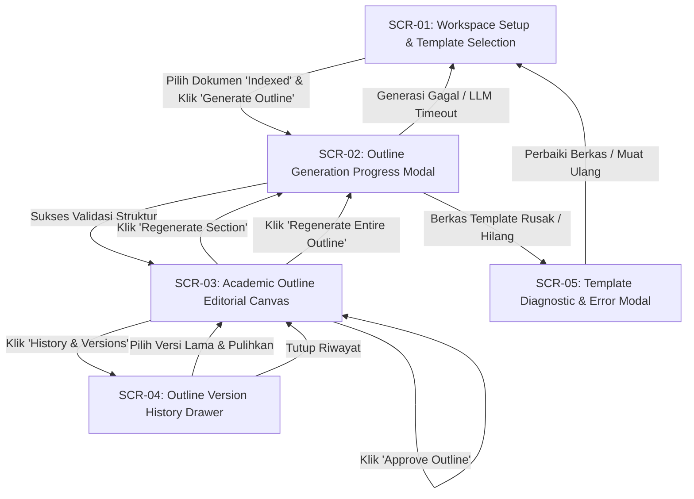
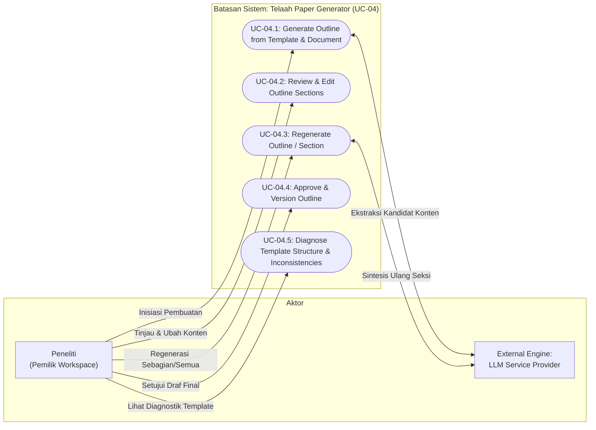
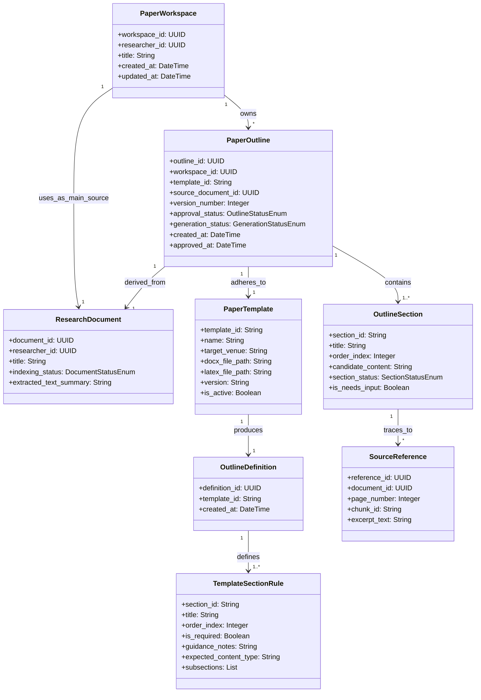

# Feature Specification: UC-04 Template-Based Paper Outline Generation – ICONIX Process

**Feature Branch**: `004-paper-outline-generation`  
**Created**: 2026-09-29  
**Status**: Draft  
**Input**: User description: "UC-04: Template-Based Paper Outline Generation (iciCos DOCX and LaTeX Templates)"  
**Methodology Reference**: Doug Rosenberg & Matt Stephens, *Use Case Driven Object Modeling with UML*  

> **Decomposition & Boundary Notice**:  
> Fitur ini mencakup **UC-04: Template-Based Paper Outline Generation**. Outline paper dibangun secara deterministik dari dua input utama:
> 1. Konten terekstraksi dan terindeks dari satu dokumen riset utama (*main research document*) yang berstatus `Indexed` (output dari UC-03).
> 2. Berkas template resmi konferensi (dimulai dengan template **iciCos**) yang tersimpan sebagai berkas statis di direktori sistem dalam format ganda: DOCX dan LaTeX.
>
> Fitur ini **TIDAK MENGGUNAKAN** "Framework A" ataupun metodologi *reverse-engineering* terpisah. Struktur outline semata-mata diturunkan dari struktur template yang dinormalisasi (*Single Source of Truth*), sedangkan kandidat konten draf diisi oleh Large Language Model (LLM) di bawah batasan ketat template dan referensi dokumen sumber.  
> Fitur ini **TIDAK MELAKUKAN**: penulisan draf paragraf/seksi lengkap (masuk pada UC-06), pencarian semantik lintas basis pengetahuan multi-dokumen (UC-05), validasi sitasi dan kompilasi ekspor LaTeX/PDF (UC-07), ataupun penilaian orisinalitas/plagiarisme.

---

## Clarifications & Open Decisions

The following items are designated for explicit user confirmation:

- **[NEEDS CLARIFICATION: Template Directory Structure & LaTeX File Placement]**: Saat ini direktori `backend/src/templates/` memuat berkas DOCX (`conference-template-a4.docx`, `conference-template-letter.docx`) serta berkas bibliografi IEEE (`IEEEtran.bst`, `*.bib`), namun belum memiliki berkas template `.tex` (misalnya `bare_conf.tex` atau `conference-template.tex`). Apakah struktur direktori template akan diorganisasi per subfolder template (misal `backend/src/templates/icicos/`) yang memuat pasangan berkas DOCX dan LaTeX secara berdampingan?
- **[NEEDS CLARIFICATION: Multi-Language Translation Policy]**: Jika dokumen sumber utama berbahasa Indonesia (misal skripsi, tesis, atau laporan penelitian) sedangkan template target iciCos berbahasa Inggris (standar IEEE), apakah pengisian kandidat outline otomatis diterjemahkan ke dalam Bahasa Inggris akademis, dipertahankan dalam bahasa sumber dokumen, atau mengikuti opsi preferensi peneliti saat memulai generasi?
- **[NEEDS CLARIFICATION: Regeneration Scope & Manual Edits Preservation]**: Ketika peneliti telah mengedit manual beberapa seksi outline lalu memilih *Regenerate Outline* secara keseluruhan, apakah sistem secara default mempertahankan seksi yang telah diedit manual (dengan opsi *checkbox* reset total), atau selalu menghasilkan draf baru murni dari LLM dengan tetap mengarsipkan draf editan manual sebagai versi terpisah di riwayat?

---

## 1. Overview & System Context

Telaah adalah platform penyusun draf manuskrip ilmiah yang dirancang untuk membantu akademisi, dosen, dan peneliti menyusun artikel ilmiah yang siap dipublikasikan ke konferensi atau jurnal bereputasi. Setelah UC-01 (Autentikasi Google OAuth), UC-02 (Impor Dokumen Google Drive), dan UC-03 (Indexing Dokumen & Embedding Lokal), dokumen riset utama peneliti telah terindeks dan siap dijadikan landasan konten.

Fitur **UC-04 (Template-Based Paper Outline Generation)** bertugas menjembatani dokumen sumber hasil riset dengan format publikasi target (diawali dengan template konferensi **iciCos**). Sistem membaca template statis (DOCX dan LaTeX), menurunkan definisi outline terpadu (*Normalized Outline Definition*), mengekstrak konten kunci dari dokumen terindeks, dan menghasilkan outline artikel ilmiah yang terstruktur rapi, tertelusuri hingga ke nomor halaman dan chunk sumber, serta bebas dari fabrikasi data.

### Target Actors
- **Peneliti (Researcher / Author)**: Pemilik workspace paper yang memilih dokumen riset utama, memilih template target, memantau kemajuan pembuatan outline, mereview, mengedit per seksi, melakukan regenerasi seksi atau outline, dan menyetujui draf outline final.
- **LLM Synthesis Engine (System Component)**: Layanan pemrosesan bahasa alami yang memetakan konten dokumen sumber ke dalam bidang-bidang terstruktur seksi template dengan batasan anti-halusinasi ketat.

### Core Business Value & Problem Statement
- **Kepatuhan Struktur Konferensi Target**: Peneliti sering kali kesulitan menyesuaikan draf awal dengan struktur dan instruksi gaya selingkung konferensi (seperti IEEE iciCos). Dengan menggunakan template sebagai acuan mutlak (*Single Source of Truth*), seluruh seksi wajib hadir dalam urutan yang tepat.
- **Integritas Ilmiah & Anti-Halusinasi**: Penulisan outline tidak boleh memuat angka, kesimpulan, sitasi, atau klaim yang tidak berdasar dari dokumen sumber. Bagian yang tidak memiliki bukti dukung ditandai secara transparan sebagai `[NEEDS INPUT]`.
- **Keterlacakan Sumber (Source Provenance)**: Setiap poin ringkasan latar belakang, masalah, metode, dan hasil dapat dilacak balik (*traceable*) ke potongan teks (chunk) dan halaman dokumen sumber.
- **Kendali Manusia (Human-in-the-Loop Approval)**: Tidak ada outline yang dianggap final sebelum peneliti meninjau, mengedit jika perlu, dan menyetujuinya (*explicit approval*).

---

## 2. GUI Storyboards & Screen Navigation

Antarmuka pengguna mematuhi **Academic Editorial Canvas** dan Konstitusi Telaah v1.3.0 Prinsip 7: permukaan kertas hangat (*Warm Paper Surface* `#FCF9F8`), tipografi serif berwibawa (*Newsreader* untuk display/judul seksi), sans-serif ergonomis (*Inter* untuk kontrol editorial dan teks isi), monospace presisi (*JetBrains Mono* untuk kode, chunk ID, dan tag metadata), serta aksen *Scholarly Royal Blue* (`#1D4ED8`) dan *Archival Emerald* (`#006C4A`). Seluruh ikon antarmuka wajib berasal dari keluarga `@phosphor-icons/react`.

### Screen Inventory

| Screen / View ID | Screen Name | Key UI Elements | Next Screen / Action Trigger |
|---|---|---|---|
| `SCR-01` | Workspace Setup & Template Selection View | Dropdown pemilihan dokumen sumber (hanya status `Indexed` yang aktif; dokumen non-indexed diberi badge disabled beserta tooltip alasan), Kartu pemilih Template Target (default: `iciCos IEEE Conference Template`), Ringkasan metadata template (DOCX + LaTeX versions), Tombol "Generate Outline" | Klik "Generate Outline" -> `SCR-02` |
| `SCR-02` | Outline Generation Progress Modal | Stepper visual kemajuan dengan 6 status: Preparing Template → Reading Document → Generating Outline → Validating Structure → Ready for Review (atau Failed), Indikator waktu berjalan, Tombol "Batalkan", Banner error aksi lanjut jika gagal | Transisi sukses -> `SCR-03` Gagal / Timeout -> Kembali ke `SCR-01` dengan dialog diagnostik `SCR-05` |
| `SCR-03` | Academic Outline Editorial Canvas | **Panel Kiri**: Pohon Navigasi Seksi Template (daftar seksi terurut, indikator status: *Filled*, *Needs Input*, *Edited*, badge *Required*). **Area Tengah**: Editor Seksi Aktif (Judul seksi resmi template, petunjuk penulisan resmi template, textarea konten kandidat, tombol per-seksi "Regenerate Section", penanda status seksi). **Panel Kanan**: Panel Keterlacakan Sumber (*Provenance Drawer* menampilkan chunk ID, nomor halaman, cuplikan teks dokumen sumber asli). **Header Aksi**: Tombol "Regenerate Entire Outline", Tombol "History & Versions" -> `SCR-04`, Tombol primer "Approve Outline". | Klik "History" -> `SCR-04` Klik "Approve Outline" -> Dialog konfirmasi approval, status berubah menjadi *Approved* |
| `SCR-04` | Outline Version History Drawer | Daftar riwayat versi outline (v1, v2, ...), tanggal pembuatan, pemicu (inisiasi/regenerasi), label status (*Draft* / *Approved*), pratinjau ringkas, tombol "Pulihkan Versi Ini" / "Bandingkan dengan Versi Aktif" | Klik "Pulihkan Versi" -> Konfirmasi pergantian draf aktif di `SCR-03` |
| `SCR-05` | Template Diagnostic & Error Modal | Rincian pesan kesalahan saat berkas template hilang, korup, atau tidak terbaca; rincian peringatan inkonsistensi struktur antara DOCX dan LaTeX beserta penjelasan aturan preseden yang diterapkan otomatis | Klik "Tutup" / "Muat Ulang Template" -> Kembali ke `SCR-01` |

### Storyboard Navigation Flow

---

## 3. Use Case Model (Doug Rosenberg Canonical)

### 3.1 Use Case Diagram (Actors & System Boundary)

---

### 3.2 Detailed Use Case Specifications

#### UC-04.1: Generate Paper Outline from Template & Indexed Document

- **Primary Actor**: Peneliti (Pemilik Workspace Paper)
- **Goal in Context**: Menghasilkan draf outline terstruktur awal berdasarkan seksi template resmi (iciCos) yang terisi dengan ringkasan konten dari dokumen sumber terindeks serta dilengkapi data keterlacakan (*provenance*).
- **Preconditions**:
  1. Peneliti telah terautentikasi dan memiliki Paper Workspace yang valid.
  2. Dokumen riset utama telah melalui UC-03 dengan status `Indexed`.
  3. Berkas template target (DOCX dan LaTeX) tersedia pada direktori statis sistem.
- **Postconditions (Success Guarantees)**:
  1. Definisi outline ternormalisasi (*Normalized Outline Definition*) berhasil dibaca atau dimuat dari cache.
  2. Draf outline versi awal (`v1`) berstatus `Draft` tersimpan dalam Paper Workspace.
  3. Seluruh seksi wajib template hadir sesuai urutan baku tanpa ada penambahan atau pengurangan seksi.
  4. Setiap isian seksi memuat tautan referensi chunk dokumen sumber, atau ditandai `[NEEDS INPUT]` jika bukti dokumen tidak ditemukan.
  5. Status proses beralih menjadi `Ready for review`.
- **Trigger**: Peneliti memilih dokumen riset terindeks, memilih template iciCos, dan menekan tombol "Generate Outline" pada `SCR-01`.

##### Basic Course of Events (Sunny Day Flow)

| Step | Actor Action | System Response |
|:---:|---|---|
| 1 | Peneliti memilih dokumen riset utama yang berstatus `Indexed` dan memilih template `iciCos`. | Sistem memverifikasi kepemilikan workspace dan ketersediaan dokumen sumber. Menampilkan ringkasan template dan mengaktifkan tombol "Generate Outline". |
| 2 | Peneliti menekan tombol "Generate Outline". | Sistem menampilkan modal kemajuan (`SCR-02`) dengan status awal: `Preparing template`. |
| 3 | - | Sistem memuat berkas template (DOCX dan LaTeX), memeriksa integritasnya, dan menghasilkan *Normalized Outline Definition*. Memperbarui status: `Reading document`. |
| 4 | - | Sistem membaca konten dokumen terindeks dari basis data lokal (output UC-03) yang terkait dengan dokumen riset utama tersebut. Memperbarui status: `Generating outline`. |
| 5 | - | Sistem mengirimkan konteks dokumen dan aturan seksi template ke LLM Engine dengan instruksi deterministik: isi setiap seksi dengan kandidat konten ringkas, tandai seksi tanpa dukungan data sebagai `[NEEDS INPUT]`, dan catat referensi chunk/halaman asal. Dilarang mengarang angka, sitasi, atau mengubah urutan seksi. |
| 6 | - | Sistem menerima respons LLM dan memperbarui status menjadi `Validating`. Sistem memvalidasi struktur output terhadap *Normalized Outline Definition*: memastikan seluruh seksi wajib hadir, urutan konsisten, dan format field valid. |
| 7 | - | Sistem menyimpan hasil generasi sebagai `PaperOutline` baru berstatus `Draft` (versi `v1`) yang terikat pada workspace peneliti. |
| 8 | - | Sistem memperbarui status modal menjadi `Ready for review` dan mengalihkan tampilan ke Academic Outline Editorial Canvas (`SCR-03`). |

##### Alternate & Exception Courses (Rainy Day Flows)

- **Alt-1: Dokumen Sumber Belum Berstatus `Indexed`**
  - **Pada langkah 1**: Jika dokumen riset yang dipilih masih berstatus `extracting`, `indexing`, atau `failed`:
  - Sistem menonaktifkan opsi pemilihan dokumen, menampilkan badge status aktual (misal: "Indexing in progress" atau "Indexing failed"), dan memunculkan tooltip informatif bahwa outline hanya dapat dibangun dari dokumen yang selesai diindeks.
- **Alt-2: Berkas Template Hilang atau Korup**
  - **Pada langkah 3**: Jika berkas DOCX atau LaTeX tidak ditemukan pada direktori sistem, rusak, atau gagal diparsing:
  - Sistem menghentikan alur generasi, mencatat log audit, memperbarui status menjadi `Failed`, dan menampilkan modal diagnostik `SCR-05` dengan pesan ramah pengguna: "Berkas template konferensi tidak dapat dibaca. Hubungi administrator sistem." Transaksi dibatalkan tanpa membuat draf baru.
- **Alt-3: Inkonsistensi Struktur Antara DOCX dan LaTeX**
  - **Pada langkah 3**: Jika seksi pada berkas DOCX berbeda dari seksi pada berkas LaTeX:
  - Sistem menerapkan aturan preseden: **DOCX menjadi acuan struktur outline dan urutan seksi penulisan**, sedangkan **LaTeX menjadi acuan struktur konfigurasi ekspor**. Sistem mencatat rincian ketidaksesuaian ke dalam log metadata outline dan memunculkan notifikasi peringatan non-blocking pada layar editorial.
- **Alt-4: Dokumen Sumber Terlalu Singkat atau Kurang Teks**
  - **Pada langkah 4**: Jika teks dokumen yang terindeks sangat minim (< 150 kata) sehingga tidak mencukupi untuk ekstraksi latar belakang atau metode:
  - Sistem melanjutkan proses, namun seksi-seksi yang tidak memiliki bukti dukung ditandai secara eksplisit dengan `[NEEDS INPUT]`, dan sistem memberikan banner catatan pada `SCR-03`: "Dokumen sumber sangat singkat. Sebagian besar seksi memerlukan input manual peneliti."
- **Alt-5: Dokumen Sumber Berbeda Bahasa dari Template (misal Dokumen Indonesia, Template English)**
  - **Pada langkah 5**: Dokumen riset berbahasa Indonesia, sedangkan target template iciCos menuntut artikel berbahasa Inggris.
  - Sesuai klarifikasi yang disepakati [NEEDS CLARIFICATION: Multi-Language Translation Policy], sistem memproses teks dengan menerjemahkan intisari secara akademis ke dalam Bahasa Inggris baku tanpa mengubah makna fakta dokumen asli.
- **Alt-6: Kegagalan Format Output LLM (Validasi Gagal) & Retry Terbatas**
  - **Pada langkah 6**: Jika LLM mengembalikan format yang tidak sesuai skema (misal ada seksi wajib yang hilang atau urutan tertukar):
  - Sistem melakukan percobaan ulang (*retry*) otomatis hingga maksimal 2 kali dengan prompt perbaikan kesalahan (*error correction prompt*).
  - Jika setelah 2 kali retry validasi tetap gagal, status generasi diubah menjadi `Failed`. Modal menampilkan pesan: "Pembuatan outline otomatis gagal memenuhi validasi struktur template. Silakan coba kembali." Tombol "Coba Lagi" disediakan pada `SCR-02`.
- **Alt-7: Layanan LLM Tidak Tersedia atau Waktu Habis (*Timeout*)**
  - **Pada langkah 5**: Jika koneksi ke penyedia LLM terputus atau melebihi batas waktu (timeout > 60 detik):
  - Sistem memperbarui status menjadi `Failed` dan menampilkan pesan: "Layanan kecerdasan buatan sedang tidak merespons. Dokumen dan template Anda tetap aman. Silakan klik Coba Lagi beberapa saat lagi."
- **Alt-8: Permintaan Generasi Ganda Bersamaan (*Concurrent Requests*)**
  - **Pada langkah 2**: Jika ada dua permintaan generasi untuk workspace yang sama dalam waktu berdekatan:
  - Sistem menolak permintaan kedua dengan status HTTP 409 / pesan "Proses pembuatan outline untuk workspace ini sedang berlangsung."

---

#### UC-04.2: Review & Edit Outline Sections

- **Primary Actor**: Peneliti
- **Goal in Context**: Meninjau setiap seksi outline yang diisi otomatis, membaca referensi chunk asal, memperbaiki atau melengkapi teks seksi, dan menyelesaikan seksi berstatus `[NEEDS INPUT]`.
- **Preconditions**: Draf outline aktif terbuka di `SCR-03`.
- **Postconditions**: Konten seksi diperbarui, status seksi beralih menjadi `Edited` (atau tetap `Needs Input` jika penanda belum dihapus), dan perubahan tersimpan otomatis (*auto-save*) atau manual ke draf aktif.
- **Trigger**: Peneliti mengklik salah satu seksi di pohon navigasi seksi `SCR-03` dan mengetik perubahan di editor teks.

##### Basic Course of Events
1. Peneliti memilih seksi tertentu dari pohon navigasi (misal: "Section II: Methodology").
2. Sistem memuat teks seksi, aturan panduan resmi template untuk seksi tersebut, dan daftar chunk sumber di panel keterlacakan kanan.
3. Peneliti meninjau kandidat teks dan membaca cuplikan teks asli pada panel referensi untuk memastikan kesesuaian fakta.
4. Peneliti menyunting teks langsung pada editor (misal melengkapi bagian yang sebelumnya bertanda `[NEEDS INPUT]`).
5. Sistem memvalidasi perubahan dan menyimpan pembaruan ke draf seksi, menandai status seksi sebagai `Edited`.

---

#### UC-04.3: Regenerate Outline or Single Section

- **Primary Actor**: Peneliti
- **Goal in Context**: Melakukan regenerasi konten draf dengan LLM, baik hanya untuk satu seksi spesifik (tanpa mengganggu seksi lain) maupun untuk seluruh outline sekaligus (menghasilkan versi baru).
- **Preconditions**: Draf outline aktif terbuka di `SCR-03`.
- **Postconditions**: 
  - Jika regenerasi per-seksi: hanya konten seksi tersebut yang disintesis ulang dan diperbarui pada draf aktif.
  - Jika regenerasi seluruh outline: sistem membuat versi draf baru (misal `v2`), sedangkan versi draf sebelumnya dipertahankan utuh dalam riwayat versi.
- **Trigger**: Peneliti menekan tombol "Regenerate Section" pada editor seksi aktif, ATAU menekan tombol "Regenerate Entire Outline" pada header `SCR-03`.

##### Basic Course of Events (Regenerasi Seluruh Outline)
1. Peneliti menekan tombol "Regenerate Entire Outline".
2. Sistem memunculkan dialog konfirmasi: "Regenerasi seluruh outline akan membuat versi draf baru (vX+1). Draf Anda saat ini tidak akan ditimpa dan tetap tersimpan di riwayat."
3. Peneliti mengonfirmasi tindakan.
4. Sistem memicu pipeline generasi (seperti pada UC-04.1 langkah 3–7) dengan parameter dokumen dan template yang sama.
5. Sistem menyimpan draf baru dengan nomor versi incremented (`vX+1`) dan status `Draft`.
6. Sistem menampilkan draf baru tersebut pada `SCR-03` dengan riwayat versi diperbarui pada `SCR-04`.

---

#### UC-04.4: Approve & Version Paper Outline

- **Primary Actor**: Peneliti
- **Goal in Context**: Memberikan persetujuan eksplisit (*explicit human approval*) terhadap draf outline sehingga statusnya terkunci sebagai draf outline yang siap digunakan untuk tahapan penulisan naskah (UC-06).
- **Preconditions**: 
  - Peneliti telah meninjau draf outline pada `SCR-03`.
  - Seluruh seksi wajib terisi (tidak ada seksi wajib yang kosong total).
- **Postconditions**:
  - Draf outline aktif ditandai dengan status `Approved`.
  - Outline disematkan sebagai acuan resmi workspace paper peneliti.
  - Jika di kemudian hari peneliti melakukan regenerasi, draf baru akan dibuat tanpa menimpa versi `Approved` yang sudah ada.
- **Trigger**: Peneliti menekan tombol "Approve Outline" pada header `SCR-03`.

##### Basic Course of Events
1. Peneliti menekan tombol "Approve Outline".
2. Sistem memeriksa apakah masih terdapat penanda `[NEEDS INPUT]` pada seksi wajib.
   - Jika masih ada: Sistem memunculkan dialog peringatan: "Masih terdapat seksi dengan penanda [NEEDS INPUT]. Apakah Anda yakin ingin menyetujui outline ini sekarang?" Peneliti dapat memilih untuk melengkapi terlebih dahulu atau tetap menyetujui.
3. Peneliti mengonfirmasi persetujuan.
4. Sistem memperbarui status draf outline menjadi `Approved`, mencatat waktu persetujuan (*approved_at*), dan menampilkan badge visual *Approved* di antarmuka.

---

## 4. Initial Domain Model (Noun-Phrase Extraction)

Berdasarkan ekstraksi konsep bisnis dari *use case* dan kamus istilah akademis, berikut model domain konseptual untuk UC-04:

### Domain Concept Definitions

- **`PaperWorkspace`**: Lingkungan kerja digital seorang peneliti yang menampung artikel ilmiah yang sedang disusun, dokumen riset utama yang digunakan, konfigurasi template target, serta riwayat versi draf outline dan manuskrip.
- **`ResearchDocument`**: Berkas riset utama milik peneliti yang telah diimpor dari Google Drive (UC-02) dan berhasil diproses serta diindeks ke dalam basis data embedding lokal (UC-03).
- **`PaperTemplate`**: Konfigurasi template statis yang tersimpan dalam sistem (contoh: `iciCos IEEE Conference Template`). Mengacu pada sepasang berkas fisik: berkas DOCX (acuan tata letak, judul seksi, dan panduan penulisan) dan berkas LaTeX (acuan struktur kompilasi dan kelas dokumen).
- **`OutlineDefinition`**: Definisi skema outline ternormalisasi yang dihasilkan dari pemindaian dan ekstraksi pasangan berkas template. Menjadi acuan tunggal (*Single Source of Truth*) bagi susunan seksi artikel ilmiah.
- **`TemplateSectionRule`**: Aturan seksi individu dalam definisi template, mendefinisikan pengenal seksi (`section_id`), judul resmi (`title`), urutan seksi (`order_index`), sifat wajib/opsional (`is_required`), panduan penulisan resmi template (`guidance_notes`), dan daftar subseksi jika ada.
- **`PaperOutline`**: Objek draf outline artikel ilmiah pada workspace tertentu. Memiliki versi eksplisit (`version_number`), status pembuatan (`generation_status`: *Preparing*, *Reading*, *Generating*, *Validating*, *Ready for Review*, *Failed*), serta status persetujuan (`approval_status`: *Draft*, *Approved*).
- **`OutlineSection`**: Butir seksi nyata dalam draf outline yang memuat teks kandidat yang disintesis LLM atau disunting manual oleh peneliti, serta status seksi (`Filled`, `Needs Input`, `Edited`).
- **`SourceReference`**: Rekaman bukti dukung keterlacakan (*provenance record*) yang mengaitkan teks kandidat seksi ke lokasi fisik dokumen sumber: ID dokumen, nomor halaman asli, dan ID chunk embedding dari UC-03.

---

## 5. Requirements Traceability

### Functional Requirements (FR)

- **FR-001 (Main Source Document Selection)**: Sistem HARUS mengizinkan peneliti memilih dokumen riset utama hanya dari dokumen milik workspace peneliti yang memiliki status `Indexed`. Dokumen dengan status selain `Indexed` (`uploading`, `extracting`, `indexing`, `failed`) HARUS dinonaktifkan dari pemilihan disertai penjelasan alasan yang jelas pada antarmuka. *(Ditelusuri ke UC-04.1 Step 1, Alt-1)*
- **FR-002 (Target Template Selection)**: Sistem HARUS menyediakan pilihan template publikasi target statis (dimulai dengan `iciCos IEEE Conference Template`) dan dirancang secara modular sehingga penambahan template baru hanya membutuhkan penambahan berkas di direktori template tanpa mengubah logika bisnis aplikasi. *(Ditelusuri ke UC-04.1 Step 1)*
- **FR-003 (Template Parsing & Validation)**: Sistem HARUS membaca berkas template DOCX dan LaTeX serta menghasilkan `OutlineDefinition` yang ternormalisasi. Jika berkas template hilang, tidak terbaca, atau rusak, sistem HARUS memblokir proses generasi dan menampilkan pesan kesalahan yang jelas dan dapat ditindaklanjuti. *(Ditelusuri ke UC-04.1 Step 3, Alt-2)*
- **FR-004 (Template Precedence Rule on Inconsistency)**: Jika terjadi perbedaan struktur seksi antara berkas DOCX dan LaTeX pada template yang sama, sistem HARUS mencatat laporan inkonsistensi tersebut dan menerapkan aturan preseden baku: berkas DOCX menentukan struktur dan urutan seksi penulisan outline, sedangkan berkas LaTeX menentukan struktur perintah ekspor dokumen. *(Ditelusuri ke UC-04.1 Step 3, Alt-3)*
- **FR-005 (Document-to-Section Content Synthesis)**: Sistem HARUS memanfaatkan konten terekstraksi dari dokumen riset utama untuk mengisi setiap seksi template dengan kandidat konten yang relevan (seperti latar belakang, rumusan masalah, tujuan, metodologi penelitian, temuan/hasil utama, dan kesimpulan) sesuai instruksi panduan seksi template. *(Ditelusuri ke UC-04.1 Step 4-5)*
- **FR-006 (Strict Template Section Invariance)**: Outline yang dihasilkan HARUS memuat seluruh seksi wajib dari template dalam urutan yang tepat sesuai `TemplateSectionRule`. Mesin LLM DILARANG menambah seksi baru di luar template, menghapus seksi wajib, mengubah nama judul seksi resmi, atau mengubah urutan seksi. *(Ditelusuri ke UC-04.1 Step 5-6)*
- **FR-007 (Transparent Needs Input Marker)**: Jika dokumen riset sumber tidak memuat informasi atau bukti dukung untuk suatu seksi atau butir isian tertentu, sistem HARUS membubuhkan penanda eksplisit `[NEEDS INPUT]` dan DILARANG KERAS mengarang (*hallucinating/inventing*) konten fiktif. *(Ditelusuri ke UC-04.1 Step 5, Alt-4)*
- **FR-008 (Source Provenance Tracking)**: Setiap butir kandidat konten yang berhasil diisi HARUS mencatat dan menampilkan metadata lokasi sumbernya pada dokumen asli: nama/ID dokumen, nomor halaman asli, dan referensi chunk UC-03, sehingga peneliti dapat memverifikasi keabsahannya. *(Ditelusuri ke UC-04.1 Step 5, UC-04.2 Step 3)*
- **FR-009 (Strict Anti-Fabrication Rule)**: Sistem DILARANG mengarang angka metrik hasil eksperimen, kesimpulan yang tidak ada dalam dokumen, maupun sitasi/referensi fiktif. Setiap sitasi yang tidak termaktub dalam dokumen sumber riset utama HARUS dikecualikan dari outline. *(Ditelusuri ke UC-04.1 Step 5)*
- **FR-010 (Pre-Display Structure Validation & Limited Retry)**: Sistem HARUS memvalidasi draf outline hasil generasi terhadap `OutlineDefinition` (kehadiran seluruh seksi wajib, urutan, tipe data field) sebelum menampilkannya ke peneliti. Jika validasi gagal, sistem HARUS mencoba ulang secara otomatis maksimal 2 kali; jika tetap gagal, sistem beralih ke status `Failed` dengan tombol coba lagi (*retry*). *(Ditelusuri ke UC-04.1 Step 6, Alt-6)*
- **FR-011 (Interactive Editorial & Granular Regeneration)**: Peneliti DAPAT meninjau konten, mengedit teks seksi secara manual, meminta regenerasi ulang untuk satu seksi tertentu saja (*single section regeneration*), ataupun meminta regenerasi outline secara keseluruhan (*full outline regeneration*). *(Ditelusuri ke UC-04.2, UC-04.3)*
- **FR-012 (Explicit Human Approval Gate)**: Tidak ada draf outline yang dianggap final sebelum disetujui secara sadar dan eksplisit oleh peneliti melalui tindakan *Approve Outline*. *(Ditelusuri ke UC-04.4)*
- **FR-013 (Immutable Versioning & Overwrite Prevention)**: Draf outline yang disetujui HARUS disimpan sebagai versi permanen dalam Paper Workspace. Tindakan regenerasi berikutnya HARUS menciptakan versi draf baru (misal `v2`) dan DILARANG menimpa secara diam-diam (*silent overwrite*) versi draf yang telah disetujui. *(Ditelusuri ke UC-04.3, UC-04.4)*
- **FR-014 (Workspace Authorization & Tenant Isolation)**: Peneliti HANYA dapat melihat, membuat, mengedit, meregenerasi, dan menyetujui outline dari Paper Workspace miliknya sendiri. Akses terhadap outline milik peneliti lain HARUS ditolak secara tegas. *(Ditelusuri ke Batasan Sistem)*
- **FR-015 (Visible Generation Progress Telemetry)**: Proses pembuatan outline HARUS menampilkan indikator status kemajuan secara real-time dan berurutan: `Preparing template` → `Reading document` → `Generating outline` → `Validating` → `Ready for review` (atau `Failed`). *(Ditelusuri ke UC-04.1 Step 2-8)*

---

### Non-Functional Requirements (NFR)

- **NFR-001 (Performance & Non-Blocking Operation)**: Proses pembuatan draf outline untuk dokumen riset standar (10–30 halaman) HARUS selesai dalam waktu yang wajar (< 45 detik dalam kondisi jaringan LLM normal). Proses HARUS berjalan secara asinkron (*non-blocking*) sehingga peneliti tetap dapat melihat progres animasi status tanpa pembekuan antarmuka (*UI freeze*).
- **NFR-002 (Structural Repeatability & Determinism)**: Untuk template yang sama, sistem HARUS selalu menghasilkan struktur pohon seksi yang 100% konsisten dan berulang (*deterministic structure*), terlepas dari variasi isi konten dokumen sumber.
- **NFR-003 (Data & Template Immutability)**: Berkas dokumen sumber asli milik peneliti dan berkas template statis pada sistem TIDAK PERNAH dimodifikasi oleh proses pembuatan outline (bersifat *read-only*).
- **NFR-004 (Graceful & Actionable Error Handling)**: Seluruh pesan kegagalan (seperti LLM timeout, berkas template korup, dokumen tidak valid) HARUS disajikan dalam bahasa akademis yang mudah dipahami dan memberikan rekomendasi tindakan konkrit bagi peneliti. Sistem DILARANG menampilkan *stack trace* internal atau informasi teknis sensitif ke antarmuka pengguna.
- **NFR-005 (Design & Accessibility Compliance)**: Antarmuka pengguna HARUS mematuhi standar Konstitusi Telaah v1.3.0 Prinsip 7 (Academic Editorial Canvas, rasio kontras WCAG AA minimal 4.5:1, tipografi Newsreader/Inter/JetBrains Mono, dan ikonografi eksklusif `@phosphor-icons/react`).

---

## 6. Success Criteria & Scope Boundaries

### Measurable Success Criteria

- **SC-001 (Template Structural Accuracy)**: 100% draf outline yang dihasilkan dari template iciCos memuat seluruh seksi wajib dalam urutan dan penamaan yang persis sesuai dengan template acuan.
- **SC-002 (Zero Hallucinated Section Data)**: 0% data angka, klaim metodologi, atau kesimpulan yang tidak didukung oleh dokumen sumber muncul sebagai teks terisi tanpa penanda `[NEEDS INPUT]`.
- **SC-003 (Complete Source Traceability)**: Minimal 95% dari setiap butir kandidat konten yang berstatus `Filled` memiliki metadata keterlacakan valid yang merujuk pada nomor halaman atau chunk ID dokumen sumber.
- **SC-004 (Failure Resilience & Actionability)**: Jika berkas template atau dokumen tidak valid, 100% kasus menghasilkan pesan galat terarah yang dapat ditindaklanjuti dalam waktu < 2 detik tanpa *crash* aplikasi.
- **SC-005 (Version Integrity)**: 100% operasi regenerasi setelah status *Approved* berhasil membuat versi dokumen draf baru tanpa memodifikasi catatan versi sebelumnya.
- **SC-006 (Editorial Usability)**: Peneliti dapat menyelesaikan peninjauan, penyuntingan seksi, dan persetujuan draf outline rata-rata dalam waktu kurang dari 5 menit.

### Scope Boundaries

#### In Scope
- Pembacaan dan parsing template resmi iciCos (DOCX dan LaTeX).
- Ekstraksi konten dokumen utama berstatus `Indexed` (output UC-03).
- Sintesis kandidat konten seksi berbasis LLM dengan panduan batasan template.
- Pelabelan otomatis `[NEEDS INPUT]` untuk seksi tanpa dukungan data dokumen.
- Pencatatan dan penayangan keterlacakan sumber (*source provenance*) per seksi.
- Validasi struktur pra-tayang dan penanganan *retry* terbatas.
- Peninjauan interaktif, pengeditan langsung seksi, dan regenerasi per seksi / seluruh outline.
- Manajemen draf versi outline (*versioning*) dan gerbang persetujuan eksplisit (*human approval*).
- Isolasi hak akses berbasis kepemilikan workspace peneliti.

#### Out of Scope
- Metodologi "Framework A" atau teknik *reverse-engineering* dokumen di luar struktur template.
- Penulisan draf narasi paragraf lengkap atau draf manuskrip utuh (dialokasikan untuk UC-06).
- Pencarian dan penggabungan referensi multi-dokumen lintas *knowledge base* (dialokasikan untuk UC-05).
- Validasi format sitasi bibliografi (BibTeX), pengecekan DOI, dan kompilasi ekspor berkas LaTeX/PDF (dialokasikan untuk UC-07).
- Pengunggahan template kustom oleh pengguna (*user-uploaded templates*).
- Prediksi penerimaan paper (*acceptance prediction*), penghitungan skor orisinalitas, atau pengecekan plagiarisme.

---

## 7. Git & Version Control Strategy

- **Feature Branch**: `004-paper-outline-generation`
- **Conventional Commits Standard**:
  - `feat(outline)`: Fitur parsing template, generasi outline, dan editor seksi
  - `test(outline)`: Pengujian unit dan integrasi skema outline, validasi template, dan kontrol versi
  - `refactor(outline)`: Peningkatan struktur parser template atau alur regenerasi
  - `chore(outline)`: Konfigurasi berkas template iciCos dan dokumentasi pendukung
- **Major Milestone Checkpoints**:
  - **Milestone 1 (Template Ingestion & Schema Definition)**: `feat(template): implement DOCX and LaTeX template parser and normalized outline definition model`
  - **Milestone 2 (Generation & Validation Pipeline)**: `feat(outline): build document context binding, LLM prompt synthesis with [NEEDS INPUT] rules, and structural validator`
  - **Milestone 3 (Editorial Canvas & Versioning)**: `feat(ui): implement Academic Editorial Canvas with section tree, provenance drawer, and version history`
  - **Milestone 4 (Verification & Approval Gate)**: `test(outline): verify end-to-end template adherence, non-overwrite versioning, and human approval flow`
