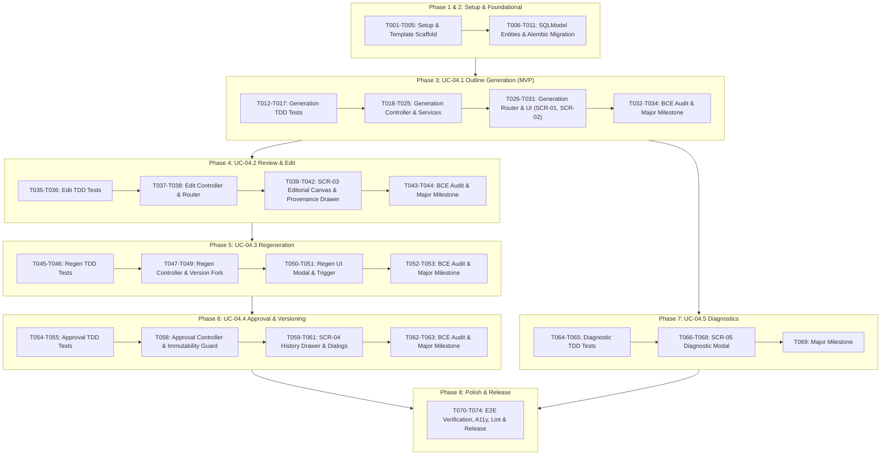

# Tasks: UC-04 Template-Based Paper Outline Generation – ICONIX Implementation Plan

**Input**: Design documents from `/specs/004-paper-outline-generation/` (`spec.md`, `plan.md`, `research.md`, `data-model.md`, `contracts/outline-api.md`, `quickstart.md`)  
**Prerequisites**: `plan.md` (PDR & CDR Approved), `spec.md`, `research.md`, `data-model.md`, Telaah Constitution v1.3.0  
**Methodology Reference**: Doug Rosenberg's ICONIX Process (BCE Architecture: Tests → Entity → Controller → Boundary)  
**Branch**: `004-paper-outline-generation`

---

## Git Version Control Rules (Mandatory)
1. **Atomic Per-Task Commits**: After completing any implementation task and verifying its test, execute:  
   `git add <modified-files> && git commit -m "<type>(<scope>): <concise description>"`
2. **Major Checkpoint Commits**: At the conclusion of each Phase and upon completing each Use Case (ICONIX UC), execute the designated **Major Milestone Commit**.
3. **Commit Convention**: Follow Conventional Commits (`feat:`, `test:`, `refactor:`, `chore:`, `fix:`).

---

## Phase 1: Setup & Environment Initialization

**Purpose**: Scaffolding directories, configurations, template assets, and dependencies.

- [x] T001 Initialize feature module directory structure at `backend/src/outlines/` and frontend page/component directories at `frontend/src/app/workspace/outline/` and `frontend/src/components/features/outline/` per plan.md
- [x] T002 Scaffold template directory at `backend/src/templates/icicos/` by copying `conference-template-a4.docx` to `template.docx`, creating LaTeX export reference `template.tex`, and authoring declarative section configuration `outline-sections.yaml`
- [x] T003 Configure Python dependencies (`python-docx>=1.1.0`, `PyYAML>=6.0`, `google-generativeai>=0.8.0`) in `backend/pyproject.toml`
- [x] T004 [P] Configure frontend test helpers and mock fixtures for outline generation states in `frontend/src/lib/api/outlines.ts`
- [x] T005 **Git Major Commit**: `git add . && git commit -m "chore(setup): scaffold UC-04 outline project structure, icicos templates, and dependencies"`

---

## Phase 2: Foundational Entity Layer & Database Migrations

**Purpose**: Establish database schemas, SQLModel entities, repository layer, and migration scripts before use case controllers run.

- [x] T006 Implement Enum types (`OutlineLanguageEnum`: `en_ieee`, `id_formal`; `GenerationStatusEnum`: `preparing`, `reading`, `generating`, `validating`, `ready`, `failed`; `ApprovalStatusEnum`: `draft`, `approved`; `SectionStatusEnum`: `filled`, `needs_input`, `edited`) and `PaperOutline` SQLModel entity with constraints ("id UUID PK default uuid4", "researcher_id UUID FK NOT NULL INDEX", "document_id UUID FK NOT NULL INDEX", "template_id VARCHAR(100) NOT NULL", "version_number INTEGER NOT NULL DEFAULT 1", "language_choice ENUM NOT NULL DEFAULT en_ieee", "generation_status ENUM NOT NULL DEFAULT preparing", "approval_status ENUM NOT NULL DEFAULT draft", "failure_reason TEXT NULLABLE", "created_at TIMESTAMPTZ NOT NULL DEFAULT now()", "approved_at TIMESTAMPTZ NULLABLE", composite index on `(researcher_id, document_id)`, composite index on `(document_id, version_number)`) in `backend/src/outlines/models.py`
- [x] T007 Implement `OutlineSection`, `SectionField`, and `SourceReference` SQLModel entities with constraints ("OutlineSection: id UUID PK default uuid4, outline_id UUID FK NOT NULL INDEX, section_key VARCHAR(100) NOT NULL, title VARCHAR(500) NOT NULL, order_index INTEGER NOT NULL, is_required BOOLEAN NOT NULL DEFAULT TRUE, section_status ENUM NOT NULL DEFAULT needs_input, composite indexes on (outline_id, order_index) and (outline_id, section_key)", "SectionField: id UUID PK default uuid4, section_id UUID FK NOT NULL INDEX, field_key VARCHAR(100) NOT NULL, field_label VARCHAR(500) NOT NULL, content TEXT NOT NULL DEFAULT '[NEEDS INPUT]', is_needs_input BOOLEAN NOT NULL DEFAULT TRUE, is_edited BOOLEAN NOT NULL DEFAULT FALSE, order_index INTEGER NOT NULL, index on (section_id, order_index)", "SourceReference: id UUID PK default uuid4, field_id UUID FK NOT NULL INDEX, chunk_id UUID FK NOT NULL, document_id UUID FK NOT NULL, page_number INTEGER NULLABLE, excerpt_text TEXT NOT NULL, index on (field_id)") in `backend/src/outlines/models.py`
- [x] T008 Implement `OutlineRepository` base CRUD and query methods (`create_outline`, `create_outline_with_sections`, `get_outline_by_id`, `update_outline_status`, `get_field_by_id`, `update_field_content`, `clone_edited_sections`, `approve_outline`, `list_outline_versions`) in `backend/src/outlines/repository.py`
- [x] T009 Create Alembic database migration script `alembic/versions/004_paper_outlines_schema.py` creating the 4 enum types, 4 tables (`paper_outlines`, `outline_sections`, `section_fields`, `source_references`), and all indexes
- [x] T010 Run migration in test environment (`alembic upgrade head`) and verify schema matches `data-model.md`
- [x] T011 **Git Major Commit**: `git add . && git commit -m "feat(core): implement database migrations and foundational entity models"`

**PDR Verification Checkpoint**: Entity models conform to Updated Domain Model in `plan.md` and schema constraints in `data-model.md`.

---

## Phase 3: Use Case 1 (UC-04.1) – Generate Paper Outline from Template & Indexed Document (Priority: P1) [MVP]

**Goal**: Researcher selects an indexed document, chooses the iciCos template and outline language (`en_ieee` or `id_formal`), and generates a structured v1 draft outline with directed chunk retrieval, Gemini LLM synthesis, `[NEEDS INPUT]` markers, and structure validation.  
**Independent Test**: `pytest backend/tests/outlines/test_generation.py -v` (verifies template parsing, chunk retrieval, LLM synthesis, and full async generation flow from `POST /api/outlines/generate` through status `ready`).

### Step 3.1: Unit & Integration Tests (TDD - Write First)
- [x] T012 [P] [UC1] Write unit tests for `TemplateParser` (`test_parse_template_icicos`, `test_missing_file_failure`, `test_docx_yaml_normalization`) in `backend/tests/outlines/test_template_parser.py`
- [x] T013 [P] [UC1] Write unit tests for `ChunkRetriever` verifying cosine similarity search and field-targeted query generation on `document_chunks` in `backend/tests/outlines/test_retriever.py`
- [x] T014 [P] [UC1] Write unit tests for `LLMSynthesizer` (anti-hallucination `[NEEDS INPUT]` rule, language policy `en_ieee` vs `id_formal`, technical term preservation, JSON response parsing) in `backend/tests/outlines/test_llm_synthesizer.py`
- [x] T015 [P] [UC1] Write integration tests for `OutlineService` generation pipeline, NFR-001 latency target assertion (<45s execution budget), and FastAPI router endpoints (`POST /api/outlines/generate`, `GET /api/outlines/{id}/status`, `GET /api/outlines/{id}`) in `backend/tests/outlines/test_service.py` and `backend/tests/outlines/test_router.py`
- [x] T016 [UC1] Verify tests FAIL prior to implementation (Red stage)
- [x] T017 [UC1] **Git Commit (Tests)**: `git add backend/tests/outlines/ && git commit -m "test(UC1): add failing test suite for UC-04.1 outline generation and parsing"`

### Step 3.2: Controller Layer (Business Logic & Validation)
- [x] T018 [P] [UC1] Implement request and response Pydantic DTOs (`GenerateOutlineRequest`, `OutlineStatusResponse`, `OutlineDetailResponse`, `SectionDTO`, `FieldDTO`, `SourceRefDTO`) in `backend/src/outlines/schemas.py`
- [x] T019 [UC1] Implement `TemplateParser` in `backend/src/outlines/template_parser.py` extracting DOCX headings, YAML body section fields, and LaTeX export configs into normalized `OutlineDefinition`
- [x] T020 [UC1] Implement `ChunkRetriever` in `backend/src/outlines/retriever.py` retrieving top-k chunks from `document_chunks` table via pgvector cosine similarity filtered by `index_version_id`
- [x] T021 [UC1] Implement `LLMSynthesizer` in `backend/src/outlines/llm_synthesizer.py` interfacing with `gemini-2.0-flash` with structured JSON output and `[NEEDS INPUT]` anti-hallucination prompt
- [x] T022 [UC1] Implement `OutlineService` generation logic (`generate_outline`, `validate_generate_request`, `assert_no_active_generation`, `validate_outline_structure`) in `backend/src/outlines/service.py`
- [x] T023 [UC1] Implement background worker orchestration in `backend/src/outlines/worker.py` handling async status progression (`preparing` → `reading` → `generating` → `validating` → `ready`/`failed`) and up to 2 automated retries on schema failure
- [x] T024 [UC1] Verify unit and integration tests pass (Green stage)
- [x] T025 [UC1] **Git Commit (Controller)**: `git add backend/src/outlines/ && git commit -m "feat(UC1): implement template parser, chunk retriever, LLM synthesizer, and async worker"`

### Step 3.3: Boundary Layer (API Router & Frontend GUI)
- [x] T026 [UC1] Implement FastAPI Router endpoints (`POST /api/outlines/generate`, `GET /api/outlines/{outline_id}/status`, `GET /api/outlines/{outline_id}`) with Bearer auth, 409 conflict guard, and workspace tenant isolation in `backend/src/outlines/router.py`
- [x] T027 [UC1] Register `outlines_router` in `backend/src/main.py` under prefix `/api/outlines`
- [x] T028 [P] [UC1] Implement frontend API client methods (`generateOutline`, `getOutlineStatus`, `getOutlineDetail`) in `frontend/src/lib/api/outlines.ts`
- [x] T029 [P] [UC1] Implement SCR-01 Workspace Setup & Template Selection view with indexed doc dropdown, disabled tooltip for non-indexed docs, iciCos template card, and language radio buttons in `frontend/src/app/workspace/outline/page.tsx` and `frontend/src/components/features/outline/TemplateSelectionCard.tsx`
- [x] T030 [P] [UC1] Implement SCR-02 Outline Generation Progress Modal with 6-state visual stepper (`Preparing`, `Reading`, `Generating`, `Validating`, `Ready for Review`, `Failed`) in `frontend/src/components/features/outline/GenerationProgressModal.tsx`
- [x] T031 [UC1] Wire SCR-01 and SCR-02 to trigger generation, poll status every 3s, and auto-redirect to SCR-03 upon `ready` status in `frontend/src/app/workspace/outline/page.tsx`

### Step 3.4: BCE Audit & Major Milestone Checkpoint
- [x] T032 [UC1] **BCE Audit**: Confirm Frontend & Router (Boundary) never query Database (Entity) directly; all operations mediated by `OutlineService`
- [x] T033 [UC1] Run integration tests and confirm all sunny-day and rainy-day flows (Alt-1 non-indexed doc, Alt-7 timeout, Alt-8 concurrent conflict) pass
- [x] T034 [UC1] **Git Major Commit (Milestone)**: `git add . && git commit -m "feat(UC1): complete UC-04.1 outline generation from template and document end-to-end [MVP Milestone]"`

**Checkpoint**: UC-04.1 is fully functional and delivers an independently testable MVP.

---

## Phase 4: Use Case 2 (UC-04.2) – Review & Edit Outline Sections (Priority: P2)

**Goal**: Researcher views the structured outline in the Academic Editorial Canvas (SCR-03), inspects chunk provenance in the right drawer, and directly edits field text (marking it as `is_edited: true` with an `Edited` badge).  
**Independent Test**: `pytest backend/tests/outlines/test_section_editing.py -v` (verifies `PATCH /api/outlines/{id}/fields/{field_id}` updates content, sets `is_edited=true`, and provenance drawer displays accurate chunk refs).

### Step 4.1: Tests (TDD)
- [ ] T035 [P] [UC2] Write unit and integration tests for `PATCH /api/outlines/{outline_id}/fields/{field_id}` and section detail querying in `backend/tests/outlines/test_section_editing.py`
- [ ] T036 [UC2] **Git Commit (Tests)**: `git add backend/tests/outlines/ && git commit -m "test(UC2): add tests for section field editing and provenance retrieval"`

### Step 4.2: Controller & Entity Extensions
- [ ] T037 [P] [UC2] Implement field update Pydantic DTO (`UpdateFieldRequest`) in `backend/src/outlines/schemas.py` and service method `update_field_content` in `backend/src/outlines/service.py`
- [ ] T038 [UC2] Implement `PATCH /api/outlines/{outline_id}/fields/{field_id}` endpoint in `backend/src/outlines/router.py`

### Step 4.3: Boundary & Integration (Frontend Academic Editorial Canvas)
- [ ] T039 [P] [UC2] Implement `SectionTreeNav.tsx` displaying ordered template sections, required badges, and status badges (`Filled`, `Needs Input`, `Edited`) in `frontend/src/components/features/outline/SectionTreeNav.tsx`
- [ ] T040 [P] [UC2] Implement `ProvenanceDrawer.tsx` displaying chunk ID, original page number, and source excerpt text in `frontend/src/components/features/outline/ProvenanceDrawer.tsx`
- [ ] T041 [P] [UC2] Implement `SectionFieldEditor.tsx` with textarea, field guidance notes, and auto-save / manual save trigger in `frontend/src/components/features/outline/SectionFieldEditor.tsx`
- [ ] T042 [UC2] Assemble SCR-03 3-panel layout in `frontend/src/app/workspace/outline/[outlineId]/page.tsx` adhering to Academic Editorial Canvas (`#FCF9F8` warm paper, Newsreader/Inter/JetBrains Mono, `@phosphor-icons/react`)
- [ ] T043 [UC2] **BCE Audit**: Confirm strict adherence to Boundary-Controller-Entity separation in field edit flows
- [ ] T044 [UC2] **Git Major Commit (Milestone)**: `git add . && git commit -m "feat(UC2): complete UC-04.2 review and edit outline sections with provenance drawer"`

---

## Phase 5: Use Case 3 (UC-04.3) – Regenerate Outline or Single Section (Priority: P3)

**Goal**: Researcher can regenerate a single section in-place or regenerate the entire outline into a new version (`vX+1`), preserving `Edited` sections by default or performing a complete reset if requested.  
**Independent Test**: `pytest backend/tests/outlines/test_regeneration.py -v` (verifies single-section regeneration and full outline regeneration with `reset_all_sections=false` preserving edited fields vs `reset_all_sections=true`).

### Step 5.1: Tests (TDD)
- [ ] T045 [P] [UC3] Write unit and integration tests for single-section regeneration and outline version forking (`reset_all_sections` flag, `version_number` increment) in `backend/tests/outlines/test_regeneration.py`
- [ ] T046 [UC3] **Git Commit (Tests)**: `git add backend/tests/outlines/ && git commit -m "test(UC3): add test suite for single-section and full outline regeneration with edit preservation"`

### Step 5.2: Controller & Entity Extensions
- [ ] T047 [P] [UC3] Implement regeneration schemas (`RegenerateOutlineRequest`) in `backend/src/outlines/schemas.py`
- [ ] T048 [UC3] Implement `regenerate_section` and `fork_outline_version` in `backend/src/outlines/service.py` and `backend/src/outlines/repository.py`
- [ ] T049 [UC3] Implement `POST /api/outlines/{outline_id}/regenerate` and `POST /api/outlines/{outline_id}/sections/{section_id}/regenerate` in `backend/src/outlines/router.py`

### Step 5.3: Boundary & Integration
- [ ] T050 [P] [UC3] Implement Regeneration Confirmation Modal with list of preserved vs re-synthesized sections and "Reset All Sections" checkbox in `frontend/src/components/features/outline/RegenerationConfirmModal.tsx`
- [ ] T051 [UC3] Wire per-section "Regenerate Section" button in `SectionFieldEditor.tsx` and header "Regenerate Entire Outline" button to backend endpoints in `frontend/src/app/workspace/outline/[outlineId]/page.tsx`
- [ ] T052 [UC3] **BCE Audit**: Confirm section regeneration and version creation operate strictly via Service controller
- [ ] T053 [UC3] **Git Major Commit (Milestone)**: `git add . && git commit -m "feat(UC3): complete UC-04.3 outline and single-section regeneration with edit preservation"`

---

## Phase 6: Use Case 4 (UC-04.4) – Approve & Version Paper Outline (Priority: P4)

**Goal**: Researcher approves draft outline, locking it as `approved` and immutable; subsequent edit attempts trigger an automatic fork to a new draft (`vX+1`), and researcher can browse version history (SCR-04).  
**Independent Test**: `pytest backend/tests/outlines/test_approval.py -v` (verifies `POST /api/outlines/{id}/approve` locking row, warning on unresolved `[NEEDS INPUT]`, test rejection of edits on approved outline, and test version list endpoint `GET /api/outlines/document/{id}/versions`).

### Step 6.1: Tests (TDD)
- [ ] T054 [P] [UC4] Write unit and integration tests for outline approval, immutability guard, edit fork on approved outline, and version listing in `backend/tests/outlines/test_approval.py`
- [ ] T055 [UC4] **Git Commit (Tests)**: `git add backend/tests/outlines/ && git commit -m "test(UC4): add test suite for outline approval gate, immutability, and version history"`

### Step 6.2: Controller & Entity Extensions
- [ ] T056 [P] [UC4] Implement `ApproveResponse` and `VersionListResponse` DTOs in `backend/src/outlines/schemas.py`
- [ ] T057 [UC4] Implement `approve_outline`, `check_needs_input`, and `fork_on_edit_attempt` methods in `backend/src/outlines/service.py`
- [ ] T058 [UC4] Implement `POST /api/outlines/{outline_id}/approve` and `GET /api/outlines/document/{document_id}/versions` endpoints in `backend/src/outlines/router.py`

### Step 6.3: Boundary & Integration
- [ ] T059 [P] [UC4] Implement SCR-04 `VersionHistoryDrawer.tsx` listing all versions with status badges, creation timestamps, and "Switch to this Version" action in `frontend/src/components/features/outline/VersionHistoryDrawer.tsx`
- [ ] T060 [P] [UC4] Implement Approval Confirmation Dialog with warning count for unresolved `[NEEDS INPUT]` fields in `frontend/src/components/features/outline/ApproveOutlineDialog.tsx`
- [ ] T061 [UC4] Implement edit interception dialog on approved outlines ("This outline has been approved. Editing will create a new draft (vX+1)") in `frontend/src/components/features/outline/OutlineEditorCanvas.tsx`
- [ ] T062 [UC4] **BCE Audit**: Confirm immutability and versioning invariants are enforced at the Controller layer
- [ ] T063 [UC4] **Git Major Commit (Milestone)**: `git add . && git commit -m "feat(UC4): complete UC-04.4 outline approval gate, immutable versioning, and history drawer"`

---

## Phase 7: Use Case 5 (UC-04.5) – Template Diagnostics & Inconsistency Reporting (Priority: P5)

**Goal**: Provide diagnostic reporting modal (SCR-05) when template files are missing, corrupt, or inconsistent between DOCX and LaTeX, with precedence rules clearly documented.  
**Independent Test**: `pytest backend/tests/outlines/test_diagnostics.py -v` (verifies template validation returns actionable diagnostic errors when files are missing or malformed, and precedence rules are enforced).

### Step 7.1: Tests (TDD)
- [ ] T064 [P] [UC5] Write tests for template diagnostic reporting and precedence rule resolution in `backend/tests/outlines/test_diagnostics.py`
- [ ] T065 [UC5] **Git Commit (Tests)**: `git add backend/tests/outlines/ && git commit -m "test(UC5): add tests for template diagnostic reporting and precedence resolution"`

### Step 7.2: Controller & Boundary
- [ ] T066 [P] [UC5] Implement template diagnostic schemas and service error mapping in `backend/src/outlines/schemas.py` and `backend/src/outlines/service.py`
- [ ] T067 [P] [UC5] Implement SCR-05 `TemplateDiagnosticModal.tsx` displaying specific missing file / parsing failure details in `frontend/src/components/features/outline/TemplateDiagnosticModal.tsx`
- [ ] T068 [UC5] Wire error boundary in SCR-01 and SCR-02 to trigger SCR-05 on template failure in `frontend/src/app/workspace/outline/page.tsx`
- [ ] T069 [UC5] **Git Major Commit (Milestone)**: `git add . && git commit -m "feat(UC5): complete UC-04.5 template diagnostic modal and error handling"`

---

## Phase 8: Polish, Cross-Cutting Verification & Release

**Purpose**: Full E2E validation against quickstart scenarios (Scenarios 1-5), design audit against Constitution Principle 7 (Academic Editorial Canvas, `@phosphor-icons/react`, zero `lucide-react`), cleanup, and final release commit.

- [ ] T070 Execute all 5 scenarios in `specs/004-paper-outline-generation/quickstart.md` and verify success criteria SC-001 through SC-006
- [ ] T071 [P] Verify strict compliance with Constitution Principle 7 (Academic Editorial Canvas, Warm Paper `#FCF9F8`, typography Newsreader/Inter/JetBrains Mono, zero `lucide-react` imports, 100% `@phosphor-icons/react`)
- [ ] T072 [P] Verify tenant isolation (FR-014) across all 8 endpoints in `backend/tests/outlines/test_tenant_isolation.py`
- [ ] T073 Code formatting, linting cleanup (`ruff check backend/src/outlines/`, `bun run lint` in frontend), and remove dead imports
- [ ] T074 **Git Major Commit (Release)**: `git add . && git commit -m "chore(release): finalize UC-04 paper outline generation implementation, verification, and documentation"`

---

## Dependencies & Completion Order

---

## Parallel Execution Opportunities

- **Phase 1 Setup**:
  - `T002` (Template scaffold) can run in parallel with `T004` (Frontend test setup).
- **Phase 2 Entity Layer**:
  - `T006` (`PaperOutline` model) and `T007` (`OutlineSection`, `SectionField`, `SourceReference` models) can be drafted simultaneously once base enums are established.
- **Phase 3 (UC-04.1 MVP)**:
  - `T012` (`TemplateParser` tests), `T013` (`ChunkRetriever` tests), and `T014` (`LLMSynthesizer` tests) can be written completely in parallel.
  - `T028` (Frontend API client), `T029` (SCR-01 View), and `T030` (SCR-02 Modal) can be built in parallel with backend worker testing.
- **Phase 4 (UC-04.2)**:
  - `T039` (`SectionTreeNav.tsx`), `T040` (`ProvenanceDrawer.tsx`), and `T041` (`SectionFieldEditor.tsx`) can be developed concurrently by frontend developers.
- **Phase 5 & 6 (UC-04.3 & UC-04.4)**:
  - UI components `RegenerationConfirmModal.tsx` (`T050`) and `VersionHistoryDrawer.tsx` (`T059`) can be created in parallel.

---

## Implementation Strategy & MVP Scope

1. **MVP Scope**: Complete **Phase 1**, **Phase 2**, and **Phase 3 (UC-04.1)**. This delivers the complete sunny-day generation pipeline from indexed document + iciCos template → validated draft outline with provenance and `[NEEDS INPUT]` markers.
2. **Incremental Delivery**:
   - *Increment 1 (MVP)*: UC-04.1 (Generation Pipeline + SCR-01/SCR-02).
   - *Increment 2*: UC-04.2 (Editorial Canvas SCR-03 + Field Editing + Provenance Drawer).
   - *Increment 3*: UC-04.3 (Single-section & full outline regeneration with edit preservation).
   - *Increment 4*: UC-04.4 (Explicit human approval gate + immutable versioning + SCR-04 history).
   - *Increment 5*: UC-04.5 & Polish (Template diagnostics SCR-05 + E2E regression check).
